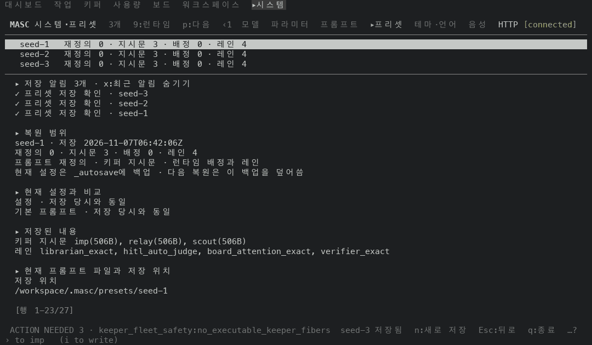
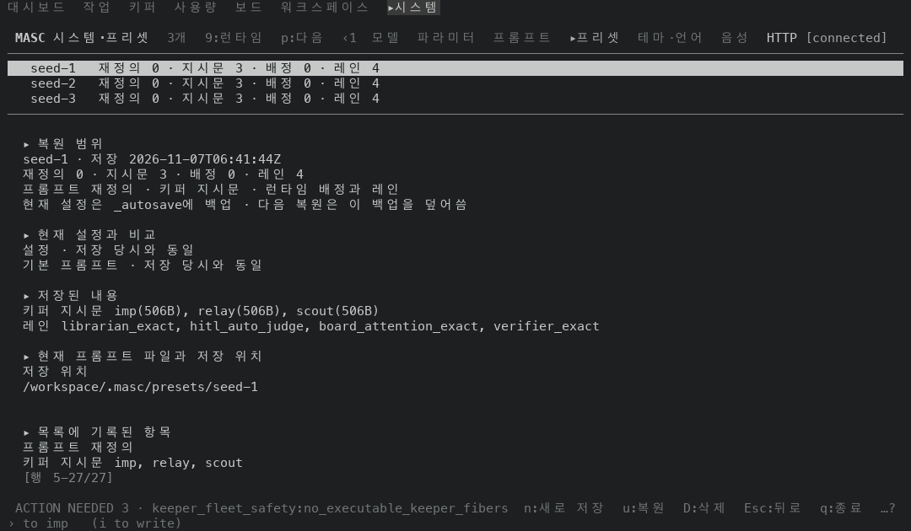
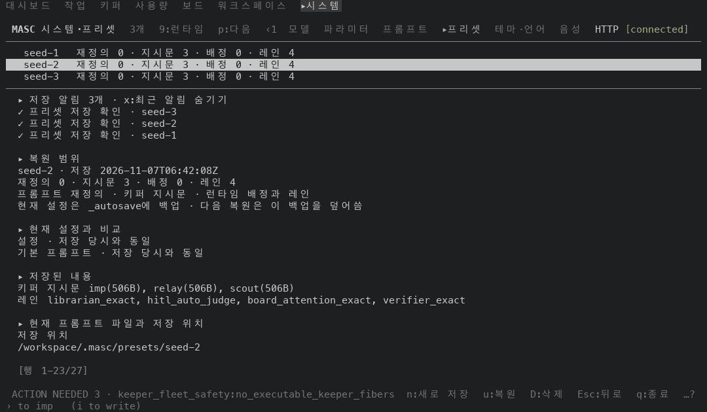
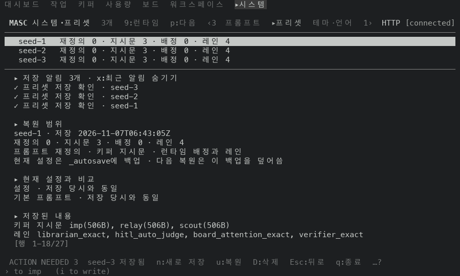
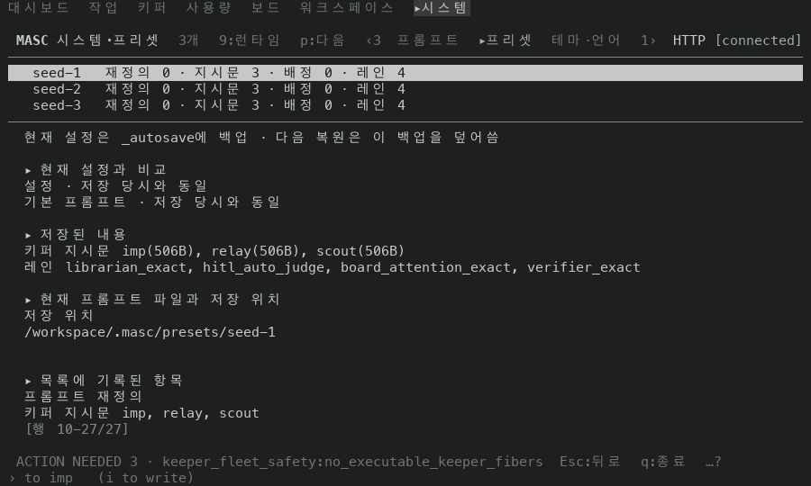
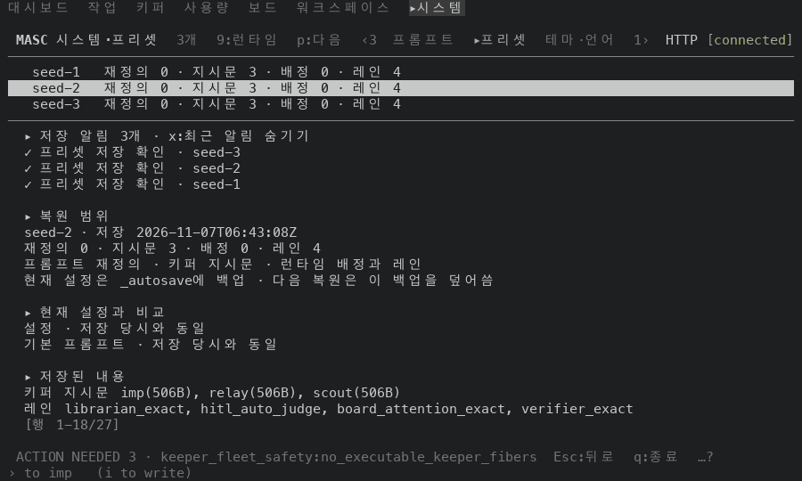

# System / presets 휠: 고치기 전과 후 화면 (#49643)

#49643 은 System / presets 에서 상세가 그 방향으로 움직일 수 없을 때 휠을 프리셋 목록으로 보내요. 이 폴더는 그 PR 본문의 측정에 쓴 화면 캡처예요.

## 어떻게 찍었나

- 앞: 증명 빌드 run 42342482841. 코드 커밋은 `24690b15ce4`(#49618)이고, 프리셋 코드는 이 PR 의 바탕과 같아요(두 커밋 사이에 프리셋 변경이 없어요). 산출물 `masc-tui` 의 sha256 은 `ebf30ec5a50ad7df25bfd61d298768d79ea8804d547dc0f3e3d7a0b456b811b1` 이고 `--build-commit` 은 `24690b15ce4fa3746b649f7627a5fe02dd0fb969` 예요.
- 뒤: 증명 빌드 run 42346681488. 코드 커밋은 `19a66316d1a`(이 PR 의 코드와 변경 기록)이에요. 산출물 `masc-tui` 의 sha256 은 `e43d18370fd1c8cb1d49b74461f1bd725f242280b3aad3a8e3da6fcfdef6d930` 이고 `--build-commit` 은 `19a66316d1a9d77d7f12433e2f761bf4cef051ce` 예요. 두 빌드 모두 두 잡이 성공했고 `--build-commit` 이 run 의 커밋과 같아요.
- 이미지에는 빌드 커밋이 안 찍혀요. 앞과 뒤는 위 산출물로 가려요.
- 일회용 워크스페이스에서 서버를 띄우고 tmux 안에서 TUI 를 열었어요. 팔레트로 System / presets 에 들어가 이 화면의 `n` 으로 프리셋 셋(`seed-1`~`seed-3`)을 저장했어요. 휠 보고(SGR, `ESC[<65;col;rowM`, 창 한가운데 좌표)를 0.12초 간격으로 한 칸씩 보내고 칸마다 화면을 읽었어요.
- 상세의 '저장 위치' 줄은 일회용 워크스페이스의 실제 경로(내 장비의 경로)라서 `/workspace/.masc/presets/<이름>` 으로 바꿔 그렸어요. 경로가 접혀 있던 둘째 줄 자리는 빈 줄이에요. 나머지 글자는 캡처 그대로예요.

## 화면

프리셋 상세는 27행이에요. 120x35 에서는 23행이, 100x30 에서는 18행이 한 화면에 보여요(`[행 1-23/27]`, `[행 1-18/27]`).

120x35, 휠 5개.

| 시작 | 앞 | 뒤 |
| --- | --- | --- |
|  |  |  |
| `seed-1` · 행 1-23/27 | 선택은 `seed-1` 그대로, 상세만 내려가 행 5-27/27 | 상세가 끝에 닿은 다음 칸이 목록을 움직여 `seed-2` · 행 1-23/27 |

100x30, 휠 10개.

| 시작 | 앞 | 뒤 |
| --- | --- | --- |
|  |  |  |
| `seed-1` · 행 1-18/27 | 선택은 `seed-1` 그대로, 상세만 내려가 행 10-27/27 | 상세가 끝에 닿은 다음 칸이 목록을 움직여 `seed-2` · 행 1-18/27 |

시작 화면은 앞과 뒤가 같아요(저장 시각만 달라요). 한 장만 실었어요.

## 칸마다 읽은 값

휠 보고를 한 번에 한 칸씩 아래로 12번, 위로 12번 보내고 칸마다 화면을 읽었어요. 칸 안의 글은 반전으로 그려진 줄(선택된 프리셋)과 상세 표시 `[행 a-b/27]` 의 a-b 예요.

### 앞 (run 42342482841)

| 칸 | 100x30 | 120x35 |
| --- | --- | --- |
| 시작 | `seed-1` · 1-18 | `seed-1` · 1-23 |
| 휠↓ 1 | `seed-1` · 2-19 | `seed-1` · 2-24 |
| 휠↓ 2 | `seed-1` · 3-20 | `seed-1` · 3-25 |
| 휠↓ 3 | `seed-1` · 4-21 | `seed-1` · 4-26 |
| 휠↓ 4 | `seed-1` · 5-22 | `seed-1` · 5-27 |
| 휠↓ 5 | `seed-1` · 6-23 | `seed-1` · 5-27 |
| 휠↓ 6 | `seed-1` · 7-24 | `seed-1` · 5-27 |
| 휠↓ 7 | `seed-1` · 8-25 | `seed-1` · 5-27 |
| 휠↓ 8 | `seed-1` · 9-26 | `seed-1` · 5-27 |
| 휠↓ 9 | `seed-1` · 10-27 | `seed-1` · 5-27 |
| 휠↓ 10 | `seed-1` · 10-27 | `seed-1` · 5-27 |
| 휠↓ 11 | `seed-1` · 10-27 | `seed-1` · 5-27 |
| 휠↓ 12 | `seed-1` · 10-27 | `seed-1` · 5-27 |
| 휠↑ 1 | `seed-1` · 9-26 | `seed-1` · 4-26 |
| 휠↑ 2 | `seed-1` · 8-25 | `seed-1` · 3-25 |
| 휠↑ 3 | `seed-1` · 7-24 | `seed-1` · 2-24 |
| 휠↑ 4 | `seed-1` · 6-23 | `seed-1` · 1-23 |
| 휠↑ 5 | `seed-1` · 5-22 | `seed-1` · 1-23 |
| 휠↑ 6 | `seed-1` · 4-21 | `seed-1` · 1-23 |
| 휠↑ 7 | `seed-1` · 3-20 | `seed-1` · 1-23 |
| 휠↑ 8 | `seed-1` · 2-19 | `seed-1` · 1-23 |
| 휠↑ 9 | `seed-1` · 1-18 | `seed-1` · 1-23 |
| 휠↑ 10 | `seed-1` · 1-18 | `seed-1` · 1-23 |
| 휠↑ 11 | `seed-1` · 1-18 | `seed-1` · 1-23 |
| 휠↑ 12 | `seed-1` · 1-18 | `seed-1` · 1-23 |

### 뒤 (run 42346681488)

| 칸 | 100x30 | 120x35 |
| --- | --- | --- |
| 시작 | `seed-1` · 1-18 | `seed-1` · 1-23 |
| 휠↓ 1 | `seed-1` · 2-19 | `seed-1` · 2-24 |
| 휠↓ 2 | `seed-1` · 3-20 | `seed-1` · 3-25 |
| 휠↓ 3 | `seed-1` · 4-21 | `seed-1` · 4-26 |
| 휠↓ 4 | `seed-1` · 5-22 | `seed-1` · 5-27 |
| 휠↓ 5 | `seed-1` · 6-23 | `seed-2` · 1-23 |
| 휠↓ 6 | `seed-1` · 7-24 | `seed-2` · 2-24 |
| 휠↓ 7 | `seed-1` · 8-25 | `seed-2` · 3-25 |
| 휠↓ 8 | `seed-1` · 9-26 | `seed-2` · 4-26 |
| 휠↓ 9 | `seed-1` · 10-27 | `seed-2` · 5-27 |
| 휠↓ 10 | `seed-2` · 1-18 | `seed-3` · 1-23 |
| 휠↓ 11 | `seed-2` · 2-19 | `seed-3` · 2-24 |
| 휠↓ 12 | `seed-2` · 3-20 | `seed-3` · 3-25 |
| 휠↑ 1 | `seed-2` · 2-19 | `seed-3` · 2-24 |
| 휠↑ 2 | `seed-2` · 1-18 | `seed-3` · 1-23 |
| 휠↑ 3 | `seed-1` · 1-18 | `seed-2` · 1-23 |
| 휠↑ 4 | `seed-1` · 1-18 | `seed-1` · 1-23 |
| 휠↑ 5 | `seed-1` · 1-18 | `seed-1` · 1-23 |
| 휠↑ 6 | `seed-1` · 1-18 | `seed-1` · 1-23 |
| 휠↑ 7 | `seed-1` · 1-18 | `seed-1` · 1-23 |
| 휠↑ 8 | `seed-1` · 1-18 | `seed-1` · 1-23 |
| 휠↑ 9 | `seed-1` · 1-18 | `seed-1` · 1-23 |
| 휠↑ 10 | `seed-1` · 1-18 | `seed-1` · 1-23 |
| 휠↑ 11 | `seed-1` · 1-18 | `seed-1` · 1-23 |
| 휠↑ 12 | `seed-1` · 1-18 | `seed-1` · 1-23 |

같은 상태에서 `j` 는 앞과 뒤가 같아요. 두 번에 `seed-3` 까지 옮기고 거기서 멈추고, `k` 는 두 번에 `seed-1` 로 돌아와요.

## 못 한 것

- 실제 마우스와 트랙패드는 못 썼어요. tmux 로 보낸 SGR 휠 보고만 썼어요.
- 저장 경고가 상세에 떠 있을 때의 휠은 화면으로 못 쟀어요. 이미 있는 이름으로 `n` 저장을 해도 저장이 바로 끝나서 경고가 안 떠요. 그 경우는 코드로만 확인했어요.
