# 첫 읽기를 보낸 화면이 `press r` 대신 `(reading…)` 을 그려요: 고치기 전과 후 화면 (#49720, #49736, #49792)

세 PR 은 화면이 첫 읽기를 보내고 답을 기다리는 동안 `(not loaded yet — press r)` 대신 `(reading…)` 을 그려요. 이 폴더는 세 PR 본문의 측정에 쓴 표와 화면 캡처예요.

## 어느 PR 이 어느 화면을 고치나

| PR | 화면 |
| --- | --- |
| #49720 | Work, Schedules, Clients, Task Verdicts, Task Review, Librarian history, Runtime, Logs, Connectors |
| #49736 | Fusion, Memory, Workspace |
| #49792 | 화면이 아니라 입력 루프예요. 읽기를 시작하면 화면을 다시 그려요. Logs 와 Clients 가 여기에 걸렸어요 |

## 어떻게 쟀나

- main: 증명 빌드 run 42371514152. 코드 커밋은 `28979ad8bec`(세 PR 의 바탕 main)이에요. 산출물 `masc-tui` 의 sha256 은 `dba21538d9c386321961d9330ae4e5cf09d7437616783b7cf0f116212fc5ece7` 이고 `--build-commit` 이 코드 커밋과 같아요.
- #49736: 증명 빌드 run 42371483573. 코드 커밋은 `74e3c85461c`이에요. #49736 의 코드 위에 #49720 의 코드가 같이 있어요. sha256 은 `fc72fa7abda8a2d6b162ac40e4cc1ce577fd0a3d39b4dfc578e8fcc95dc90ab3` 이고 `--build-commit` 이 같아요.
- #49792: 증명 빌드 run 42373806717. 코드 커밋은 `f026159feea`이에요. 세 PR 의 코드가 모두 있어요. sha256 은 `324040ddb784043a4d6f443cd5ee9c24f76b7336c8d0cb7462201ca70ed3fde7` 이고 `--build-commit` 이 같아요.
- 세 빌드 모두 run 이 성공했어요. 각 PR 의 머리는 이 코드 커밋 위에 변경 기록(`changelog.d`)을 더하고, #49792 는 이 폴더도 더해요. #49720 의 코드만 쌓은 빌드는 따로 만들지 않았어요. 이미지에는 빌드 커밋이 안 찍혀요.
- 일회용 워크스페이스에 키퍼·글·작업을 몇 개 심은 서버를 띄우고, 그 앞에 중계를 뒀어요. 중계는 서버가 보내는 조각마다 2.5초 붙잡고, 요청이 나가고 답이 온 시각을 적어요. tmux 100x30 에서 TUI 를 열었어요.
- 팔레트(`:` 뒤 `go <화면>`)로 화면을 열고, Enter 를 보낸 때부터 0.4·1.5·3·5·9초에 화면 글자를 읽었어요. 표의 `press r` 은 그 표본에 `(not loaded yet — press r)` 줄이 있었다는 뜻이고, `reading…` 은 `(reading…)` 줄이 있었다는 뜻이에요. `-` 는 둘 다 없었다는 뜻이에요.
- 세 번 나눠 돌렸어요. 첫째는 Task Review 와 Workspace 를 막 켠 TUI 에서 처음 여는 묶음이에요. 둘째는 Repositories, Fusion, System 네 곳, Memory 로 일곱 화면이에요. 셋째는 23개 화면을 차례로 여는 순회예요. 순회에서는 앞서 연 화면이 읽어 둔 값 때문에 줄이 안 보이는 화면이 있어서, 화면마다 첫째, 둘째, 셋째 순서로 처음 나온 묶음의 값을 썼어요.
- 이미지 속 글은 화면 문구뿐이고, 로컬 경로나 비밀 값은 없어요.

## main 과 #49792

main 은 세 PR 의 바탕이고, #49792 는 세 PR 의 코드가 모두 있는 빌드예요.

| 화면 | 채우는 요청 (나간 때 → 답한 때, 초) | main: 0.4 · 1.5 · 3 · 5 · 9초 | #49792: 0.4 · 1.5 · 3 · 5 · 9초 |
| --- | --- | --- | --- |
| Work | +2.5 → +5.0 | press r · press r · press r · press r · - | reading… · reading… · reading… · - · - |
| Schedules | +0.0 → +2.5 | press r · press r · - · - · - | reading… · reading… · - · - · - |
| Clients | +0.0 → +2.5 | press r · press r · - · - · - | reading… · reading… · - · - · - |
| Task Verdicts | +0.0 → +2.5 | press r · press r · - · - · - | reading… · reading… · - · - · - |
| Task Review | +2.5 → +5.0 | press r · press r · press r · - · - | reading… · reading… · reading… · reading… · - |
| Librarian history | +0.0 → +2.5 | press r · press r · - · - · - | reading… · reading… · - · - · - |
| Runtime | +2.5 → +5.0 | press r · press r · press r · - · - | reading… · reading… · reading… · reading… · - |
| Logs | +0.0 → +2.5 | press r · press r · - · - · - | reading… · reading… · - · - · - |
| Connectors | +0.0 → +2.5 | press r · press r · - · - · - | - · - · - · - · - |
| Fusion | +0.0 → +2.5 | press r · press r · - · - · - | reading… · reading… · - · - · - |
| Memory | +2.5 → +5.0 | press r · press r · press r · press r · - | reading… · reading… · reading… · reading… · - |
| Workspace | +0.1 → +2.6 | press r · press r · - · - · - | reading… · reading… · - · - · - |

표본 60칸 중 `press r` 줄이 main 은 30칸이고 #49792 는 0칸이에요. `(reading…)` 줄은 #49792 에서 29칸이에요. Connectors 는 줄 자체를 없앴어요(바로 위 안내가 이미 `Reading connectors…` 라고 말해요). 위 열두 화면 밖의 18개 화면은 `press r` 줄이 main 에서 0칸, #49792 에서 0칸이에요. 순회 중에는 앞서 연 화면 때문에 값이 이미 읽혀 있던 화면도 섞여 있어서, 이 칸은 다른 화면에 줄이 새로 생기지 않았다는 확인으로만 읽어 주세요.

## main 과 #49736

#49736 까지만 쌓은 빌드는 #49792 가 없는 빌드예요. `press r` 줄이 3칸 남았고 `(reading…)` 줄은 27칸이에요. 남은 칸은 Logs 와 Clients 예요.

| 화면 | 채우는 요청 (나간 때 → 답한 때, 초) | main: 0.4 · 1.5 · 3 · 5 · 9초 | #49736: 0.4 · 1.5 · 3 · 5 · 9초 |
| --- | --- | --- | --- |
| Work | +2.5 → +5.0 | press r · press r · press r · press r · - | reading… · reading… · reading… · reading… · - |
| Schedules | +0.0 → +2.5 | press r · press r · - · - · - | reading… · reading… · - · - · - |
| Clients | +0.0 → +2.5 | press r · press r · - · - · - | press r · reading… · - · - · - |
| Task Verdicts | +0.0 → +2.5 | press r · press r · - · - · - | reading… · reading… · - · - · - |
| Task Review | +2.5 → +5.0 | press r · press r · press r · - · - | reading… · reading… · reading… · reading… · - |
| Librarian history | +0.0 → +2.5 | press r · press r · - · - · - | reading… · reading… · - · - · - |
| Runtime | +2.5 → +5.0 | press r · press r · press r · - · - | reading… · reading… · reading… · reading… · - |
| Logs | +0.0 → +2.5 | press r · press r · - · - · - | press r · press r · - · - · - |
| Connectors | +0.0 → +2.5 | press r · press r · - · - · - | - · - · - · - · - |
| Fusion | +0.0 → +2.5 | press r · press r · - · - · - | reading… · reading… · - · - · - |
| Memory | +2.5 → +5.0 | press r · press r · press r · press r · - | reading… · reading… · reading… · reading… · - |
| Workspace | +0.1 → +2.6 | press r · press r · - · - · - | reading… · reading… · - · - · - |

Logs 의 스트림 요청은 Enter 뒤 0.03초에 나가는데, #49736 은 0.1·0.25·0.4초에 `press r`, 0.6초부터 `(reading…)` 을 그려요. 읽기가 Enter 를 처리한 반복에서 첫 화면을 고른 뒤에 시작하고, 다음 화면이 그려질 때까지 줄이 예전 그대로예요. 같은 화면을 더 촘촘한 시각으로 읽은 값이에요(같은 중계, 첫 방문).

| 빌드 | 화면 | 0.1초 | 0.25초 | 0.4초 | 0.6초 | 0.9초 | 1.3초 | 2초 |
| --- | --- | --- | --- | --- | --- | --- | --- | --- |
| #49736 | Logs | press r | press r | press r | reading… | reading… | reading… | reading… |
| #49792 | Logs | reading… | reading… | reading… | reading… | reading… | reading… | reading… |

#49792 는 읽기가 시작되면 화면을 다시 그리게 해요. #49792 는 0.1초부터 `(reading…)` 이에요.

## 서버가 없을 때

서버가 없는 포트에 TUI 를 붙이고 같은 열두 화면을 열었어요. 1.5초와 4초에 읽었어요. 읽기가 길에 없으면 줄은 예전 그대로여야 해요.

| 화면 | main: 1.5 · 4초 | #49792: 1.5 · 4초 |
| --- | --- | --- |
| Clients | press r · press r | press r · press r |
| Connectors | press r · press r | press r · press r |
| Fusion | press r · press r | press r · press r |
| Librarian history | press r · press r | press r · press r |
| Logs | press r · press r | press r · press r |
| Memory | press r · press r | press r · press r |
| Runtime | press r · press r | press r · press r |
| Schedules | press r · press r | press r · press r |
| Task Review | press r · press r | press r · press r |
| Task Verdicts | press r · press r | press r · press r |
| Work | press r · press r | press r · press r |
| Workspace | press r · press r | press r · press r |

24칸 중 `press r` 줄이 #49792 에서 24칸이에요. main 과 같아요. `(reading…)` 은 한 칸도 없어요.

## 화면

모두 100x30 화면의 위쪽 10줄이에요. 화면마다 main 과 #49792 를 위아래로 놓았어요.

Enter 뒤 1.5초예요. Work 는 머리줄이 `· reading Work +1` 이라고 말하는데 본문은 `press r` 이라고 해서 main 은 서로 어긋나요.

### Work

main

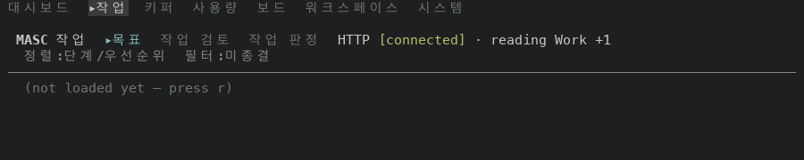

#49792

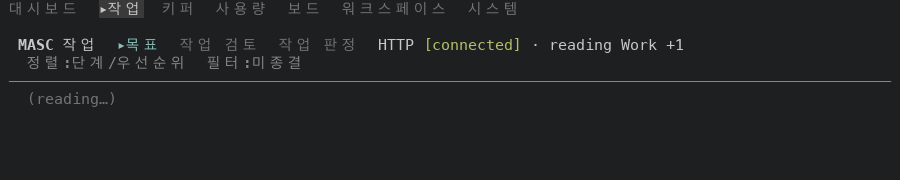

### Schedules

main

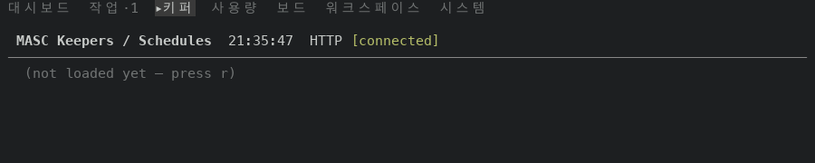

#49792

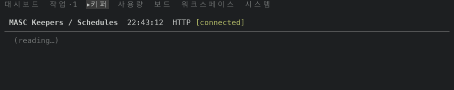

### Clients

main

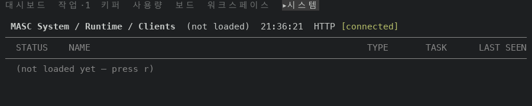

#49792

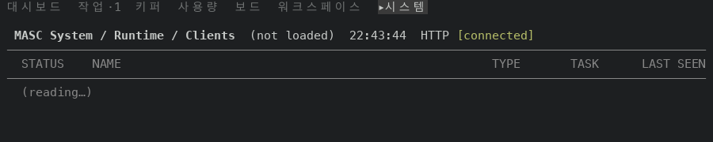

### Task Verdicts

main

#49792

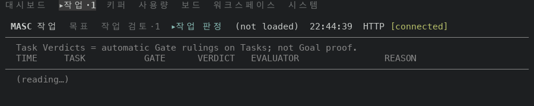

### Librarian history

main

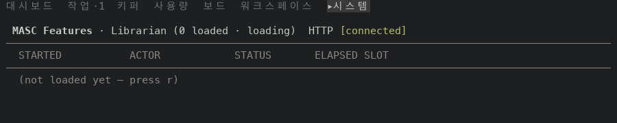

#49792

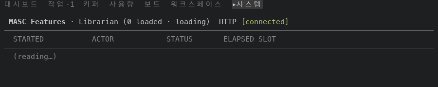

### Logs

main

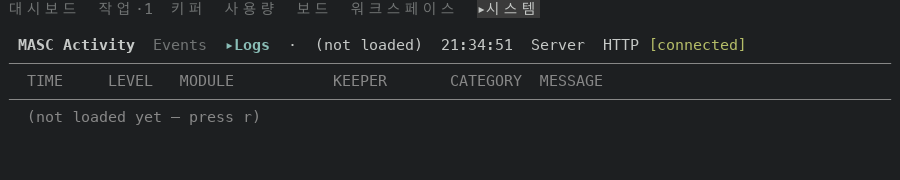

#49792

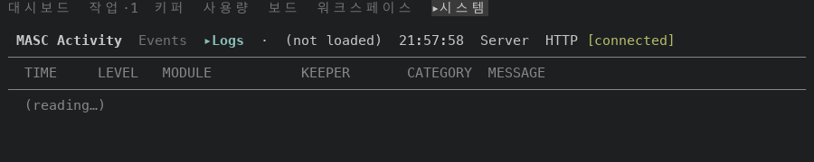

### Connectors

main

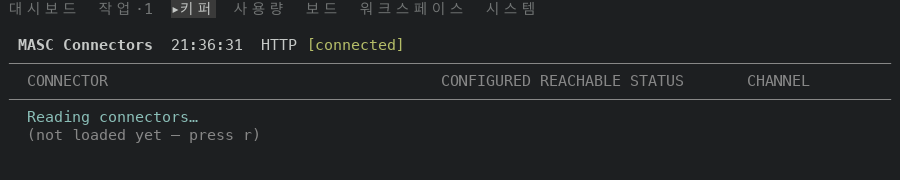

#49792

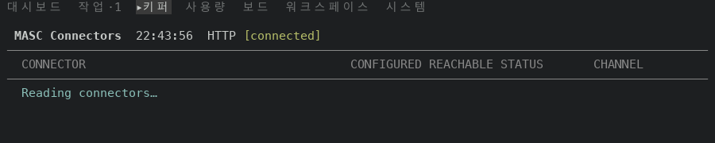

### Fusion

main

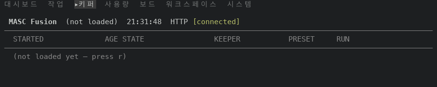

#49792

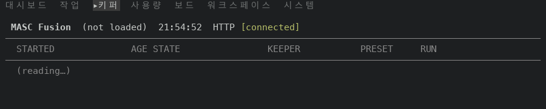

### Workspace

main

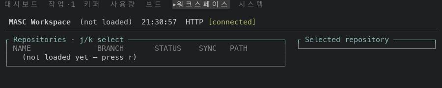

#49792

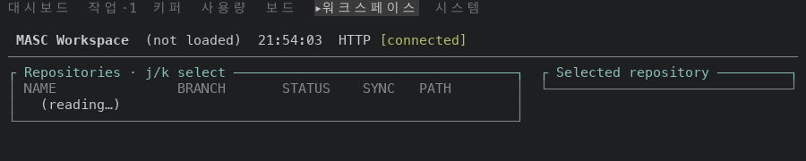

Enter 뒤 3초예요. 이 세 화면은 읽기가 2.5초에 나가서 3초에도 읽는 중이에요.

### Task Review

main

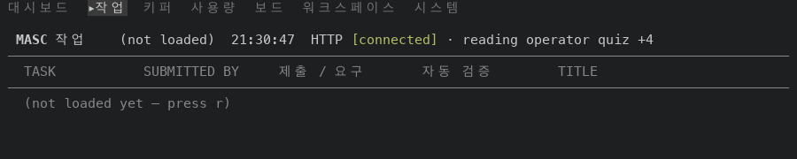

#49792

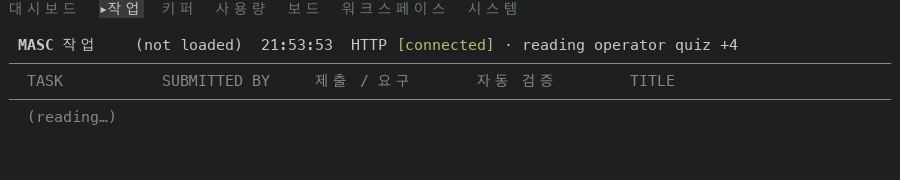

### Runtime

main

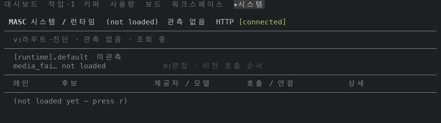

#49792

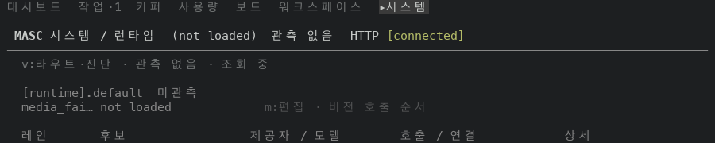

### Memory

main

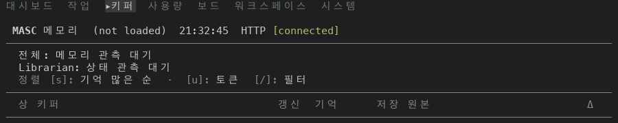

#49792

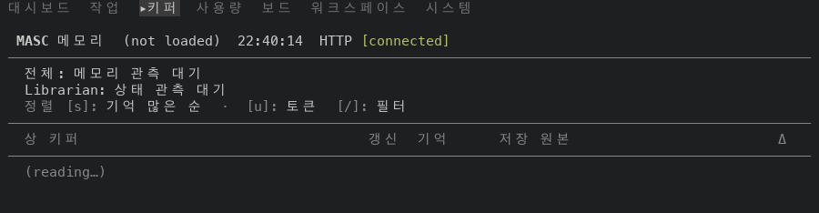

## 못 잰 것

- 중계가 서버 응답을 2.5초씩 붙잡아서 읽는 시간을 일부러 늘렸어요. 실제 서버에서 이 줄이 보이는 시간은 재지 않았어요.
- Memory 사실 브라우저(키퍼를 골라 Enter)와 Fusion 상세는 열어 보지 않았어요. 코드만 바꿨어요.
- 읽기가 길에 올랐다가 실패하는 경우는 하네스로 만들지 않았어요. 코드에서 `empty_page_of` 가 오류를 먼저 봐서 `Page_failed` 가 먼저 가요.
- 바꾸지 않은 화면: Changes(#49785), Work 의 goal 상세, Keepers 의 로컬 명단 안내.
- Task Review 머리줄의 하위 탭이 읽는 동안 사라지는 현상은 이 PR 이 건드리지 않았어요(#49789).
