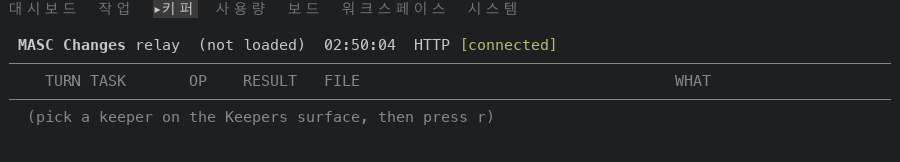
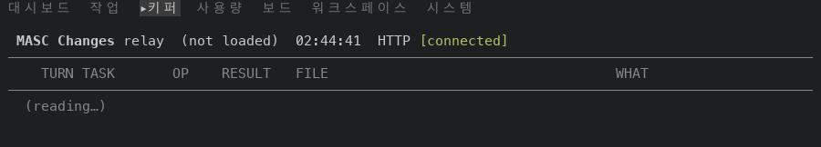
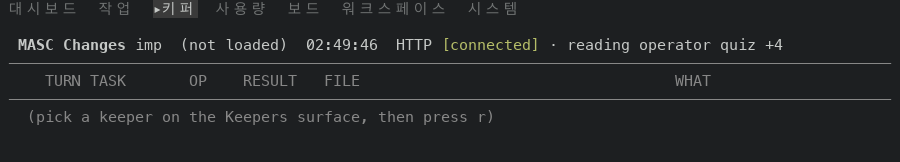
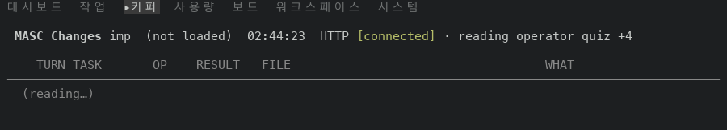

# Changes 화면이 읽는 중에 `(reading…)` 을 그려요: 고치기 전과 후 화면 (#49848)

#49848 은 Changes 화면이 키퍼의 파일 변경을 읽는 동안 `(pick a keeper on the Keepers surface, then press r)` 대신 `(reading…)` 을 그려요. 이 폴더는 PR 본문의 측정에 쓴 표와 화면 캡처예요.

## 어떻게 쟀나

- main: 증명 빌드 run 42396690157(성공). 빌드한 커밋은 `961946859ed2`이에요. 이 PR 의 바탕 `94953c05d96e` 에서 여기까지 달라진 곳은 `changelog.d/49825.md`, `config/tools`, `docs/evidence`, `docs/rfc`, `lib/keeper`, `lib/server`, `lib/tool_surface`, `test/dune`, `test/stanzas`, `test/test_execute_tool_toml_parity.ml`, `test/test_keeper_execute_background.ml`, `test/test_keeper_tool_execute_typed_input.ml` 예요. `bin/` 은 같고, 그 차이에 `file-changes` 글자는 없어요. 산출물 `masc-tui` 의 sha256 은 `6cee036c5d2aa237cd690cba7e23d4cc1f5370ff0ff59638b1e8833d4eeca3fa` 이고 `--build-commit` 이 빌드한 커밋과 같아요.
- #49848: 증명 빌드 run 42396601141(성공). 빌드한 커밋은 `bbcb462abe75`(PR 머리)이에요. sha256 은 `e18d1ec36387d589a187055a3fd5e11e47f2271b14bc6cf6f8462857678b1209` 이고 `--build-commit` 이 같아요.
- 일회용 워크스페이스에 키퍼·글·작업을 몇 개 심은 서버를 띄우고, 그 앞에 중계를 뒀어요. 중계는 서버가 보내는 조각마다 2.5초 붙잡고, 요청이 나가고 답이 온 시각을 적어요. tmux 100x30 에서 TUI 를 열었어요.
- 두 경로를 쟀어요. 첫째는 팔레트(`:` 뒤 `go Changes`)로 화면을 여는 길이고, 둘째는 화면이 자리 잡은 뒤 `]` 로 다음 키퍼를 고르는 길이에요. Enter 나 `]` 를 보낸 때부터 0.4·1.5·3·5·9초에 화면 글자를 읽었어요.
- 표의 `pick a keeper…` 는 목록 자리에 `(pick a keeper on the Keepers surface, then press r)` 줄이 있었다는 뜻이고, `reading…` 은 `(reading…)` 줄이, `no files` 는 `(this keeper wrote no files in the window)` 줄이 있었다는 뜻이에요. 서버가 심어 둔 키퍼는 파일을 쓴 기록이 없어서 답이 오면 `no files` 가 돼요.
- 이미지 속 글은 화면 문구뿐이고, 로컬 경로나 비밀 값은 없어요.

## 표

| 경로 | 읽기 요청 (나간 때 → 답한 때, 초) | main: 0.4 · 1.5 · 3 · 5 · 9초 | #49848: 0.4 · 1.5 · 3 · 5 · 9초 |
| --- | --- | --- | --- |
| 팔레트로 열기 (`:` 뒤 `go Changes`) | main +0.06 → +2.56, #49848 +0.01 → +2.52 | pick a keeper… · pick a keeper… · no files · no files · no files | reading… · reading… · no files · no files · no files |
| `]` 로 다음 키퍼 고르기 | main +0.01 → +2.52, #49848 +0.03 → +2.54 | pick a keeper… · pick a keeper… · no files · no files · no files | reading… · reading… · no files · no files · no files |

## 화면

`]` 로 키퍼를 고른 뒤 1.5초 때 화면의 윗부분이에요. 왼쪽이 main, 오른쪽이 이 PR 이에요.

| main | #49848 |
| --- | --- |
|  |  |

팔레트로 연 경우도 같은 모양이에요.

| main | #49848 |
| --- | --- |
|  |  |
