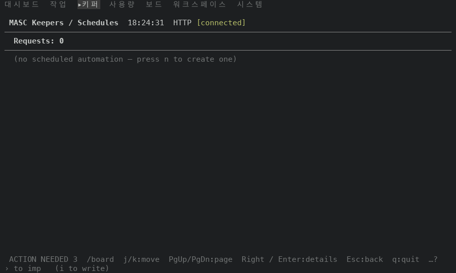
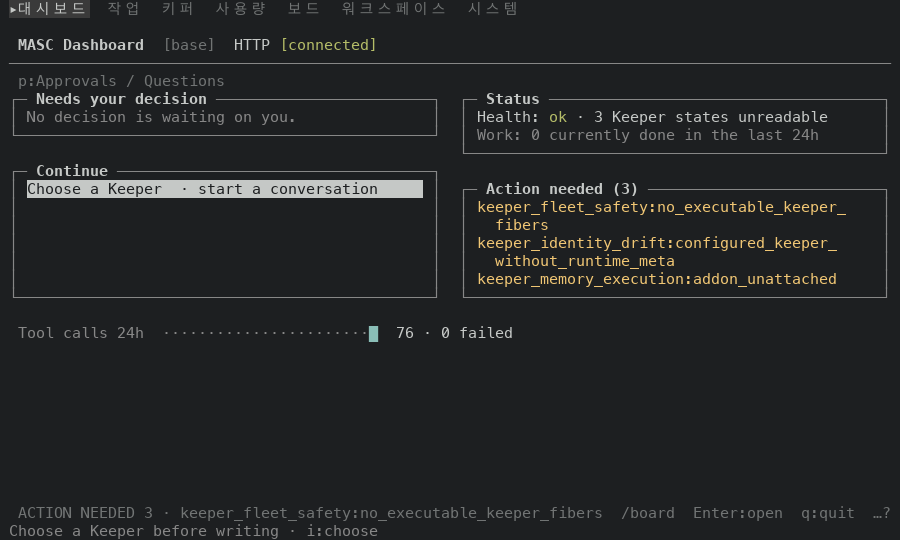

# 찾기가 없는 화면에 남는 이전 검색 글자 (#49911)

Board 에서 `/` 로 찾고 Enter 로 마친 글자가 `/` 가 열리지 않는 화면의 푸터에 어떻게 보이는지 고치기 전후로 쟀어요. 화면 글과 배치는 시험으로 고정하지 않아서(헌법 354-355행) 이 폴더의 표와 화면이 근거예요.

## 방법

일회용 워크스페이스에 키퍼·글·작업을 몇 개 심은 서버를 띄우고, tmux 3.6a 안에서 TUI 를 돌렸어요. 화면 이동은 `:` 팔레트의 `go <이름>` 으로 했고, 단계마다 화면을 저장했어요. 크기는 100x30, 80x24 예요.

1. Board 로 가서 `/` 와 `board` 를 치고(글자를 치는 중), Enter 로 마쳐요.
2. Schedules, Dashboard, Usage 로 차례로 가요. 셋 다 `/` 가 열리지 않는 화면이에요.
3. Board 로 돌아와요.
4. Keepers 로 가요. `/` 가 열리는 화면이에요. 이어서 첫 Keeper 의 상세로 들어갔다가 Esc 로 나와요. 상세는 `/` 가 열리지 않아요.
5. Board 로 가서 Esc 를 눌러 Dashboard 로 나와요.

대조로, 같은 걸음에서 `/` 를 한 번도 열지 않은 세션도 두 빌드로 돌렸어요.

- 고치기 전: 이 브랜치가 갈라진 main 의 증명 빌드 run 42466180464(성공), 커밋 `0f26356a5c1a`, `masc-tui` sha256 `f886e1b614fdc5c06d8f78a2c77c371b6d9a240095d729430e0247be2a801b95`, `--build-commit` 이 같아요.
- 고친 뒤: #49911 의 코드 커밋 증명 빌드 run 42466024127(성공), 커밋 `f0cab6c8b120`, sha256 `310f995f18a2c187bd1f78f91c9e3bde140e4782150f4a8b8d2646c444aa47ae`, `--build-commit` 이 같아요.
- 두 빌드 사이에 바뀐 파일: `bin/masc_tui_render_prim.ml`, `bin/masc_tui_render_prim.mli`.

## 결과

`/` 가 열리지 않는 화면의 푸터예요. 고치기 전에는 모두 `/board` 가 붙어 있고, 고친 뒤에는 없어요.

| 화면 | 크기 | 고치기 전 | 고친 뒤 |
| --- | --- | --- | --- |
| Schedules | 100x30 | `ACTION NEEDED 3  /board  j/k:move  PgUp/PgDn:page  Right / Enter:details  Esc:back  q:quit  …?` | `ACTION NEEDED 3  j/k:move  PgUp/PgDn:page  Right / Enter:details  Esc:back  q:quit  …?` |
| Schedules | 80x24 | `ACTION NEEDED 3  /board  j/k:move  Right / Enter:details  Esc:back  q:quit  …?` | `ACTION NEEDED 3  j/k:move  Right / Enter:details  Esc:back  q:quit  …?` |
| Dashboard | 100x30 | `ACTION NEEDED 3 · keeper_fleet_safety:no_executable_keeper_fibers  /board  Enter:open  q:quit  …?` | `ACTION NEEDED 3 · keeper_fleet_safety:no_executable_keeper_fibers  Enter:open  q:quit  …?` |
| Dashboard | 80x24 | `ACTION NEEDED 3  /board  Left:Keepers  j/k:choose  Enter:open  q:quit  …?` | `ACTION NEEDED 3  Left:Keepers  j/k:choose  Enter:open  p:requests  q:quit  …?` |
| Usage | 100x30 | `ACTION NEEDED 3  /board  j/k:scroll  p:Usage / Telemetry  v / V:view  Esc:Dashboard  q:quit  …?` | `ACTION NEEDED 3  j/k:scroll  p:Usage / Telemetry  f:account  v / V:view  Esc:Dashboard  q:quit  …?` |
| Usage | 80x24 | `ACTION NEEDED 3  /board  j/k:scroll  v / V:view  Esc:Dashboard  q:quit  …?` | `ACTION NEEDED 3  j/k:scroll  v / V:view  Esc:Dashboard  q:quit  …?` |
| Keeper 상세 | 100x30 | `ACTION NEEDED 3  /board  [ ]:tab  b:requeue board  Left / Esc:back  q:quit  …?` | `ACTION NEEDED 3 · keeper_fleet_safety:no_executable_keeper_fibers  Left / Esc:back  q:quit  …?` |
| Keeper 상세 | 80x24 | `ACTION NEEDED 3  /board  [ ]:tab  b:requeue board  Left / Esc:back  q:quit  …?` | `ACTION NEEDED 3  [ ]:tab  b:requeue board  Left / Esc:back  q:quit  …?` |
| Board 에서 Esc 로 나간 Dashboard | 100x30 | `ACTION NEEDED 3 · keeper_fleet_safety:no_executable_keeper_fibers  /board  Enter:open  q:quit  …?` | `ACTION NEEDED 3 · keeper_fleet_safety:no_executable_keeper_fibers  Enter:open  q:quit  …?` |
| Board 에서 Esc 로 나간 Dashboard | 80x24 | `ACTION NEEDED 3  /board  Left:Keepers  j/k:choose  Enter:open  q:quit  …?` | `ACTION NEEDED 3  Left:Keepers  j/k:choose  Enter:open  p:requests  q:quit  …?` |

`…?` 는 폭이 모자라 키 일부를 숨겼다는 표시예요(`?` 로 도움말에서 볼 수 있어요). `/board` 가 쓰던 칸이 풀려서 푸터가 고르는 키가 바뀐 곳이 있어요.

- Dashboard(80x24): 키 `p:requests` 가 다시 보여요.
- Usage(100x30): 키 `f:account` 가 다시 보여요.
- Keeper 상세(100x30): 키 `[ ]:tab`, `b:requeue board` 가 푸터에서 빠져요. `ACTION NEEDED` 가 숫자 뒤에 이유까지 길게 나오는 대신이에요(`?` 도움말에는 그대로 있어요). 검색을 한 적 없는 세션도 같은 푸터예요.
- Board 에서 Esc 로 나간 Dashboard(80x24): 키 `p:requests` 가 다시 보여요.

아래는 두 빌드가 같아야 하는 단계이고, 실제로 같았어요.

- 검색 글자가 쓰이는 화면의 푸터와 제목줄이 두 빌드에서 같아요(시각 제외, 두 크기 모두): 검색 전의 Board, 글자를 치는 중(`/board (1)▌`), Enter 로 마친 뒤(`/board (1) n/N`), 다른 화면에 갔다 돌아온 Board, Keepers(`/board (none) n/N`), Esc 직전의 Board. 본문의 글 id 와 나이는 서버를 띄울 때마다 달라서 비교하지 않았어요.
- 검색을 한 적 없는 세션의 같은 걸음은 두 빌드의 푸터가 같아요(위 다섯 화면, 두 크기 모두).
- 고친 뒤 푸터는 검색을 한 적 없는 세션의 푸터와 글자까지 같아요(위 다섯 화면, 두 크기 모두).

## 화면(100x30)

| 고치기 전 | 고친 뒤 |
| --- | --- |
|  |  |
|  |  |

## 재지 않은 것

- Esc 로 검색 글자를 지우는 동작은 만들지 않았고 재지 않았어요.
- 컨텍스트 창 제목은 같은 함수를 읽지만 따로 재지 않았어요.
- 푸터 키 표시를 끈 설정(hints off)은 재지 않았어요.
- 80x24 는 글자 표만 있고 PNG 는 100x30 만 있어요.
