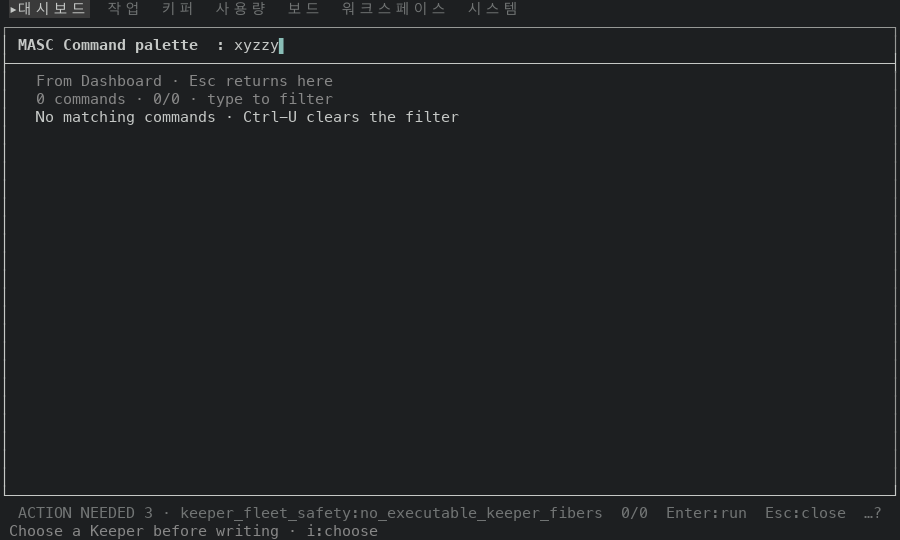
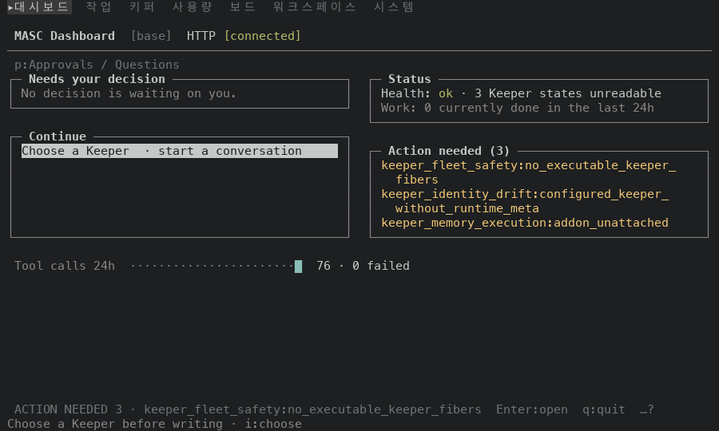
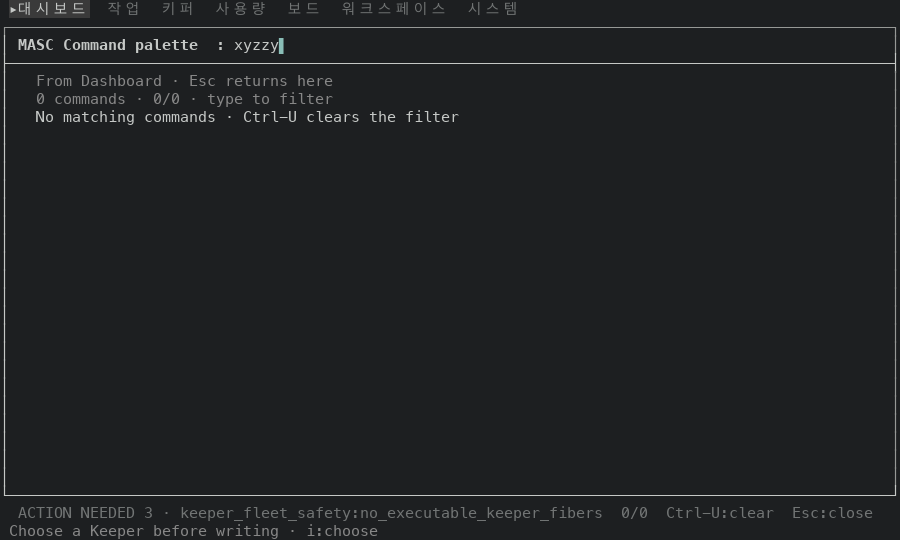

# 맞는 명령이 없을 때의 명령 팔레트 (#49890)

`:` 로 연 명령 팔레트에 맞는 명령이 없는 글자를 쳤을 때 푸터와 Enter 가 어떻게 달라지는지 고치기 전후로 쟀어요. 화면 글과 배치는 시험으로 고정하지 않아서(헌법 354-355행) 이 폴더의 표와 화면이 근거예요.

## 방법

일회용 워크스페이스에 키퍼·글·작업을 몇 개 심은 서버를 띄우고, tmux 3.6a 안에서 TUI 를 돌렸어요. 대시보드에서 키를 누르고 단계마다 화면을 저장했어요. 크기는 100x30, 80x24 예요.

1. `:` 를 눌러 팔레트를 열고 `xyzzy` 를 쳐요. 맞는 명령이 없어요.
2. Enter 를 눌러요.
3. Esc 를 눌러요.
4. `:` 와 `def xyzzy` 를 치고 Enter 를 눌러요. Code 질문이라 목록에 행이 없어도 실행돼요.
5. `:` 와 `go Workspace` 를 치고 Enter 를 눌러요. 맞는 명령이 있어요.

- 고치기 전: 이 브랜치가 갈라진 main 의 증명 빌드 run 42406458200(성공), 커밋 `83365d060101`, `masc-tui` sha256 `4d95c59d5bafff9812e1de67cff92a0403f86f852ea2b25a3bfe3cd50ea0cf60`, `--build-commit` 이 같아요.
- 고친 뒤: #49890 의 코드 커밋 증명 빌드 run 42406386202(성공), 커밋 `78fe0c0b9619`, sha256 `31481ae3876dc052dc4b293b6b2919f7b392e4c6b9bd9a1fe50d8b26a9bc585b`, `--build-commit` 이 같아요.
- 두 빌드 사이에 바뀐 파일: `bin/masc_tui.ml`, `bin/masc_tui_palette.ml`, `bin/masc_tui_palette.mli`, `bin/masc_tui_render_overlays.ml`, `test/test_tui_palette_matching.ml`.

## 결과

| 단계 | 크기 | 고치기 전 | 고친 뒤 |
| --- | --- | --- | --- |
| `xyzzy` 를 친 뒤 푸터 | 100x30 | `0/0  Enter:run  Esc:close  …?` | `0/0  Ctrl-U:clear  Esc:close` |
| `xyzzy` 를 친 뒤 푸터 | 80x24 | `0/0  Enter:run  Up/Down:select  Esc:close  …?` | `0/0  Ctrl-U:clear  Esc:close` |
| Enter 뒤 | 100x30 | 팔레트가 닫히고 Dashboard 로 돌아가요 | 팔레트가 열려 있고 `xyzzy` 가 그대로예요 |
| Enter 뒤 | 80x24 | 팔레트가 닫히고 Dashboard 로 돌아가요 | 팔레트가 열려 있고 `xyzzy` 가 그대로예요 |

`…?` 는 폭이 모자라 키 일부를 숨겼다는 표시예요(`?` 로 도움말에서 볼 수 있어요). 고치기 전에는 목록이 비어 있어도 `Enter:run` 이 남고 두 크기 모두 `…?` 가 붙어요. 고친 뒤에는 남은 키가 모두 들어가서 `…?` 가 없어요.

아래는 두 빌드가 같아야 하는 단계이고, 실제로 같았어요.

- `Esc` 로 닫은 뒤 화면은 두 빌드가 같아요(시각 제외, 두 크기 모두).
- Code 질문 `def xyzzy` 는 Enter 로 닫히고 같은 안내가 떠요. 두 빌드의 화면이 같아요(두 크기 모두).
- `go Workspace` 를 치고 Enter 를 누르면 두 빌드 모두 Workspace 에 닿고, 그 화면도 같아요(시각 제외).

## 화면(100x30)

| 고치기 전 | 고친 뒤 |
| --- | --- |
|  |  |
|  |  |

## 재지 않은 것

- 파일 찾기·글 검색·위치 고르기 팔레트의 0건 동작은 건드리지 않았고 재지 않았어요.
- Enter 는 tmux 가 보내는 `\r` 로 눌렀어요. 터미널마다 다른 키 코드는 재지 않았어요.
