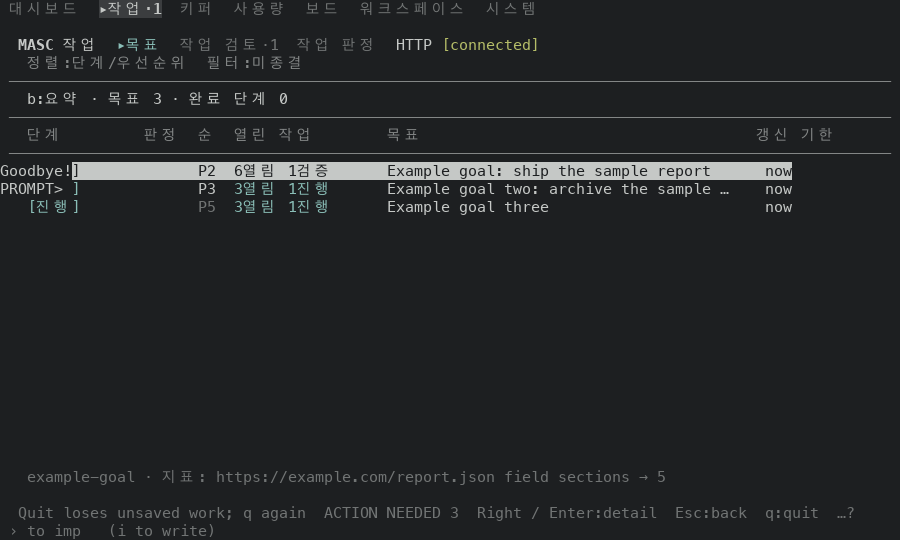
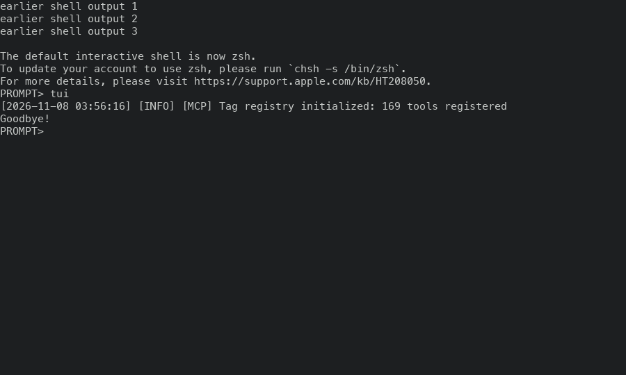

# 터미널을 다른 프로그램에 넘겼다 받을 때 대체 화면과 마우스 보고: 고치기 전과 후 (#49877)

## 어떻게 쟀나

일회용 워크스페이스에 키퍼·글·작업을 몇 개 심은 서버를 띄우고, tmux 3.6a 안의 대화형 bash 에서 TUI 를 포그라운드 job 으로 돌렸어요. 시작 전에 셸에 `earlier shell output 1~3` 세 줄을 찍어 둬서, 끝낸 뒤 이 줄이 화면에 남는지 볼 수 있어요. Schedules 화면에서 `n` 을 눌러 `$EDITOR` 로 JSON 폼을 열고(빈 폼이라 에디터가 끝나면 `HTTP 400` 알림이 떠요), 에디터가 끝난 뒤 `:` 로 팔레트가 열리는지 보고, `q` 두 번으로 끝냈어요. 에디터는 네 가지예요.

- `quiet`: 터미널 모드를 건드리지 않고 4초 뒤 끝나는 스크립트
- `resets`: 시작할 때 마우스 보고를 켜고 끝날 때 끄는 스크립트(`ESC[?1000h` `ESC[?1006h` / `l`). 마우스를 쓰는 터미널 에디터가 하는 일이에요
- `vim`: 시스템 vim, 설정 파일 없이 열고 `:q!`
- `f2quiet`: `quiet` 와 같은 스크립트를, F2 로 마우스를 터미널에 돌려준 뒤에 열어요

vim 은 9.1 이에요. 단계마다 tmux 가 아는 터미널 모드를 읽었어요: 대체 화면(`alternate_on`), 마우스 보고(`mouse_button_flag` 와 `mouse_sgr_flag`, TUI 가 `ESC[?1006;1000;1002h` 로 켜는 모드)예요. 마우스 보고가 켜져 있으면 터미널은 휠과 클릭을 앞에 있는 프로그램에게 `ESC[<…M` 문자로 보내요. 표의 칸은 `대체 화면 · 마우스 보고` 순서예요. `에디터가 켠 보고` 는 에디터가 직접 켠 표준 보고(`ESC[?1000h`)라서 TUI 가 켜는 모드(`mouse_button_flag`)와 달라요.

- 부모 빌드(#49871 의 코드): 증명 빌드 run 42401082217(성공), 커밋 `b1f68b8d02df`, `masc-tui` sha256 `d46354284a3ce64cdbd0b806e8ec827b63eabd6f648d728baa12a8e7c3e360d1`, `--build-commit` 이 빌드한 커밋과 같아요. 베이스 브랜치 머리와는 `changelog.d` 조각만 달라요.
- #49877 빌드: 증명 빌드 run 42402696977(성공), 커밋 `5f4a7227ca91`, sha256 `65d6d1ef51dc05625a7d5c4e7783d08969e2c0219641b104fd3b9b27f88d7659`, `--build-commit` 이 같아요.
- 두 빌드 사이에 바뀐 파일은 `bin/masc_tui.ml`, `changelog.d/49871.md` 예요.

## 읽는 법

- 에디터가 끝난 뒤 대체 화면: 부모 빌드는 에디터 4종 모두 꺼짐, 이 PR 은 4종 모두 켜짐이에요.
- 끝낸 뒤 화면에 남은 셸 출력은 부모 빌드 0줄, 이 PR 3줄(에디터 4종 모두)이에요. 부모 빌드는 마지막 프레임이 셸 화면을 덮은 채 남아요.
- 마우스 보고를 켜고 끄는 에디터(`resets`)가 끝난 뒤 마우스 보고: 부모 빌드는 꺼짐, 이 PR 은 켜짐이에요.
- 모드를 건드리지 않는 에디터(`quiet`)와 vim 이 도는 동안 마우스 보고: 부모 빌드는 켜짐, 이 PR 은 꺼짐이에요.
- F2 로 마우스를 터미널에 돌려준 뒤(`f2quiet`)에는 두 빌드 모두 에디터 전후로 마우스 보고가 꺼진 채예요. 새 쌍이 F2 를 따라요.
- Ctrl-Z 길의 5단계 값은 부모 빌드와 이 PR 이 같아요(아래 표).

## 에디터 왕복

### 에디터 `quiet`

| 단계 | 부모 빌드 | #49877 빌드 |
| --- | --- | --- |
| TUI 가 돌 때(Schedules) | 켜짐 · 켜짐 | 켜짐 · 켜짐 |
| `n` 으로 에디터를 열고 1.8초 뒤 | 꺼짐 · 켜짐 | 꺼짐 · 꺼짐 |
| 에디터가 끝난 뒤 | 꺼짐 · 켜짐 | 켜짐 · 켜짐 |
| 돌아와서 `:` 를 눌렀을 때 | 꺼짐 · 켜짐 | 켜짐 · 켜짐 |
| `q` 두 번으로 끝낸 뒤(셸이 앞에 있어요) | 꺼짐 · 꺼짐 | 꺼짐 · 꺼짐 |
| 끝난 뒤 화면에 남은 셸 출력(시작 전에 찍어 둔 3줄 중) | 0줄 | 3줄 |

### 에디터 `resets`

| 단계 | 부모 빌드 | #49877 빌드 |
| --- | --- | --- |
| TUI 가 돌 때(Schedules) | 켜짐 · 켜짐 | 켜짐 · 켜짐 |
| `n` 으로 에디터를 열고 1.8초 뒤 | 꺼짐 · 에디터가 켠 보고 | 꺼짐 · 에디터가 켠 보고 |
| 에디터가 끝난 뒤 | 꺼짐 · 꺼짐 | 켜짐 · 켜짐 |
| 돌아와서 `:` 를 눌렀을 때 | 꺼짐 · 꺼짐 | 켜짐 · 켜짐 |
| `q` 두 번으로 끝낸 뒤(셸이 앞에 있어요) | 꺼짐 · 꺼짐 | 꺼짐 · 꺼짐 |
| 끝난 뒤 화면에 남은 셸 출력(시작 전에 찍어 둔 3줄 중) | 0줄 | 3줄 |

### 에디터 `vim`

| 단계 | 부모 빌드 | #49877 빌드 |
| --- | --- | --- |
| TUI 가 돌 때(Schedules) | 켜짐 · 켜짐 | 켜짐 · 켜짐 |
| `n` 으로 에디터를 열고 1.8초 뒤 | 켜짐 · 켜짐 | 켜짐 · 꺼짐 |
| 에디터가 끝난 뒤 | 꺼짐 · 켜짐 | 켜짐 · 켜짐 |
| 돌아와서 `:` 를 눌렀을 때 | 꺼짐 · 켜짐 | 켜짐 · 켜짐 |
| `q` 두 번으로 끝낸 뒤(셸이 앞에 있어요) | 꺼짐 · 꺼짐 | 꺼짐 · 꺼짐 |
| 끝난 뒤 화면에 남은 셸 출력(시작 전에 찍어 둔 3줄 중) | 0줄 | 3줄 |

### 에디터 `f2quiet`

| 단계 | 부모 빌드 | #49877 빌드 |
| --- | --- | --- |
| TUI 가 돌 때(Schedules) | 켜짐 · 꺼짐 | 켜짐 · 꺼짐 |
| `n` 으로 에디터를 열고 1.8초 뒤 | 꺼짐 · 꺼짐 | 꺼짐 · 꺼짐 |
| 에디터가 끝난 뒤 | 꺼짐 · 꺼짐 | 켜짐 · 꺼짐 |
| 돌아와서 `:` 를 눌렀을 때 | 꺼짐 · 꺼짐 | 켜짐 · 꺼짐 |
| `q` 두 번으로 끝낸 뒤(셸이 앞에 있어요) | 꺼짐 · 꺼짐 | 꺼짐 · 꺼짐 |
| 끝난 뒤 화면에 남은 셸 출력(시작 전에 찍어 둔 3줄 중) | 0줄 | 3줄 |

## 끝낸 뒤 셸 화면(vim)

| 부모 빌드 | #49877 빌드 |
| --- | --- |
|  |  |

## Ctrl-Z 길(바뀌지 않았는지 확인)

| 단계 | 부모 빌드 | #49877 빌드 |
| --- | --- | --- |
| TUI 가 돌 때 | 켜짐 · 켜짐 | 켜짐 · 켜짐 |
| Ctrl-Z 로 멈춘 뒤 | 꺼짐 · 꺼짐 | 꺼짐 · 꺼짐 |
| `fg` 로 이어간 뒤 | 켜짐 · 켜짐 | 켜짐 · 켜짐 |
| 이어가서 `:` 를 눌렀을 때 | 켜짐 · 켜짐 | 켜짐 · 켜짐 |
| `q` 두 번으로 끝낸 뒤 | 꺼짐 · 꺼짐 | 꺼짐 · 꺼짐 |

측정하지 않은 것: kitty 키보드 확장과 붙여넣기 모드(2004)는 tmux 가 플래그로 보여 주지 않아(붙여넣기 모드는 `#{bracket_paste_flag}` 가 켜도 꺼도 빈 값이에요) 재지 않았고, 이 PR 이 새로 끄거나 켜지도 않아요. 플레이어 핸드오프는 실제 재생기가 필요해서 재지 않았어요. 돌아올 때 마우스를 F2 상태와 상관없이 켜던 것을 F2 를 따르게 바꾼 것은 코드를 읽고 한 변경이에요. 실제 휠 이벤트를 넣어 보지는 않았고, 모드 플래그가 켜져 있으면 터미널이 보고를 보낸다는 점에 기댔어요.
