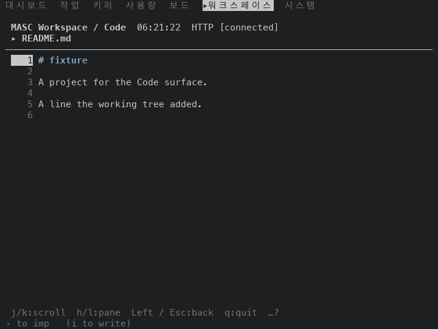
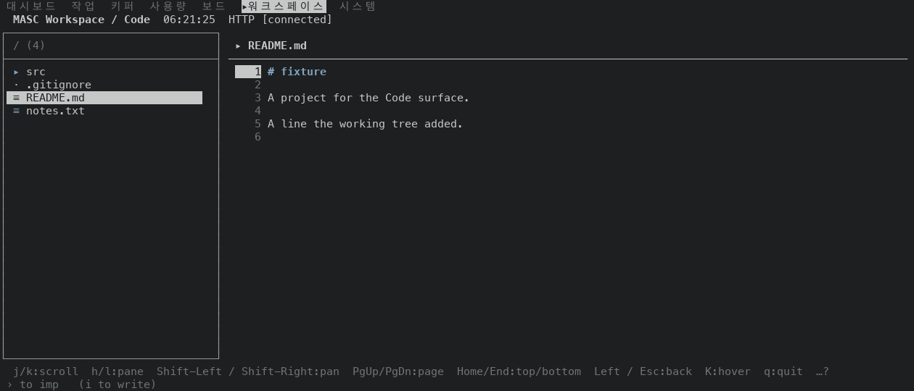
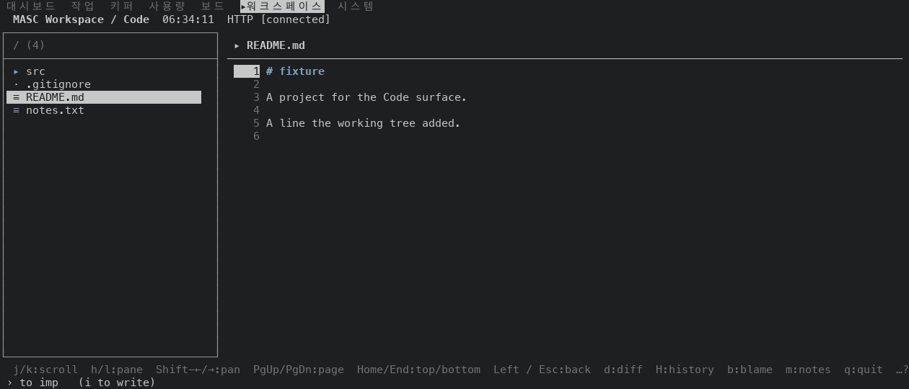
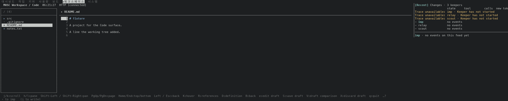
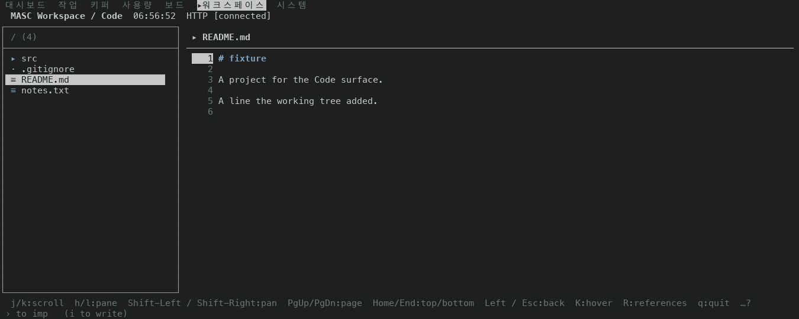
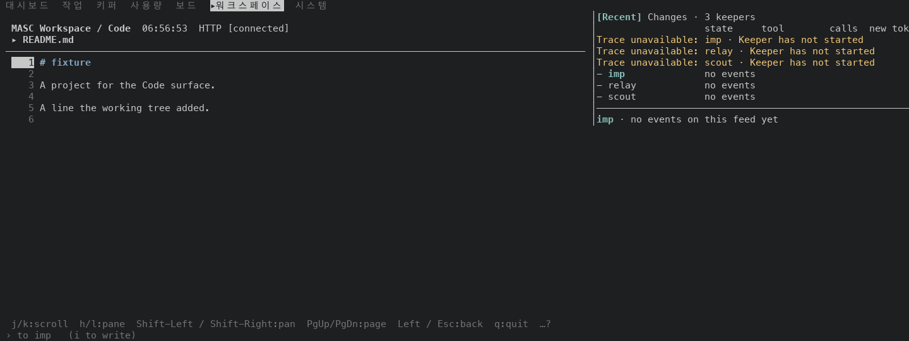
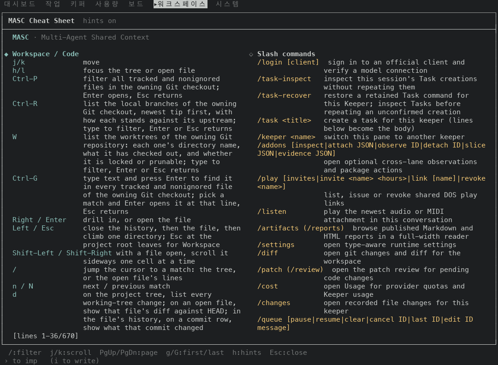

# Code 파일 푸터가 diff·history·blame·notes 키를 먼저 보여요(#50150)

Code 화면에서 파일을 열면 푸터 키 줄에 `d:diff`, `H:history`, `b:blame`, `m:notes`, `y:copy source` 가 없었어요. 300칸에서도 `K:hover R:references D:definition B:back e:edit draft S:save draft V:draft comparison X:discard draft` 가 그 자리를 채웠어요. 푸터는 키 표 순서대로 앞에서부터 채우는데, 표에서 이 다섯 키가 언어 서버 키와 초안 키 뒤에 있었어요.

## 바꾼 것

- `bin/masc_tui_keys.ml` Code 표에서 `d`, `H`, `b`, `m`, `y` 를 `K` 앞으로 옮겼어요. 키 동작은 그대로예요.
- 파일 창 푸터에서 `Shift-Left / Shift-Right:pan`(28칸)을 `Shift-←/→:pan`(13칸)으로 줄여요. Diff 창 푸터는 이미 그렇게 써요. 도움말 시트는 전체 이름을 그대로 둬요.
- `docs/guides/TUI-KEYS.md` 는 표에서 만든 문서라 같은 순서로 다시 만들었어요. 도움말 시트도 같은 순서를 따라서 Code 시트에서 `n / N` 다음 행이 `K` 에서 `d` 로 바뀌어요(행 글은 그대로예요). 시트 화면 앞뒤를 아래에 넣었어요.

## 잰 것

- 증명 빌드 둘이에요. 앞은 `214806e33111`(run 42518546224, masc-tui sha256 `2309d3076818…`)이에요. 이 PR 의 바탕 커밋(`789b0b150b91`)과 소스가 같아요. 두 커밋의 차이는 `docs/evidence/` 와 `changelog.d/` 파일뿐이에요. 뒤는 이 브랜치 코드 커밋 `deda60d70427`(run 42524666622, masc-tui sha256 `6ea4453a1594…`)이에요.
- 같은 서버 환경에서 읽었어요. 알림이 없는 환경이에요. 작은 Git 저장소를 서버 작업 폴더에 만들었어요. `src/main.ml`(90줄 넘게, 첫 줄에 `masc(fixture)` 메모)은 커밋 둘과 작업 폴더 변경이 있고, `README.md` 는 작업 폴더에서 고쳐졌고 `notes.txt` 는 추적하지 않아요.
- 읽기 하나: Code 화면 상태 7개 x 폭 7개(80, 100, 120, 140, 160, 200, 300칸, 30줄) = 49곳의 푸터 줄(아래에서 둘째 줄)이에요. 상태는 저장소 루트 파일 목록(tree), `src` 안 파일 목록(subdir), 파일 창(`README.md`)(file), 파일 창(`src/main.ml`, 메모가 있어요)(memo), Diff 창(`README.md`)(diff), 메모 창(`src/main.ml`)(notes), History 창(`src/main.ml`)(history)예요. 49곳 전부를 `footer-rows.tsv` 에 넣었어요(상태, 폭, 같은지, 앞, 뒤).
- 읽기 둘: 파일 창(`README.md`)을 폭 21개(80, 90, 100, 110, 120, 130, 140, 150, 157, 158, 159, 160, 170, 180, 190, 200, 220, 240, 260, 280, 300칸, 30줄)에서 같은 두 빌드로 다시 읽었어요. 21곳 전부를 `footer-rows-fine.tsv` 에 넣었어요(폭, Code 화면 폭, 같은지, 앞, 뒤). Code 화면 폭은 오른쪽 Activity 창의 경계 줄(`│[Recent]`)에서 읽었어요.
- 읽기 셋: Activity 창이 열린 폭 7곳(158, 159, 160, 170, 180, 190, 200칸)의 푸터를, Code 화면 폭이 같고 창이 없는 폭(102, 103, 104, 114, 124, 134, 144칸)의 푸터와 두 빌드에서 견주었어요. `footer-rows-surface.tsv` 에 넣었어요.

## 결과

- 읽기 하나: 49곳 중 14곳의 푸터가 바뀌었어요. 바뀐 상태는 파일 창 둘(`README.md`, `src/main.ml`)이에요. 나머지 다섯 상태(폴더 목록 둘, Diff 창, 메모 창, History 창)는 푸터 줄이 폭마다 글자까지 같아요(`footer-rows.tsv` 의 `same` 열이 1이에요).
- 두 파일 창의 푸터는 폭마다 글자까지 같아요. 두 빌드 모두 그래요.
- 읽기 둘: 21폭 모두에서 파일 창 푸터가 달라요. 100, 158칸은 `Shift-Left / Shift-Right` 가 `Shift-←/→` 로 줄어든 것뿐이에요. 나머지 폭에서 늘고 준 키는 아래 표의 마지막 두 열이에요.
- 이름이 보이는 `d H b m y` 개수는 앞 모든 폭에서 0개예요. 뒤는 아래 표와 같아요.
- 이름이 보이는 언어 서버 키와 초안 키(`K R D B e S V X`)는 뒤 빌드에서 220칸부터 보여요. 300칸에서 6개이고 `V`, `X` 가 잘려요. 좁은 폭에서는 이 키들이 먼저 잘려요.
- 읽은 파일에는 초안이 없는데 300칸 푸터에 `S:save draft` 가 나와요. 푸터가 초안이 있는지 보지 않아서 그래요.
- 푸터가 Code 화면 폭을 남김없이 채우는 폭은 앞 0곳, 뒤 3곳(140, 159, 220칸)이에요. 푸터는 키가 들어가는 만큼 채워서 남는 칸이 0일 때가 있어요. `…?` 가 줄 끝 칸에 놓이고 잘리지 않아요.

| 폭 | Code 화면 폭 | `d H b m y` 앞 → 뒤 | `K R D B e S V X` 앞 → 뒤 | 뒤에서 늘어난 키 | 뒤에서 줄어든 키 |
|---|---|---|---|---|---|
| 80 | 80 | 0 → 0개 | 0 → 0개 | `Shift-←/→` | - |
| 90 | 90 | 0 → 0개 | 0 → 0개 | `PgUp/PgDn` | - |
| 100 | 100 | 0 → 0개 | 0 → 0개 | - | - |
| 110 | 110 | 0 → 0개 | 0 → 0개 | `Home/End` | - |
| 120 | 120 | 0 → 1개 | 0 → 0개 | `d` | - |
| 130 | 130 | 0 → 2개 | 1 → 0개 | `d` `H` | `K` |
| 140 | 140 | 0 → 4개 | 1 → 0개 | `d` `H` `b` `m` | `K` |
| 150 | 150 | 0 → 4개 | 2 → 0개 | `d` `H` `b` `m` | `K` `R` |
| 157 | 157 | 0 → 5개 | 3 → 0개 | `d` `H` `b` `m` `y` | `K` `R` `D` |
| 158 (Activity 창 열림) | 102 | 0 → 0개 | 0 → 0개 | - | - |
| 159 (Activity 창 열림) | 103 | 0 → 0개 | 0 → 0개 | `Home/End` | - |
| 160 (Activity 창 열림) | 104 | 0 → 0개 | 0 → 0개 | `Home/End` | - |
| 170 (Activity 창 열림) | 114 | 0 → 1개 | 0 → 0개 | `Home/End` `d` | - |
| 180 (Activity 창 열림) | 124 | 0 → 2개 | 0 → 0개 | `d` `H` | - |
| 190 (Activity 창 열림) | 134 | 0 → 3개 | 1 → 0개 | `d` `H` `b` | `K` |
| 200 (Activity 창 열림) | 144 | 0 → 4개 | 2 → 0개 | `d` `H` `b` `m` | `K` `R` |
| 220 (Activity 창 열림) | 164 | 0 → 5개 | 4 → 1개 | `d` `H` `b` `m` `y` | `R` `D` `B` |
| 240 (Activity 창 열림) | 184 | 0 → 5개 | 5 → 2개 | `d` `H` `b` `m` `y` | `D` `B` `e` |
| 260 (Activity 창 열림) | 204 | 0 → 5개 | 6 → 4개 | `d` `H` `b` `m` `y` | `e` `S` |
| 280 (Activity 창 열림) | 224 | 0 → 5개 | 7 → 5개 | `d` `H` `b` `m` `y` | `S` `V` |
| 300 (Activity 창 열림) | 244 | 0 → 5개 | 8 → 6개 | `d` `H` `b` `m` `y` | `V` `X` |

## 157칸에서 158칸으로 넓히면 키가 줄어요

157칸에서 158칸으로 넓히면 앞 빌드는 `K R D` 3개가 0개로, 뒤 빌드는 `d H b m y` 5개가 0개로 줄어요. 두 빌드가 같은 모양이에요.

- 원인은 오른쪽 Activity 창이에요. 158칸부터 열려요(`bin/masc_tui_acting_pane.ml` 의 `pane_cols` 56 + 화면 최소 폭 102). 창이 열리면 Code 화면은 터미널 폭에서 56칸을 뺀 폭만 써요. 읽은 값은 158칸 102, 160칸 104, 200칸 144, 300칸 244칸이에요(표의 `Code 화면 폭`).
- 푸터는 Code 화면 폭 안에서 키를 채워요(`bin/masc_tui_render_code.ml` 944행의 `footer_line state ~max_cells:cols`). 읽기 셋에서 확인했어요. 창이 열린 7개 폭의 푸터가 Code 화면 폭이 같은 창 없는 폭의 푸터와 두 빌드 모두 글자까지 같아요(14곳 중 14곳).
- 158칸에서 Code 화면은 102칸이에요. 뒤 빌드 푸터가 82칸이고 다음 키 `Home/End:top/bottom` 이 들어갈 자리는 20칸이라서 키가 안 들어가요. Code 화면이 110칸보다 좁으면(`bin/masc_tui_render_code.ml` 293행, 임계값 `Masc_tui_roster_pane.threshold_cols` 110) 파일 목록과 파일 창이 나란히 서지 않고 한 창씩 보여요(`h/l:pane`). 아래 160칸 쌍이에요.
- 창 폭을 뺀 Code 화면이 다시 넓어지는 만큼 키가 돌아와요. 뒤 빌드에서 `d H b m y` 는 170칸 1개, 180칸 2개, 190칸 3개, 200칸 4개, 220칸 5개예요.
- 이 PR 은 Activity 창 폭과 Code 화면 폭을 바꾸지 않아요.

푸터 줄이에요. 나머지 폭은 `footer-rows-fine.tsv` 에 있어요.

| 폭 | 앞 | 뒤 |
|---|---|---|
| 140 | `j/k:scroll  h/l:pane  Shift-Left / Shift-Right:pan  PgUp/PgDn:page  Home/End:top/bottom  Left / Esc:back  K:hover  q:quit  …?` | `j/k:scroll  h/l:pane  Shift-←/→:pan  PgUp/PgDn:page  Home/End:top/bottom  Left / Esc:back  d:diff  H:history  b:blame  m:notes  q:quit  …?` |
| 150 | `j/k:scroll  h/l:pane  Shift-Left / Shift-Right:pan  PgUp/PgDn:page  Home/End:top/bottom  Left / Esc:back  K:hover  R:references  q:quit  …?` | `j/k:scroll  h/l:pane  Shift-←/→:pan  PgUp/PgDn:page  Home/End:top/bottom  Left / Esc:back  d:diff  H:history  b:blame  m:notes  q:quit  …?` |
| 157 | `j/k:scroll  h/l:pane  Shift-Left / Shift-Right:pan  PgUp/PgDn:page  Home/End:top/bottom  Left / Esc:back  K:hover  R:references  D:definition  q:quit  …?` | `j/k:scroll  h/l:pane  Shift-←/→:pan  PgUp/PgDn:page  Home/End:top/bottom  Left / Esc:back  d:diff  H:history  b:blame  m:notes  y:copy source  q:quit  …?` |
| 158 | `j/k:scroll  h/l:pane  Shift-Left / Shift-Right:pan  PgUp/PgDn:page  Left / Esc:back  q:quit  …?` | `j/k:scroll  h/l:pane  Shift-←/→:pan  PgUp/PgDn:page  Left / Esc:back  q:quit  …?` |
| 160 | `j/k:scroll  h/l:pane  Shift-Left / Shift-Right:pan  PgUp/PgDn:page  Left / Esc:back  q:quit  …?` | `j/k:scroll  h/l:pane  Shift-←/→:pan  PgUp/PgDn:page  Home/End:top/bottom  Left / Esc:back  q:quit  …?` |
| 170 | `j/k:scroll  h/l:pane  Shift-Left / Shift-Right:pan  PgUp/PgDn:page  Left / Esc:back  q:quit  …?` | `j/k:scroll  h/l:pane  Shift-←/→:pan  PgUp/PgDn:page  Home/End:top/bottom  Left / Esc:back  d:diff  q:quit  …?` |

## 화면

앞(위)과 뒤(아래)예요. 푸터는 맨 아래에서 둘째 줄이에요.

파일, 80칸

파일, 140칸

파일, 300칸

파일, 150칸(Activity 창이 없어요. 목록과 파일이 나란히 서요)

파일, 160칸(Activity 창이 열려서 Code 화면이 104칸이에요. 파일 창 하나만 보여요)

도움말 시트(`?`), 120칸 44줄. Code 시트에서 `n / N` 다음 행이 앞은 `K`, 뒤는 `d` 예요.

## 시험

Test 워크플로 run 42524663701 이 이 브랜치에서 통과했어요: `test_tui_keys_doc`(`docs/guides/TUI-KEYS.md` 가 표에서 만든 글과 같은지), `test_tui_keys` 70개, `test_tui_footer_detail_state` 7개, `test_tui_footer_row_need` 14개, `test_tui_footer_notice_forms` 4개, `test_tui_help_filter` 20개예요. 증명 빌드가 만든 `key-reference.md` 도 `docs/guides/TUI-KEYS.md` 와 바이트까지 같아요. 푸터 순서를 글자로 확인하는 시험은 더하지 않았어요(`docs/constitution.xml` 354행).

## 재지 않은 것

- 언어 서버가 붙은 환경이에요. `K`, `R`, `D`, `B` 가 실제로 답하는 모습은 읽지 않았어요.
- 초안이 있는 파일의 푸터예요. `footer_hints_code` 가 초안 상태를 받지 않아서 초안이 있어도 같다고 읽었어요. 초안이 있을 때만 초안 키를 앞세우려면 초안 상태를 아는 창 종류가 따로 있어야 하고, 이 PR 범위 밖이에요.
- 알림이 있는 환경이에요. 알림이 키를 밀어내는 일은 #49925 가 다뤄요.
- 80칸보다 좁은 폭, 300칸보다 넓은 폭, 30줄이 아닌 높이예요.
- 파일 창이 아닌 상태(폴더 목록, Diff 창, 메모 창, History 창)를 21폭으로 읽는 일이에요. 7폭(80~300칸)만 읽었고 앞뒤가 같았어요.
- Activity 창을 닫거나 넓은 모양(`wide`)으로 바꾼 상태예요. 기본 상태만 읽었어요.
