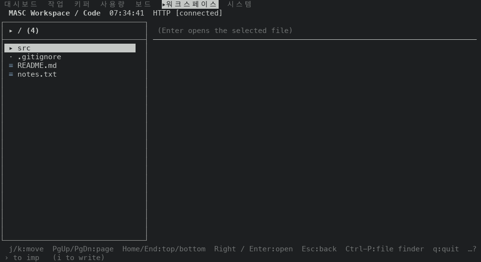
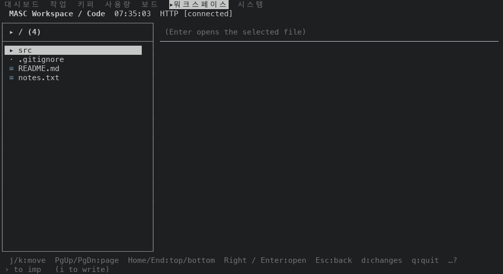
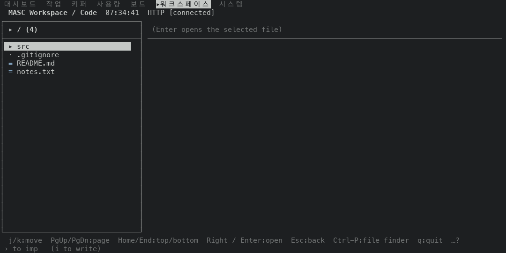
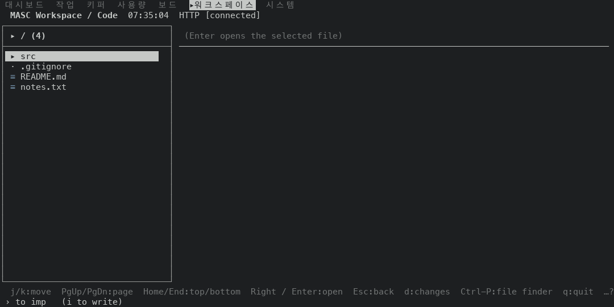
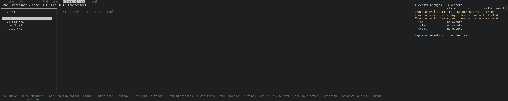
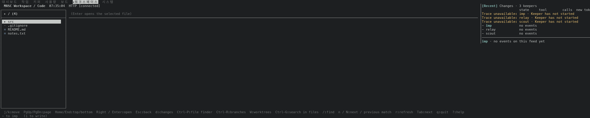
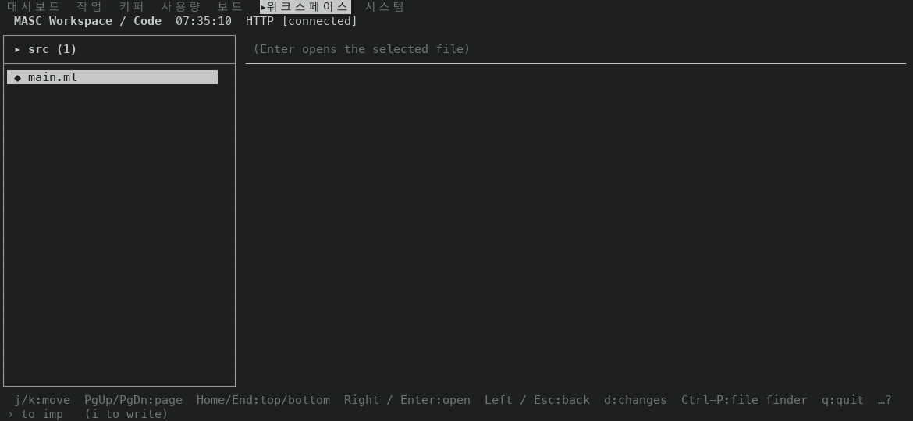
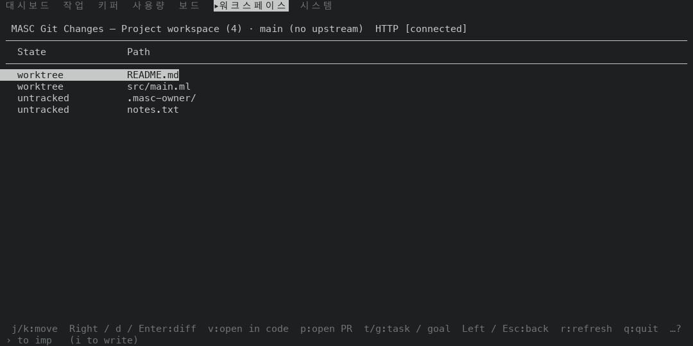
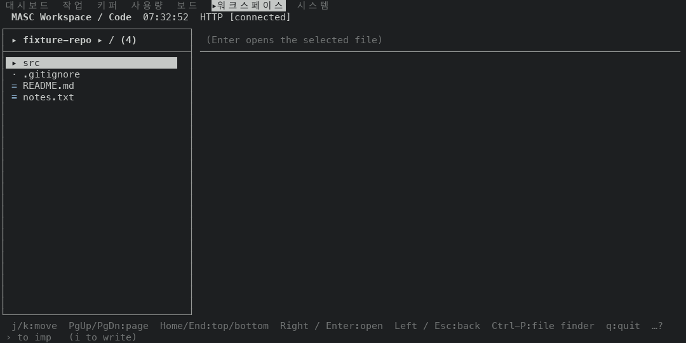

# Code 프로젝트 파일 목록 푸터에 `d:changes` 를 적어요(#50161)

Code 화면에서 프로젝트 파일 목록에 포커스가 있을 때 `d` 를 누르면 Git Changes 화면이 열려요. 푸터는 이 키를 적지 않았어요. 푸터가 `d` 를 파일을 연 뒤에만 쓰는 키로 묶어서 목록 푸터에서 뺐기 때문이에요. 도움말 시트에는 `d` 가 "on the project tree, list every working-tree change" 로 이미 적혀 있어요.

## 바꾼 것

- `Masc_tui_keys.code_tree_opens_changes` 한 함수가 "이 작업 폴더의 목록이 `d` 에 답하는가" 를 정해요. 키 처리기(`bin/masc_tui.ml` 의 `Some "d"` 갈래)와 푸터가 같은 함수를 읽어요.
- 프로젝트 작업 폴더만 답해요. 키퍼 작업 폴더와 저장소 목록은 `d` 를 처리하는 갈래가 없어서 푸터가 지금처럼 적지 않아요.
- 푸터 창 종류 `Code_tree`, `Code_root` 가 작업 폴더(scope)를 함께 들고 다녀요. `code_pane_of` 가 `state.code_scope` 를 넘겨요.
- 목록 푸터에서 `d` 의 이름은 `changes` 예요. 파일 창의 이름은 `diff` 그대로예요.
- 키 표, 도움말 시트, `docs/guides/TUI-KEYS.md` 는 바뀌지 않았어요.

## 잰 것

- 증명 빌드 둘이에요. 앞은 `deda60d70427`(run 42524666622, masc-tui sha256 `6ea4453a1594…`)이에요. 이 PR 의 바탕 브랜치(#50150)의 코드 커밋이에요. 뒤는 이 브랜치의 코드 커밋 `3fa0ea5d5798`(run 42529656726, masc-tui sha256 `8704dea77267…`)이에요.
- 같은 서버 환경에서 읽었어요. 알림이 없는 환경이에요. 작은 Git 저장소를 서버 작업 폴더에 만들었어요. 루트에 `src/`, `.gitignore`, `README.md`, `notes.txt` 가 있어요.
- 읽기 하나: 프로젝트 목록 상태 3개 x 폭 21개(80, 90, 100, 110, 120, 130, 140, 150, 157, 158, 159, 160, 170, 180, 190, 200, 220, 240, 260, 280, 300칸, 30줄) = 63곳의 푸터 줄(아래에서 둘째 줄)이에요. 상태는 tr1 프로젝트 루트(파일 읽기 없음), tr2 프로젝트 루트(파일을 읽는 중, 목록에 포커스), tr3 `src` 안이에요.
- 읽기 둘: 등록한 저장소의 목록(tr4)을 같은 폭 21곳에서 읽었어요. 고정 서버에는 저장소가 없어서 중계가 `/api/v1/repositories` 답에 한 줄(`fixture-repo`)을 넣었어요. Code 루트에서 Esc 로 Workspace 탭에 가서 그 줄에 Enter 를 눌러 `Code_scope_repo` 로 열었어요. 목록에는 프로젝트의 파일 4개가 보였어요. 푸터는 `state.code_scope` 를 읽으므로 이 읽기는 푸터를 보는 데 쓸 수 있어요.
- 84곳 전부를 `footer-rows.tsv` 에 넣었어요(상태, 폭, Code 화면 폭, 같은지, 앞·뒤 줄 칸 수, 앞, 뒤). Code 화면 폭은 오른쪽 Activity 창의 경계 줄(`│[Recent]`)에서 읽었어요.
- 화면 쌍은 tr1 의 110, 120, 300칸과 파일을 읽지 않은 `src` 안 130칸이에요. 저장소 목록은 120칸이에요.
- `d` 를 눌러 열리는 화면은 두 빌드에서 같아요. 저장소 목록에서 `d` 를 누르면 화면이 그대로예요(앞뒤 빌드 모두). 둘 다 맨 위 두 줄을 뺀 모든 줄을 견주었어요.

## 결과

- 앞 빌드는 84곳 모두에서 `d` 를 적지 않아요.
- 뒤 빌드는 프로젝트 목록 63곳 중 47곳이 `d:changes` 를 적어요.
  - 프로젝트 루트(파일 읽기 없음): 21곳 중 19곳. 안 적는 폭은 80, 90칸이에요.
  - 프로젝트 루트(파일을 읽는 중, 목록에 포커스): 21곳 중 15곳. 안 적는 폭은 80, 90, 100, 158, 159, 160칸이에요.
  - `src` 안: 21곳 중 13곳. 안 적는 폭은 80, 90, 100, 110, 158, 159, 160, 170칸이에요.
- 저장소 목록 21곳은 앞뒤 푸터가 글자까지 같고 `d` 를 적지 않아요.
- 뒤 빌드에서 늘어난 키는 `d` 하나예요.
- `d` 를 안 적는 16곳은 앞 빌드와 푸터가 글자까지 같아요. 이유가 둘이에요.
  - 자리가 없어요(9곳): 앞 빌드 푸터 뒤에 남은 칸이 `  d:changes` 의 11칸보다 적어요. 루트(읽기 없음) 90칸(1칸 남음), 루트(읽는 중) 80칸(2칸 남음), 루트(읽는 중) 100칸(1칸 남음), 루트(읽는 중) 158칸(3칸 남음), 루트(읽는 중) 159칸(4칸 남음), 루트(읽는 중) 160칸(5칸 남음), `src` 안 90칸(5칸 남음), `src` 안 110칸(4칸 남음), `src` 안 170칸(8칸 남음)이에요. 158, 159, 160, 170칸은 Activity 창이 56칸을 가져가서 Code 화면이 터미널보다 좁아요.
  - 자리가 남는데 안 들어가요(7곳): 푸터는 뒤에서부터 키를 하나씩 버려서 줄을 맞추고, 버린 키를 다시 넣지 않아요. `d` 는 `Home/End` 보다 뒤에 있어서 먼저 버려지고, 그다음 `Home/End` 까지 버려야 줄이 맞는 폭이에요. 그러면 `d:changes` 가 들어갈 칸이 남는데도 줄에 안 들어와요. 루트(읽기 없음) 80칸(12칸 남음), 루트(읽는 중) 90칸(12칸 남음), `src` 안 80칸(11칸 남음), `src` 안 100칸(15칸 남음), `src` 안 158칸(17칸 남음), `src` 안 159칸(18칸 남음), `src` 안 160칸(19칸 남음)이에요.
- `d` 가 보이는 47곳 중 20곳은 줄어든 키가 없어요. 27곳은 키가 줄어요(`src` 안 300칸은 `Tab` 과 `?:help` 둘).
  - 푸터는 키 표 순서(Navigate, Act, Search, Meta)로 앞에서부터 채우고 모자라면 뒤에서부터 버려요. `d` 는 Act 라서 Search 키보다 앞에 놓여요.
  - 줄어든 키는 `Ctrl-P` 6곳, `Ctrl-R` 6곳, `W` 6곳, `Ctrl-G` 2곳, `n / N` 2곳, `Tab` 2곳, `?:help` 2곳, `/` 1곳, `r` 1곳이에요. Search 키(`Ctrl-P` `Ctrl-R` `W` `Ctrl-G`)가 20곳이에요.
- 줄이 짧아진 곳은 23곳이에요. 빠진 키가 `d:changes` 보다 넓어서 줄 끝에 빈 칸이 늘어요. 예는 루트(읽기 없음) 110칸이에요. 줄이 109칸에서 100칸으로 짧아져요(Code 화면 110칸).

| 폭 | Code 화면 폭 | 루트(읽기 없음) | 루트(읽는 중) | `src` 안 | 저장소 루트 |
|---|---|---|---|---|---|
| 80 | 80 | 같음 | 같음 | 같음 | 같음 |
| 90 | 90 | 같음 | 같음 | 같음 | 같음 |
| 100 | 100 | +`d` | 같음 | 같음 | 같음 |
| 110 | 110 | +`d` -`Ctrl-P` | +`d` | 같음 | 같음 |
| 120 | 120 | +`d` | +`d` -`Ctrl-P` | +`d` | 같음 |
| 130 | 130 | +`d` -`Ctrl-R` | +`d` | +`d` -`Ctrl-P` | 같음 |
| 140 | 140 | +`d` -`W` | +`d` -`Ctrl-R` | +`d` | 같음 |
| 150 | 150 | +`d` | +`d` -`W` | +`d` -`Ctrl-R` | 같음 |
| 157 | 157 | +`d` | +`d` -`W` | +`d` -`W` | 같음 |
| 158 (Activity 창 열림) | 102 | +`d` | 같음 | 같음 | 같음 |
| 159 (Activity 창 열림) | 103 | +`d` | 같음 | 같음 | 같음 |
| 160 (Activity 창 열림) | 104 | +`d` | 같음 | 같음 | 같음 |
| 170 (Activity 창 열림) | 114 | +`d` -`Ctrl-P` | +`d` | 같음 | 같음 |
| 180 (Activity 창 열림) | 124 | +`d` | +`d` -`Ctrl-P` | +`d` | 같음 |
| 190 (Activity 창 열림) | 134 | +`d` -`Ctrl-R` | +`d` | +`d` -`Ctrl-P` | 같음 |
| 200 (Activity 창 열림) | 144 | +`d` -`W` | +`d` -`Ctrl-R` | +`d` -`Ctrl-R` | 같음 |
| 220 (Activity 창 열림) | 164 | +`d` -`Ctrl-G` | +`d` | +`d` -`W` | 같음 |
| 240 (Activity 창 열림) | 184 | +`d` | +`d` -`/` | +`d` -`Ctrl-G` | 같음 |
| 260 (Activity 창 열림) | 204 | +`d` -`n / N` | +`d` | +`d` | 같음 |
| 280 (Activity 창 열림) | 224 | +`d` -`Tab` | +`d` -`r` | +`d` -`n / N` | 같음 |
| 300 (Activity 창 열림) | 244 | +`d` | +`d` -`?:help` | +`d` -`Tab` -`?:help` | 같음 |

`+` 는 뒤에서 늘어난 키, `-` 는 줄어든 키예요. `같음` 은 앞뒤 푸터가 글자까지 같다는 뜻이에요.

루트(읽기 없음)의 푸터 줄이에요. 나머지는 `footer-rows.tsv` 에 있어요.

| 폭 | 앞 | 뒤 |
|---|---|---|
| 100 | `j/k:move  PgUp/PgDn:page  Home/End:top/bottom  Right / Enter:open  Esc:back  q:quit  …?` | `j/k:move  PgUp/PgDn:page  Home/End:top/bottom  Right / Enter:open  Esc:back  d:changes  q:quit  …?` |
| 110 | `j/k:move  PgUp/PgDn:page  Home/End:top/bottom  Right / Enter:open  Esc:back  Ctrl-P:file finder  q:quit  …?` | `j/k:move  PgUp/PgDn:page  Home/End:top/bottom  Right / Enter:open  Esc:back  d:changes  q:quit  …?` |
| 120 | `j/k:move  PgUp/PgDn:page  Home/End:top/bottom  Right / Enter:open  Esc:back  Ctrl-P:file finder  q:quit  …?` | `j/k:move  PgUp/PgDn:page  Home/End:top/bottom  Right / Enter:open  Esc:back  d:changes  Ctrl-P:file finder  q:quit  …?` |
| 130 | `j/k:move  PgUp/PgDn:page  Home/End:top/bottom  Right / Enter:open  Esc:back  Ctrl-P:file finder  Ctrl-R:branches  q:quit  …?` | `j/k:move  PgUp/PgDn:page  Home/End:top/bottom  Right / Enter:open  Esc:back  d:changes  Ctrl-P:file finder  q:quit  …?` |
| 140 | `j/k:move  PgUp/PgDn:page  Home/End:top/bottom  Right / Enter:open  Esc:back  Ctrl-P:file finder  Ctrl-R:branches  W:worktrees  q:quit  …?` | `j/k:move  PgUp/PgDn:page  Home/End:top/bottom  Right / Enter:open  Esc:back  d:changes  Ctrl-P:file finder  Ctrl-R:branches  q:quit  …?` |
| 300 | `j/k:move  PgUp/PgDn:page  Home/End:top/bottom  Right / Enter:open  Esc:back  Ctrl-P:file finder  Ctrl-R:branches  W:worktrees  Ctrl-G:search in files  /:find  n / N:next / previous match  r:refresh  Tab:next  q:quit  ?:help` | `j/k:move  PgUp/PgDn:page  Home/End:top/bottom  Right / Enter:open  Esc:back  d:changes  Ctrl-P:file finder  Ctrl-R:branches  W:worktrees  Ctrl-G:search in files  /:find  n / N:next / previous match  r:refresh  Tab:next  q:quit  ?:help` |

## 화면

앞(위)과 뒤(아래)예요. 푸터는 맨 아래에서 둘째 줄이에요.

프로젝트 루트 110칸(`Ctrl-P` 가 빠지고 `d` 가 들어와요)

프로젝트 루트 120칸(키가 빠지지 않고 `d` 만 늘어요)

프로젝트 루트 300칸

`src` 안 130칸(파일 읽기 없음. 위 표에 없는 상태예요)

프로젝트 목록에서 `d` 를 누르면 열리는 화면이에요. 두 빌드가 같아요.

등록한 저장소의 목록 120칸이에요. 앞뒤가 같고 푸터가 `d` 를 적지 않아요. `d` 를 눌러도 화면이 그대로예요.

## 시험

Test 워크플로 run 42530422274 가 이 브랜치에서 통과했어요. `test_tui_footer_detail_state` 8개예요. run 42531084978 도 통과했어요. `test_tui_keys` 70개예요. 새 시험은 `the tree names d where the list opens the changes` 하나예요. 프로젝트·키퍼·저장소 세 작업 폴더에서 목록 푸터가 `d` 를 적는 곳과 `code_tree_opens_changes` 가 답하는 곳이 같은지 봐요. 이미 있던 `scoped_keys` 표에는 키퍼·저장소 목록에서 `d` 를 적지 않는 줄 둘을 더했어요. 푸터 줄의 글자나 순서를 확인하는 시험은 더하지 않았어요(`docs/constitution.xml` 354행).

## 재지 않은 것

- 키퍼 작업 폴더(`Code_scope_keeper`)의 목록이에요. 고정 서버에 키퍼가 쓴 파일 기록이 없어서 화면으로는 읽지 못했어요. 시험이 `code_pane_of` 로 읽어요.
- 저장소 목록은 중계가 넣은 한 줄로 읽었어요. 서버에 등록된 저장소가 아니에요.
- 알림이 있는 환경이에요. 알림이 키를 밀어내는 일은 #49925 가 다뤄요.
- Activity 창을 닫은 상태, 80칸보다 좁은 폭, 300칸보다 넓은 폭, 30줄이 아닌 높이예요.
- `Git changes` 라벨을 쓴 푸터는 읽지 않았어요.

## 정해야 할 것

- **밀려나는 키**: `d` 가 Search 키보다 앞이라서 27곳에서 키 하나가 빠져요. 키 표의 그룹 순서를 그대로 따른 결과예요. `d` 를 Search 키 뒤에 두는 방법도 있어요. 표의 그룹 순서를 바꾸는 일이라 이 PR 에서는 하지 않았고 그 푸터는 읽지 않았어요.
- **버린 키를 다시 넣는 일**: 푸터 맞춤(`bin/masc_tui_footer.ml`)은 키를 한 번 버리면 다시 넣지 않아요. 이 PR 의 7곳에서 `d:changes` 가 자리가 남는데도 빠지는 이유예요. 맞춤은 모든 화면의 푸터가 쓰는 코드라 이 PR 에서는 건드리지 않았어요.
- **라벨**: `changes`(9칸)를 썼어요. Repositories 푸터는 같은 화면을 `Git changes` 라고 불러요. 4칸이 더 필요해서 루트 100칸 (앞 89칸 + `  d:Git changes` 15칸 = 104칸)에는 들어가지 않아요. 계산한 값이에요.
