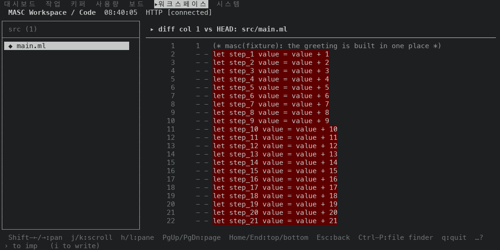
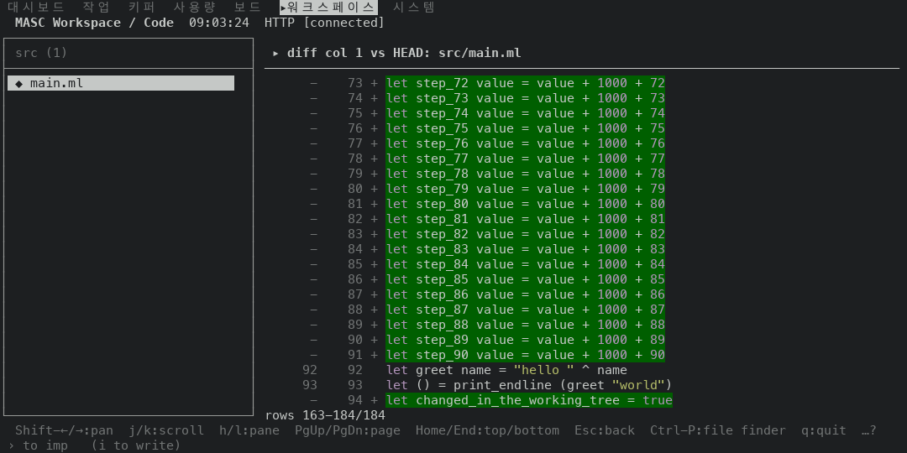
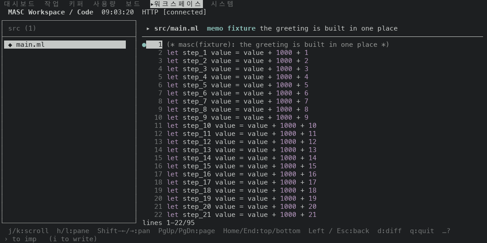
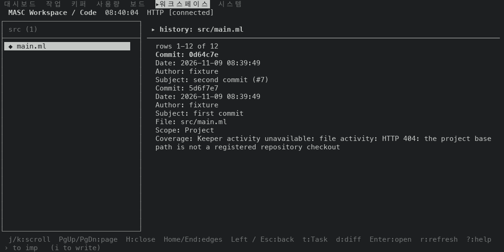
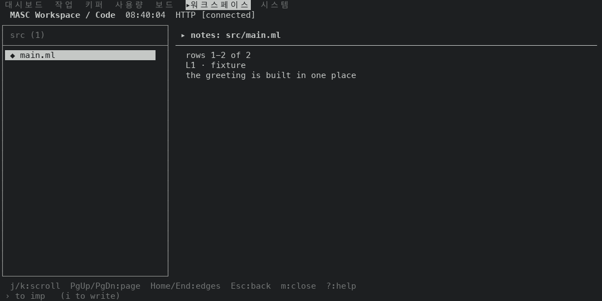
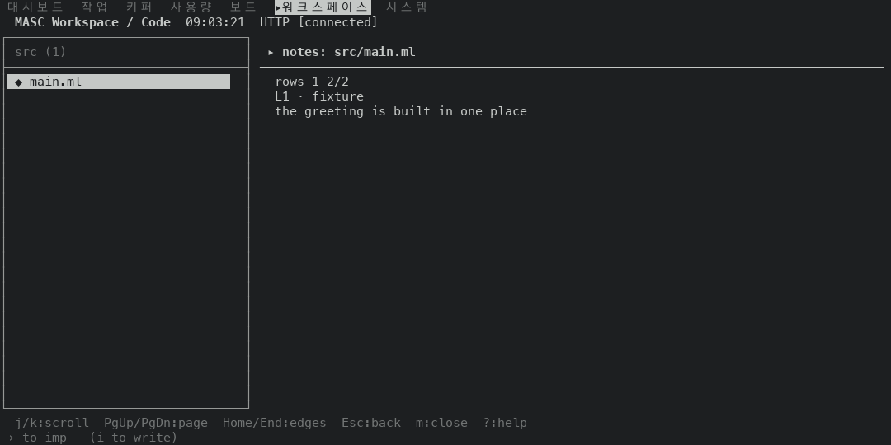

# Code 화면의 위치 줄 (#50188)

`d` 로 연 긴 diff 가 창 아래 줄에 창이 보이는 줄 범위를 적고, Code 화면의 위치 줄 네 곳을 `Masc_tui_scroll.window_reading` 으로 만든 앞뒤를 비교했어요.

## 환경

- 앞: 증명 빌드 `u66`(코드 `d0dfb9df9777`, run 42534445384). 뒤: `u68`(코드 `eddaefead058`, run 42537260867).
- 120x30(폭 표는 60, 80, 100, 120, 160칸 x 30줄), 고정 서버의 작은 Git 저장소예요. `src/main.ml` 은 95줄이고 작업 트리 변경이 diff 184줄이라 창(22줄)보다 길어요.
- 같은 걸음으로 앞뒤를 읽고, 시각과 실행마다 달라지는 값(고정 저장소의 커밋 해시와 날짜)은 가리고 줄마다 비교했어요.

## 결과

| 화면 | 앞 | 뒤 | 다른 줄 |
|---|---|---|---|
| diff, 연 직후 | (적지 않음) | `rows 1-22/184` | 창 아래 1줄 |
| diff, `PageDown` | (적지 않음) | `rows 22-43/184` | 창 아래 1줄 |
| diff, `End` | (적지 않음) | `rows 163-184/184` | 창 아래 1줄 |
| 파일 창, 맨 위 | `lines 1-22 of 95` | `lines 1-22/95` | 창 아래 1줄 |
| 파일 창, 맨 아래 | `lines 74-95 of 95` | `lines 74-95/95` | 창 아래 1줄 |
| 히스토리 | `rows 1-12 of 12` | `rows 1-12/12` | 위치 1줄 |
| 노트 | `rows 1-2 of 2` | `rows 1-2/2` | 위치 1줄 |

- diff 의 제목(`diff col 1 vs HEAD: src/main.ml`)과 창의 22줄은 앞뒤가 같아요. diff 를 연 세 화면에서 다른 줄은 창 아래 줄뿐이에요.
- 창에 다 들어오는 diff(작은 고정 저장소의 4줄 diff)와 위치 줄이 없는 파일 화면은 앞뒤가 글자까지 같아요.
- 앞 층(#50172)이 읽은 키 화면 37개는 창 아래 줄 말고 같아요. diff 를 연 직후와 `PageDown`, `End`, `PageUp`, `Home` 을 누른 뒤 5개, `j` 200번 뒤 맨 위·맨 아래와 `k` 를 하나씩 누른 32개예요. 창이 처음 움직이는 누름은 여전히 1번째예요.

## 폭별 모양(`End` 를 누른 뒤)

`widths.tsv` 에도 있어요. 제목은 60칸에서도 경로 `src/main.ml` 까지 보이고, 창 아래 줄은 모든 폭에서 마지막 창을 적어요. 100칸까지는 파일 목록이 숨어서 diff 가 폭 전체를 써요.

| 폭 | 제목 | 창 아래 줄 |
|---|---|---|
| 60칸 | `diff col 1 vs HEAD: src/main.ml` | `rows 163-184/184` |
| 80칸 | `diff col 1 vs HEAD: src/main.ml` | `rows 163-184/184` |
| 100칸 | `diff col 1 vs HEAD: src/main.ml` | `rows 163-184/184` |
| 120칸 | `diff col 1 vs HEAD: src/main.ml` | `rows 163-184/184` |
| 160칸 | `diff col 1 vs HEAD: src/main.ml` | `rows 163-184/184` |

## 그림(앞, 뒤)

| 앞 | 뒤 |
|---|---|
|  |  |
|  |  |
|  |  |
|  |  |
|  |  |

## 재지 않은 것

- hover 창의 위치 줄(`rows X-Y/Z · Esc returns to code`): 언어 서버 답이 있어야 열려서 고정 서버로 못 읽었어요. 바뀐 코드는 노트·히스토리와 같은 모양이에요.
- 알림이 있는 환경(#49925), 80칸보다 좁은 폭에서 긴 경로, 30줄이 아닌 높이
