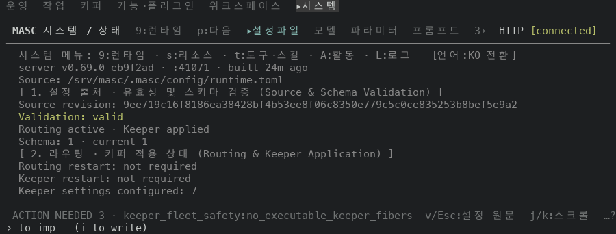
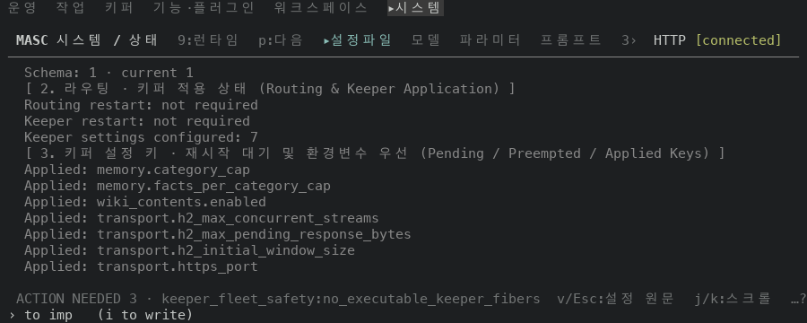

# System 설정 파일 상태 화면의 End·G·g 키

## 실측

고정 서버 위에서 증명 빌드 둘로 같은 키 순서를 눌러 찍었어요. 앞은 main `eb9f2add9bda`(run `42588242955`), 뒤는 그 위에 이 PR 의 코드 커밋 1개를 얹어 빌드한 run `42589034989` 이에요. 두 빌드의 소스는 코드 파일 2개만 달라요(`git diff --name-only` 로 확인했어요). 폭 100x20 에서 System 의 설정파일 화면 `v` 로 상태 화면을 열고 `End`, `g`, `G`, `Home`, `j`, `G`, `Home` 을 차례로 눌렀어요. 아래 값은 찍은 text 에서 읽었어요.

| 누른 키 | 앞 | 뒤 |
|---|---|---|
| `End` | 화면이 그대로예요(맨 위) | 마지막 행(`Applied: transport.https_port`)까지 내려가요 |
| `G` | 화면이 그대로예요 | `End` 와 같은 화면이에요 |
| `g` | 화면이 그대로예요 | 맨 위로 돌아와요 |
| `j`(맨 위에서) | 한 행 내려가요 | 한 행 내려가요 |
| `G`(`j` 로 한 행 내려온 뒤) | 화면이 그대로예요(한 행 내려온 채) | `End` 와 같은 화면이에요 |
| `Home`(`j` 와 `G` 뒤) | 맨 위로 돌아와요 | 맨 위로 돌아와요 |

`End` 뒤 화면의 첫 행은 `Schema: 1 · current 1` 이고 마지막 행은 `Applied: transport.https_port` 이에요. 위 판정은 모두 두 빌드의 text 가 같은지 다른지 비교한 값이에요.

푸터 힌트 문자열에 `Home/End:처음/끝` 을 더했어요. 고정 서버에서는 ACTION NEEDED 알림이 줄 앞을 차지해서 두 빌드 모두 힌트 줄이 `ACTION NEEDED 3 · keeper_fleet_safety:no_executable_keeper_fibers  v/Esc:설정 원문  j/k:스크롤  …?` 로 같고, 폭 160 에서도 같아요(폭 160 에서는 오른쪽에 Changes 패널이 붙어 힌트 줄이 100칸을 쓰기 때문이에요). 그래서 새 힌트가 화면에 보이는 모습은 못 찍었어요.

안 잰 것: 폭 100 높이 20 만 봤어요. 상태 화면의 행이 한 화면에 다 들어가는 터미널에서는 `End` 와 `G` 가 아무 일도 하지 않아요(이미 끝이에요).

| 앞 | 뒤 |
|---|---|
| `End` 를 누른 뒤  |   |
