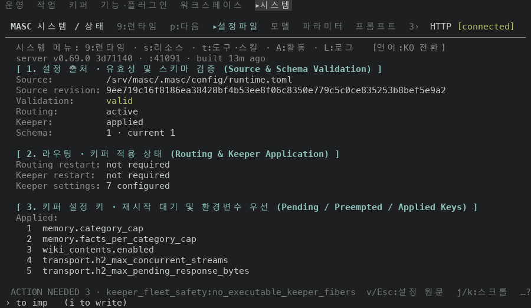
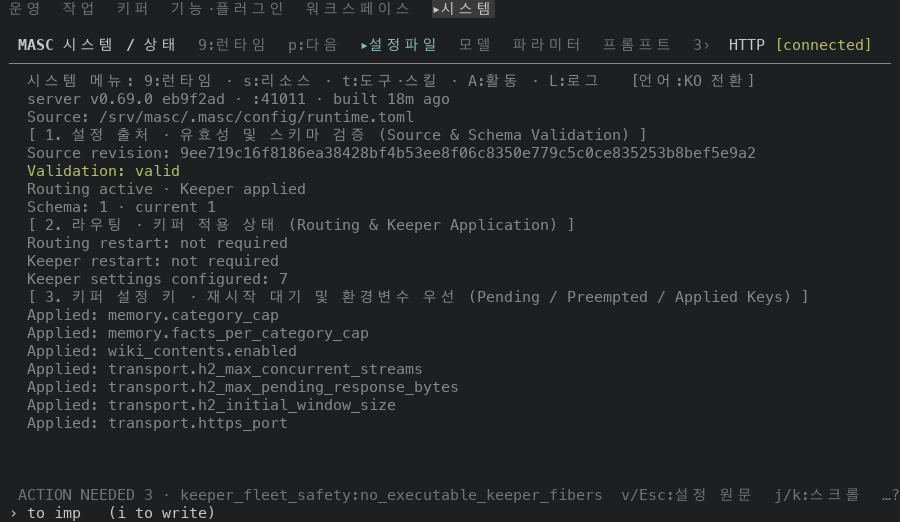
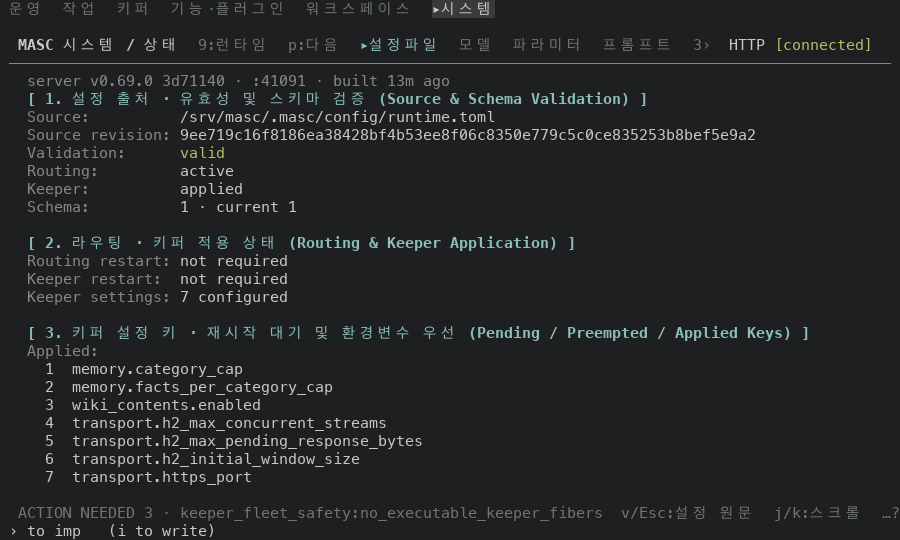

# System 설정 파일 상태 화면을 라벨 칸 하나로 맞춰 그리기

## 실측

고정 서버 위에서 증명 빌드 둘로 같은 화면을 찍었어요. 앞은 main `eb9f2add9bda`(run `42588242955`), 뒤는 그 위에 이 PR 의 코드 커밋 3개를 얹어 빌드한 run `42589966683` 이에요. 두 빌드의 소스는 코드·시험 파일 13개만 달라요(`git diff --name-only` 로 확인했어요). System 의 설정파일 화면에서 `v` 로 연 상태 화면을 찍었고, 아래 값은 찍은 text·ANSI 에서 읽었어요.

| 잰 것 | 앞 | 뒤 |
|---|---|---|
| 값이 라벨 옆에서 시작하는 칸(사실 줄 7개 → 9개) | 5곳 (11, 15, 19, 20, 31) | 1곳 (20) |
| `Applied` 라벨이 찍힌 행 | 7개 | 1개 (밑에 1..7 번호 행) |
| 구역 제목 색 | 회색(256색 102) | 굵게 + 밝은 청록 |
| 구역 사이 빈 행 | 0개 | 2개 |
| `Source revision` 라벨 색 / 값 색 | 회색(256색 102) / 회색(256색 102) | 회색(256색 102) / 칠하지 않음 |
| `Validation` 라벨 색 / 값 색(`valid`) | 밝은 초록 / 밝은 초록 | 회색(256색 102) / 밝은 초록 |
| 상태 줄 수(메뉴·base·server 줄 제외) | 18 | 22 |
| 라우팅·키퍼 줄 | `Routing active · Keeper applied` 한 줄 | `Routing`·`Keeper` 사실 두 줄 |
| 개수 줄 | `Keeper settings configured: 7` | `Keeper settings: 7 configured` |

사실 9개의 값(앞에서 한 줄이던 `Routing`·`Keeper`·`Keeper settings` 는 위 표의 글만 달라요)과 적용된 키 7개의 글·순서, 구역 제목 3개의 글은 앞뒤가 같아요. `Source` 경로는 찍은 서버의 임시 폴더라서 `/srv/masc` 로 바꿔 찍었어요(설정 원본 응답 하나만 바꿨어요). 그림에서는 찍은 서버의 임시 폴더 경로가 드러나는 `base` 줄 하나만 뺐어요. 위쪽 메뉴 줄은 앞뒤가 같고, `server` 줄은 빌드의 커밋·포트·경과 시간이 달라요.

안 잰 것: 폭 100 만 봤어요. 검증 경고·오류가 있는 설정, 재시작 대기·환경변수 우선 키가 있는 설정, TOML 파싱 실패, 읽기 전의 화면은 고정 서버에 없어서 찍지 않았어요(톤만 옮겼어요).

| 앞 | 뒤 |
|---|---|
| 상태 화면 위쪽  |   |
| 상태 화면 아래쪽(PgDn)  |   |
