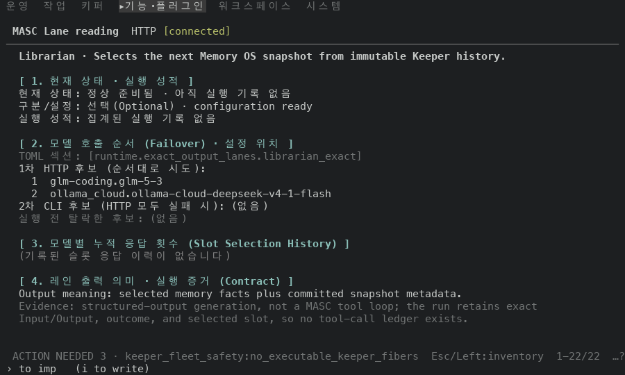
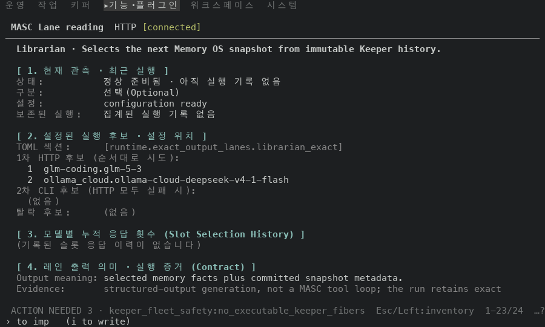
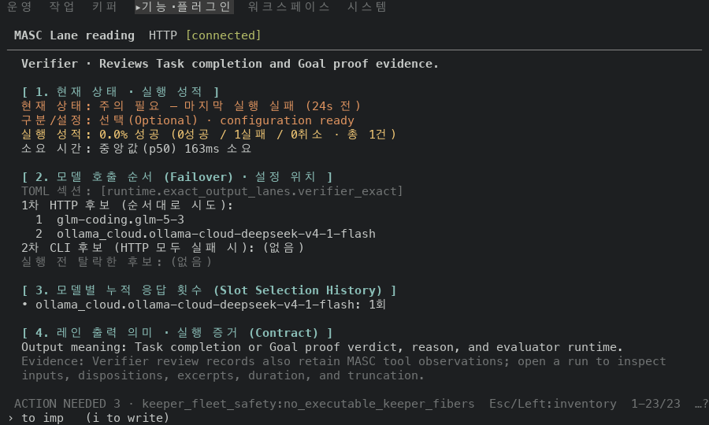
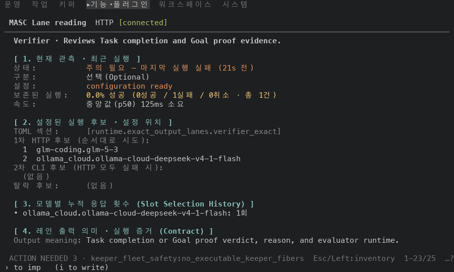

# Features 의 Exact lane 상세를 라벨 칸 하나로 맞춰 그리기

## 실측

고정 서버 위에서 증명 빌드 둘로 같은 화면을 찍었어요. 앞은 main 끝 `d4ae1ead0b2b`(run `42581496654`), 뒤는 그 위에 이 PR 의 코드 커밋 4개를 얹은 끝(run `42583259174`)이에요. 두 빌드의 소스는 코드·시험 파일 10개만 달라요(`git diff --name-only` 로 확인했어요). Features 화면에서 Librarian 줄과 Verifier 줄(마지막 실행이 실패)을 고르고 `d` 로 연 레인 상세를 찍었어요. 아래 값은 찍은 text·ANSI 에서 읽었어요.

| 잰 것 | 앞 | 뒤 |
|---|---|---|
| 값이 라벨 옆에서 시작하는 칸(Verifier) | 4곳 (13, 14, 19, 24) | 1곳 (19) |
| `Evidence` 문장이 감겨 이어지는 줄이 시작하는 칸(Librarian) | 3 | 19 (값 칸) |
| 상태 행(`현재 상태` → `상태`)의 라벨 색 / 값 색(Verifier) | 밝은 빨강 / 밝은 빨강 | 회색(256색 102) / 밝은 빨강 |
| 구역 제목(Librarian) | `1. 현재 상태 · 실행 성적` / `2. 모델 호출 순서 (Failover) · 설정 위치` | `1. 현재 관측 · 최근 실행` / `2. 설정된 실행 후보 · 설정 위치` |
| 개요 아래 칸의 구역 제목 | `현재 관측 · 최근 실행` / `설정된 실행 후보` | (같음) |
| `선택(Optional)` 의 색(Verifier) | 밝은 빨강 | 칠하지 않음 |
| 페이지 전체 행 수(Librarian / Verifier) | 22 / 23 | 24 / 25 |

후보 번호 행(2개)과 `Output meaning`·`Evidence` 두 문장의 글은 앞뒤가 같아요. 문장 앞의 `Output meaning:`·`Evidence:` 는 글에서 빠지고 라벨로 그려져요.

`속도` 줄(앞의 `소요 시간`)의 값(앞 `중앙값(p50) 163ms 소요`, 뒤 `중앙값(p50) 125ms 소요`)은 고정 서버가 그때 돌린 실행의 시간이라 찍을 때마다 달라요.

안 잰 것: 값으로 잰 건 폭 100 뿐이에요. 폭 80 과 50 은 찍어서 눈으로만 봤고(긴 값은 값 칸 안에서 감겨요) 사진은 붙이지 않았어요. 후보가 탈락한 줄(`실행 전 탈락한 후보`), JEV 줄, 등록 오류 줄, 슬롯 응답 이력이 여러 개인 줄은 고정 서버에 없어서 찍지 않았어요(톤만 옮겼어요).

| 앞 | 뒤 |
|---|---|
| Librarian 상세  |   |
| Verifier 상세 (마지막 실행 실패)  |   |
