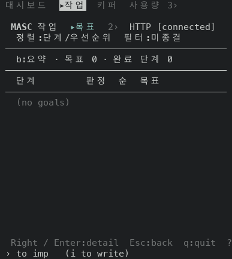
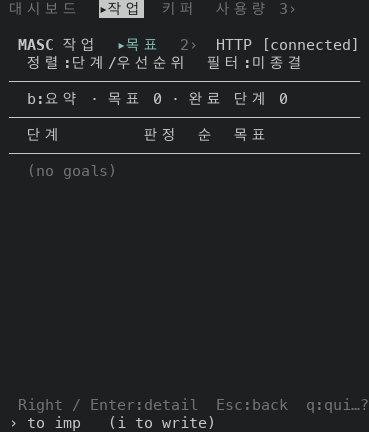
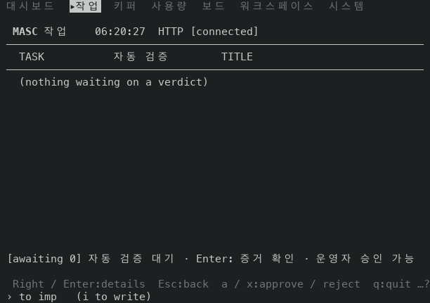
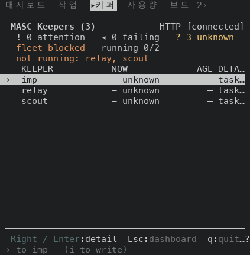

# 푸터가 키를 뺀 줄은 늘 `…?` 로 끝나요(#50141)

푸터가 키를 다 못 그리고 못 버리는 키(`Esc`, `q`, `Enter` 등)만 남기는 폭이 있어요. 그 폭에서 줄이 `…?` 가 아니라 `?` 하나로 끝났어요. 이 PR 은 그 줄을 `…?` 로 끝내요.

## 잰 것

- 증명 빌드 둘이에요. 앞은 main `8f385a3b2b78`(run 42521780255, masc-tui sha256 `a3a6d96deb17…`), 뒤는 이 브랜치 코드 커밋 `5fa2090fd423`(run 42523918537, masc-tui sha256 `2fd2cda37c28…`)이에요.
- 같은 서버 환경에서 읽었어요. 알림이 없는 환경이에요(`/health` 가 `operator_action_required=false`). 읽기 하나: 화면 12개(Work, Task Review, Task Verdicts, Board, Keepers, Memory, Features, Logs, Activity, Tools, Approvals, Fusion)를 24줄로 열고, 80칸부터 40칸까지 1칸씩 줄이며 푸터 줄(아래에서 둘째 줄)을 읽었어요. 빌드마다 492곳이에요. `footer-rows.tsv` 에 492곳 전부를 넣었어요(화면, 폭, 같은지, 앞, 뒤).
- 읽기 둘: System 화면의 설정 창 7개(runtime.toml, models, params, prompts, presets, themes, voice)를 80칸부터 40칸까지 읽었어요. 빌드마다 287곳이에요. 이 창들은 푸터 글자가 한국어예요(`Esc:뒤로  q:종료`). `footer-rows-config.tsv` 에 넣었어요.
- 읽기 셋: 같은 설정 창 7개를 40칸부터 10칸까지 읽었어요. 빌드마다 217곳이에요. 한국어 푸터는 못 버리는 키가 짧아서(`Esc:뒤로  q:종료`가 18칸) 마지막 갈래가 40칸 아래에서 돌아요. `footer-rows-config-narrow.tsv` 에 넣었어요.

## 결과

- 읽기 하나: 앞 빌드에서 푸터가 `?` 로만 끝난 곳이 24곳이에요. 공백 뒤 `?` 가 16곳, 마지막 키에 붙은 `?`(`q:quit?`)가 8곳이에요. 뒤 빌드는 0곳이에요. 모두 `…?` 로 끝나요.
- 나머지 468곳은 두 빌드의 푸터가 글자까지 같아요.
- 푸터가 아닌 줄은 시각, 이벤트 수, 로그 줄이 읽을 때마다 달라서 비교하지 않았어요. 두 빌드의 소스 차이는 `bin/masc_tui_footer.ml` 18줄이에요.
- 바뀐 곳은 화면 8개(Work, Task Review, Task Verdicts, Board, Keepers, Memory, Features, Logs)예요. 화면마다 폭 세 칸이 이어져요. 못 버리는 키 줄이 P칸이면 폭이 P+3, P+2, P+1칸일 때예요. P+4칸부터는 앞 빌드도 `…?` 로 끝나요.
- 읽기 둘: 설정 창 287곳은 두 빌드 모두 `…?` 로 끝나고 푸터 글자도 같아요. 한국어 푸터는 못 버리는 키가 짧아서 80~40칸에서는 마지막 갈래에 들어오지 않아요.
- 읽기 셋: 40~10칸 217곳 중 앞 빌드에서 `?` 로만 끝난 곳이 21곳이에요(공백 뒤 14곳, 마지막 키에 붙은 곳 7곳). 뒤 빌드는 0곳이에요. 설정 창마다 폭 세 칸이에요. 나머지 196곳은 푸터가 같아요.
- 두 칸 너비 글자(`종`, `료`)가 자르는 자리에 걸리면 그 글자를 빼고 공백으로 채워요. 줄 전체 폭은 그대로예요. 아래 표의 P+1 줄(`q:종 …?`)이에요.

| 화면 | 폭 | 앞 | 뒤 |
|---|---|---|---|
| Work | 43 | `Right / Enter:detail  Esc:back  q:quit  ?` | `Right / Enter:detail  Esc:back  q:quit …?` |
| Work | 42 | `Right / Enter:detail  Esc:back  q:quit ?` | `Right / Enter:detail  Esc:back  q:quit…?` |
| Work | 41 | `Right / Enter:detail  Esc:back  q:quit?` | `Right / Enter:detail  Esc:back  q:qui…?` |
| Task Review | 68 | `Right / Enter:details  Esc:back  a / x:approve / reject  q:quit  ?` | `Right / Enter:details  Esc:back  a / x:approve / reject  q:quit …?` |
| Task Review | 67 | `Right / Enter:details  Esc:back  a / x:approve / reject  q:quit ?` | `Right / Enter:details  Esc:back  a / x:approve / reject  q:quit…?` |
| Task Review | 66 | `Right / Enter:details  Esc:back  a / x:approve / reject  q:quit?` | `Right / Enter:details  Esc:back  a / x:approve / reject  q:qui…?` |
| Task Verdicts | 68 | `Right / Enter:verdict  Esc:back  y / x:agree / overrule  q:quit  ?` | `Right / Enter:verdict  Esc:back  y / x:agree / overrule  q:quit …?` |
| Task Verdicts | 67 | `Right / Enter:verdict  Esc:back  y / x:agree / overrule  q:quit ?` | `Right / Enter:verdict  Esc:back  y / x:agree / overrule  q:quit…?` |
| Task Verdicts | 66 | `Right / Enter:verdict  Esc:back  y / x:agree / overrule  q:quit?` | `Right / Enter:verdict  Esc:back  y / x:agree / overrule  q:qui…?` |
| Board | 58 | `Right / Enter:read  Esc:back  v / V:up / down  q:quit  ?` | `Right / Enter:read  Esc:back  v / V:up / down  q:quit …?` |
| Board | 57 | `Right / Enter:read  Esc:back  v / V:up / down  q:quit ?` | `Right / Enter:read  Esc:back  v / V:up / down  q:quit…?` |
| Board | 56 | `Right / Enter:read  Esc:back  v / V:up / down  q:quit?` | `Right / Enter:read  Esc:back  v / V:up / down  q:qui…?` |
| Keepers | 48 | `Right / Enter:detail  Esc:dashboard  q:quit  ?` | `Right / Enter:detail  Esc:dashboard  q:quit …?` |
| Keepers | 47 | `Right / Enter:detail  Esc:dashboard  q:quit ?` | `Right / Enter:detail  Esc:dashboard  q:quit…?` |
| Keepers | 46 | `Right / Enter:detail  Esc:dashboard  q:quit?` | `Right / Enter:detail  Esc:dashboard  q:qui…?` |
| Memory | 42 | `Enter:facts  Esc:clear / back  q:quit  ?` | `Enter:facts  Esc:clear / back  q:quit …?` |
| Memory | 41 | `Enter:facts  Esc:clear / back  q:quit ?` | `Enter:facts  Esc:clear / back  q:quit…?` |
| Memory | 40 | `Enter:facts  Esc:clear / back  q:quit?` | `Enter:facts  Esc:clear / back  q:qui…?` |
| Features | 46 | `Right / Enter:open  Esc:dashboard  q:quit  ?` | `Right / Enter:open  Esc:dashboard  q:quit …?` |
| Features | 45 | `Right / Enter:open  Esc:dashboard  q:quit ?` | `Right / Enter:open  Esc:dashboard  q:quit…?` |
| Features | 44 | `Right / Enter:open  Esc:dashboard  q:quit?` | `Right / Enter:open  Esc:dashboard  q:qui…?` |
| Logs | 43 | `Right / Enter:detail  Esc:back  q:quit  ?` | `Right / Enter:detail  Esc:back  q:quit …?` |
| Logs | 42 | `Right / Enter:detail  Esc:back  q:quit ?` | `Right / Enter:detail  Esc:back  q:quit…?` |
| Logs | 41 | `Right / Enter:detail  Esc:back  q:quit?` | `Right / Enter:detail  Esc:back  q:qui…?` |

한국어 푸터(설정 창, 읽기 셋)예요. 같은 줄이 나오는 창을 묶었어요.

| 설정 창 | 폭 | 앞 | 뒤 |
|---|---|---|---|
| runtime.toml, models, prompts, presets, voice | 21 | `Esc:뒤로  q:종료  ?` | `Esc:뒤로  q:종료 …?` |
| runtime.toml, models, prompts, presets, voice | 20 | `Esc:뒤로  q:종료 ?` | `Esc:뒤로  q:종료…?` |
| runtime.toml, models, prompts, presets, voice | 19 | `Esc:뒤로  q:종료?` | `Esc:뒤로  q:종 …?` |
| params | 37 | `e / Enter:편집  Esc:뒤로  q:종료  ?` | `e / Enter:편집  Esc:뒤로  q:종료 …?` |
| params | 36 | `e / Enter:편집  Esc:뒤로  q:종료 ?` | `e / Enter:편집  Esc:뒤로  q:종료…?` |
| params | 35 | `e / Enter:편집  Esc:뒤로  q:종료?` | `e / Enter:편집  Esc:뒤로  q:종 …?` |
| themes | 33 | `Enter:적용  Esc:뒤로  q:종료  ?` | `Enter:적용  Esc:뒤로  q:종료 …?` |
| themes | 32 | `Enter:적용  Esc:뒤로  q:종료 ?` | `Enter:적용  Esc:뒤로  q:종료…?` |
| themes | 31 | `Enter:적용  Esc:뒤로  q:종료?` | `Enter:적용  Esc:뒤로  q:종 …?` |

## 화면

푸터 줄만 달라요. 앞(위)과 뒤(아래)예요.

Work, 43칸(`q:quit  ?` → `q:quit …?`)

 

Work, 42칸(`q:quit ?` → `q:quit…?`)

 

Work, 41칸(`q:quit?` → `q:qui…?`)

 

Task Review, 68칸

 

Keepers, 47칸

 

## 시험

Test 워크플로 run 42523915568 이 이 브랜치에서 통과했어요. 푸터 시험 파일 다섯 개예요: `test_tui_footer_status_items` 11개(main 에서 4번이 실패하던 것, #49427), `test_tui_footer_notice_forms`, `test_tui_footer_detail_state`, `test_tui_keys`, `test_tui_nav_trace`.

## 재지 않은 것

- 알림이 있는 환경이에요. 알림이 키를 밀어내는 일은 #49925 가 다뤄요.
- 80칸보다 넓은 폭과 24줄이 아닌 높이예요.
- 읽기 하나의 12개와 설정 창 7개 밖의 화면이에요. 푸터를 만드는 코드는 같지만 화면별로 읽지 않았어요.
- 설정 창 밖에서 한국어 라벨을 쓰는 푸터(`voice_agent`, `prompt_assets`)를 따로 읽지 않았어요. 설정 창과 같은 갈래를 타요.
- Memory 에서 아래 셋째 줄이 `unread ?` 로 끝나는 곳이 있어요. 푸터가 아니라 상태 줄이고 두 빌드가 같아요.
