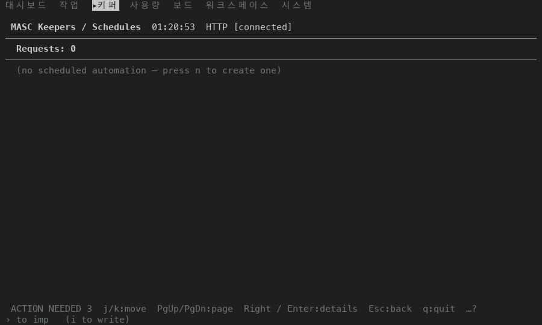
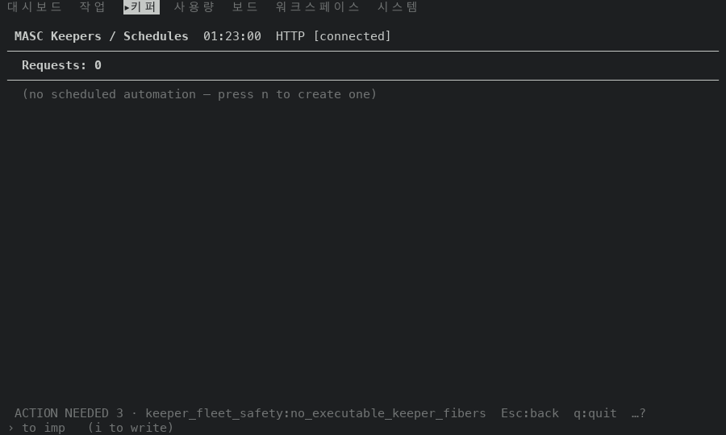
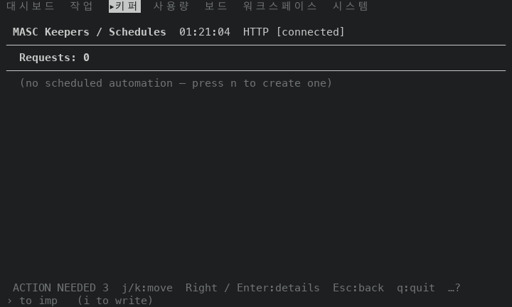
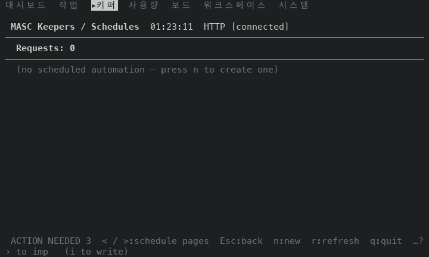
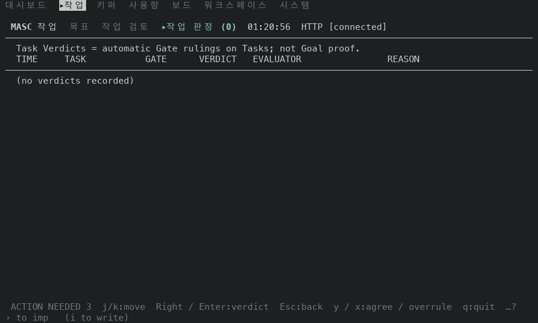
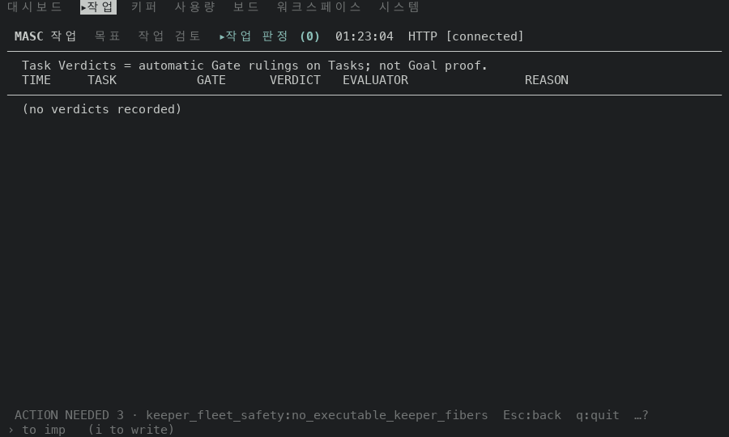
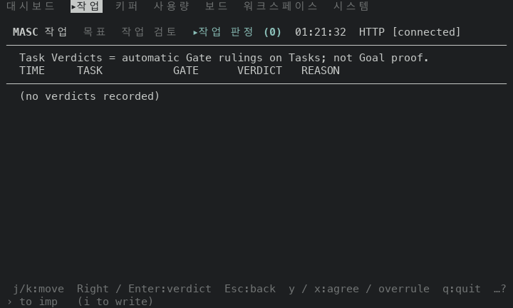
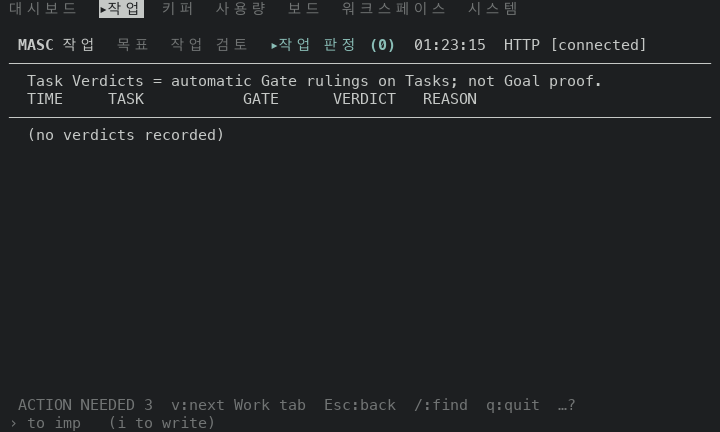
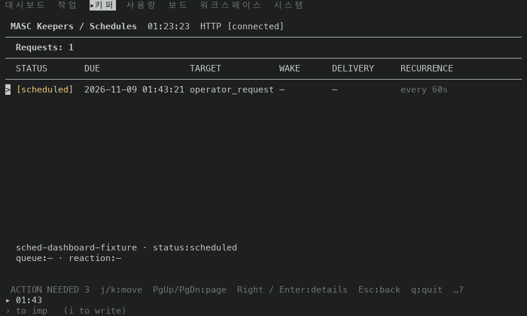
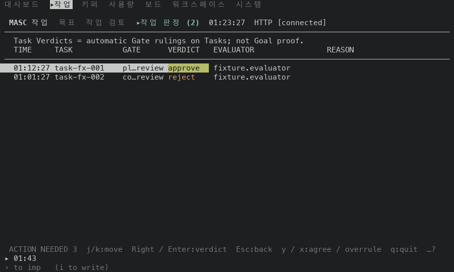

# 빈 Schedules·Task Verdicts 푸터가 행이 있어야 하는 키를 빼요: 고치기 전과 후 (#50076)

## 어떻게 쟀나

일회용 워크스페이스에 서버를 띄우고, TUI 와 서버 사이에 두 답만 바꿔 주는 중계를 뒀어요.

- `GET /api/v1/dashboard/scheduled-automation`: 행이 있는 경우에 예약 한 줄(`every 60s`, 상태 `scheduled`, 아직 깨어난 적 없음)을 끼워 줘요. 행 모양은 서버가 쓰는 값이에요(`dashboard/src/api/fixtures/scheduled-automation-lookup-found.json` 의 `request`). 시각은 요청 시각 기준으로 옮겼어요.
- `GET /api/v1/dashboard/harness-health`: 행이 있는 경우에 판정 두 줄(`plan_review` 승인, `code_review` 반려, 실행자 `fixture.evaluator`)을 끼워 줘요.
- 행이 없는 경우는 중계가 답을 바꾸지 않아요. 새 워크스페이스의 서버가 준 빈 목록이에요.

tmux 3.6a 안의 TUI 로 명령 팔레트에서 `go Schedules`, `go Task Verdicts` 를 열고, 화면에 `ACTION NEEDED` 가 보일 때까지 최대 40초 기다린 뒤 찍었어요. 고치기 전 80x24 Task Verdicts 는 푸터가 이 문구를 밀어내서 40초를 다 기다리고 찍었어요. 크기는 100x30 과 80x24 예요. 행은 가짜 값이에요.

- 고치기 전: 이 브랜치가 갈라진 main 의 증명 빌드 run 42493830723, 커밋 `b91485d3cfc3`, `masc-tui` sha256 `d57d51e3ad83fb19223a027b8fc06575fe13c1380c455baed20d3cf4b1dffb75`, `--build-commit` 이 같아요. 이 run 의 `native-tui / macos-tui` 는 성공이고, 같은 run 의 `Source and config syntax` 가 취소돼서 run 전체는 취소로 끝났어요. 취소 원인은 못 찾았어요. 영수증(`receipt.json`)의 소스 커밋은 `b91485d3cfc3a8bb2b872d66c1b72b305a154312` 로 검증했어요.
- 고친 뒤: 이 PR 코드 커밋의 증명 빌드 run 42497759710(성공), 커밋 `cdd3b6196f46`, `masc-tui` sha256 `e2aad98ea8b961344faf18d060f7d8e7665276784db2fd63ea7691ca950c41ac`, `--build-commit` 이 같아요. 영수증 소스 커밋을 검증했어요. 이 빌드 뒤에 `08417af98905` 가 `bin/masc_tui_render_work.ml` 의 주석 위치만 옮겼어요(코드는 같아요).
- 두 빌드 사이에 바뀐 파일: `bin/masc_tui_keys.ml`, `bin/masc_tui_keys.mli`, `bin/masc_tui_render_verification.ml`, `bin/masc_tui_render_work.ml`, `test/dune`, `test/test_tui_footer_row_need.ml`.

## 읽는 법

- 푸터는 목록이 비어 있어도 `j/k`, `PgUp/PgDn`, `Right / Enter`(Task Verdicts 는 `y / x` 도)를 그렸어요. 이 PR 은 키 표에서 이 키들에 `Needs_row` 를 달고, 목록 렌더러가 행이 없다고 말하면 푸터에서 빼요.
- 핸들러의 조건과 같아요. 이동·페이지 키는 `row_list` 의 `rl_count = 0` 에서 아무것도 안 하고, Schedules 의 `Enter`·`e`·`x`·`Y` 는 `snapshot.scs_rows` 의 `List.nth_opt` 로 행을 찾아요.
- `…?` 는 폭이 모자라 키 일부를 숨겼다는 표시예요.

## 푸터

| 화면 | 크기 | 고치기 전 푸터 | 고친 뒤 푸터 |
| --- | --- | --- | --- |
| Schedules, 행이 없는 목록 | 100x30 | `ACTION NEEDED 3  j/k:move  PgUp/PgDn:page  Right / Enter:details  Esc:back  q:quit  …?` | `ACTION NEEDED 3 · keeper_fleet_safety:no_executable_keeper_fibers  Esc:back  q:quit  …?` |
| Schedules, 행이 없는 목록 | 80x24 | `ACTION NEEDED 3  j/k:move  Right / Enter:details  Esc:back  q:quit  …?` | `ACTION NEEDED 3  < / >:schedule pages  Esc:back  n:new  r:refresh  q:quit  …?` |
| Schedules, 행이 있는 목록 | 100x30 | `ACTION NEEDED 3  j/k:move  PgUp/PgDn:page  Right / Enter:details  Esc:back  q:quit  …?` | `ACTION NEEDED 3  j/k:move  PgUp/PgDn:page  Right / Enter:details  Esc:back  q:quit  …?` (같음) |
| Schedules, 행이 있는 목록 | 80x24 | `ACTION NEEDED 3  j/k:move  Right / Enter:details  Esc:back  q:quit  …?` | `ACTION NEEDED 3  j/k:move  Right / Enter:details  Esc:back  q:quit  …?` (같음) |
| Task Verdicts, 행이 없는 목록 | 100x30 | `ACTION NEEDED 3  j/k:move  Right / Enter:verdict  Esc:back  y / x:agree / overrule  q:quit  …?` | `ACTION NEEDED 3 · keeper_fleet_safety:no_executable_keeper_fibers  Esc:back  q:quit  …?` |
| Task Verdicts, 행이 없는 목록 | 80x24 | `j/k:move  Right / Enter:verdict  Esc:back  y / x:agree / overrule  q:quit  …?` | `ACTION NEEDED 3  v:next Work tab  Esc:back  /:find  q:quit  …?` |
| Task Verdicts, 행이 있는 목록 | 100x30 | `ACTION NEEDED 3  j/k:move  Right / Enter:verdict  Esc:back  y / x:agree / overrule  q:quit  …?` | `ACTION NEEDED 3  j/k:move  Right / Enter:verdict  Esc:back  y / x:agree / overrule  q:quit  …?` (같음) |
| Task Verdicts, 행이 있는 목록 | 80x24 | `j/k:move  Right / Enter:verdict  Esc:back  y / x:agree / overrule  q:quit  …?` | `j/k:move  Right / Enter:verdict  Esc:back  y / x:agree / overrule  q:quit  …?` (같음) |

행이 없는 목록에서 푸터가 고르는 것이 바뀌었어요.

- 100x30: `ACTION NEEDED` 이유가 길게 나오고 키는 `Esc:back  q:quit` 만 보여요. 이 PR 은 푸터가 알림 이유를 키보다 먼저 그리는 우선순위(#49925)를 건드리지 않았어요. 눈에 보이는 키가 늘지 않아요.
- 80x24 Schedules: `n:new`, `r:refresh` 가 보여요. 고치기 전에는 `…?` 뒤에 있었어요. 첫 키 `< / >:schedule pages` 는 쪽이 하나뿐인 빈 목록에서 아무 일도 안 해요(아래).
- 80x24 Task Verdicts: `v:next Work tab`, `/:find` 가 보이고 `ACTION NEEDED 3` 알림이 돌아와요. 고치기 전에는 키 줄이 길어서 알림이 밀려나 있었어요.

## 고치기 전 빌드에서 푸터에 떠 있던 키를 눌러 본 결과(100x30)

목록에 들어간 뒤 키 하나를 누르고 화면을 이전 화면과 견줬어요. 제목·탭 줄과 시각·날짜 숫자는 뺐어요. 누를 때마다 목록 화면에 다시 들어갔어요.

| 화면 | 글자와 색이 그대로 | 알림 한 줄만 바뀜 | 다른 일이 일어남 |
| --- | --- | --- | --- |
| Schedules(행 없음) | `j` `k` `Down` `Up` `PageDown` `PageUp` `Home` `End` `Right` `Enter` `x`, 그리고 `<` `>` | `e`(`modify: no schedule under the cursor`), `Y`(`nothing on this surface has a link`) | 없음 |
| Task Verdicts(행 없음) | `j` `k` `Down` `Up` `PageDown` `PageUp` `Home` `End` `Right` `Enter` `y` `x` | `Y`(`nothing on …`) | `v`(다음 Work 탭 Goals 로 이동), `/`(검색 입력줄이 열려요) |

고친 뒤 빌드에서 같은 키를 같은 순서로 눌렀을 때 키마다 결과 분류가 같았어요(키 처리는 바뀌지 않았어요).

## 두 빌드가 같아야 하는 단계

시각과 날짜는 빼고 화면 전체를 견줬어요.

- 행이 있는 Schedules·Task Verdicts: 두 크기 모두 푸터를 포함해 화면이 같아요(위 표의 `(같음)`).
- 행이 없는 목록: 화면에서 다른 줄은 푸터 한 줄뿐이에요(네 경우 모두 2줄 차이: 고치기 전 한 줄, 고친 뒤 한 줄).

## 화면

| 화면 | 고치기 전 | 고친 뒤 |
| --- | --- | --- |
| Schedules, 행 없음, 100x30 |  |  |
| Schedules, 행 없음, 80x24 |  |  |
| Task Verdicts, 행 없음, 100x30 |  |  |
| Task Verdicts, 행 없음, 80x24 |  |  |

행이 있는 목록은 푸터가 같아서 고친 뒤 화면만 실어요(100x30):  

## 재지 않은 것

- 실제 서버가 보낸 예약과 판정. 위 행은 중계가 만든 가짜 값이에요.
- 행이 두 개 이상이고 커서가 끝에 있는 목록, 서버 쪽이 둘 이상인 Schedules(`< / >` 가 움직이는 경우).
- 120x35 이상의 크기, 푸터 키 표시를 끈 설정.
- Approvals, Fusion, Clients, Code, Changes, Workspace 의 빈 목록 푸터. 이 PR 에서 고치지 않았어요(고치기 전 빌드에서 행 키를 그리는 것만 봤어요).
