# 빈 Approvals 푸터가 승인 행과 질문이 있어야 하는 키를 빼요: 고치기 전과 후 (#50112)

## 어떻게 쟀나

일회용 워크스페이스에 서버를 띄우고, TUI 와 서버 사이에 답만 바꿔 주는 중계를 뒀어요. #50076 부터 #50094 까지와 같은 방식이에요.

- `GET /api/v1/keepers/tool-approvals`: 승인이 있는 경우에 보류된 도구 호출 두 줄(`Shell`, `WriteFile`)을 줘요. 기다린 시간이 흔들리지 않게 요청 시각보다 5일 전으로 했어요.
- `GET /api/v1/keepers/asks`: 질문이 있는 경우에 Keeper `scout` 의 질문 한 줄(선택지 둘과 직접 쓰기)을 끼워 줘요. 서버가 준 작업 공간 확인 값은 그대로 두고 `asks` 와 `open_count` 만 바꿔요.
- 질문이 있는데 커서가 어느 것에도 없는 경우: 중계가 처음 40초는 질문 `ask-fx-1` 을, 그 뒤에는 `ask-fx-2` 를 줘요. TUI 가 `ask-fx-1` 에 커서를 둔 채 `r` 로 다시 읽으면 그 질문이 사라져서 커서가 풀려요. 화면에는 `nothing selected -- [ or ] chooses a question` 이 떠요.
- `GET /api/v1/lane-addons/asks`: Lane Add-on 질문 한 줄만 있는 경우에 줘요. 이 질문은 Keeper 가 한 것이 아니라서 출처가 없어요.
- `GET /health`: 일회용 서버는 `ACTION NEEDED 3` 을 내요(이유 3개, 첫째가 `keeper_fleet_safety:no_executable_keeper_fibers`). 서버가 필요한 운영자 조치를 알리지 않으면 이 알림이 없어서, 알림 없는 환경은 `operator_action_required` 를 `false` 로, `operator_action_reasons` 를 빈 목록으로 바꿔서 따로 쟀어요.

tmux 3.6a 안의 TUI 로 명령 팔레트에서 `go Approvals` 를 열고 찍었어요. 크기는 100x30 과 80x24 예요. 승인·질문은 가짜 값이에요.

- 고치기 전: 부모 층 #50094 코드 커밋 `3b2d043f27b3` 의 증명 빌드 run 42508812178(성공), `masc-tui` sha256 `6d661bcb3ec3cbc56ff9bcf47af649097d3cc6865bf9389bb6bfd22a81f71596`, `--build-commit` 이 같아요.
- 고친 뒤: 이 PR 코드 커밋 `2e6bd2a6bb0c` 의 증명 빌드 run 42516522107(성공), `masc-tui` sha256 `3181bec0e735ac9a71b4b3ba19f58d8e615013160ac1cc8b504fc136c1fd9c3d`, `--build-commit` 이 같아요. 영수증(`receipt.json`)의 소스 커밋 `2e6bd2a6bb0c77afa56f55bbff9fc914a8e31eb2` 를 검증했어요.
- 두 빌드 사이에 바뀐 코드 파일: `bin/masc_tui.ml`, `bin/masc_tui_keys.ml`, `bin/masc_tui_keys.mli`, `bin/masc_tui_render_approvals.ml`, `bin/masc_tui_render_prim.ml`, `bin/masc_tui_render_prim.mli`, `bin/masc_tui_types.ml`, `test/test_tui_footer_detail_state.ml`, `test/test_tui_footer_row_need.ml`.

## 읽는 법

푸터의 키는 필요로 하는 것이 서로 달라요. 이 PR 은 푸터가 세 가지를 따라 그리게 해요: 승인 줄이 있는지, 질문 목록이 주는 것(질문 없음, 질문은 있는데 고른 것이 없음, 질문을 골랐음), 질문 출처가 있는지.

| 키 | 필요한 것 | 그게 없을 때 핸들러가 하는 일 |
| --- | --- | --- |
| `j/k` | 승인 줄 | `row_list` 의 Approvals 갈래가 줄 수 0 을 줘서 커서가 안 움직여요 |
| `y / n` | 승인 줄 | `answer_presented_approval` 이 알림 `Approval list changed; review the updated row before deciding` 만 내요 |
| `[ / ]` | 열린 질문 | `move_ask_cursor` 가 열린 질문이 없으면 커서를 그대로 둬요 |
| `a` | 고른 질문 | `enter_ask_answering` 이 알림만 내요. 질문이 있는데 고른 것이 없으면 `Choose a question with [ or ] first`, 질문이 없으면 `No question is waiting on you` 예요 |
| `o / O` | 질문 출처(고른 Keeper 질문, 마지막 답, 열려 있는 출처 상자 중 하나) | `toggle_selected_ask_origin` 이 알림 `No Keeper turn asked this question`, `inspect_selected_ask_origin` 이 알림 `No question source is available` 만 내요 |
| `w` `e` | 없음 | 행과 상관없이 팔레트(`gate Workspace / `, `gate Outside services / `)를 열어요. 그래서 푸터에 남아요 |

- `[ / ]` 는 질문이 하나이고 이미 골랐을 때 눌러도 화면이 그대로예요. 푸터는 질문이 있으면 `[ / ]` 를 그려요. `j/k` 가 한 줄짜리 목록에서도 남는 것과 같게 뒀어요.
- `a` 는 고른 질문이 있어야 해서, 질문은 있는데 커서가 어느 것에도 없으면 푸터가 `[ / ]` 만 그리고 `a` 는 빼요. `[` 가 질문을 골라 주고, 그 뒤에 `a` 가 나와요.
- `o / O` 는 한 항목이에요. 고른 Keeper 질문에서 `o` 는 출처 상자를 열고 `O` 는 질문이 부른 턴을 읽어요. 그 턴이 기록되지 않은 질문에서 `O` 는 알림 `The question did not record a calling turn` 만 내요. `o` 가 움직이니 항목은 남겨요.
- `…?` 는 폭이 모자라 키 일부를 숨겼다는 표시예요.
- 화면 맨 아래 `› to imp   (i to write)` 줄은 모든 화면에 같은 모양으로 있는 메시지 입력줄이에요. 이 PR 과 관계없어요.

## 푸터: 서버가 `ACTION NEEDED` 를 내는 환경

| 화면 | 크기 | 고치기 전 푸터 | 고친 뒤 푸터 |
| --- | --- | --- | --- |
| 승인·질문이 없는 목록 | 100x30 | `ACTION NEEDED 3  j/k:move  y / n:decide  w:Workspace mode  e:Outside mode  Esc:back  q:quit  …?` | `ACTION NEEDED 3 · keeper_fleet_safety:no_executable_keeper_fibers  Esc:back  q:quit  …?` |
| 승인·질문이 없는 목록 | 80x24 | `ACTION NEEDED 3  j/k:move  y / n:decide  Esc:back  q:quit  …?` | `ACTION NEEDED 3  w:Workspace mode  e:Outside mode  Esc:back  q:quit  …?` |
| 승인 두 줄, 질문 없음 | 100x30 | `ACTION NEEDED 3  j/k:move  y / n:decide  w:Workspace mode  e:Outside mode  Esc:back  q:quit  …?` | `ACTION NEEDED 3  j/k:move  y / n:decide  w:Workspace mode  e:Outside mode  Esc:back  q:quit  …?` (같음) |
| 승인 두 줄, 질문 없음 | 80x24 | `ACTION NEEDED 3  j/k:move  y / n:decide  Esc:back  q:quit  …?` | `ACTION NEEDED 3  j/k:move  y / n:decide  Esc:back  q:quit  …?` (같음) |
| 질문 한 줄(커서가 올라 있음), 승인 없음 | 100x30 | `ACTION NEEDED 3  j/k:move  y / n:decide  w:Workspace mode  e:Outside mode  Esc:back  q:quit  …?` | `ACTION NEEDED 3 · keeper_fleet_safety:no_executable_keeper_fibers  Esc:back  q:quit  …?` |
| 질문 한 줄(커서가 올라 있음), 승인 없음 | 80x24 | `ACTION NEEDED 3  j/k:move  y / n:decide  Esc:back  q:quit  …?` | `ACTION NEEDED 3  w:Workspace mode  e:Outside mode  Esc:back  q:quit  …?` |
| 승인 두 줄과 질문 한 줄 | 100x30 | `ACTION NEEDED 3  j/k:move  y / n:decide  w:Workspace mode  e:Outside mode  Esc:back  q:quit  …?` | `ACTION NEEDED 3  j/k:move  y / n:decide  w:Workspace mode  e:Outside mode  Esc:back  q:quit  …?` (같음) |
| 승인 두 줄과 질문 한 줄 | 80x24 | `ACTION NEEDED 3  j/k:move  y / n:decide  Esc:back  q:quit  …?` | `ACTION NEEDED 3  j/k:move  y / n:decide  Esc:back  q:quit  …?` (같음) |
| 질문이 있는데 커서가 어느 것에도 없음 | 100x30 | `ACTION NEEDED 3  j/k:move  y / n:decide  w:Workspace mode  e:Outside mode  Esc:back  q:quit  …?` | `ACTION NEEDED 3 · keeper_fleet_safety:no_executable_keeper_fibers  Esc:back  q:quit  …?` |
| 질문이 있는데 커서가 어느 것에도 없음 | 80x24 | `ACTION NEEDED 3  j/k:move  y / n:decide  Esc:back  q:quit  …?` | `ACTION NEEDED 3  w:Workspace mode  e:Outside mode  Esc:back  q:quit  …?` |
| Lane Add-on 질문 한 줄만 | 100x30 | `ACTION NEEDED 3  j/k:move  y / n:decide  w:Workspace mode  e:Outside mode  Esc:back  q:quit  …?` | `ACTION NEEDED 3 · keeper_fleet_safety:no_executable_keeper_fibers  Esc:back  q:quit  …?` |
| Lane Add-on 질문 한 줄만 | 80x24 | `ACTION NEEDED 3  j/k:move  y / n:decide  Esc:back  q:quit  …?` | `ACTION NEEDED 3  w:Workspace mode  e:Outside mode  Esc:back  q:quit  …?` |

- 100x30: 승인이 없는 네 화면(승인·질문이 없는 목록, 질문 한 줄, 커서가 풀린 질문, Lane Add-on 질문)에서 고친 뒤 푸터가 움직이는 `w:Workspace mode`, `e:Outside mode` 를 잃어요. 고치기 전에는 보였어요. 안 움직이는 `j/k`, `y / n:decide` 가 같이 보였어요.
- 원인: `y / n` 은 푸터가 버리지 않는 키라서 알림 문구 옆에 늘 남아요(`never_dropped_keys`). 고치기 전에는 `ACTION NEEDED 3 · keeper_fleet_safety:no_executable_keeper_fibers  y / n:decide  Esc:back  q:quit  …?` 가 103칸이라 100칸에 안 들어갔어요. 그래서 푸터가 알림을 `ACTION NEEDED 3` 으로 줄이고 그 옆에 키를 그렸어요. 고친 뒤에는 `y / n` 이 없어서 같은 줄이 89칸이에요. 긴 알림 문구가 그대로 들어가고, 키는 버리지 않는 `Esc`, `q` 만 남아요. `drop_hint_items` 가 키를 뒤에서부터 먼저 버리기 때문이에요.
- 80x24: 긴 알림 문구가 두 빌드 모두 안 들어가서(89칸) 알림이 `ACTION NEEDED 3` 이에요. 고친 뒤에 `w`, `e` 가 보여요.
- 승인이 있는 화면(승인 두 줄, 승인 두 줄과 질문)은 두 크기 모두 두 빌드의 푸터가 같아요. 키가 모두 움직여서 뺄 키가 없어요.
- 알림이 키보다 먼저 폭을 차지하는 규칙(#49925)은 이 PR 이 바꾸지 않았어요. 알림 문구를 `ACTION NEEDED 3` 으로 줄여서 키를 살릴지는 #49925 에서 정해야 해요.

## 푸터: 알림이 없는 환경

| 화면 | 크기 | 고치기 전 푸터 | 고친 뒤 푸터 |
| --- | --- | --- | --- |
| 승인·질문이 없는 목록 | 100x30 | `j/k:move  y / n:decide  w:Workspace mode  e:Outside mode  [ / ]:ask  Esc:back  q:quit  …?` | `w:Workspace mode  e:Outside mode  r:refresh  Tab:next  Esc:back  q:quit  ?:help` |
| 승인·질문이 없는 목록 | 80x24 | `j/k:move  y / n:decide  w:Workspace mode  e:Outside mode  Esc:back  q:quit  …?` | `w:Workspace mode  e:Outside mode  r:refresh  Tab:next  Esc:back  q:quit  …?` |
| 승인 두 줄, 질문 없음 | 100x30 | `j/k:move  y / n:decide  w:Workspace mode  e:Outside mode  [ / ]:ask  Esc:back  q:quit  …?` | `j/k:move  y / n:decide  w:Workspace mode  e:Outside mode  r:refresh  Esc:back  q:quit  …?` |
| 승인 두 줄, 질문 없음 | 80x24 | `j/k:move  y / n:decide  w:Workspace mode  e:Outside mode  Esc:back  q:quit  …?` | `j/k:move  y / n:decide  w:Workspace mode  e:Outside mode  Esc:back  q:quit  …?` (같음) |
| 질문 한 줄(커서가 올라 있음), 승인 없음 | 100x30 | `j/k:move  y / n:decide  w:Workspace mode  e:Outside mode  [ / ]:ask  Esc:back  q:quit  …?` | `w:Workspace mode  e:Outside mode  [ / ]:ask  a:answer a question  Esc:back  q:quit  …?` |
| 질문 한 줄(커서가 올라 있음), 승인 없음 | 80x24 | `j/k:move  y / n:decide  w:Workspace mode  e:Outside mode  Esc:back  q:quit  …?` | `w:Workspace mode  e:Outside mode  [ / ]:ask  Esc:back  q:quit  …?` |
| 승인 두 줄과 질문 한 줄 | 100x30 | `j/k:move  y / n:decide  w:Workspace mode  e:Outside mode  [ / ]:ask  Esc:back  q:quit  …?` | `j/k:move  y / n:decide  w:Workspace mode  e:Outside mode  [ / ]:ask  Esc:back  q:quit  …?` (같음) |
| 승인 두 줄과 질문 한 줄 | 80x24 | `j/k:move  y / n:decide  w:Workspace mode  e:Outside mode  Esc:back  q:quit  …?` | `j/k:move  y / n:decide  w:Workspace mode  e:Outside mode  Esc:back  q:quit  …?` (같음) |
| 질문이 있는데 커서가 어느 것에도 없음 | 100x30 | `j/k:move  y / n:decide  w:Workspace mode  e:Outside mode  [ / ]:ask  Esc:back  q:quit  …?` | `w:Workspace mode  e:Outside mode  [ / ]:ask  r:refresh  Tab:next  Esc:back  q:quit  ?:help` |
| 질문이 있는데 커서가 어느 것에도 없음 | 80x24 | `j/k:move  y / n:decide  w:Workspace mode  e:Outside mode  Esc:back  q:quit  …?` | `w:Workspace mode  e:Outside mode  [ / ]:ask  r:refresh  Esc:back  q:quit  …?` |
| Lane Add-on 질문 한 줄만 | 100x30 | `j/k:move  y / n:decide  w:Workspace mode  e:Outside mode  [ / ]:ask  Esc:back  q:quit  …?` | `w:Workspace mode  e:Outside mode  [ / ]:ask  a:answer a question  r:refresh  Esc:back  q:quit  …?` |
| Lane Add-on 질문 한 줄만 | 80x24 | `j/k:move  y / n:decide  w:Workspace mode  e:Outside mode  Esc:back  q:quit  …?` | `w:Workspace mode  e:Outside mode  [ / ]:ask  Esc:back  q:quit  …?` |

- 100x30: 안 움직이던 키(`j/k`, `y / n`, 질문이 없을 때의 `[ / ]`)가 빠지고 `r:refresh`, `Tab:next`, `?:help` 와 질문을 골랐을 때의 `a:answer a question` 이 들어와요. 승인과 질문이 모두 없는 화면은 `…?` 없이 키가 다 보여요.
- 80x24: 폭이 좁아서 `…?` 가 남아요. 고친 뒤 푸터 앞쪽의 키(`w`, `e`, `[ / ]`, `r`, `Tab`)는 모두 움직여요. 질문을 고른 화면에서 `a:answer a question` 은 폭이 모자라 `…?` 뒤로 밀려요.
- 승인이 있는 화면은 100x30 에서 `[ / ]` 가 빠지고 `r:refresh` 가 들어와요. 80x24 는 두 빌드 푸터가 같아요. 승인과 질문이 같이 있는 화면은 두 크기 모두 같아요.

## 고치기 전 빌드에서 키를 눌러 본 결과(100x30, 알림 있는 환경)

키마다 새 세션에서 상태를 만들고, 기준 화면을 찍은 뒤 키를 한 번 누르고 다시 찍었어요. 비교에서 제목줄·탭줄·시계는 뺐어요. 행이 있는 상태에서는 `y` 와 `n` 을 누르지 않았어요. 서버로 결정이 가기 때문이에요.

| 상태 | 키 | 누르면 | 고친 뒤 푸터 |
| --- | --- | --- | --- |
| 승인·질문이 없는 목록 | `j` `k` | 화면 그대로 | 뺐어요 |
| 승인·질문이 없는 목록 | `y` `n` | 알림 `Approval list changed; review the updated row before deciding` | 뺐어요 |
| 승인·질문이 없는 목록 | `[` `]` | 화면 그대로 | 뺐어요 |
| 승인·질문이 없는 목록 | `a` | 알림 `No question is waiting on you` | 뺐어요 |
| 승인·질문이 없는 목록 | `o` | 알림 `No Keeper turn asked this question` | 뺐어요 |
| 승인·질문이 없는 목록 | `O` | 알림 `No question source is available` | 뺐어요 |
| 승인·질문이 없는 목록 | `w` `e` | 팔레트(`gate Workspace / `, `gate Outside services / `)가 열려요 | 남겨요 |
| 승인 두 줄, 질문 없음 | `j` | 커서가 둘째 줄로 가요 | 남겨요 |
| 승인 두 줄, 질문 없음 | `[` `]` | 화면 그대로 | 뺐어요 |
| 승인 두 줄, 질문 없음 | `a` | 알림 `No question is waiting on you` | 뺐어요 |
| 승인 두 줄, 질문 없음 | `o` | 알림 `No Keeper turn asked this question` | 뺐어요 |
| 승인 두 줄, 질문 없음 | `O` | 알림 `No question source is available` | 뺐어요 |
| 승인 두 줄, 질문 없음 | `w` | 팔레트가 열려요 | 남겨요 |
| 질문 한 줄(커서가 올라 있음), 승인 없음 | `j` | 화면 그대로 | 뺐어요 |
| 질문 한 줄(커서가 올라 있음), 승인 없음 | `y` | 알림 `Approval list changed; review the updated row before deciding` | 뺐어요 |
| 질문 한 줄(커서가 올라 있음), 승인 없음 | `[` `]` | 화면 그대로(질문이 하나) | 남겨요 |
| 질문 한 줄(커서가 올라 있음), 승인 없음 | `a` | 답하는 화면이 열려요 | 남겨요 |
| 질문 한 줄(커서가 올라 있음), 승인 없음 | `o` | 출처 상자(`Recorded question source`)가 열려요 | 남겨요 |
| 질문 한 줄(커서가 올라 있음), 승인 없음 | `O` | 알림 `The question did not record a calling turn` | `o` 가 움직여서 `o / O` 한 항목으로 남겨요 |
| 질문이 있는데 커서가 어느 것에도 없음 | `j` | 화면 그대로 | 뺐어요 |
| 질문이 있는데 커서가 어느 것에도 없음 | `y` | 알림 `Approval list changed; review the updated row before deciding` | 뺐어요 |
| 질문이 있는데 커서가 어느 것에도 없음 | `a` | 알림 `Choose a question with [ or ] first` | 뺐어요 |
| 질문이 있는데 커서가 어느 것에도 없음 | `[` | 질문이 골라져요 | 남겨요 |
| 질문이 있는데 커서가 어느 것에도 없음 | `o` | 알림 `No Keeper turn asked this question` | 뺐어요 |
| 질문이 있는데 커서가 어느 것에도 없음 | `O` | 알림 `No question source is available` | 뺐어요 |
| Lane Add-on 질문 한 줄만 | `j` | 화면 그대로 | 뺐어요 |
| Lane Add-on 질문 한 줄만 | `[` `]` | 화면 그대로(질문이 하나) | 남겨요 |
| Lane Add-on 질문 한 줄만 | `a` | 답하는 화면이 열려요 | 남겨요 |
| Lane Add-on 질문 한 줄만 | `o` | 알림 `No Keeper turn asked this question` | 뺐어요 |
| Lane Add-on 질문 한 줄만 | `O` | 알림 `No question source is available` | 뺐어요 |

핸들러는 두 빌드가 같아서(이 PR 은 푸터만 바꿔요) 고친 뒤 빌드에서는 따로 누르지 않았어요. 위 푸터 표의 화면은 키를 누르기 전에 찍었어요. 키를 눌러 뜬 알림(`No question is waiting on you` 등)은 푸터 맨 앞 칸을 차지해서 뒤쪽 키를 밀어요. 이 PR 이 바꾸는 부분이 아니라서 표에 넣지 않았어요.

## 질문 머리줄

질문 블록의 머리줄 `[?] Questions waiting on you (N) · a:open answers` 는 모든 상태에서 `a:open answers` 로 끝났어요. 질문이 0건이거나 커서가 어느 질문에도 없을 때 `a` 는 알림만 내요. 이제 질문을 골랐을 때만 `a` 를 알리고, 푸터와 같은 말(`a:answer a question`)로 써요. 머리줄은 키 표의 문구를 그대로 가져와서(`approval_answer_hint`) 푸터와 어긋날 수 없어요.

| 상태 | 고치기 전 머리줄 | 고친 뒤 머리줄 |
| --- | --- | --- |
| 승인·질문이 없는 목록 | `[?] Questions waiting on you (0) · a:open answers` | `[?] Questions waiting on you (0)` |
| 승인 두 줄, 질문 없음 | `[?] Questions waiting on you (0) · a:open answers` | `[?] Questions waiting on you (0)` |
| 질문 한 줄(커서가 올라 있음), 승인 없음 | `[?] Questions waiting on you (1) · a:open answers` | `[?] Questions waiting on you (1) · a:answer a question` |
| 승인 두 줄과 질문 한 줄 | `[?] Questions waiting on you (1) · a:open answers` | `[?] Questions waiting on you (1) · a:answer a question` |
| 질문이 있는데 커서가 어느 것에도 없음 | `[?] Questions waiting on you (1) · a:open answers` | `[?] Questions waiting on you (1)` |
| Lane Add-on 질문 한 줄만 | `[?] Questions waiting on you (1) · a:open answers` | `[?] Questions waiting on you (1) · a:answer a question` |

## 두 빌드가 같아야 하는 단계

푸터와 머리줄만 바뀌어야 해요. 두 빌드의 화면 전체를 줄 단위로 견줬어요(빈 줄은 뺐고 시계 숫자는 가렸어요).

달라진 줄은 푸터와 질문 머리줄뿐이에요.

## 화면

| 화면 | 고치기 전 | 고친 뒤 |
| --- | --- | --- |
| 알림 있음, 승인·질문 없음, 100x30 | 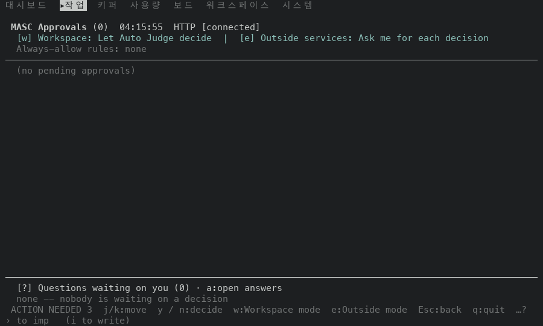 | 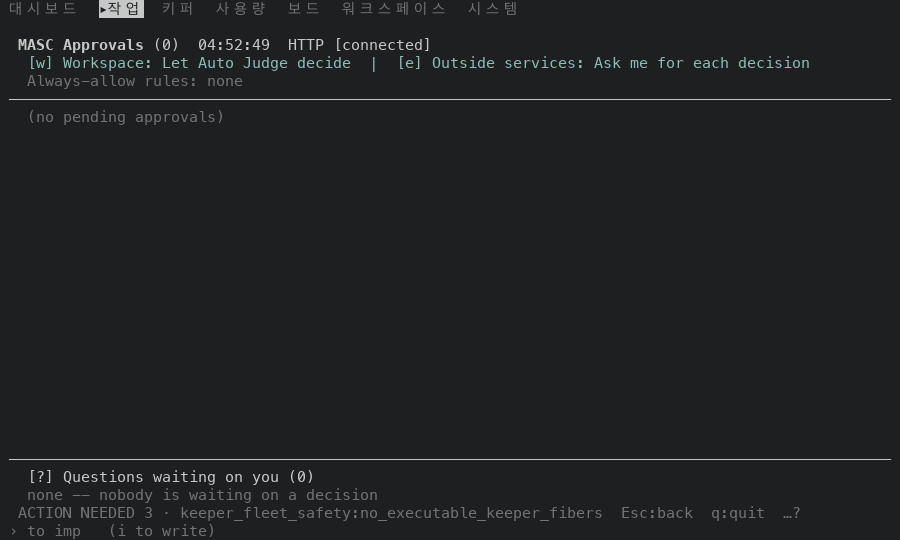 |
| 알림 있음, 승인·질문 없음, 80x24 | 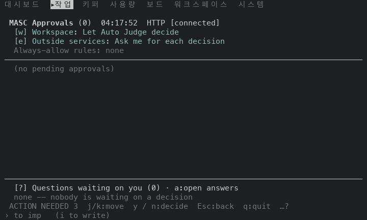 | 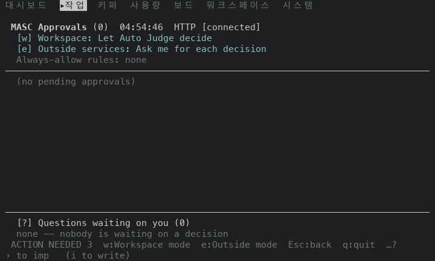 |
| 알림 없음, 승인·질문 없음, 100x30 | 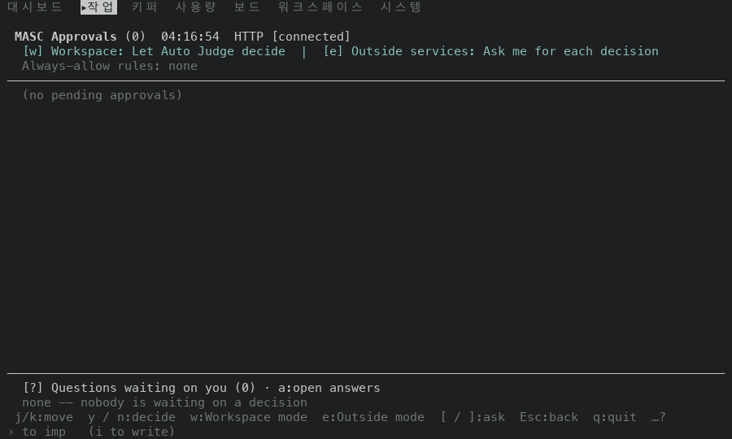 | 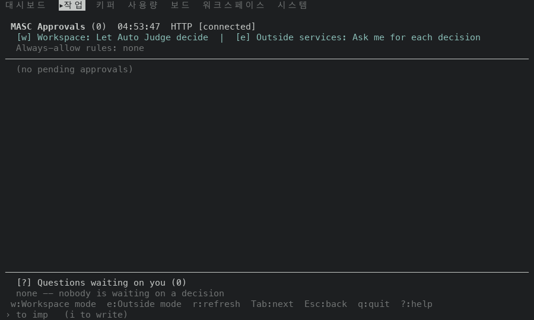 |
| 알림 없음, 승인·질문 없음, 80x24 | 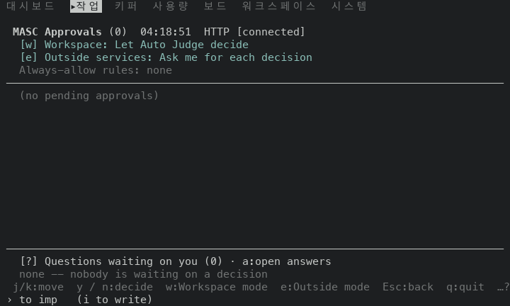 | 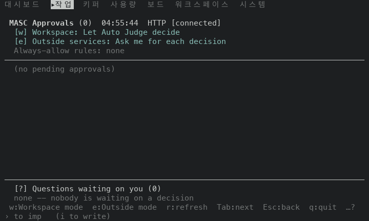 |
| 알림 없음, 승인 두 줄, 100x30 | 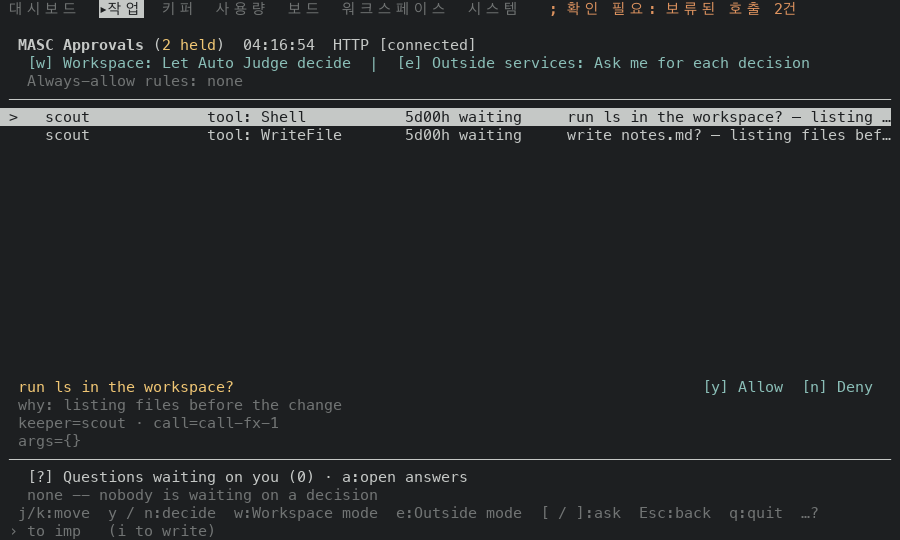 | 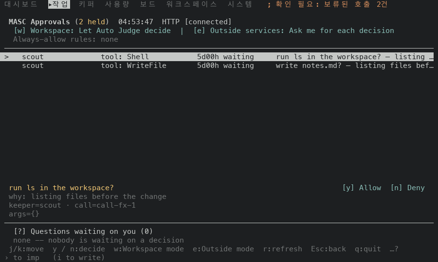 |
| 알림 없음, 승인 두 줄, 80x24 | 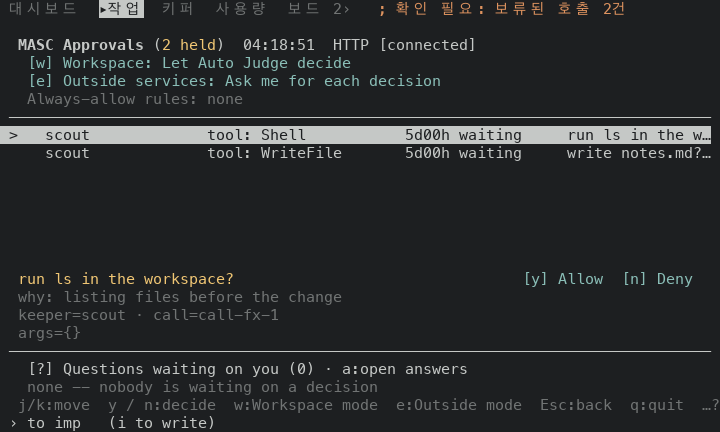 | 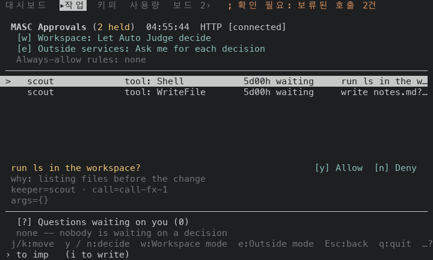 |
| 알림 없음, 질문 한 줄(커서 있음), 100x30 | 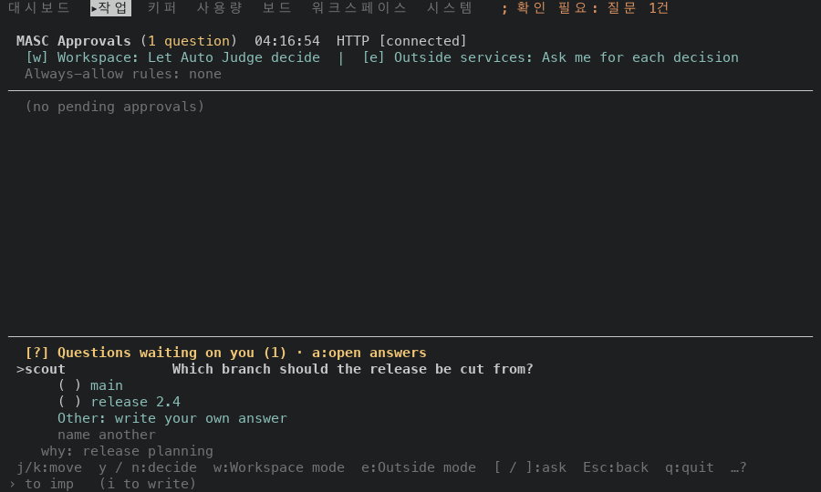 | 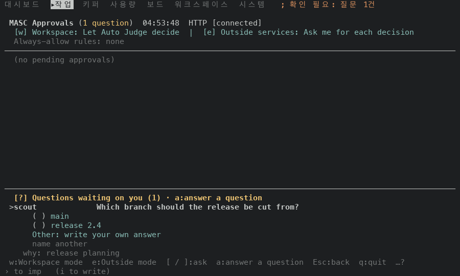 |
| 알림 없음, 질문 한 줄(커서 있음), 80x24 | 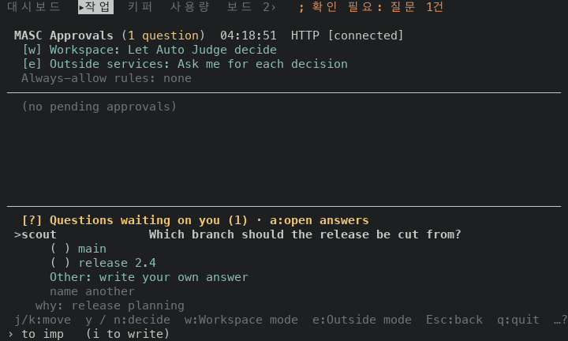 | 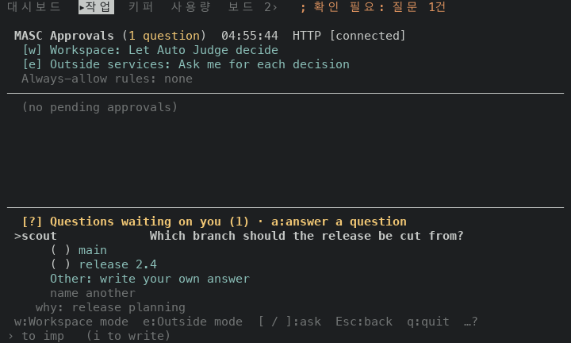 |
| 알림 없음, 질문이 있는데 커서가 없음, 100x30 | 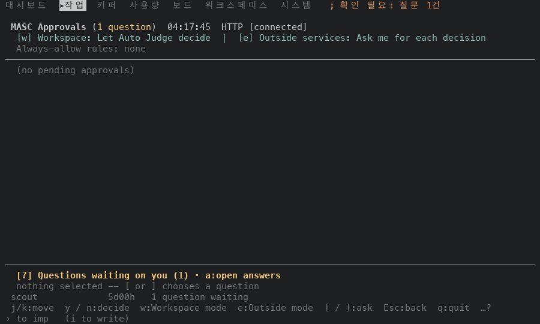 | 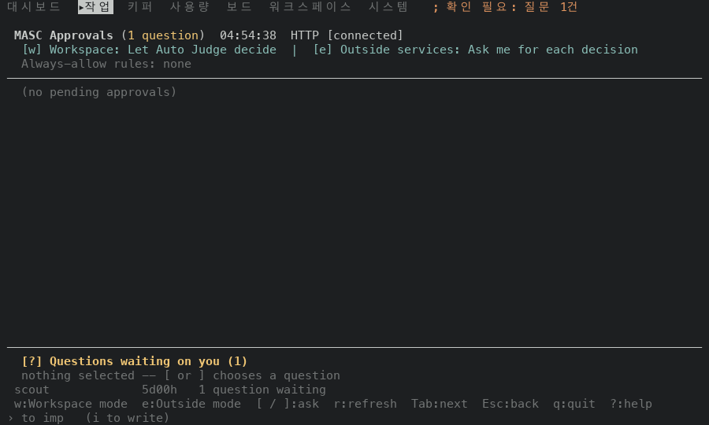 |
| 알림 없음, 질문이 있는데 커서가 없음, 80x24 | 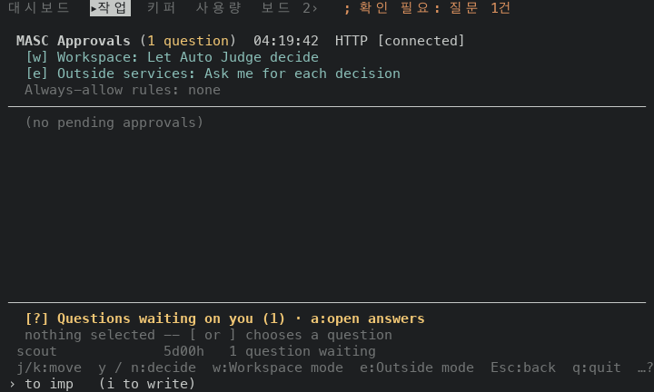 | 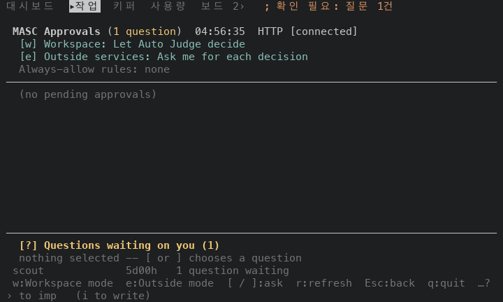 |
| 알림 없음, Lane Add-on 질문, 100x30 | 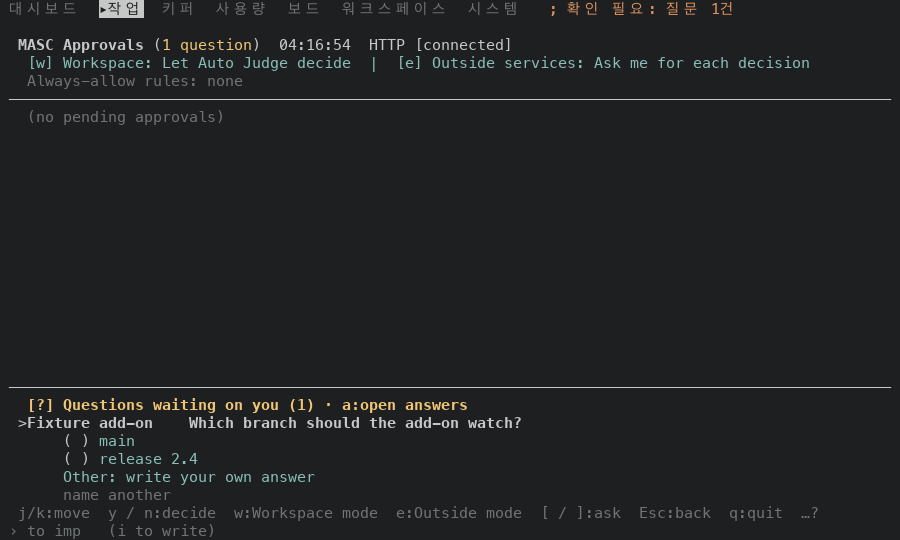 |  |
| 알림 없음, Lane Add-on 질문, 80x24 | 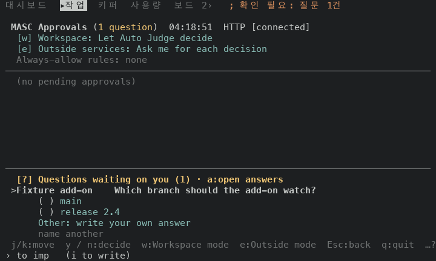 |  |
| 알림 없음, 승인 두 줄과 질문 한 줄, 100x30 | 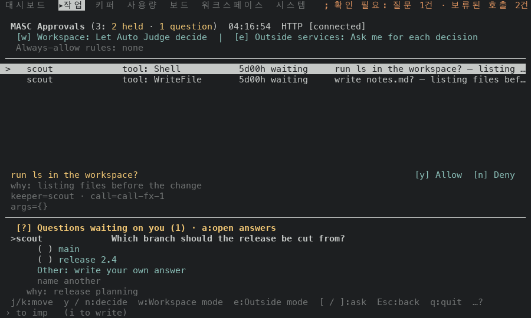 |  |

## 재지 않은 것

- 승인이 셋 이상이거나 질문이 둘 이상인 목록. 질문이 둘 이상이면 `[ / ]` 가 질문을 옮겨요. 고치기 전 빌드의 `[ / ]` 는 이 경우를 눌러 보지 않았어요.
- 승인 상세(`Enter` 로 연 화면)와 질문에 답하는 화면의 푸터. 이 PR 은 바꾸지 않아요.
- Gate 승인 줄과 운영자 승인 줄. 승인 줄은 보류된 도구 호출만 먹였어요. 세 종류는 같은 목록(`approval_items`)에 있어서 `approvals` 는 길이만 봐요.
- 마지막 답의 출처만 남은 상태(질문이 없는데 `o / O` 가 움직이는 경우). 시험 파일은 이 조합(`source = true`, 질문 없음)을 확인하지만 화면으로는 재지 않았어요.
- 120x35 이상의 크기, 알림 이유 문구가 다른 서버 환경.
