# 빈 Goals 푸터가 행이 있어야 하는 키를 빼요, Workspace `v` 와 빈 목록 제목도 고쳐요: 고치기 전과 후 (#50094)

## 어떻게 쟀나

일회용 워크스페이스에 서버를 띄우고, TUI 와 서버 사이에 답만 바꿔 주는 중계를 뒀어요. #50076, #50081, #50087 과 같은 방식이에요.

- `GET /api/v1/dashboard/planning`: 행이 있는 경우에 Goal 한 줄(`goal-fx-1`, 단계 `executing`, 우선순위 P2, 갱신 시각은 요청보다 5시간 30분 전)을 끼워 줘요. 행이 없는 경우는 중계가 답을 바꾸지 않아요. 새 워크스페이스의 서버가 준 빈 목록이에요.
- `GET /api/v1/repositories`: 읽기 실패 경우에 `repositories` 목록이 없는 답을 줘요. TUI 가 이 답을 읽지 못해서 `missing required field 'repositories'` 를 보여 줘요.
- `GET /health`: 일회용 서버는 `ACTION NEEDED 3` 을 내요(이유 3개, 첫째가 `keeper_fleet_safety:no_executable_keeper_fibers`). 서버가 필요한 운영자 조치를 알리지 않으면 이 알림이 없어서, 알림 없는 환경은 `operator_action_required` 를 `false` 로, `operator_action_reasons` 를 빈 목록으로 바꿔서 따로 쟀어요.

tmux 3.6a 안의 TUI 로 명령 팔레트에서 `go Work`(Goals 탭이 열려요), `go Workspace` 를 열고 찍었어요. 알림 있는 환경은 화면에 `ACTION NEEDED` 가 보일 때까지 최대 40초 기다렸고, 알림 없는 환경은 15초 가만히 뒀어요. 크기는 100x30 과 80x24 예요. 행은 가짜 값이에요.

- 고치기 전: 부모 층 #50087 코드 커밋 `4e3dae8457f5` 의 증명 빌드 run 42504950261(성공), `masc-tui` sha256 `bb2973c4b28f6a3c77f92865a35f1f46efd667b9e9270dd7b8c943d7289cf5c3`, `--build-commit` 이 같아요.
- 고친 뒤: 이 PR 코드 커밋 `3b2d043f27b3` 의 증명 빌드 run 42508812178(성공), `masc-tui` sha256 `6d661bcb3ec3cbc56ff9bcf47af649097d3cc6865bf9389bb6bfd22a81f71596`, `--build-commit` 이 같아요. 영수증(`receipt.json`)의 소스 커밋 `3b2d043f27b30369da9f2cb6466aa4658c7779e2` 를 검증했어요.
- 두 빌드 사이에 바뀐 코드 파일: `bin/masc_tui_keys.ml`, `bin/masc_tui_keys.mli`, `bin/masc_tui_render_work.ml`, `bin/masc_tui_render_repositories.ml`, `test/test_tui_footer_detail_state.ml`, `test/test_tui_footer_row_need.ml`.

## 읽는 법

- Goals 푸터는 목록이 비어 있어도 `z`, `j/k`, `Right / Enter` 를 앞에 그렸어요. 이 PR 은 키 표에서 Goals 의 행 키에 `Needs_row` 를 달고, 목록 렌더러가 행이 없다고 말하면 푸터에서 빼요.
- 핸들러의 조건과 같아요. 눌러 본 결과는 아래 「눌러 본 결과」 표에 있고, 여기에는 핸들러가 끝나는 자리만 적어요.
  - `Right / Enter` 와 `z`: `open_planning_detail` 이 `List.nth_opt` 로 Goal 을 못 찾으면 `()` 로 끝나요. `z` 는 `open_candle` 이 같은 함수를 거쳐요.
  - `/`: 검색 원본(`surface_row_texts`)의 `Planning_list` 갈래가 보이는 Goal 이 없으면 `None` 이라 검색줄이 안 열려요.
  - 이동·페이지·처음/끝·`n / N`: `row_list` 의 `Planning_list` 갈래가 `rl_count = 0` 을 줘요. 렌더러가 세는 행 수와 `rl_count` 는 같은 식(`planning_visible_goals ~filter ~sort`)이에요.
  - `b`, `t`, `p`, `v`, `f`, `s` 는 행을 안 봐요. 필터가 Goal 을 다 가렸을 때 `f` 로 되돌려요. 그래서 이 키들은 푸터에 남아요.
  - `t` 로 Tasks 에 포커스를 주면 `render_planning` 이 `render_work_tasks` 를 그려요. 그 푸터는 따로 있어서(`footer_hints_work_tasks`) 이 PR 이 바꾸는 Goals 푸터가 아니에요.
- Workspace 의 `v` 는 행이 아니라 읽을 화면이 있어야 해요. 저장소를 고른 경우에 그 저장소를 읽고, 목록 읽기가 실패한 경우에는 저장소가 없어도 그 실패를 열어요. #50087 에서 `v` 를 `Needs_row` 로 달았더니 읽기 실패 뒤 푸터에서 `v` 가 사라졌어요(#50087 리뷰 P3). 이 PR 은 `Needs_reading` 을 새로 달고, 렌더러가 `selected_repository_reading` 이 있는지를 푸터에 알려요.
- `…?` 는 폭이 모자라 키 일부를 숨겼다는 표시예요.
- 화면 맨 아래 `› to imp   (i to write)` 줄은 모든 화면에 같은 모양으로 있는 메시지 입력줄이에요. 이 PR 과 관계없어요.

## 푸터: 서버가 `ACTION NEEDED` 를 내는 환경

| 화면 | 크기 | 고치기 전 푸터 | 고친 뒤 푸터 |
| --- | --- | --- | --- |
| Goals, 행이 없는 목록 | 100x30 | `ACTION NEEDED 3  z:Candle  j/k:move  t:Goals / Tasks  Right / Enter:detail  Esc:back  q:quit  …?` | `ACTION NEEDED 3 · keeper_fleet_safety:no_executable_keeper_fibers  Esc:back  q:quit  …?` |
| Goals, 행이 없는 목록 | 80x24 | `ACTION NEEDED 3  z:Candle  Right / Enter:detail  Esc:back  q:quit  …?` | `ACTION NEEDED 3  t:Goals / Tasks  p:Approvals  Esc:back  q:quit  …?` |
| Workspace, 목록 읽기 실패 | 100x30 | `ACTION NEEDED 3 · keeper_fleet_safety:no_executable_keeper_fibers  a:add  Esc:back  q:quit  …?` | `ACTION NEEDED 3 · keeper_fleet_safety:no_executable_keeper_fibers  Esc:back  q:quit  …?` |
| Workspace, 목록 읽기 실패 | 80x24 | `ACTION NEEDED 3  a:add  Esc:back  /:find  r:refresh  Tab:next  q:quit  ?:help` | `ACTION NEEDED 3  v:full details  a:add  Esc:back  /:find  q:quit  …?` |

행이 있는 Goals 는 두 크기 모두 푸터가 같아요.

이 환경에서 100x30 은 쓸 수 있는 키가 줄어요.

- Goals(행 없음): 고치기 전에 보이던 `t:Goals / Tasks` 가 가려지고 `Esc:back  q:quit` 만 남아요. 안 움직이던 `z`, `j/k`, `Right / Enter` 는 같이 빠져요.
- Workspace(읽기 실패): 고치기 전에 보이던 `a:add` 가 가려져요. 새로 들어간 `v:full details` 도 폭이 모자라 같이 밀려요.
- 원인은 푸터가 알림을 키보다 먼저 두고 키를 뒤에서부터 버리는 규칙이에요(`masc_tui_footer.ml` 의 `drop_hint_items`). 안 움직이던 키가 빠지면 그 폭을 긴 이유 문구(`ACTION NEEDED 3 · keeper_fleet_safety:no_executable_keeper_fibers`)가 차지해요. #50087 의 Changes 에서도 `[ / ]:keeper` 가 같은 이유로 가려졌어요. 이 PR 은 이 우선순위(#49925)를 건드리지 않았어요.
- 80x24 는 알림이 짧은 모양(`ACTION NEEDED 3`)이라서 Goals 는 `t`, `p` 가 보이고, Workspace 는 `v` 가 보이는 대신 `r:refresh`, `Tab:next`, `?:help` 가 `…?` 로 밀려요.

## 푸터: 알림이 없는 환경

| 화면 | 크기 | 고치기 전 푸터 | 고친 뒤 푸터 |
| --- | --- | --- | --- |
| Goals, 행이 없는 목록 | 100x30 | `z:Candle  j/k:move  t:Goals / Tasks  p:Approvals  Right / Enter:detail  Esc:back  q:quit  …?` | `t:Goals / Tasks  p:Approvals  v:next Work tab  f:filter  s:sort  b:summary  Esc:back  q:quit  …?` |
| Goals, 행이 없는 목록 | 80x24 | `z:Candle  j/k:move  Right / Enter:detail  Esc:back  q:quit  …?` | `t:Goals / Tasks  p:Approvals  v:next Work tab  f:filter  Esc:back  q:quit  …?` |
| Workspace, 목록 읽기 실패 | 100x30 | `a:add  Esc:back  /:find  r:refresh  Tab:next  q:quit  ?:help` | `v:full details  a:add  Esc:back  /:find  r:refresh  Tab:next  q:quit  ?:help` |
| Workspace, 목록 읽기 실패 | 80x24 | `a:add  Esc:back  /:find  r:refresh  Tab:next  q:quit  ?:help` | `v:full details  a:add  Esc:back  /:find  r:refresh  Tab:next  q:quit  ?:help` |

행이 있는 Goals 와 행이 없는 Workspace 는 두 크기 모두 푸터가 같아요. 알림이 없으면 키가 줄지 않아요.

- Goals(행 없음) 100x30: 동작하는 키 `t p v f s b` 가 모두 보여요. 고치기 전에는 안 움직이는 `z`, `j/k`, `Right / Enter` 가 앞에 있었고 `v f s b` 는 폭이 모자라 `…?` 뒤로 밀렸어요. 80x24 는 `t p v f` 가 보여요.
- Workspace(읽기 실패): `v:full details` 가 새로 보이고 나머지 키는 그대로 다 들어가요.

## 고치기 전 빌드에서 행 없는 Goals 의 푸터 키를 눌러 본 결과(100x30)

목록에 들어간 뒤 키 하나를 누르고 화면을 이전 화면과 견줬어요. 제목·탭 줄과 시각 숫자는 뺐어요. 누를 때마다 Goals 목록에 다시 들어갔고, 값이 남는 `f`, `s` 는 맨 끝에 눌렀어요.

| 글자와 색이 그대로 | 알림 한 줄만 바뀜 | 다른 일이 일어남 |
| --- | --- | --- |
| `j` `k` `Down` `Up` `PageDown` `PageUp` `Home` `End` `Right` `Enter` `z` `/` `n` `N` | `Y`(`nothing on this surface has a link`) | `b`(요약 화면이 열려요), `t`(Tasks), `p`(Approvals), `v`(다음 Work 탭), `f`(필터 `미종결` → `완료`), `s`(정렬 `단계/우선순위` → `최근 갱신`) |

고친 뒤 빌드에서 같은 키를 같은 순서로 눌렀고 결과 분류가 같았어요(키 처리는 바뀌지 않았어요).

`t` 로 연 Tasks 화면의 푸터는 두 빌드가 같아요(Task 가 없는 환경에서 쟀어요): `ACTION NEEDED 3  j/k:select  t / Esc:Goals  Enter:detail  r:refresh  Tab:next  q:quit  ?:help`. Tasks 포커스에서는 Goals 푸터가 아니라 이 푸터가 그려져요.

Workspace 는 목록 읽기가 실패한 뒤 100x30 에서 두 키를 눌러 봤어요. 두 빌드의 결과가 같아요.

- `v`: `Workspace / inventory` 읽기 화면이 열리고 `Read failed`, `missing required field 'repositories'` 가 보여요. 고치기 전 빌드는 이 키를 푸터에 안 그렸어요.
- `Enter`: 화면이 그대로예요.

## 빈 Workspace 목록의 패널 제목

저장소가 0개일 때 목록 제목이 `Repositories · j/k select` 였어요. 행이 없으면 `j/k` 는 아무것도 안 해요. 이 PR 은 행이 없을 때 `Repositories` 만 써요.

| 크기 | 고치기 전 제목 | 고친 뒤 제목 |
| --- | --- | --- |
| 100x30 | `┌ Repositories · j/k select ─…` | `┌ Repositories ─…` |
| 80x24 | `┌ Repositories · j/k select ─…` | `┌ Repositories ─…` |

저장소가 있으면 제목은 `Repositories · j/k select` 그대로예요.

## 두 빌드가 같아야 하는 단계

시각과 날짜는 빼고 화면 전체를 견줬어요.

- 행이 있는 Goals: 두 크기 모두 푸터를 포함해 화면이 같아요(0줄 차이).
- 행이 있는 Workspace 와 Changes: 두 크기 모두 화면이 같아요(네 경우 모두 0줄 차이). 제목 변경은 행이 없을 때만 일어나요.
- 행이 없는 Workspace: 화면에서 다른 줄은 목록 제목 한 줄뿐이에요(두 크기 모두 2줄 차이). 푸터는 같아요. 행이 없는 Changes 는 두 크기 모두 0줄 차이예요.
- 행이 없는 Goals: 화면에서 다른 줄은 푸터 한 줄뿐이에요(두 크기 모두 2줄 차이: 고치기 전 한 줄, 고친 뒤 한 줄).

## 화면

알림이 있는 환경이에요(알림 없는 환경은 맨 아래 두 줄).

| 화면 | 고치기 전 | 고친 뒤 |
| --- | --- | --- |
| Goals, 행 없음, 100x30 |  |  |
| Goals, 행 없음, 80x24 | 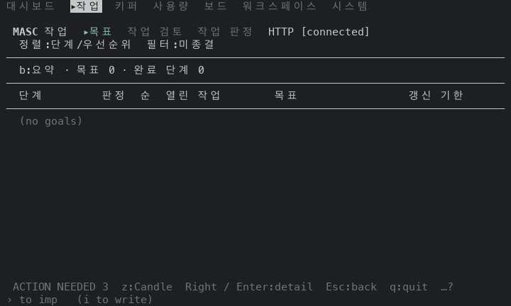 |  |
| Workspace, 읽기 실패, 100x30 | 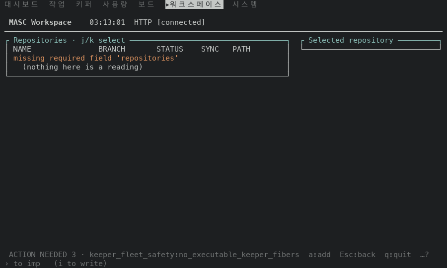 |  |
| Workspace, 읽기 실패, 80x24 | 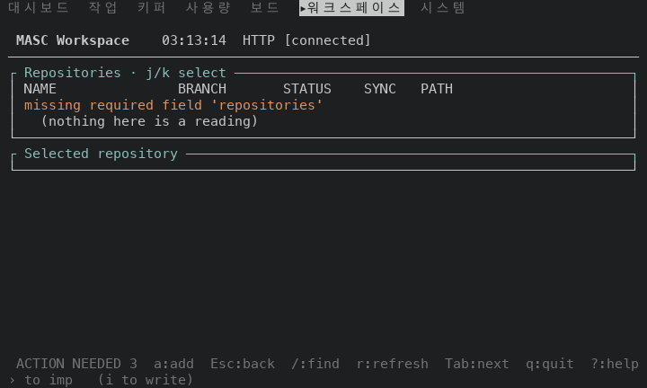 | 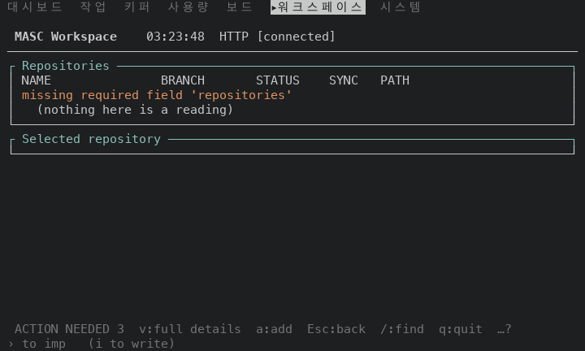 |
| Workspace, 행 없음, 100x30 | 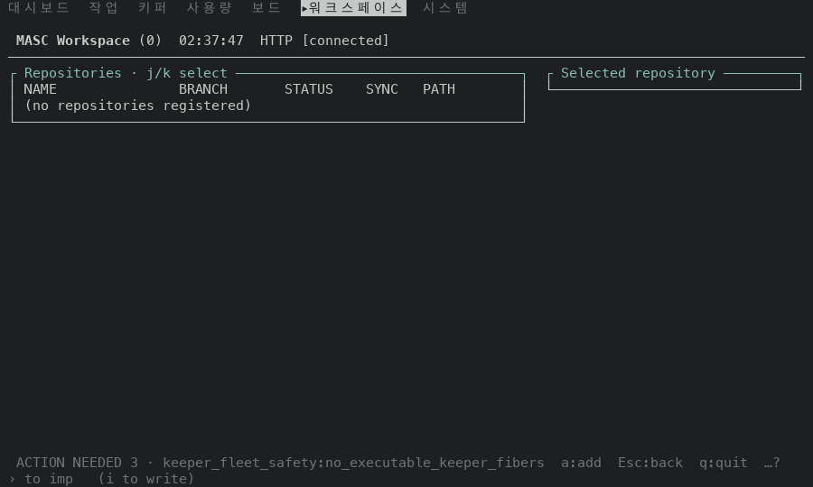 |  |
| Workspace, 행 없음, 80x24 | 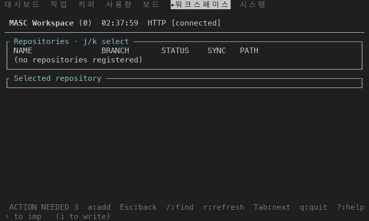 | 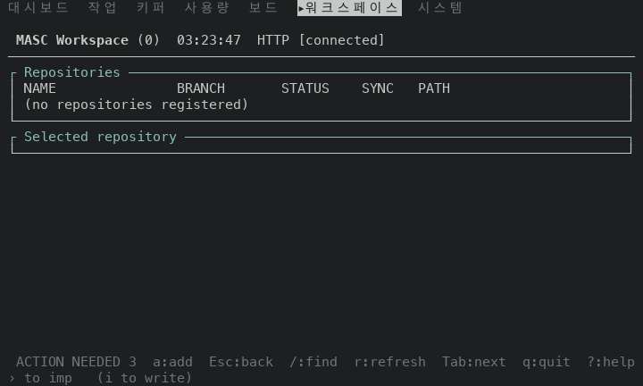 |
| 알림 없음, Goals, 행 없음, 100x30 | 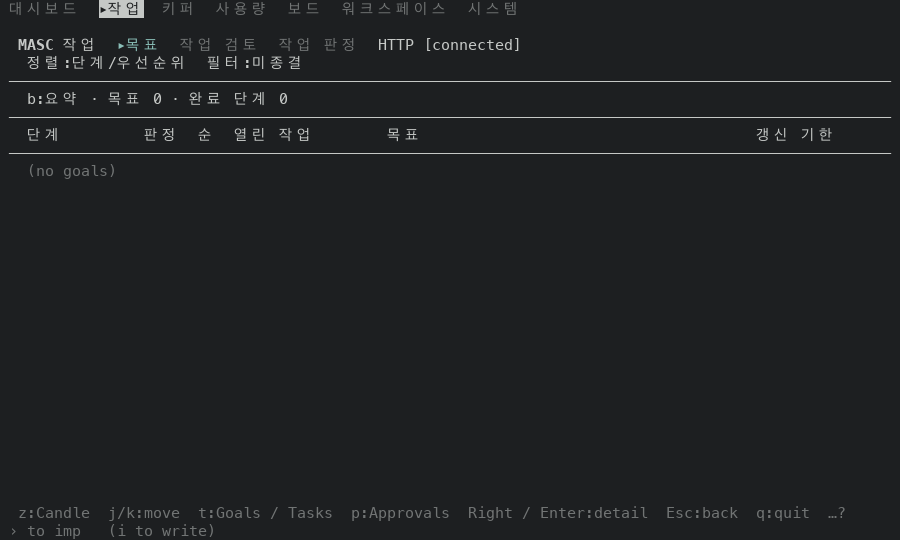 | 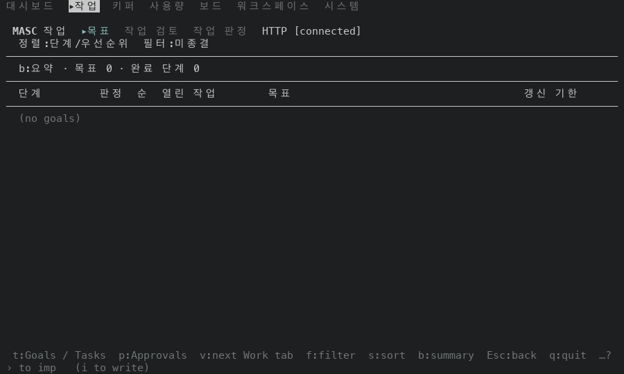 |
| 알림 없음, Workspace, 읽기 실패, 100x30 | 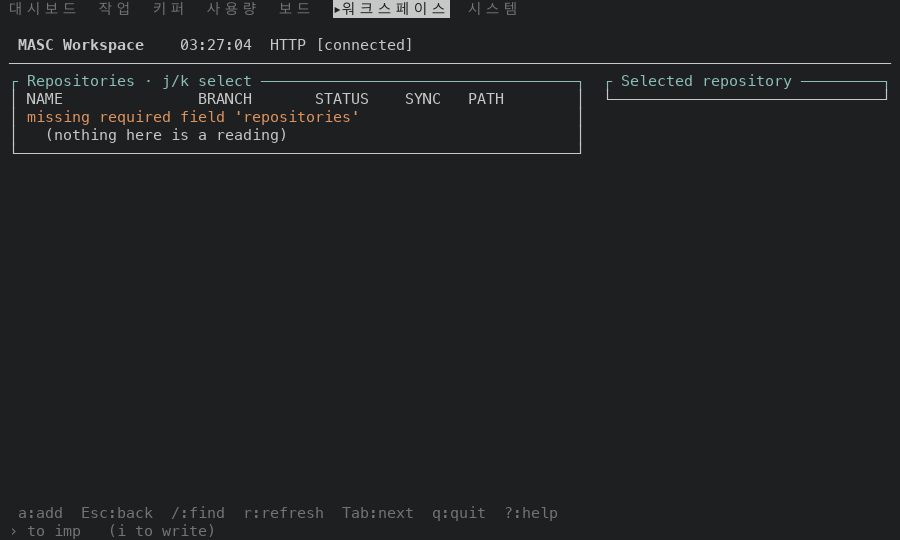 |  |

행이 있는 Goals 는 푸터가 같아서 고친 뒤 화면만 실어요(100x30): 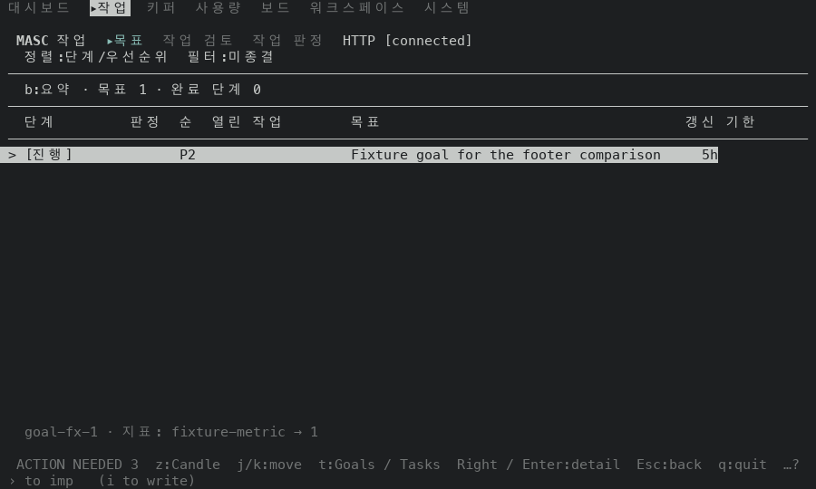

읽기 실패 뒤 `v` 를 누른 화면(고친 뒤 빌드, 100x30): 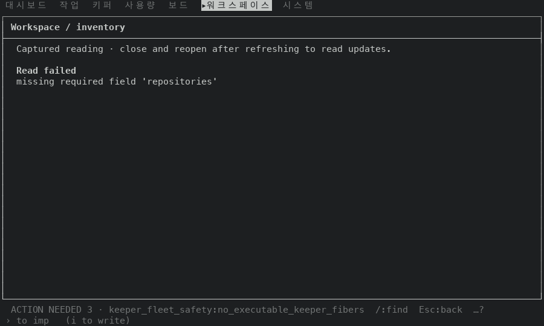

## 재지 않은 것

- 실제 서버가 보낸 Goal 과 저장소. 위 행은 중계가 만든 가짜 값이에요.
- Goal 이 둘 이상이고 커서가 끝에 있는 목록. 필터나 정렬이 Goal 을 다 가린 목록(`f` 를 누르면 이 상태가 돼요)의 푸터.
- Goals 의 `Esc`, `r`, `q`, `?` 를 눌러 본 결과. 푸터에는 그리지만 이 PR 이 바꾸지 않았어요.
- Workspace 의 `a` 를 `$EDITOR` 가 설정된 환경에서 누른 결과.
- 120x35 이상의 크기, 푸터 키 표시를 끈 설정.
- `test/test_tui_footer_row_need.ml` 에 더한 시험 세 개와 `test/test_tui_footer_detail_state.ml` 의 호출 두 곳. PR 의 CI 는 타입 검사만 해서 실행되지 않았어요. 읽어서만 맞춰 봤어요.
- Approvals, Code 의 빈 목록 푸터. 이 PR 에서 고치지 않았어요.
