# 빈 Task Review·Fusion·Clients 푸터가 행이 있어야 하는 키를 빼요: 고치기 전과 후 (#50081)

## 어떻게 쟀나

일회용 워크스페이스에 서버를 띄우고, TUI 와 서버 사이에 세 답만 바꿔 주는 중계를 뒀어요. #50076 과 같은 방식이에요.

- `GET /api/v1/verification/requests`: 행이 있는 경우에 검토 요청 한 줄(`req-fx-001`, 제출자 `keeper-fx`, 계약 `tests pass`)을 끼워 줘요.
- `GET /api/v1/dashboard/fusion-runs`: 행이 있는 경우에 끝난 실행 한 줄(`fusion-fx-001`, 프리셋 `fixture-preset`, 판정 `accept`)을 끼워 줘요.
- `GET /api/v1/dashboard/clients`: 행이 있는 경우에 클라이언트 한 줄(`client-fx`, 상태 `active`)을 끼워 줘요.
- 행이 없는 경우는 중계가 답을 바꾸지 않아요. 새 워크스페이스의 서버가 준 빈 목록이에요.

tmux 3.6a 안의 TUI 로 명령 팔레트에서 `go Task Review`, `go Fusion`, `go Clients` 를 열고, 화면에 `ACTION NEEDED` 가 보일 때까지 최대 40초 기다린 뒤 찍었어요. 고치기 전 80x24 Task Review 는 푸터가 이 문구를 밀어내서 40초를 다 기다리고 찍었어요. 크기는 100x30 과 80x24 예요. 행은 가짜 값이에요.

- 고치기 전: 부모 층 #50076 코드 커밋 `cdd3b6196f46` 의 증명 빌드 run 42497759710(성공), `masc-tui` sha256 `e2aad98ea8b961344faf18d060f7d8e7665276784db2fd63ea7691ca950c41ac`, `--build-commit` 이 같아요.
- 고친 뒤: 이 PR 코드 커밋 `23bf52c55df8` 의 증명 빌드 run 42501883344(성공), `masc-tui` sha256 `42abd3a66a1747ffe580f8f0715b37ddd43f022527098922d3fdb40ce20daa25`, `--build-commit` 이 같아요. 영수증(`receipt.json`)의 소스 커밋 `23bf52c55df8bae39d014f8605b28f671985e492` 를 검증했어요.
- 두 빌드 사이에 바뀐 파일: `bin/masc_tui_keys.ml`, `bin/masc_tui_render_fusion.ml`, `bin/masc_tui_render_lanes.ml`, `bin/masc_tui_render_verification.ml`, `bin/masc_tui_render_work.ml`, `test/test_tui_footer_row_need.ml`. `masc_tui_render_work.ml` 은 #50076 의 `08417af98905` 가 주석 위치만 옮긴 거예요(코드는 같아요). 이 PR 의 변경은 나머지 다섯 파일이에요.

## 읽는 법

- 푸터는 목록이 비어 있어도 `j/k`, `PgUp/PgDn`, `Enter` 같은 행 키를 앞에 그렸어요. 이 PR 은 키 표에서 이 키들에 `Needs_row` 를 달고, 목록 렌더러가 행이 없다고 말하면 푸터에서 빼요.
- 핸들러의 조건과 같아요.
  - Task Review 의 `a` 와 `x` 는 `verification_cursor_row` 가 `None` 이면 아무것도 안 해요.
  - Fusion 의 `K` 와 `B` 는 고른 실행이 없으면 알림 한 줄만 띄워요.
  - 이동·페이지 키는 `row_list` 의 `rl_count = 0` 에서 끝나요.
- `…?` 는 폭이 모자라 키 일부를 숨겼다는 표시예요.

## 푸터

| 화면 | 크기 | 고치기 전 푸터 | 고친 뒤 푸터 |
| --- | --- | --- | --- |
| Task Review, 행이 없는 목록 | 100x30 | `ACTION NEEDED 3  j/k:move  Right / Enter:details  Esc:back  a / x:approve / reject  q:quit  …?` | `ACTION NEEDED 3 · keeper_fleet_safety:no_executable_keeper_fibers  Esc:back  q:quit  …?` |
| Task Review, 행이 없는 목록 | 80x24 | `j/k:move  Right / Enter:details  Esc:back  a / x:approve / reject  q:quit  …?` | `ACTION NEEDED 3  v:next Work tab  h:queue / history  Esc:back  q:quit  …?` |
| Task Review, 행이 있는 목록 | 100x30 | `ACTION NEEDED 3  j/k:move  Right / Enter:details  Esc:back  a / x:approve / reject  q:quit  …?` | `ACTION NEEDED 3  j/k:move  Right / Enter:details  Esc:back  a / x:approve / reject  q:quit  …?` (같음) |
| Task Review, 행이 있는 목록 | 80x24 | `j/k:move  Right / Enter:details  Esc:back  a / x:approve / reject  q:quit  …?` | `j/k:move  Right / Enter:details  Esc:back  a / x:approve / reject  q:quit  …?` (같음) |
| Fusion, 행이 없는 목록 | 100x30 | `ACTION NEEDED 3  j/k:move  PgUp/PgDn:page  K:calling Keeper  Enter:open  Esc:back  q:quit  …?` | `ACTION NEEDED 3 · keeper_fleet_safety:no_executable_keeper_fibers  a:new run  Esc:back  q:quit  …?` |
| Fusion, 행이 없는 목록 | 80x24 | `ACTION NEEDED 3  j/k:move  PgUp/PgDn:page  Enter:open  Esc:back  q:quit  …?` | `ACTION NEEDED 3  a:new run  Esc:back  r:refresh  Tab:next  q:quit  ?:help` |
| Fusion, 행이 있는 목록 | 100x30 | `ACTION NEEDED 3  j/k:move  PgUp/PgDn:page  K:calling Keeper  Enter:open  Esc:back  q:quit  …?` | `ACTION NEEDED 3  j/k:move  PgUp/PgDn:page  K:calling Keeper  Enter:open  Esc:back  q:quit  …?` (같음) |
| Fusion, 행이 있는 목록 | 80x24 | `ACTION NEEDED 3  j/k:move  PgUp/PgDn:page  Enter:open  Esc:back  q:quit  …?` | `ACTION NEEDED 3  j/k:move  PgUp/PgDn:page  Enter:open  Esc:back  q:quit  …?` (같음) |
| Clients, 행이 없는 목록 | 100x30 | `ACTION NEEDED 3  j/k:move  PgUp/PgDn:page  Enter:detail  p / Esc:runtime  q:quit  …?` | `ACTION NEEDED 3 · keeper_fleet_safety:no_executable_keeper_fibers  p / Esc:runtime  q:quit  …?` |
| Clients, 행이 없는 목록 | 80x24 | `ACTION NEEDED 3  j/k:move  Enter:detail  p / Esc:runtime  q:quit  …?` | `ACTION NEEDED 3  p / Esc:runtime  r:refresh  Tab:next  q:quit  ?:help` |
| Clients, 행이 있는 목록 | 100x30 | `ACTION NEEDED 3  j/k:move  PgUp/PgDn:page  Enter:detail  p / Esc:runtime  q:quit  …?` | `ACTION NEEDED 3  j/k:move  PgUp/PgDn:page  Enter:detail  p / Esc:runtime  q:quit  …?` (같음) |
| Clients, 행이 있는 목록 | 80x24 | `ACTION NEEDED 3  j/k:move  Enter:detail  p / Esc:runtime  q:quit  …?` | `ACTION NEEDED 3  j/k:move  Enter:detail  p / Esc:runtime  q:quit  …?` (같음) |

행이 없는 목록에서 푸터가 고르는 것이 바뀌었어요.

- 100x30 Task Review·Clients: `ACTION NEEDED` 이유가 길게 나오고 키는 `Esc:back  q:quit`(Clients 는 `p / Esc:runtime  q:quit`)만 보여요. 이 PR 은 푸터가 알림 이유를 키보다 먼저 그리는 우선순위(#49925)를 건드리지 않았어요. 눈에 보이는 키가 늘지 않아요.
- 100x30 Fusion: `a:new run` 이 보여요. 고치기 전에는 `…?` 뒤에 있었어요.
- 80x24 Task Review: `v:next Work tab`, `h:queue / history` 가 보이고 `ACTION NEEDED 3` 알림이 돌아와요. 고치기 전에는 키 줄이 길어서 알림이 밀려나 있었어요.
- 80x24 Fusion: `a:new run`, `r:refresh`, `Tab:next`, `?:help` 가 모두 들어가서 `…?` 가 사라져요.
- 80x24 Clients: `r:refresh`, `Tab:next`, `?:help` 가 보여요.

## 고치기 전 빌드에서 푸터에 떠 있던 키를 눌러 본 결과(100x30)

목록에 들어간 뒤 키 하나를 누르고 화면을 이전 화면과 견줬어요. 제목·탭 줄과 시각·날짜 숫자는 뺐어요. 누를 때마다 목록 화면에 다시 들어갔어요.

| 화면 | 글자와 색이 그대로 | 알림 한 줄만 바뀜 | 다른 일이 일어남 |
| --- | --- | --- | --- |
| Task Review(행 없음) | `j` `k` `Down` `Up` `PageDown` `PageUp` `Home` `End` `Right` `Enter` `a` `x` `y` `n` `N` `K` `B` `e` `d` | `Y`(`nothing on …`) | `/`(푸터에 검색 입력줄이 열려요), `v`(Task Verdicts 로 이동), `h` `w` `o`(머리글이 `[awaiting 0]` 에서 `[history 0 of 0]` 으로 바뀌어요) |
| Fusion(행 없음) | `j` `k` `Down` `Up` `PageDown` `PageUp` `Home` `End` `Right` `Enter` `x` `y` `n` `N` `/` `e` `d` `v` `h` `w` `o` | `Y`(`nothing on this surface has a link`), `K`(`The calling Keeper is not in the current roster`), `B`(`Open a Fusion run to follow its Board evidence`) | `a`(실행을 만드는 양식이 열려요) |
| Clients(행 없음) | `j` `k` `Down` `Up` `PageDown` `PageUp` `Home` `End` `Right` `Enter` `a` `x` `y` `n` `N` `/` `K` `B` `e` `d` `v` `h` `w` `o` | `Y`(`nothing on this surface has a link`) | 없음 |

고친 뒤 빌드에서는 `j` `k` `Down` `Up` `PageDown` `PageUp` `Home` `End` `Right` `Enter` `a` `x` `y` `n` `N` `/` `Y` `K` `B` 를 같은 순서로 눌렀고, 키마다 결과 분류가 같았어요(키 처리는 바뀌지 않았어요). `e` `d` `v` `h` `w` `o` 는 고친 뒤 빌드에서 누르지 않았어요.

## 두 빌드가 같아야 하는 단계

시각과 날짜는 빼고 화면 전체를 견줬어요.

- 행이 있는 Task Review·Fusion·Clients: 두 크기 모두 푸터를 포함해 화면이 같아요(위 표의 `(같음)`, 여섯 경우 모두 0줄 차이).
- 행이 없는 목록: 화면에서 다른 줄은 푸터 한 줄뿐이에요(여섯 경우 모두 2줄 차이: 고치기 전 한 줄, 고친 뒤 한 줄).

## 화면

| 화면 | 고치기 전 | 고친 뒤 |
| --- | --- | --- |
| Task Review, 행 없음, 100x30 | 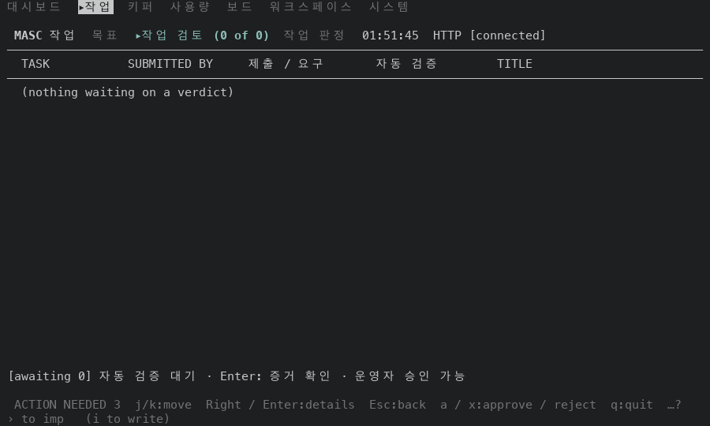 | 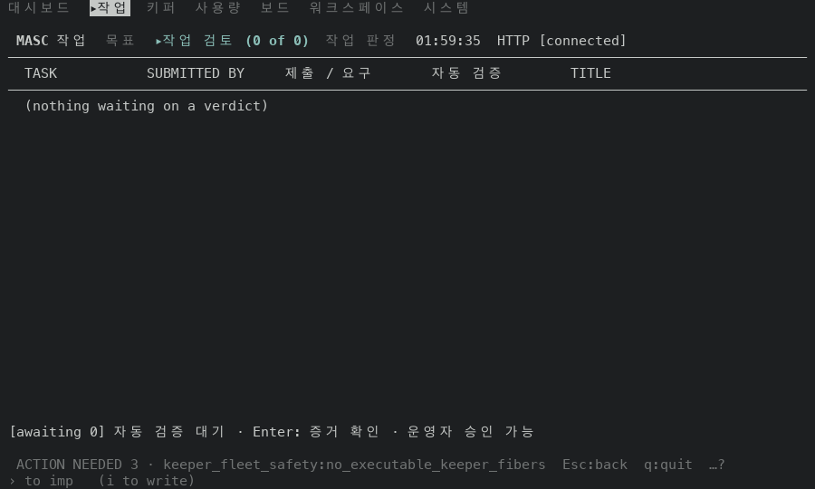 |
| Task Review, 행 없음, 80x24 | 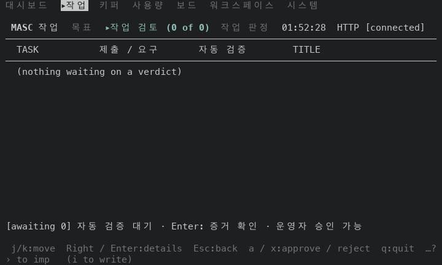 |  |
| Fusion, 행 없음, 100x30 | 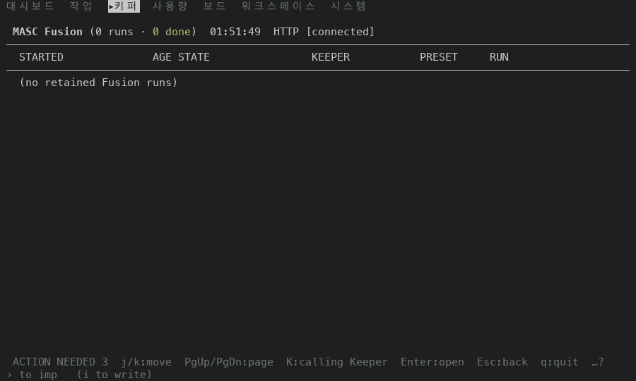 | 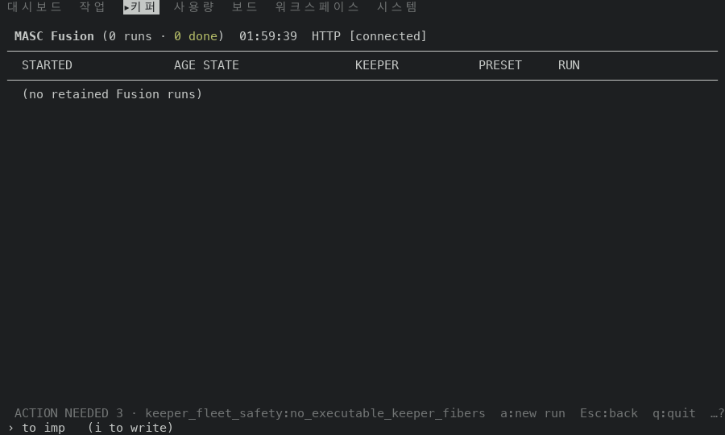 |
| Fusion, 행 없음, 80x24 | 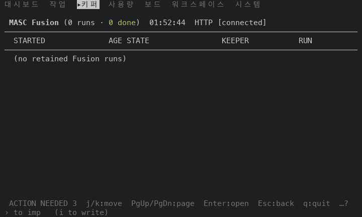 | 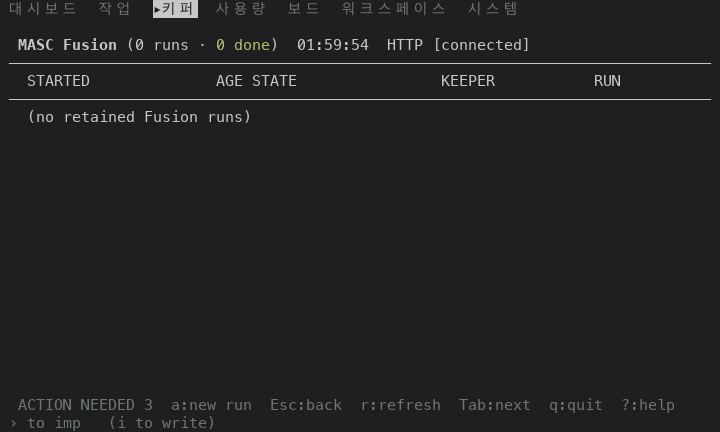 |
| Clients, 행 없음, 100x30 | 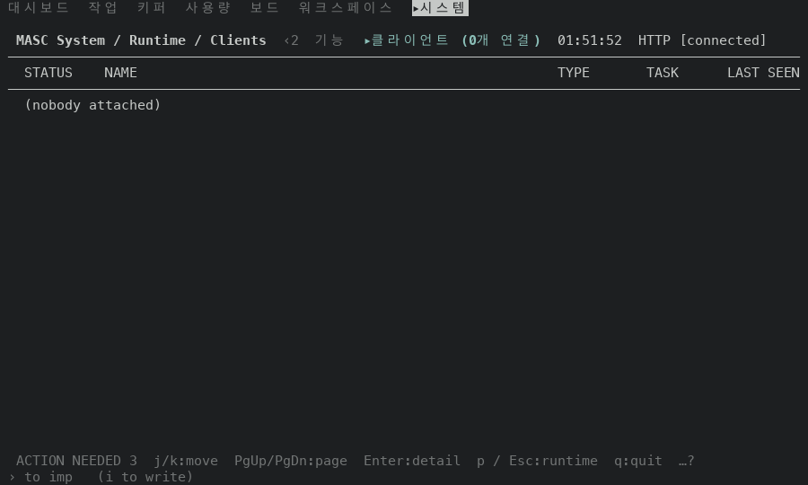 |  |
| Clients, 행 없음, 80x24 | 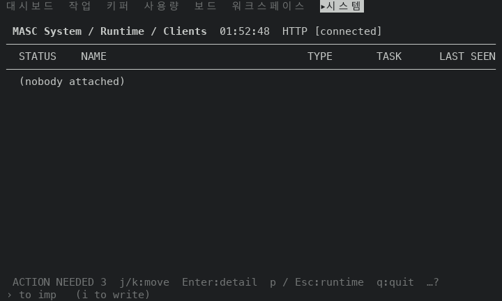 |  |

행이 있는 목록은 푸터가 같아서 고친 뒤 화면만 실어요(100x30): 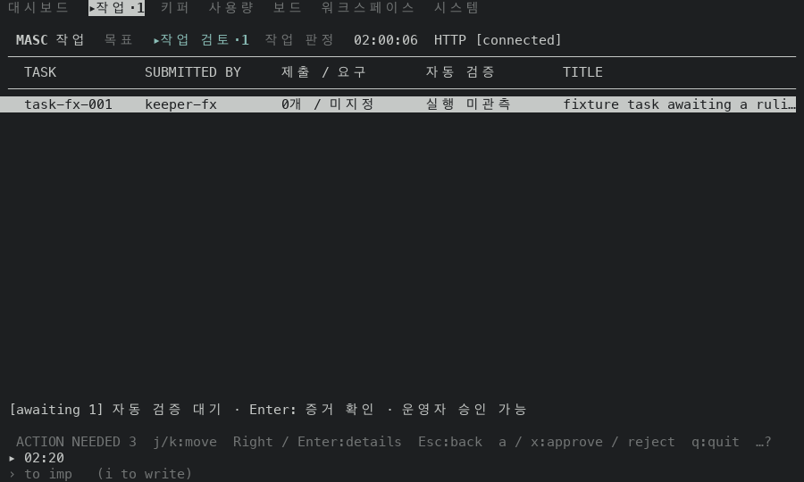 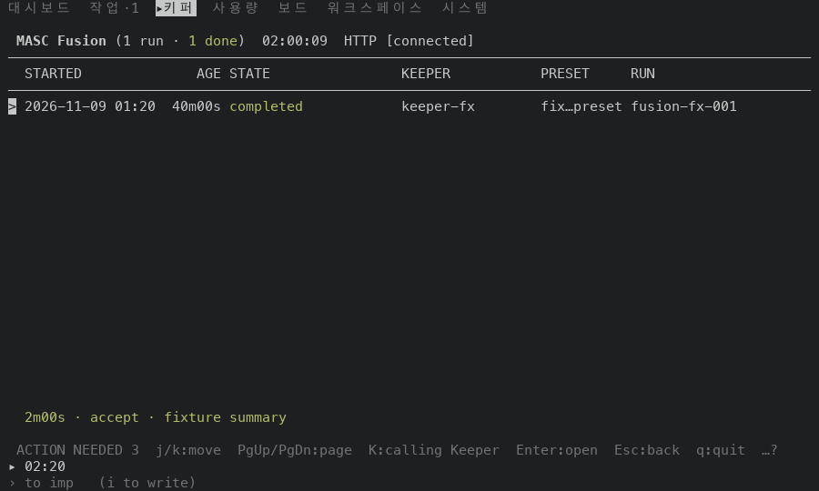 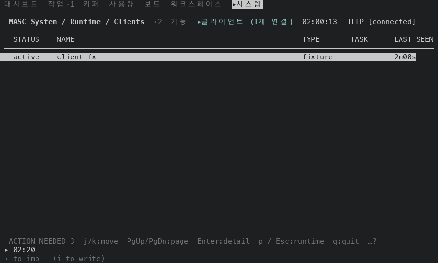

## 재지 않은 것

- 실제 서버가 보낸 검토 요청, Fusion 실행, 클라이언트. 위 행은 중계가 만든 가짜 값이에요.
- 행이 두 개 이상이고 커서가 끝에 있는 목록.
- Task Review 의 `< / >`(newer / older). 빈 목록에서 눌러 보지 않았어요. 이 키는 행이 아니라 쪽이 있어야 움직여서 `Needs_row` 와 다른 조건이 필요해요.
- 열린 Fusion 실행과 열린 Client 의 상세 화면 푸터. 이 PR 은 목록 푸터만 바꿔요.
- Task Review 의 `w` `o`. 푸터에 없는 키이고 화면이 바뀌는 것만 봤어요(`h` 와 같은 머리글 변화예요).
- 120x35 이상의 크기, 푸터 키 표시를 끈 설정.
- `test/test_tui_footer_row_need.ml` 에 더한 세 줄. PR 의 CI 는 타입 검사만 해서 이 시험은 실행되지 않았어요. 읽어서만 맞춰 봤어요.
- Approvals, Code, Changes, Workspace, Goals 의 빈 목록 푸터. 이 PR 에서 고치지 않았어요(고치기 전 빌드에서 행 키를 그리는 것만 봤어요).
