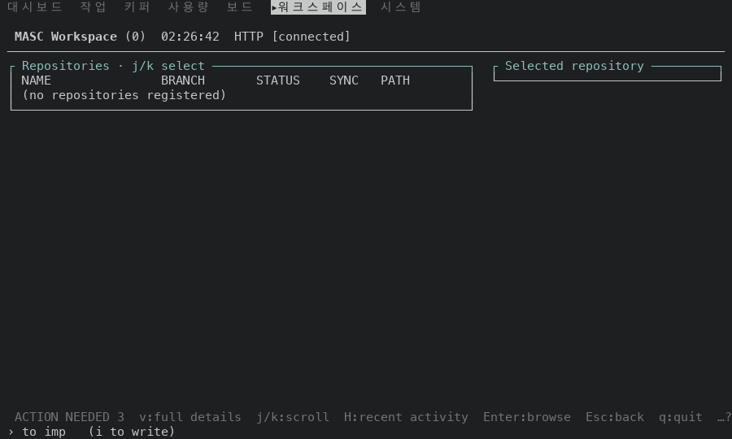
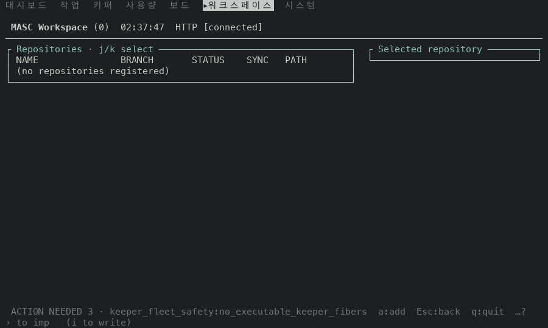
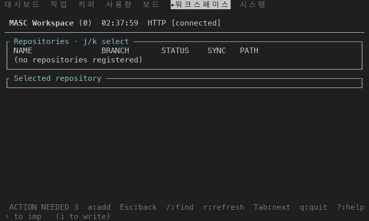
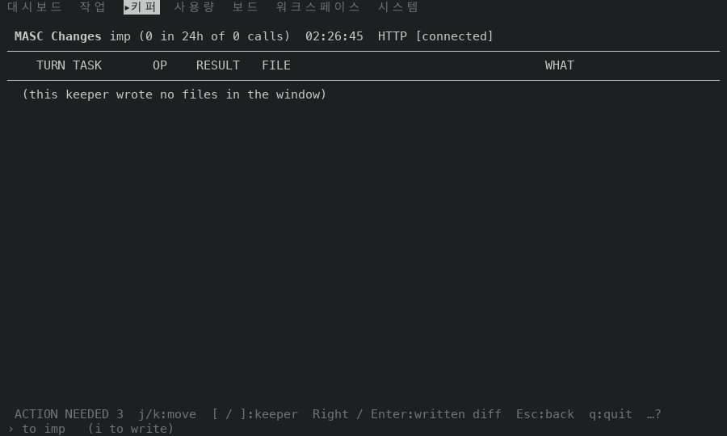
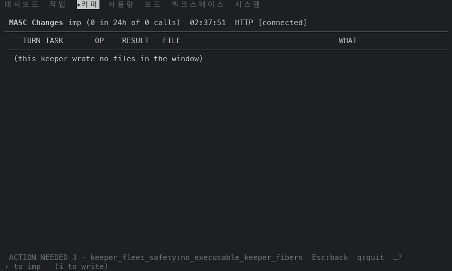
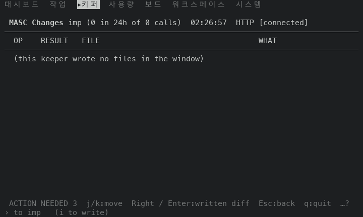
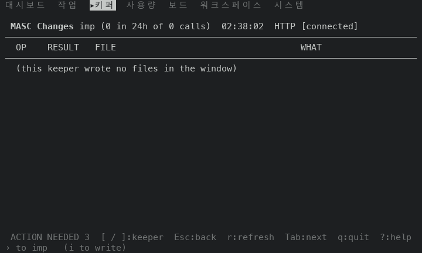
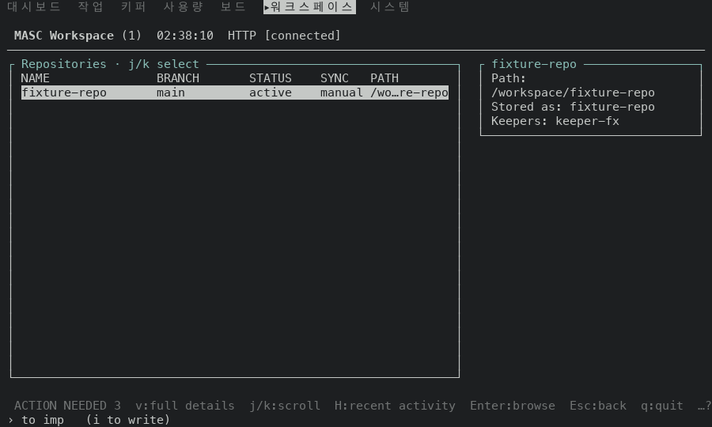
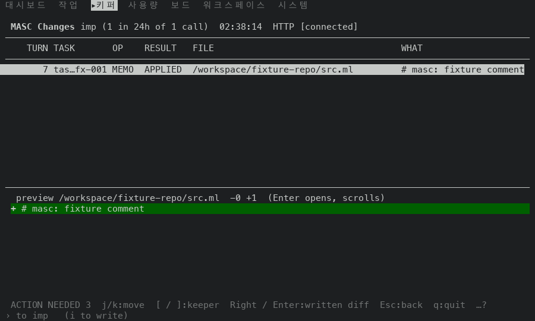

# 빈 Workspace·Changes 푸터가 행이 있어야 하는 키를 빼요: 고치기 전과 후 (#50087)

## 어떻게 쟀나

일회용 워크스페이스에 서버를 띄우고, TUI 와 서버 사이에 두 답만 바꿔 주는 중계를 뒀어요. #50076, #50081 과 같은 방식이에요.

- `GET /api/v1/repositories`: 행이 있는 경우에 저장소 한 줄(`fixture-repo`, 브랜치 `main`, 상태 `active`, 키퍼 `keeper-fx`)을 끼워 줘요.
- `GET /api/v1/keepers/<이름>/file-changes`: 행이 있는 경우에 키퍼가 쓴 변경 한 줄(주석 한 줄 끼우기, 성공)을 끼워 줘요. 행 모양은 `Tui_decode.decode_file_change` 가 읽는 값이에요.
- 행이 없는 경우는 중계가 답을 바꾸지 않아요. 새 워크스페이스의 서버가 준 빈 목록이에요.

tmux 3.6a 안의 TUI 로 명령 팔레트에서 `go Workspace`, `go Changes` 를 열고, 화면에 `ACTION NEEDED` 가 보일 때까지 최대 40초 기다린 뒤 찍었어요. 크기는 100x30 과 80x24 예요. 행은 가짜 값이에요.

- 고치기 전: 부모 층 #50081 코드 커밋 `23bf52c55df8` 의 증명 빌드 run 42501883344(성공), `masc-tui` sha256 `42abd3a66a1747ffe580f8f0715b37ddd43f022527098922d3fdb40ce20daa25`, `--build-commit` 이 같아요.
- 고친 뒤: 이 PR 코드 커밋 `4e3dae8457f5` 의 증명 빌드 run 42504950261(성공), `masc-tui` sha256 `bb2973c4b28f6a3c77f92865a35f1f46efd667b9e9270dd7b8c943d7289cf5c3`, `--build-commit` 이 같아요. 영수증(`receipt.json`)의 소스 커밋 `4e3dae8457f542a2d9c279daacb5128367ece912` 를 검증했어요.
- 두 빌드 사이에 바뀐 파일: `bin/masc_tui_keys.ml`, `bin/masc_tui_render_repositories.ml`, `test/test_tui_footer_row_need.ml`.

## 읽는 법

- 푸터는 목록이 비어 있어도 `v`, `j/k`, `Enter`, `H`(Workspace)와 `j/k`, `Right / Enter`(Changes) 같은 행 키를 앞에 그렸어요. 이 PR 은 키 표에서 이 키들에 `Needs_row` 를 달고, 목록 렌더러가 행이 없다고 말하면 푸터에서 빼요.
- 핸들러의 조건과 같아요.
  - Workspace 의 `Enter` 와 `H` 는 `List.nth_opt snapshot.rs_repositories state.repositories_cursor` 가 `None` 이면 아무것도 안 해요. `d` 는 같은 조건에서 `no repository under the cursor` 알림만 띄워요.
  - 이동·페이지 키는 `row_list` 의 `rl_count = 0` 에서 끝나요.
- `…?` 는 폭이 모자라 키 일부를 숨겼다는 표시예요.

## 푸터

| 화면 | 크기 | 고치기 전 푸터 | 고친 뒤 푸터 |
| --- | --- | --- | --- |
| Workspace, 행이 없는 목록 | 100x30 | `ACTION NEEDED 3  v:full details  j/k:scroll  H:recent activity  Enter:browse  Esc:back  q:quit  …?` | `ACTION NEEDED 3 · keeper_fleet_safety:no_executable_keeper_fibers  a:add  Esc:back  q:quit  …?` |
| Workspace, 행이 없는 목록 | 80x24 | `ACTION NEEDED 3  v:full details  Enter:browse  Esc:back  q:quit  …?` | `ACTION NEEDED 3  a:add  Esc:back  /:find  r:refresh  Tab:next  q:quit  ?:help` |
| Workspace, 행이 있는 목록 | 100x30 | `ACTION NEEDED 3  v:full details  j/k:scroll  H:recent activity  Enter:browse  Esc:back  q:quit  …?` | `ACTION NEEDED 3  v:full details  j/k:scroll  H:recent activity  Enter:browse  Esc:back  q:quit  …?` (같음) |
| Workspace, 행이 있는 목록 | 80x24 | `ACTION NEEDED 3  v:full details  Enter:browse  Esc:back  q:quit  …?` | `ACTION NEEDED 3  v:full details  Enter:browse  Esc:back  q:quit  …?` (같음) |
| Changes, 행이 없는 목록 | 100x30 | `ACTION NEEDED 3  j/k:move  [ / ]:keeper  Right / Enter:written diff  Esc:back  q:quit  …?` | `ACTION NEEDED 3 · keeper_fleet_safety:no_executable_keeper_fibers  Esc:back  q:quit  …?` |
| Changes, 행이 없는 목록 | 80x24 | `ACTION NEEDED 3  j/k:move  Right / Enter:written diff  Esc:back  q:quit  …?` | `ACTION NEEDED 3  [ / ]:keeper  Esc:back  r:refresh  Tab:next  q:quit  ?:help` |
| Changes, 행이 있는 목록 | 100x30 | `ACTION NEEDED 3  j/k:move  [ / ]:keeper  Right / Enter:written diff  Esc:back  q:quit  …?` | `ACTION NEEDED 3  j/k:move  [ / ]:keeper  Right / Enter:written diff  Esc:back  q:quit  …?` (같음) |
| Changes, 행이 있는 목록 | 80x24 | `ACTION NEEDED 3  j/k:move  Right / Enter:written diff  Esc:back  q:quit  …?` | `ACTION NEEDED 3  j/k:move  Right / Enter:written diff  Esc:back  q:quit  …?` (같음) |

행이 없는 목록에서 푸터가 고르는 것이 바뀌었어요.

- 100x30 Workspace: `a:add` 가 보여요. 고치기 전에는 `…?` 뒤에 있었어요. 저장소가 없는 Workspace 에서 할 수 있는 일은 이 키뿐이에요.
- 100x30 Changes: `ACTION NEEDED` 이유가 길게 나오고 키는 `Esc:back  q:quit` 만 보여요. 이 PR 은 푸터가 알림 이유를 키보다 먼저 그리는 우선순위(#49925)를 건드리지 않았어요. 눈에 보이는 키가 늘지 않아요(`[ / ]:keeper` 도 이유 문구에 밀려요).
- 80x24 Workspace: `a:add`, `/:find`, `r:refresh`, `Tab:next`, `?:help` 가 모두 들어가서 `…?` 가 사라져요.
- 80x24 Changes: `[ / ]:keeper`, `r:refresh`, `Tab:next`, `?:help` 가 보이고 `…?` 가 사라져요.

## 고치기 전 빌드에서 푸터에 떠 있던 키를 눌러 본 결과(100x30)

목록에 들어간 뒤 키 하나를 누르고 화면을 이전 화면과 견줬어요. 제목·탭 줄과 시각·날짜 숫자는 뺐어요. 누를 때마다 목록 화면에 다시 들어갔어요.

| 화면 | 글자와 색이 그대로 | 알림 한 줄만 바뀜 | 다른 일이 일어남 |
| --- | --- | --- | --- |
| Workspace(행 없음) | `j` `k` `Down` `Up` `PageDown` `PageUp` `Home` `End` `Right` `Enter` `H` `n` `N` `x` `y` `K` `B` `e` `h` `w` `o` | `d`(`no repository under the cursor`), `v`(`No selected reading is available`), `Y`(`nothing on this surface has a link`) | `a`(편집기를 열어 저장소를 등록해요. 측정 환경에는 `$EDITOR` 가 없어서 `no $EDITOR set` 알림이 떴어요), `/`(검색줄이 열려요) |
| Changes(행 없음) | `j` `k` `Down` `Up` `PageDown` `PageUp` `Home` `End` `/` `]` `n` `N` `a` `x` `y` `K` `B` `e` `h` `w` | `Right` `Enter` `d` `v` `o`(`no change under the cursor`), `Y`(`nothing on this surface has a link`) | `[`(다른 키퍼로 바뀌어요) |

고친 뒤 빌드에서는 `j` `k` `Down` `Up` `PageDown` `PageUp` `Home` `End` `Right` `Enter` `a` `x` `y` `n` `N` `/` `Y` `K` `B` `e` `d` `v` `h` `w` `o` `H` `[` `]` 를 두 화면에서 같은 순서로 눌렀고, 고치기 전 빌드에서 눌러 본 키마다 결과 분류가 같았어요(키 처리는 바뀌지 않았어요). 고치기 전 빌드에서 Workspace 의 `[` `]` 와 Changes 의 `H` 는 눌러 보지 않았어요.

## 두 빌드가 같아야 하는 단계

시각과 날짜는 빼고 화면 전체를 견줬어요.

- 행이 있는 Workspace·Changes: 두 크기 모두 푸터를 포함해 화면이 같아요(위 표의 `(같음)`, 네 경우 모두 0줄 차이).
- 행이 없는 목록: 화면에서 다른 줄은 푸터 한 줄뿐이에요(네 경우 모두 2줄 차이: 고치기 전 한 줄, 고친 뒤 한 줄).

## 화면

| 화면 | 고치기 전 | 고친 뒤 |
| --- | --- | --- |
| Workspace, 행 없음, 100x30 |  |  |
| Workspace, 행 없음, 80x24 |  |  |
| Changes, 행 없음, 100x30 |  |  |
| Changes, 행 없음, 80x24 |  |  |

행이 있는 목록은 푸터가 같아서 고친 뒤 화면만 실어요(100x30):  

## 재지 않은 것

- 실제 서버가 보낸 저장소와 변경. 위 행은 중계가 만든 가짜 값이에요.
- 행이 두 개 이상이고 커서가 끝에 있는 목록.
- `$EDITOR` 가 설정된 환경에서 Workspace 의 `a`. 측정 환경에서는 `no $EDITOR set` 알림만 봤어요.
- Workspace 의 Git changes 화면과 `H` 로 여는 최근 활동 화면의 푸터. 이 PR 은 저장소 목록 푸터만 바꿔요.
- Changes 의 `]`. 화면이 그대로였고 이유는 보지 않았어요.
- 120x35 이상의 크기, 푸터 키 표시를 끈 설정.
- `test/test_tui_footer_row_need.ml` 에 더한 두 줄. PR 의 CI 는 타입 검사만 해서 이 시험은 실행되지 않았어요. 읽어서만 맞춰 봤어요.
- Approvals, Code, Goals 의 빈 목록 푸터. 이 PR 에서 고치지 않았어요(고치기 전 빌드에서 행 키를 그리는 것만 봤어요).
