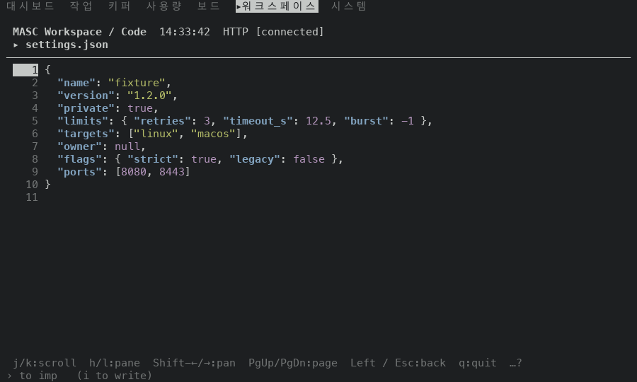
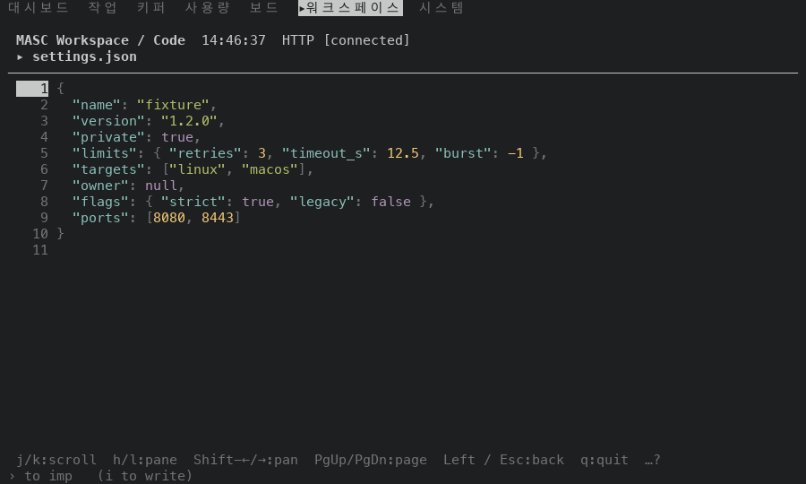
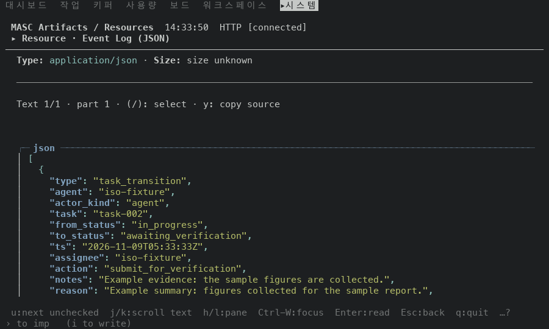
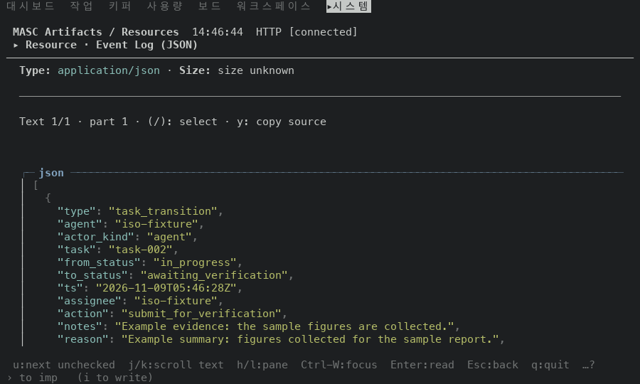

# JSON 을 어느 화면에서나 채팅과 같은 네 역할로 그리기

## 실측

고정 서버 위 증명 빌드 둘로 같은 걸음을 걸었어요. 앞은 main `89af57ba3d8f`, 뒤는 이 PR 의 코드 `08e2fd9425ae` 예요. Code 화면에서 `settings.json`(키·문자열·숫자·`true`·`null`·괄호를 다 가진 문서)을 열고, Resources 화면에서 Event Log(JSON 코드 블록)를 열어 화면마다 한 장씩 찍은 ANSI 에서 글자마다 걸린 색을 읽었어요.

| 역할 | 앞 | 뒤 |
|---|---|---|
| 키 (`"retries"`) | 굵게 + 밝은 파랑 | 밝은 청록 |
| 문자열 값 (`"fixture"`) | 밝은 초록 | 밝은 초록 |
| 숫자 (`3`) | 밝은 자주 | 밝은 노랑 |
| `true`·`false`·`null` | 밝은 자주 | 밝은 자주 |
| 구두점 (`{ } [ ] , :`) | 칠하지 않음 | 흐림 |

앞 빌드에서는 같은 JSON 키가 채팅 도구 결과에서는 밝은 청록이고 Code·Resources 에서는 굵은 밝은 파랑이에요. 숫자와 `true` 는 한 색(밝은 자주)이라 구분이 안 가고, 구두점은 칠하지 않아서 본문과 같은 무게예요. 뒤 빌드에서는 Code 가 채팅과 같은 네 역할(키 청록, 숫자 노랑, 리터럴 자주, 구두점 흐림)을 쓰고, 문자열 값 색은 그대로예요. Resources 의 JSON 코드 블록은 글자색이 원래 밝은 청록이라, 거기서는 키가 그 청록 그대로 보이고 구두점은 흐린 기본색으로 바뀌어요. Resources 의 Event Log 에는 숫자와 `true` 가 없어서 그 둘은 Code 화면에서만 쟀어요.

안 잰 것: 채팅 도구 결과와 Task history 를 같은 걸음에서 찍어 나란히 비교하지는 않았어요(둘은 이 PR 이 안 건드린 `Theme.Syntax.json_*` 를 그대로 써요). Tools·Lanes·Fusion·Activity·schedule payload 는 같은 렉서를 쓰지만 고정 서버에 JSON 내용이 없어 찍지 않았어요. 폭은 100x30 만 봤어요.

| 앞 | 뒤 |
|---|---|
| Code · settings.json  |   |
| Resources · Event Log  |   |
