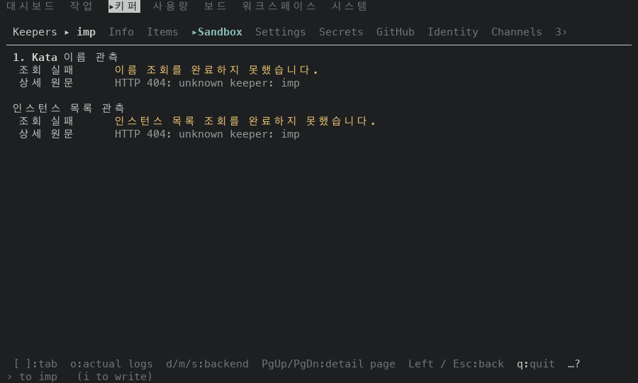
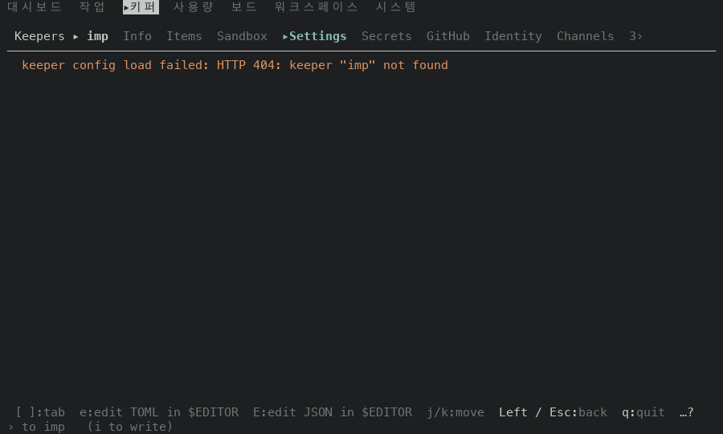

# 푸터 칸과 Keeper 탭 줄이 `key:label` 을 한 곳에서 만들어요: 문자열이 그대로인지 잰 결과 (#50134)

## 어떻게 쟀나

일회용 워크스페이스에 서버를 띄우고 tmux 3.6a 안의 TUI(100x30)를 열었어요. 가짜 Keeper 이름 세 개(`imp` `relay` `scout`)와 가짜 값이 든 일회용 서버예요. 환경은 둘이에요. 알림 있는 환경은 서버가 `ACTION NEEDED 3` 을 내요. 알림 없는 환경은 TUI 와 서버 사이 중계가 `/health` 의 `operator_action_required` 만 `false` 로 바꿔요. 두 가지를 쟀어요.

- 푸터 42곳: 명령 팔레트(`go <화면>`)로 화면 42곳에 들어가 맨 아래 푸터 줄을 읽었어요. 두 환경에서 모두 읽었어요. 푸터 칸은 대부분 `hints_in_order` 가 만들어요. MSX 와 DOS 는 `bin/masc_tui_msx.ml` 이 푸터를 직접 그려서 `hints_in_order` 를 지나지 않지만 같은 방식으로 읽었어요.
- Keeper 상세 탭 줄(`keeper_detail_tab_hint`): 알림 없는 환경에서 첫 Keeper 를 열어 처음 탭 화면을 찍고, `]` 를 11번 누르며 누를 때마다 화면 전체를 찍어 12장을 얻었어요. 알림이 있으면 알림이 폭을 차지해서 탭 줄이 안 보여요. 이 서버는 `imp` 를 목록에는 내지만 상세 읽기에는 `unknown keeper` 404 로 답해서, 탭 본문은 조회 실패 줄이에요. 비교 대상은 맨 아래 탭 줄이고 본문 줄도 두 빌드가 같았어요.
- 고치기 전: #50112 코드 커밋 `2e6bd2a6bb0c` 의 증명 빌드 run 42516522107.
- 고친 뒤: 이 PR 코드 커밋 `214806e33111` 의 증명 빌드 run 42518546224.
- 두 빌드 사이에 바뀐 코드 파일: `bin/masc_tui_keys.ml` 하나.

## 결과

- 알림 있는 환경: 푸터 42곳이 모두 두 빌드에서 글자까지 같아요.
- 알림 없는 환경: 푸터 42곳이 모두 두 빌드에서 글자까지 같아요.
- 알림 있는 환경에서는 19곳이 알림 문구에 폭을 내줘서 `Esc`·`q` 만 남아요(#49925). 이 화면들은 알림 있는 환경만으로는 `hints_in_order` 가 만든 키 글자를 견주지 못해서, 같은 화면을 알림 없는 환경에서 다시 읽었어요.
- Keeper 탭 화면 12장이 모두 두 빌드에서 줄마다 같아요(시계와 개수 숫자는 가리고 견줬어요).
- 푸터 42곳에는 한국어 라벨 줄도 들어 있어요(`System / …` 화면, 예: `Esc:뒤로  q:종료`). `hints_in_order` 가 `~label` 로 한국어 라벨을 넘기는 갈래예요.

## Keeper 상세 탭 화면

| 화면 | 고치기 전 | 고친 뒤 |
| --- | --- | --- |
| Sandbox 탭 |  |  |
| Settings 탭 |  |  |

Keeper 상세에는 탭이 11개 있고, 마지막 화면은 `]` 를 11번 눌러 처음 탭으로 돌아온 것이에요. 12장에서 서로 다른 탭 줄은 10가지예요(Secrets 탭과 Runs 탭이 같은 키 줄을 써요). 모두 두 빌드가 같아요.

| 탭 줄 |
| --- |
| `[ ]:tab  b:requeue board  B:requeue all board  j/k:move  p:boot  Left / Esc:back  q:quit  …?` |
| `[ ]:tab  j/k:preview  PgUp/PgDn:page  Home/End:first/last  v:view  Left / Esc:back  q:quit  …?` |
| `[ ]:tab  o:actual logs  d/m/s:backend  PgUp/PgDn:detail page  Left / Esc:back  q:quit  …?` |
| `[ ]:tab  e:edit TOML in $EDITOR  E:edit JSON in $EDITOR  j/k:move  Left / Esc:back  q:quit  …?` |
| `[ ]:tab  j/k:move  p:boot  w:wake  s:shutdown  x:delete  e:settings  Left / Esc:back  q:quit  …?` |
| `[ ]:tab  L:login  P:token  1:workflow  2:write:packages  Left / Esc:back  q:quit  …?` |
| `[ ]:tab  arrows+enter:connect  PgUp/PgDn:page  v:view  o:order  Left / Esc:back  q:quit  …?` |
| `[ ]:tab  j/k:transport  J/K:binding  PgUp/PgDn:detail page  Left / Esc:back  q:quit  …?` |
| `[ ]:tab  < / >:schedule pages  j/k:move  p:boot  w:wake  s:shutdown  Left / Esc:back  q:quit  …?` |
| `[ ]:tab  j/k:scroll  PgUp/PgDn:page  Home/End:oldest/follow  p:boot  Left / Esc:back  q:quit  …?` |

## 푸터 42곳 (두 빌드가 같은 줄)

| 화면 | 알림 있는 환경 | 알림 없는 환경 |
| --- | --- | --- |
| Work | `ACTION NEEDED 3  z:Candle  j/k:move  t:Goals / Tasks  Right / Enter:detail  Esc:back  q:quit  …?` | `t:Goals / Tasks  p:Approvals  v:next Work tab  f:filter  s:sort  b:summary  Esc:back  q:quit  …?` |
| Task Review | `ACTION NEEDED 3  j/k:move  Right / Enter:details  Esc:back  a / x:approve / reject  q:quit  …?` | `v:next Work tab  h:queue / history  < / >:newer / older  Esc:back  /:find  r:refresh  q:quit  …?` |
| Task Verdicts | `ACTION NEEDED 3 · keeper_fleet_safety:no_executable_keeper_fibers  Esc:back  q:quit  …?` | `v:next Work tab  Esc:back  /:find  r:refresh  Tab:next  q:quit  ?:help` |
| Features | `ACTION NEEDED 3  j/k:move  o / A:Plugins  d:reading  Right / Enter:open  Esc:dashboard  q:quit  …?` | `j/k:move  o / A:Plugins  d:reading  i:read issues  Right / Enter:open  Esc:dashboard  q:quit  …?` |
| Librarian history | `ACTION NEEDED 3  j/k:move  Right / Enter:prompt  ]:older  Left / Esc:back  r:refresh  q:quit  …?` | `j/k:move  Right / Enter:prompt  ]:older  Left / Esc:back  r:refresh  Tab:next  q:quit  ?:help` |
| HITL Auto Judge history | `ACTION NEEDED 3  j/k:move  Right / Enter:prompt  ]:older  Left / Esc:back  r:refresh  q:quit  …?` | `j/k:move  Right / Enter:prompt  ]:older  Left / Esc:back  r:refresh  Tab:next  q:quit  ?:help` |
| Board Attention history | `ACTION NEEDED 3  j/k:move  Right / Enter:prompt  ]:older  Left / Esc:back  r:refresh  q:quit  …?` | `j/k:move  Right / Enter:prompt  ]:older  Left / Esc:back  r:refresh  Tab:next  q:quit  ?:help` |
| Workspace Curator history | `ACTION NEEDED 3  j/k:move  Right / Enter:prompt  ]:older  Left / Esc:back  r:refresh  q:quit  …?` | `j/k:move  Right / Enter:prompt  ]:older  Left / Esc:back  r:refresh  Tab:next  q:quit  ?:help` |
| Verifier history | `ACTION NEEDED 3  j/k:move  Right / Enter:prompt  ]:older  Left / Esc:back  r:refresh  q:quit  …?` | `j/k:move  Right / Enter:prompt  ]:older  Left / Esc:back  r:refresh  Tab:next  q:quit  ?:help` |
| Candle Appraiser history | `ACTION NEEDED 3  j/k:move  Right / Enter:prompt  ]:older  Left / Esc:back  r:refresh  q:quit  …?` | `j/k:move  Right / Enter:prompt  ]:older  Left / Esc:back  r:refresh  Tab:next  q:quit  ?:help` |
| Clients | `ACTION NEEDED 3 · keeper_fleet_safety:no_executable_keeper_fibers  p / Esc:runtime  q:quit  …?` | `p / Esc:runtime  r:refresh  Tab:next  q:quit  ?:help` |
| Schedules | `ACTION NEEDED 3 · keeper_fleet_safety:no_executable_keeper_fibers  Esc:back  q:quit  …?` | `< / >:schedule pages  Esc:back  n:new  r:refresh  Tab:next  q:quit  ?:help` |
| Code | `ACTION NEEDED 3  j/k:move  PgUp/PgDn:page  Right / Enter:open  Esc:back  q:quit  …?` | `j/k:move  PgUp/PgDn:page  Home/End:top/bottom  Right / Enter:open  Esc:back  q:quit  …?` |
| Artifacts / Resources | `ACTION NEEDED 3  u:next unchecked  j/k:move  h/l:pane  Enter:read  Esc:back  q:quit  …?` | `u:next unchecked  j/k:move  h/l:pane  Ctrl-W:focus  Enter:read  Esc:back  q:quit  …?` |
| Tools | `ACTION NEEDED 3 · keeper_fleet_safety:no_executable_keeper_fibers  Esc:system  q:quit  …?` | `j/k:scroll  PgUp/PgDn:page  Home/End:top/bottom  p:section  J/K:Skill  Esc:system  q:quit  …?` |
| Runtime | `ACTION NEEDED 3  j/k:move / scroll  Right / Enter:detail  Esc:back  q:quit  …?` | `j/k:move / scroll  PgUp/PgDn:detail page  Right / Enter:detail  Esc:back  q:quit  …?` |
| Changes | `ACTION NEEDED 3 · keeper_fleet_safety:no_executable_keeper_fibers  Esc:back  q:quit  …?` | `[ / ]:keeper  Esc:back  r:refresh  Tab:next  q:quit  ?:help` |
| Browser Lane | `ACTION NEEDED 3  ↑/↓:choose  Enter:use browser  r:reload connections  A:advanced  Esc:cancel  …?` | `↑/↓:choose  Enter:use browser  r:reload connections  A:advanced  Esc:cancel  ?:help` |
| Connectors | `ACTION NEEDED 3 · keeper_fleet_safety:no_executable_keeper_fibers  B:Browser Lane  Esc:keeper  …?` | `B:Browser Lane  j/k:scroll  b:bind  u:unbind  r:refresh  Esc:keeper  ?:help` |
| Collab | `ACTION NEEDED 3 · keeper_fleet_safety:no_executable_keeper_fibers  m:MSX  Enter:link  Esc:back  …?` | `m:MSX  d:DOS  g:games  j/k:choose  Enter:link  r:refresh  Esc:back  n:invite  x:revoke` |
| Play links | `ACTION NEEDED 3 · keeper_fleet_safety:no_executable_keeper_fibers  m:MSX  Enter:link  Esc:back  …?` | `m:MSX  d:DOS  g:games  j/k:choose  Enter:link  r:refresh  Esc:back  n:invite  x:revoke` |
| MSX | `the cartridge list could not be read; the reason is above` | `the cartridge list could not be read; the reason is above` |
| DOS | `Esc: back  +/-: 100%` | `Esc: back  +/-: 100%` |
| Plugins | `ACTION NEEDED 3 · keeper_fleet_safety:no_executable_keeper_fibers  Esc:back  Enter:open  …?` | `?:help  Colon:palette  Esc:back  Enter:open  h:history/current  i:install  n:new  S:subs  …?` |
| Logs | `ACTION NEEDED 3  o:log origin  e:Events  Right / Enter:detail  Esc:back  q:quit  …?` | `o:log origin  e:Events  j/k:move / scroll  Right / Enter:detail  Esc:back  q:quit  …?` |
| Activity | `ACTION NEEDED 3  e / l:Events / Logs  j/k:move  f:filter  Enter:evidence  Esc:back  q:quit  …?` | `e / l:Events / Logs  j/k:move  f:filter  Enter:evidence  Esc:back  q:quit  …?` |
| Approvals | `ACTION NEEDED 3 · keeper_fleet_safety:no_executable_keeper_fibers  Esc:back  q:quit  …?` | `w:Workspace mode  e:Outside mode  r:refresh  Tab:next  Esc:back  q:quit  ?:help` |
| Memory | `ACTION NEEDED 3  j/k:move  PgUp/PgDn:page  Enter:facts  Esc:clear / back  q:quit  …?` | `j/k:move  PgUp/PgDn:page  Home/End:top/bottom  Enter:facts  Esc:clear / back  q:quit  …?` |
| Fusion | `ACTION NEEDED 3 · keeper_fleet_safety:no_executable_keeper_fibers  a:new run  Esc:back  q:quit  …?` | `a:new run  Esc:back  r:refresh  Tab:next  q:quit  ?:help` |
| Dashboard | `ACTION NEEDED 3 · keeper_fleet_safety:no_executable_keeper_fibers  Enter:open  q:quit  …?` | `Left:Keepers  j/k:choose  Enter:open  p:requests  g:quiz  ;:agenda  m:Usage  s:music  q:quit  …?` |
| Keepers | `ACTION NEEDED 3  v:view  o:order  j/k:move  Right / Enter:detail  Esc:dashboard  q:quit  …?` | `v:view  o:order  j/k:move  p:boot  w:wake  Right / Enter:detail  Esc:dashboard  q:quit  …?` |
| Usage | `ACTION NEEDED 3  j/k:scroll  p:Usage / Telemetry  f:account  v / V:view  Esc:Dashboard  q:quit  …?` | `j/k:scroll  p:Usage / Telemetry  f:account  a:all accounts  v / V:view  Esc:Dashboard  q:quit  …?` |
| Board | `ACTION NEEDED 3  j/k:move  s:sort  Right / Enter:read  Esc:back  v / V:up / down  q:quit  …?` | `j/k:move  s:sort  Ctrl-W:pane  Right / Enter:read  Esc:back  v / V:up / down  q:quit  …?` |
| Workspace | `ACTION NEEDED 3 · keeper_fleet_safety:no_executable_keeper_fibers  a:add  Esc:back  q:quit  …?` | `a:add  Esc:back  /:find  r:refresh  Tab:next  q:quit  ?:help` |
| System | `ACTION NEEDED 3 · keeper_fleet_safety:no_executable_keeper_fibers  Esc:뒤로  q:종료  …?` | `j/k:선택 / 스크롤  PgUp/PgDn:페이지  v:적용 상태  e:편집  a:계정 추가  Esc:뒤로  q:종료  …?` |
| System / runtime.toml | `ACTION NEEDED 3 · keeper_fleet_safety:no_executable_keeper_fibers  Esc:뒤로  q:종료  …?` | `j/k:선택 / 스크롤  PgUp/PgDn:페이지  v:적용 상태  e:편집  a:계정 추가  Esc:뒤로  q:종료  …?` |
| System / models | `ACTION NEEDED 3 · keeper_fleet_safety:no_executable_keeper_fibers  Esc:뒤로  q:종료  …?` | `j/k:선택 / 스크롤  PgUp/PgDn:페이지  v:전체 상세  e:편집  c:모델 복사  Esc:뒤로  q:종료  …?` |
| System / params | `ACTION NEEDED 3  e / Enter:편집  E:JSON 편집  x:기본값  j/k:선택 / 스크롤  Esc:뒤로  q:종료  …?` | `e / Enter:편집  E:JSON 편집  x:기본값  j/k:선택 / 스크롤  PgUp/PgDn:페이지  Esc:뒤로  q:종료  …?` |
| System / prompts | `ACTION NEEDED 3 · keeper_fleet_safety:no_executable_keeper_fibers  Esc:뒤로  q:종료  …?` | `j/k:선택 / 스크롤  PgUp/PgDn:페이지  Home/End:상세 처음/끝  e:편집  Esc:뒤로  q:종료  …?` |
| System / presets | `ACTION NEEDED 3 · keeper_fleet_safety:no_executable_keeper_fibers  Esc:뒤로  q:종료  …?` | `n:새로 저장  u:복원  D:삭제  j/k:선택 / 스크롤  PgUp/PgDn:페이지  Esc:뒤로  q:종료  …?` |
| System / themes | `ACTION NEEDED 3  j/k:선택 / 스크롤  PgUp/PgDn:페이지  Enter:적용  Esc:뒤로  q:종료  …?` | `j/k:선택 / 스크롤  PgUp/PgDn:페이지  Enter:적용  x:터미널 색상  f:필터  Esc:뒤로  q:종료  …?` |
| System / voice | `ACTION NEEDED 3 · keeper_fleet_safety:no_executable_keeper_fibers  Esc:뒤로  q:종료  …?` | `j/k:선택 / 스크롤  PgUp/PgDn:페이지  e:편집  a:키퍼 목소리  p:다음 탭  Esc:뒤로  q:종료  …?` |

## 재지 않은 것

- 80x24 와 120x35 크기. 이 PR 은 줄 폭을 맞추는 곳을 건드리지 않고 문자열을 만드는 곳만 옮겨서 따로 재지 않았어요.
- MSX 행의 푸터 칸은 키 글자가 아니라 오류 안내문(`the cartridge list could not be read; …`)이라 `key:label` 을 견준 근거가 아니에요. DOS 행은 `Esc: back  +/-: 100%` 로 콜론 뒤에 공백이 있고 이 PR 이 모으는 표기와 달라요.
- Keeper 탭 화면 12장 가운데 PNG 는 Sandbox 와 Settings 탭 두 쌍뿐이고 나머지는 줄 비교 결과만 있어요.
- 팔레트 목적지 밖에서 열리는 화면(Keeper 질문 큐, 채팅 입력줄 등)의 푸터. 질문 큐는 `footer_hints_queue` 가 `hints_in_order` 를 부르지만 이 줄도 따로 읽지 않았어요.
- 첫 Keeper 말고 다른 Keeper 의 탭. 탭 줄은 탭 이름만 보고 그려서 Keeper 마다 달라지지 않아요.
