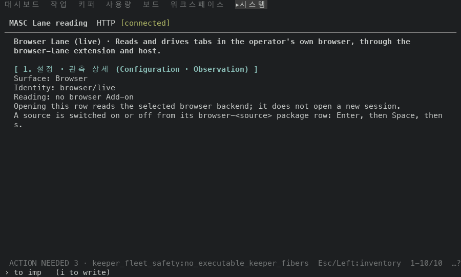
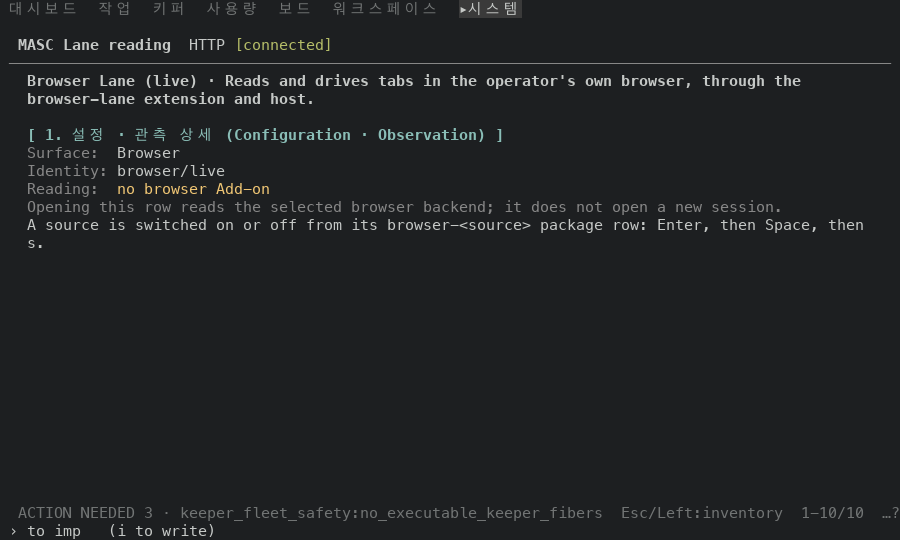
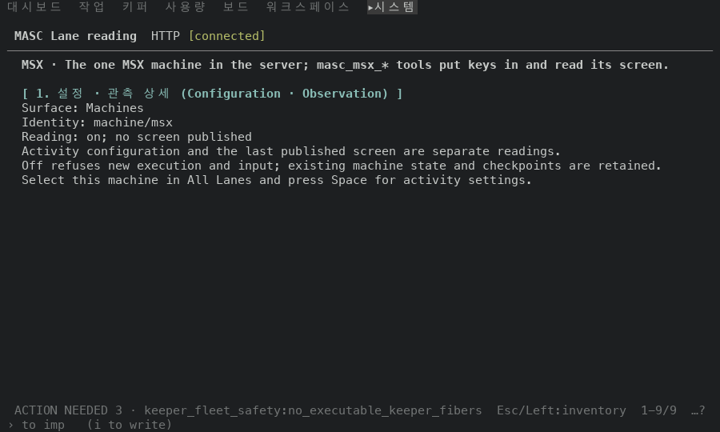
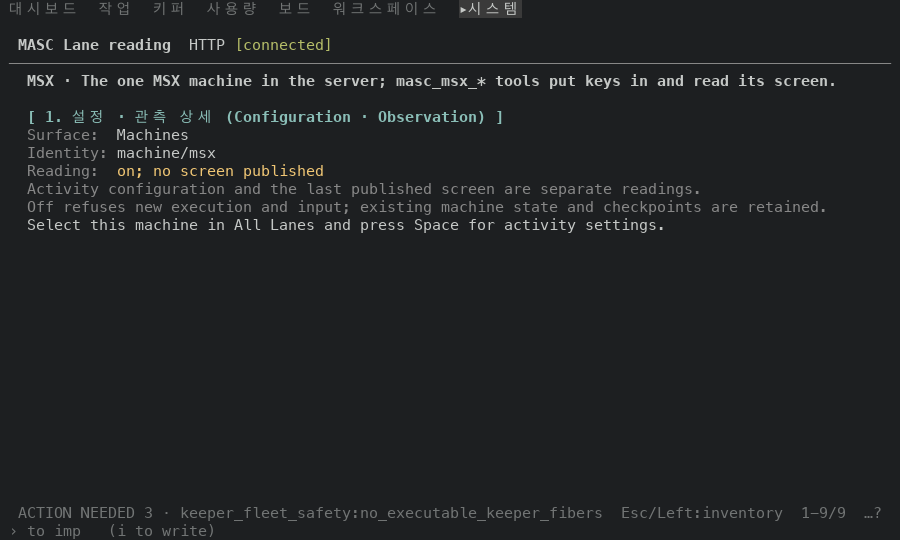
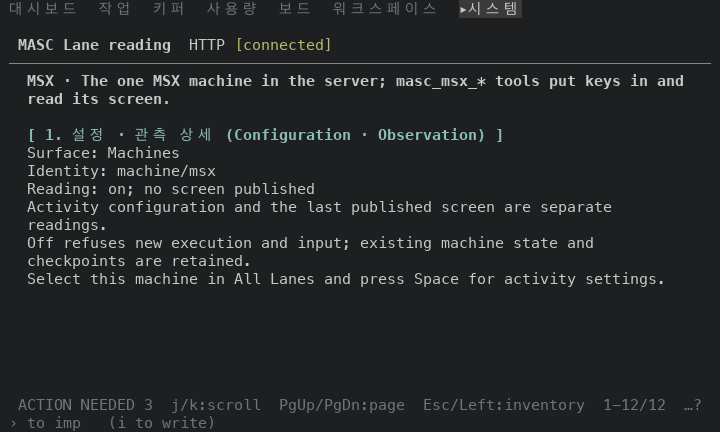
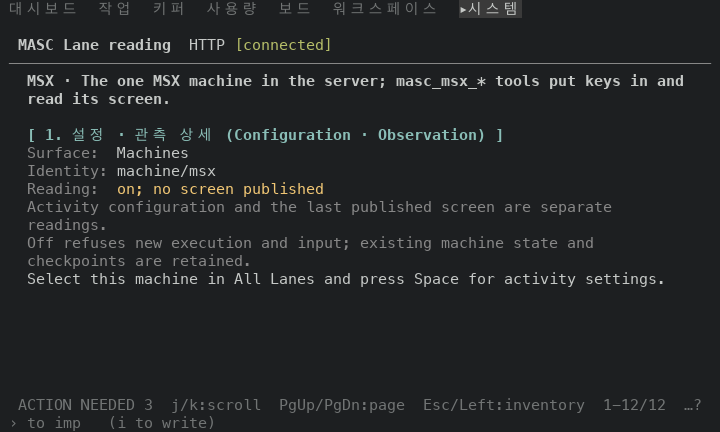

# Features 행 읽기(d): 사실과 설명을 나눠 그리기

## 실측

고정 서버 위 증명 빌드 둘로 같은 걸음을 걸었어요. 앞은 이 PR 의 바탕 main(`c46646dba7dc`), 뒤는 이 PR 의 코드 머리(`48b1354b81fd`)예요. `go Features` → `Enter` → `Down` 다섯 번(Browser Lane 행) → `d`(전체 상세) → `Esc` → `Down` → `d`(MSX) → `Esc` → `Down` → `d`(DOS) → `Esc` 순서로, 목록과 읽기 화면을 한 장씩 찍었어요.

**글자**: 읽기 화면 3곳 x 크기 2 = 6곳에서 두 빌드의 본문을 낱말 단위로 비교했어요(공백 개수는 가렸어요). 6곳 모두 같아요. 본문 줄 수는 빈 줄을 뺀 앞→뒤예요.

| 행 | 100x30 | 80x24 |
|---|---|---|
| Browser Lane (live) | 본문 9→9줄 | 본문 10→10줄 |
| MSX | 본문 8→8줄 | 본문 11→11줄 |
| DOS | 본문 8→8줄 | 본문 11→11줄 |

**목록**: 목록 3곳 x 크기 2 = 6곳에서 아래 요약 블록의 `상태:` 줄의 글자와 색 코드가 두 빌드에서 바이트까지 같아요. 목록과 읽기 화면이 한 표를 쓰도록 목록 쪽 `match` 를 지웠는데, 색은 안 움직였어요.

**색**: 두 빌드의 ANSI 를 읽었어요(100x30, 하네스가 터미널처럼 색 질문에 답해서 흐린 색이 따로 있어요).

- `Surface:`·`Identity:`·`Reading:` 라벨에 색이 붙어요. 앞 빌드의 세 줄에는 스타일이 없었어요.
- `Reading:` 의 값은 같은 행의 목록 `상태:` 줄과 같은 색 코드를 써요: Browser Lane (live) `ESC[93m`, MSX `ESC[93m`, DOS `ESC[93m`.
- 설명 문장(`Opening this row reads …`, `Activity configuration and the last …`, `Off refuses new execution …`)은 라벨과 같은 흐린 색이에요. 앞 빌드에서는 스타일이 없었어요.
- 무엇을 누르라는 문장(`A source is switched on or off …`, `Select this machine in All Lanes …`)은 두 빌드 모두 스타일이 없어요.

**화면** (MSX 기계 행, 100x30)

앞

```
   MSX · The one MSX machine in the server; masc_msx_* tools put keys in and read its screen.

   [ 1. 설정 · 관측 상세 (Configuration · Observation) ]
   Surface: Machines
   Identity: machine/msx
   Reading: on; no screen published
   Activity configuration and the last published screen are separate readings.
   Off refuses new execution and input; existing machine state and checkpoints are retained.
   Select this machine in All Lanes and press Space for activity settings.
```

뒤

```
   MSX · The one MSX machine in the server; masc_msx_* tools put keys in and read its screen.

   [ 1. 설정 · 관측 상세 (Configuration · Observation) ]
   Surface:  Machines
   Identity: machine/msx
   Reading:  on; no screen published
   Activity configuration and the last published screen are separate readings.
   Off refuses new execution and input; existing machine state and checkpoints are retained.
   Select this machine in All Lanes and press Space for activity settings.
```

**화면** (Browser Lane 행, 80x24)

앞

```
   Browser Lane (live) · Reads and drives tabs in the operator's own browser,
   through the browser-lane extension and host.

   [ 1. 설정 · 관측 상세 (Configuration · Observation) ]
   Surface: Browser
   Identity: browser/live
   Reading: no browser Add-on
   Opening this row reads the selected browser backend; it does not open a
   new session.
   A source is switched on or off from its browser-<source> package row:
   Enter, then Space, then s.
```

뒤

```
   Browser Lane (live) · Reads and drives tabs in the operator's own browser,
   through the browser-lane extension and host.

   [ 1. 설정 · 관측 상세 (Configuration · Observation) ]
   Surface:  Browser
   Identity: browser/live
   Reading:  no browser Add-on
   Opening this row reads the selected browser backend; it does not open a
   new session.
   A source is switched on or off from its browser-<source> package row:
   Enter, then Space, then s.
```

안 잰 것: 패키지(선언·워커) 행의 읽기는 고정 서버에 패키지가 없어서 화면으로 못 봤어요(줄 종류는 시험으로 봐요). 실패한 워커·잘못된 선언·등록 오류의 `Failure` 빨강과, 활동 설정 화면의 읽기 실패 줄도 화면으로 못 봤어요. 색은 하네스가 답하는 팔레트 하나로만 봤고, 밝은 배경과 색 없는 터미널은 안 봤어요. 폭은 100x30 과 80x24 만 봤어요.

| 앞 | 뒤 |
|---|---|
| Browser Lane 행 100x30<br> | <br> |
| MSX 기계 행 100x30<br> | <br> |
| MSX 기계 행 80x24<br> | <br> |
