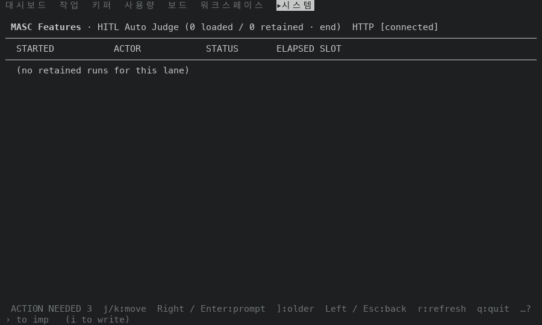
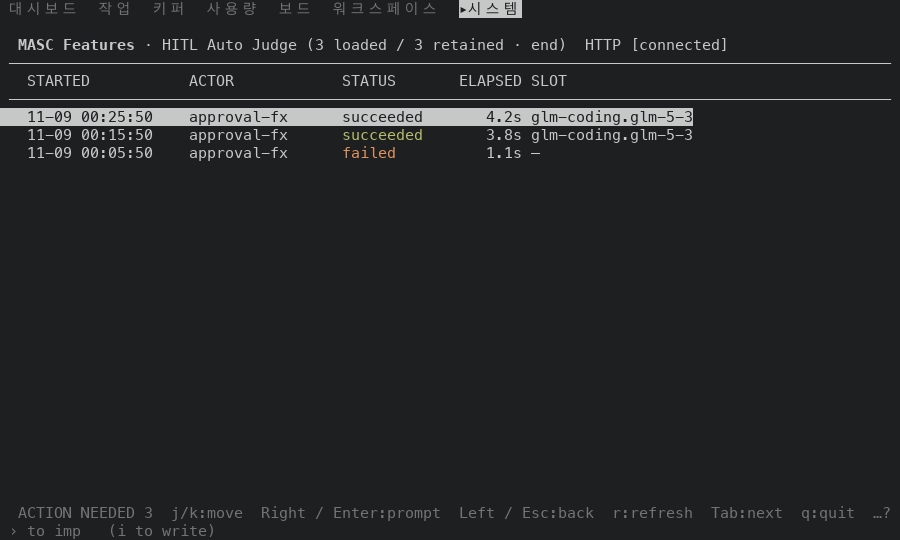
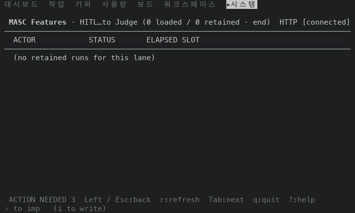

# Features 실행 목록 푸터가 동작하지 않는 키를 그리지 않아요: 고치기 전과 후 (#50051)

## 어떻게 쟀나

일회용 워크스페이스에 서버를 띄우고, TUI 와 서버 사이에 `GET /api/v1/dashboard/exact-lane-runs?lane=hitl_auto_judge` 의 답만 바꿔 주는 중계를 뒀어요. 중계는 세 가지 답 중 하나를 내보내요. 행은 가짜 값이에요(실행자 `approval-fx`, 성공 4.2초와 3.8초, 실패 1.1초).

- `empty`: 실행 0개, 더 오래된 쪽 없음
- `runs`: 실행 3개, 더 오래된 쪽 없음(서버가 `has_more: false`)
- `more`: 실행 3개, 더 오래된 쪽 있음(`has_more: true`, 전체 9개)

tmux 3.6a 안의 TUI 로 명령 팔레트에서 `go Features` 를 열고, 아래 화살표 한 번으로 고른 HITL Auto Judge 줄을 Enter 로 열어 실행 목록을 띄웠어요. 목록 화면을 찍은 뒤 `Enter`(실행 상세, 빈 목록은 아무 일 없음)를 찍고, `Esc` 로 돌아온 화면을 찍었어요. 크기는 100x30 과 80x24 예요.

- 고치기 전: 이 브랜치가 갈라진 main 의 증명 빌드 run 42493830723, 커밋 `b91485d3cfc3`, `masc-tui` sha256 `d57d51e3ad83fb19223a027b8fc06575fe13c1380c455baed20d3cf4b1dffb75`, `--build-commit` 이 같아요. 이 run 의 `native-tui / macos-tui` 는 성공이고, 같은 run 의 `Source and config syntax` 가 취소돼서 run 전체는 취소로 끝났어요. 취소 원인은 못 찾았어요. 영수증(`receipt.json`)의 소스 커밋은 `b91485d3cfc3a8bb2b872d66c1b72b305a154312` 로 검증했어요.
- 고친 뒤: 이 PR 코드 커밋의 증명 빌드 run 42494624216(성공), 커밋 `97247771f6cc`, sha256 `2c2f9ea99864222ffdf35c1ef806fd33fbb47c60508ead3e9851b133dfc2fe26`, `--build-commit` 이 같아요.
- 두 빌드 사이에 바뀐 파일: `bin/masc_tui_keys.ml`, `bin/masc_tui_keys.mli`, `bin/masc_tui_render_lanes.ml`.

## 읽는 법

- 푸터는 목록이 어떤 상태든 `j/k:move  Right / Enter:prompt  ]:older` 를 그렸어요. 이 PR 은 불러온 실행이 있을 때만 앞의 두 키를, 서버가 더 오래된 쪽을 알렸을 때만 `]:older` 를 그려요.
- 핸들러의 조건과 같아요: `Enter` 는 `List.nth_opt runs state.lane_runs_cursor` 가 있을 때(`bin/masc_tui.ml` 41122행), `]` 는 `state.lane_runs_next = Some _` 이고 불러오는 중이 아닐 때(37869행) 움직여요.
- `…?` 는 폭이 모자라 키 일부를 숨겼다는 표시예요.

## 푸터

| 목록 | 크기 | 고치기 전 푸터 | 고친 뒤 푸터 |
| --- | --- | --- | --- |
| 실행이 하나도 없는 목록 | 100x30 | `ACTION NEEDED 3  j/k:move  Right / Enter:prompt  ]:older  Left / Esc:back  r:refresh  q:quit  …?` | `ACTION NEEDED 3 · keeper_fleet_safety:no_executable_keeper_fibers  Left / Esc:back  q:quit  …?` |
| 실행이 하나도 없는 목록 | 80x24 | `ACTION NEEDED 3  j/k:move  Right / Enter:prompt  Left / Esc:back  q:quit  …?` | `ACTION NEEDED 3  Left / Esc:back  r:refresh  Tab:next  q:quit  ?:help` |
| 실행 3개, 더 오래된 쪽이 없는 목록 | 100x30 | `ACTION NEEDED 3  j/k:move  Right / Enter:prompt  ]:older  Left / Esc:back  r:refresh  q:quit  …?` | `ACTION NEEDED 3  j/k:move  Right / Enter:prompt  Left / Esc:back  r:refresh  Tab:next  q:quit  …?` |
| 실행 3개, 더 오래된 쪽이 없는 목록 | 80x24 | `ACTION NEEDED 3  j/k:move  Right / Enter:prompt  Left / Esc:back  q:quit  …?` | `ACTION NEEDED 3  j/k:move  Right / Enter:prompt  Left / Esc:back  q:quit  …?` (같음) |
| 실행 3개, 더 오래된 쪽이 있는 목록 | 100x30 | `ACTION NEEDED 3  j/k:move  Right / Enter:prompt  ]:older  Left / Esc:back  r:refresh  q:quit  …?` | `ACTION NEEDED 3  j/k:move  Right / Enter:prompt  ]:older  Left / Esc:back  r:refresh  q:quit  …?` (같음) |
| 실행 3개, 더 오래된 쪽이 있는 목록 | 80x24 | `ACTION NEEDED 3  j/k:move  Right / Enter:prompt  Left / Esc:back  q:quit  …?` | `ACTION NEEDED 3  j/k:move  Right / Enter:prompt  Left / Esc:back  q:quit  …?` (같음) |

줄어든 키가 쓰던 칸이 풀려서 푸터가 고르는 것이 바뀐 곳이 있어요.

- 실행 없음(100x30): `ACTION NEEDED` 이유가 길게 나오고 `r:refresh` 는 빠져요. 이 PR 은 푸터가 알림 이유를 키보다 먼저 그리는 우선순위를 건드리지 않았어요.
- 실행 없음(80x24): `r:refresh`, `Tab:next`, `?:help` 가 보여요. 고치기 전에는 `…?` 뒤에 숨어 있었어요.
- 실행 3개, 더 오래된 쪽 없음(100x30): `Tab:next` 가 보여요. 고친 뒤 빌드에서 `Tab` 을 눌러 보니 다음 화면(Dashboard)으로 가요.
- 80x24 에서는 더 오래된 쪽이 있어도 `]:older` 가 안 보여요. 푸터 폭이 모자라서 두 빌드가 같고, 제목의 `] older` 도 잘려요(`(3 loaded / 9 retained · ] ol…`).

## 고치기 전 빌드에서 푸터에 떠 있던 키를 눌러 본 결과(100x30)

- 실행 없음: `j`, `]`, `Enter` 모두 화면이 그대로예요. `j` 는 글자와 색이 모두 같고, `]` 와 `Enter` 는 글자가 같아요.
- 실행 3개, 더 오래된 쪽 없음: `]` 를 누르면 글자가 그대로예요. `j` 와 `Enter` 는 움직여요(`j` 는 색만 바뀌고, `Enter` 는 `Lane Run run-fx-001` 상세를 열어요).

## 두 빌드가 같아야 하는 단계

시각과 날짜는 빼고, 푸터는 위 표대로예요.

- 더 오래된 쪽이 있는 목록: 두 크기 모두 푸터가 같아요.
- 실행 3개, 더 오래된 쪽 없음(80x24): 푸터가 같아요.
- 실행이 있는 두 목록에서 `Enter` 로 연 실행 상세와, `Esc` 로 돌아온 목록(두 크기 모두): 글자가 같아요.
- 빈 목록에서 `Enter`: 목록이 그대로이고, `Esc` 는 레인 개요(`MASC Features` 기능 목록)로 돌아가요. 두 빌드가 같아요.

## 화면

| 목록 | 고치기 전 | 고친 뒤 |
| --- | --- | --- |
| 실행 없음, 100x30 |  |  |
| 실행 3개, 더 오래된 쪽 없음, 100x30 |  |  |
| 실행 없음, 80x24 |  |  |

더 오래된 쪽이 있는 목록은 푸터가 같아서 고친 뒤 화면만 실어요(`]:older` 가 그대로 있어요): 

## 재지 않은 것

- 실제 서버가 보낸 실행 목록. 위 행은 중계가 만든 가짜 값이에요.
- `]` 로 더 오래된 쪽을 실제로 불러오는 단계(`more` 에서 `]` 를 누르지 않았어요).
- 120x35 이상의 크기, 푸터 키 표시를 끈 설정.
