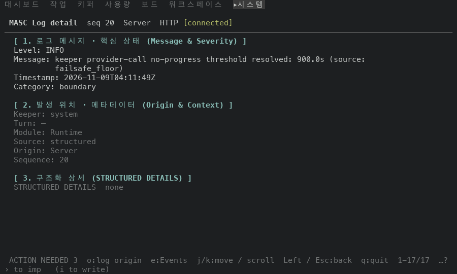
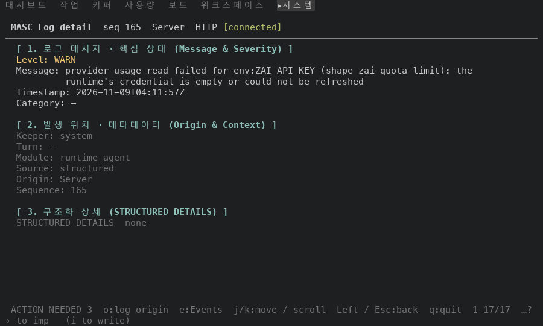
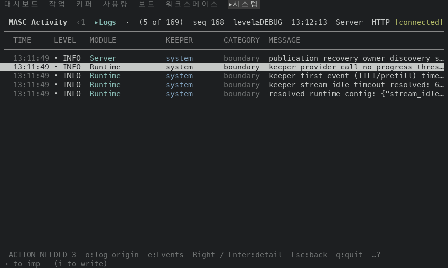
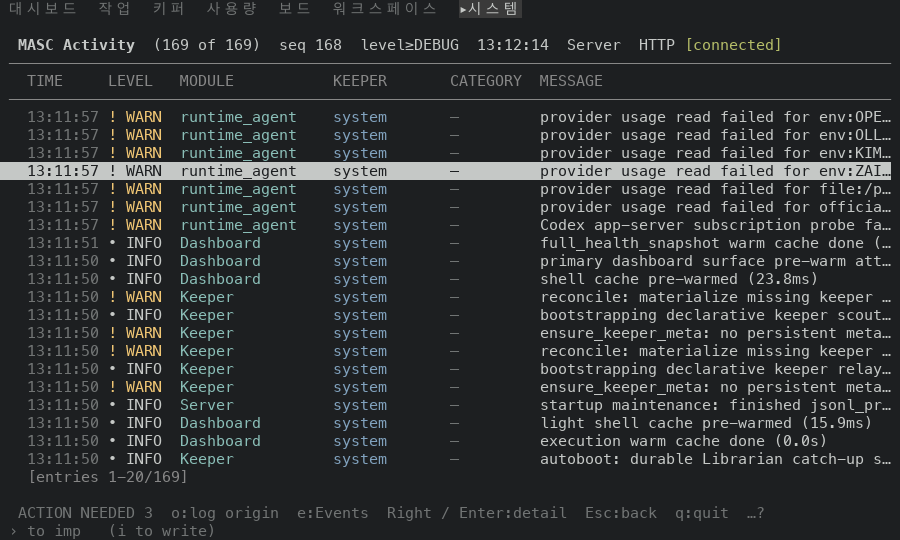

# Logs 상세: 열린 항목 안에서 필터 키(l·v·c)를 받지 않기

## 실측

고정 서버 위 증명 빌드 둘로 같은 걸음을 걸었어요. 앞은 main 에 type-check 수리(#50372)를 얹은 `c3854d9b5854`, 뒤는 그 위에 이 PR 의 코드를 얹은 `27574ed77a85`예요(main 의 type-check 가 깨져서 수리 없이는 TUI 빌드가 안 돼요). `go Logs` → `Down` 두 번 → `Enter`(로그 한 줄 열기) → `]` → `[` → `l` → `v` → `c` → `]` → `Esc` 순서로, 걸음마다 화면을 한 장씩 찍었어요. 처음 목록의 머리는 `(169 of 169) level≥DEBUG` 예요.

| 걸음 | 앞 | 뒤 |
|---|---|---|
| 항목을 열었어요 (`Sequence`) | 166 | 166 |
| `]` 로 이웃 항목 | 165 | 165 |
| `[` 로 돌아옴 | 166 | 166 |
| `l`·`v`·`c` 를 누른 뒤 `]` | 20 | 165 |
| `Esc` 로 닫은 뒤 목록 머리 | (5 of 169) level≥DEBUG | (169 of 169) level≥DEBUG |

앞 빌드에서는 열린 항목 안에서 `l`·`v`·`c` 를 눌러도 상세 화면이 그대로라 눌렀는지 알 수 없어요. 그런데 목록 쪽 필터와 커서는 바뀌어요. 그 뒤 `]` 는 열려 있던 항목의 이웃(165)이 아니라 바뀐 목록의 엉뚱한 항목(20)으로 가고, `Esc` 로 닫으면 아무도 못 본 필터가 걸린 목록이에요. 뒤 빌드에서는 세 키가 열린 항목 안에서 아무것도 안 하고, 이웃 이동과 닫은 뒤의 목록이 그대로예요. 열린 항목 안에서 누른 `l`·`v`·`c` 뒤의 상세 화면 본문은 세 장 모두 같아요(공백 개수는 가렸어요).

안 잰 것: 목록에서 `l`·`v`·`c` 가 도는 것은 이 걸음에 없어요(처리기 본문은 안 바꿨고 가드만 더했어요). `o`(로그 출처 바꾸기)와 `e`(Events)를 열린 항목 안에서 누르는 것도 안 잰 것이에요. 폭은 100x30 만 봤어요.

| 앞 | 뒤 |
|---|---|
| 필터 키 뒤 `]` 의 상세  |   |
| `Esc` 로 닫은 뒤 목록  |   |
