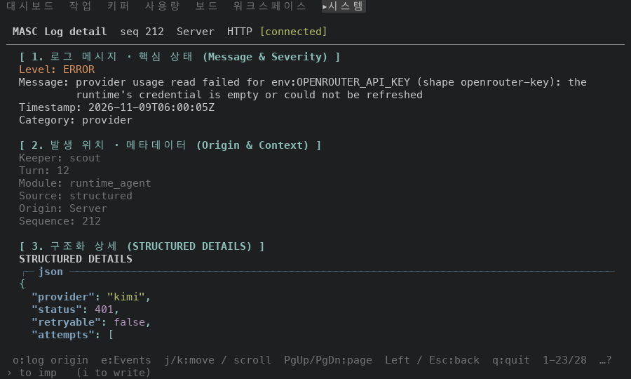
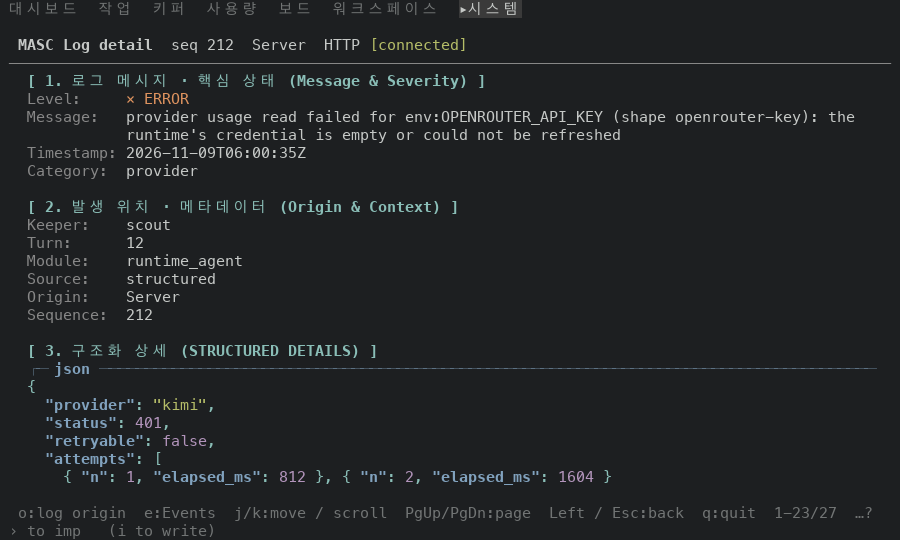
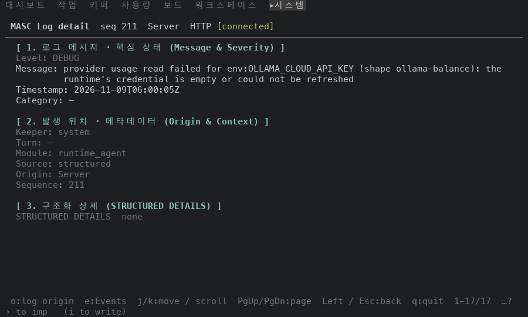
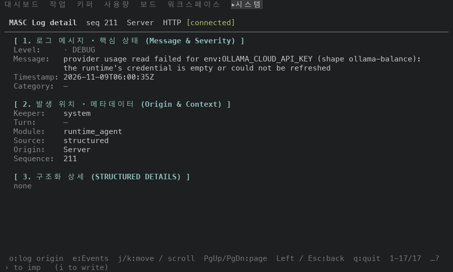
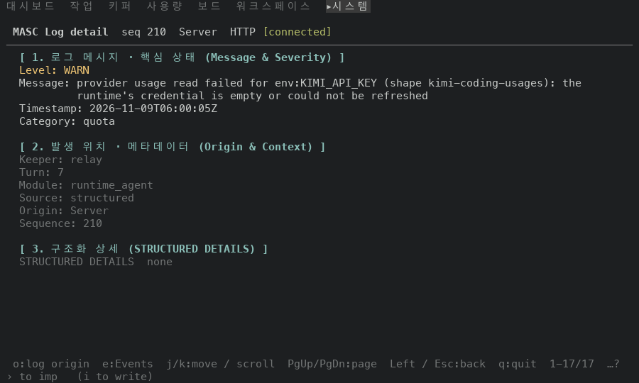
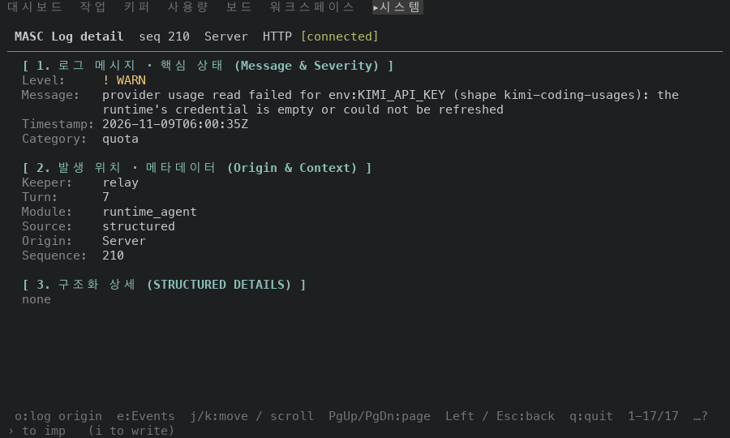

# Logs 상세를 라벨 칸 하나로 맞춰 그리기

## 실측

고정 서버 위 증명 빌드 둘로 같은 걸음을 걸었어요. 앞은 main `89af57ba3d8f`, 뒤는 이 PR 의 코드 `7b2df84cc519` 예요. Logs 목록에서 맨 위 세 줄의 상세를 열어요. 고정 서버의 맨 위 로그 줄은 info·warn 이고 구조화 상세가 비어 있어서, 캡처 프록시가 그 세 줄의 level·Keeper·turn·category·details 만 error(상세 있음)·debug(Keeper 없음)·warn 으로 바꿨어요. 그림은 100x30 이고, 아래 값은 찍은 text·ANSI 에서 읽었어요.

| 잰 것 | 앞 | 뒤 |
|---|---|---|
| 값이 시작하는 칸(error 줄, 사실 10행) | 6곳 (9, 10, 11, 12, 13, 14) | 1곳 (14) |
| Keeper 행의 라벨 색 / 값 색 | 흐림 / 흐림 | 라벨 `Theme.recede` 계열(회색(256색 102)) / 값 칠하지 않음 |
| `STRUCTURED DETAILS` 글자가 나오는 행(error 줄) | 2행 | 1행 |
| 페이지 전체 행 수(error 줄) | 28 | 27 |

Level 값 색은 목록의 Level 칸과 비교했어요. ERROR 와 WARN 은 목록과 같은 색이에요(ERROR 밝은 빨강, WARN 밝은 노랑). DEBUG 는 목록이 흐림(SGR 2)이고 상세는 `Theme.recede` 계열(회색(256색 102))이라 색이 달라요. 둘 다 흐린 색이지만 같은 색은 아니에요.

안 잰 것: 폭 100 만 봤어요. 좁은 폭에서 값이 라벨 밑으로 내려가는 경우, 긴 한 단어 값, 터미널이 팔레트를 알려 주지 않을 때의 `recede` 는 안 찍었어요.

| 앞 | 뒤 |
|---|---|
| error 줄 · 구조화 상세 있음  |   |
| debug 줄 · 빈 값  |   |
| warn 줄 · Keeper 와 turn 있음  |   |
