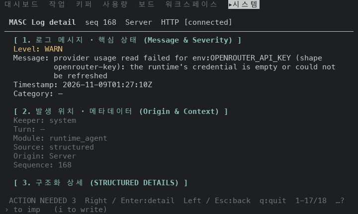
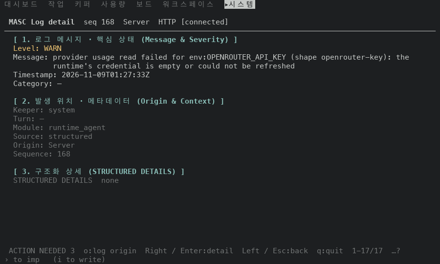
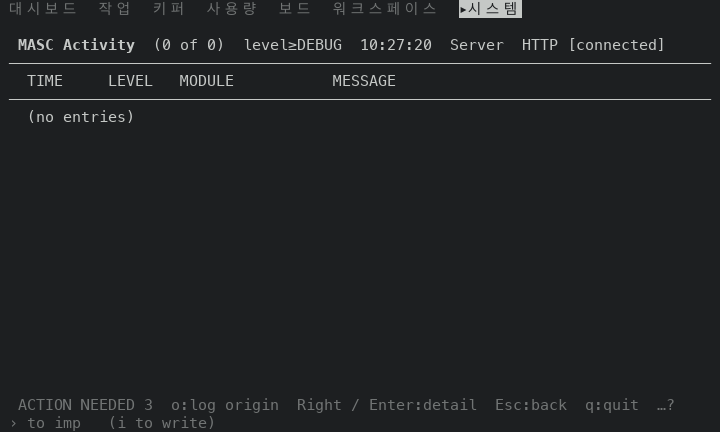
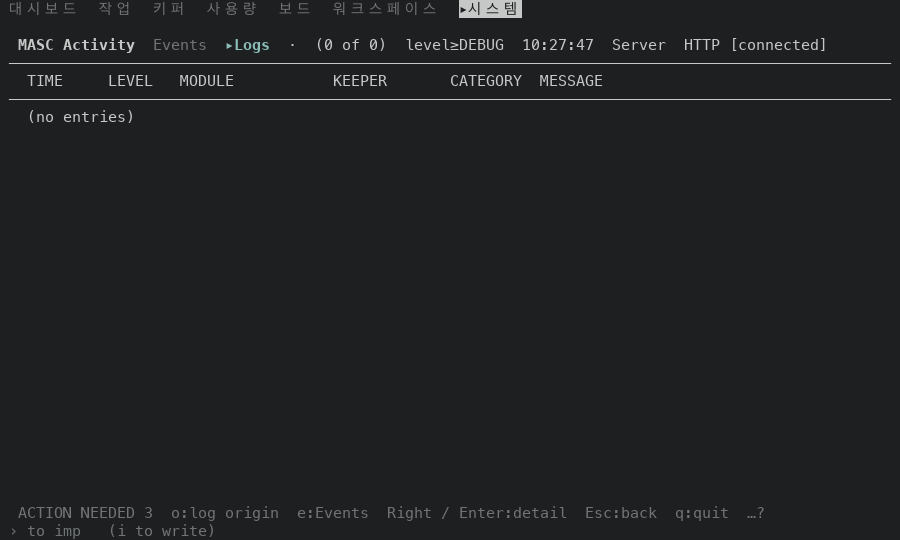
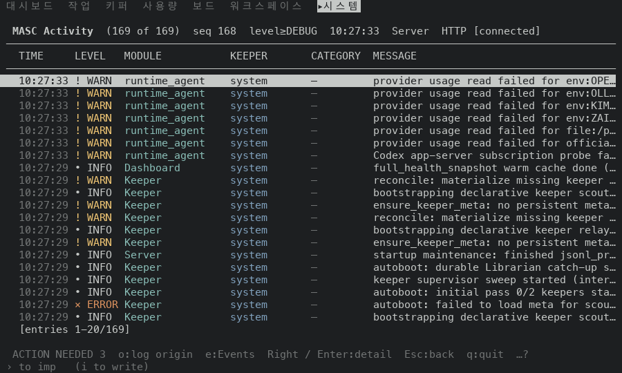
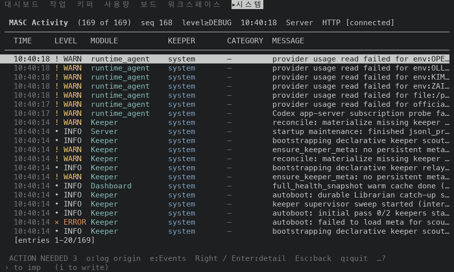

# Logs 푸터가 말하는 키 (#50249)

열린 Logs 항목과 항목이 없는 Logs 목록의 푸터에서 눌러도 아무 일도 없는 키가 빠진 앞뒤를 비교했어요.

## 환경

- 앞: 증명 빌드 `u68`(코드 `eddaefead058`, run 42537260867). 뒤: `u71`(코드 `f1ae75219f4d`, run 42545406995).
- 80x24, 100x30, 120x34. 고정 서버(작업 공간은 비어 있는 작은 Git 저장소)를 쓰고 사용자 서버는 쓰지 않았어요.
- 항목이 없는 목록은 프록시가 로그 스트림에 항목 0개짜리 스냅숏 한 프레임만 답하게 해서 만들었어요(`(0 of 0)`, `(no entries)`).
- 항목이 있는 목록과 열린 항목은 두 빌드가 각자 띄운 서버의 로그를 읽어서 본문이 서로 달라요. 푸터 줄만 비교했어요.

## 결과(푸터 줄)

| 폭 | 화면 | 앞 | 뒤 | 살아 있는 키 |
|---|---|---|---|---|
| 80x24 | 항목이 있는 목록 | `ACTION NEEDED 3  o:log origin  Right / Enter:detail  Esc:back  q:quit  …?` | `ACTION NEEDED 3  o:log origin  Right / Enter:detail  Esc:back  q:quit  …?` | 같음 |
| 80x24 | 열린 항목 | `ACTION NEEDED 3  Right / Enter:detail  Left / Esc:back  q:quit  1-17/18  …?` | `ACTION NEEDED 3  o:log origin  e:Events  Left / Esc:back  q:quit  1-17/18  …?` | +`o` +`e` |
| 80x24 | 항목이 없는 목록 | `ACTION NEEDED 3  o:log origin  Right / Enter:detail  Esc:back  q:quit  …?` | `ACTION NEEDED 3  o:log origin  e:Events  l:level floor  Esc:back  q:quit  …?` | +`e` +`l` |
| 100x30 | 항목이 있는 목록 | `ACTION NEEDED 3  o:log origin  e:Events  Right / Enter:detail  Esc:back  q:quit  …?` | `ACTION NEEDED 3  o:log origin  e:Events  Right / Enter:detail  Esc:back  q:quit  …?` | 같음 |
| 100x30 | 열린 항목 | `ACTION NEEDED 3  o:log origin  Right / Enter:detail  Left / Esc:back  q:quit  1-17/17  …?` | `ACTION NEEDED 3  o:log origin  e:Events  j/k:move / scroll  Left / Esc:back  q:quit  1-17/17  …?` | +`e` +`j/k` |
| 100x30 | 항목이 없는 목록 | `ACTION NEEDED 3  o:log origin  e:Events  Right / Enter:detail  Esc:back  q:quit  …?` | `ACTION NEEDED 3 · keeper_fleet_safety:no_executable_keeper_fibers  Esc:back  q:quit  …?` | −`o` −`e` |
| 120x34 | 항목이 있는 목록 | `ACTION NEEDED 3 · keeper_fleet_safety:no_executable_keeper_fibers  Right / Enter:detail  Esc:back  q:quit  …?` | `ACTION NEEDED 3 · keeper_fleet_safety:no_executable_keeper_fibers  Right / Enter:detail  Esc:back  q:quit  …?` | 같음 |
| 120x34 | 열린 항목 | `ACTION NEEDED 3  o:log origin  e:Events  j/k:move / scroll  Right / Enter:detail  Left / Esc:back  q:quit  1-17/17  …?` | `ACTION NEEDED 3 · keeper_fleet_safety:no_executable_keeper_fibers  o:log origin  Left / Esc:back  q:quit  1-17/17  …?` | −`e` −`j/k` |
| 120x34 | 항목이 없는 목록 | `ACTION NEEDED 3 · keeper_fleet_safety:no_executable_keeper_fibers  Right / Enter:detail  Esc:back  q:quit  …?` | `ACTION NEEDED 3 · keeper_fleet_safety:no_executable_keeper_fibers  o:log origin  e:Events  Esc:back  q:quit  …?` | +`o` +`e` |

- 열린 항목은 세 폭 모두에서 `Right / Enter` 가 빠져요. 두 키는 이미 열린 항목 위에서 아무 일도 안 해요.
- 항목이 없는 목록은 세 폭 모두에서 `j/k` `PgUp/PgDn` `Right / Enter` `n / N` `Home/End` 가 빠져요. 푸터 줄 말고 다른 줄은 앞뒤가 글자까지 같아요.
- 항목이 있는 목록은 `Right / Enter:detail` 이 남아요. 세 폭 모두 앞뒤 푸터가 같아요.
- 비운 자리를 누가 가져가는지는 푸터 맞춤이 정해요. 바뀐 여섯 쌍 중 4쌍에서는 살아 있는 키가 늘고, 2쌍(100x30 항목이 없는 목록, 120x34 열린 항목)에서는 알림 이유(`· keeper_fleet_safety:…`)가 길게 펴져서 키가 밀려나요. 알림 칩과 키 힌트가 자리를 나누는 정책은 #49925 라서 이 PR 에서 안 건드렸어요.

## 그림

| 앞 | 뒤 |
|---|---|
|  |  |
|  |  |
|  |  |
|  |  |
|  |  |
