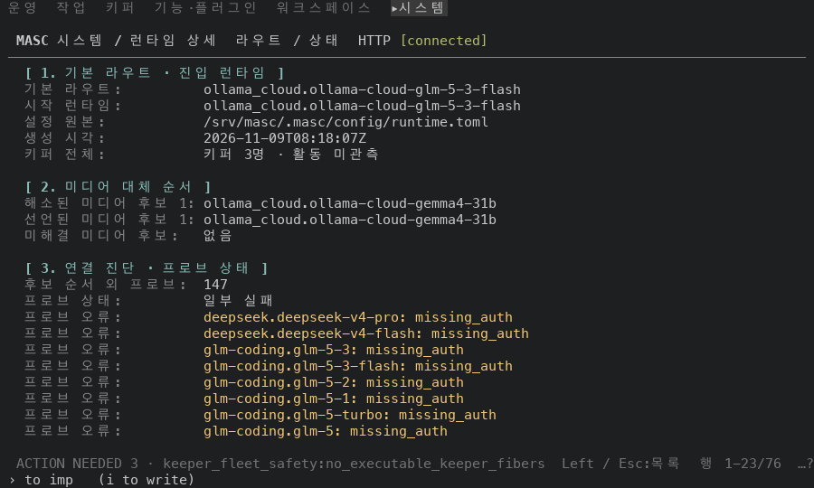
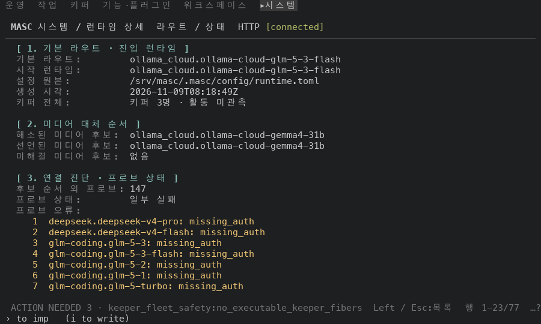
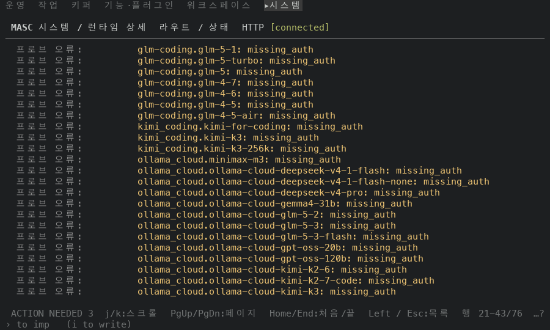
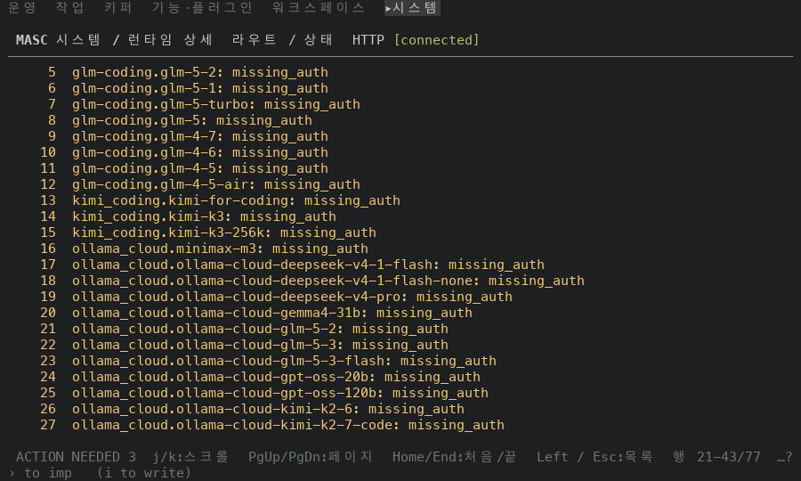

# Routes 의 반복 필드를 라벨 하나 아래 목록으로 그리기

## 실측

고정 서버 위에서 증명 빌드 둘로 같은 화면을 찍었어요. 앞은 아래 PR(#50524)의 코드 끝 `e132979f645c`(run `42583259174`, 그 뒤 커밋은 문서와 changelog 뿐이에요), 뒤는 그 위에 이 PR 의 코드 커밋 1개를 얹은 끝(run `42583334459`)이에요. 두 빌드의 소스는 코드 파일 1개만 달라요(`git diff --name-only` 로 확인했어요). Runtime 화면에서 `v` 로 연 Routes 페이지를 위부터 끝까지 읽었고, 아래 값은 찍은 text·ANSI 에서 읽었어요.

| 잰 것 | 앞 | 뒤 |
|---|---|---|
| `프로브 오류:` 라벨이 찍힌 행 | 58개 | 1개 |
| `프로브 한계:` 라벨이 찍힌 행 | 2개 | 1개 |
| 프로브 오류 글이 시작하는 칸 | 25 | 9 |
| Routes 페이지 전체 행 수 | 76 | 77 |
| 미디어 후보 행 | `해소된 미디어 후보 1:` | `해소된 미디어 후보:` |
| 값이 라벨 옆에서 시작하는 칸(라벨 칸 너비) | 25 | 24 |
| 프로브 오류 라벨 색 / 오류 글 색 | 회색(256색 102) / 밝은 노랑 | 회색(256색 102) / 밝은 노랑 (같음) |

프로브 오류 58개와 프로브 한계 2개의 글과 순서는 앞뒤가 같고, 나머지 9개 필드는 라벨과 값이 같아요(`생성 시각` 은 찍은 때의 시각이라 라벨만 비교했어요). 항목 앞에 1부터 번호가 붙어요. Runtime 행 페이지는 `Probe limitation:` 라벨이 2번에서 1번으로 줄고 한계 글이 번호 행이 돼요. 한계 글과 순서는 앞뒤가 같고, 페이지 행 수는 42에서 42이고, `Checked at`·`History window` 의 시각을 뺀 그 밖의 행은 같아요.

안 잰 것: 폭 100 만 봤어요. `이전 설정 관측` 줄이 있는 때와 한 항목이 폭보다 길어 감기는 때는 고정 서버에 없어서 찍지 않았어요.

| 앞 | 뒤 |
|---|---|
| Routes 위쪽  |   |
| Routes 가운데  |   |
