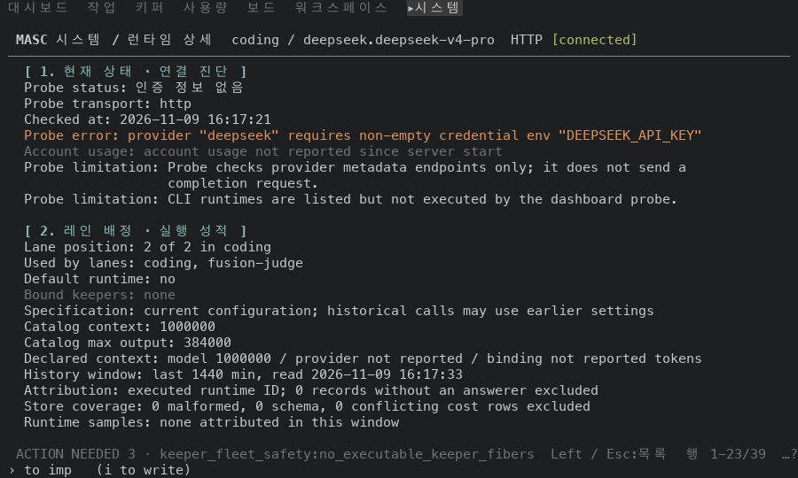
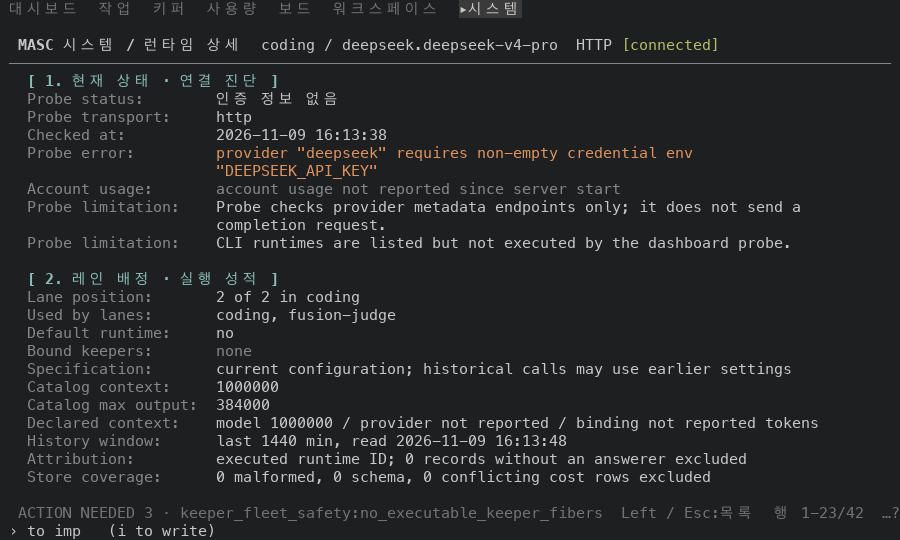
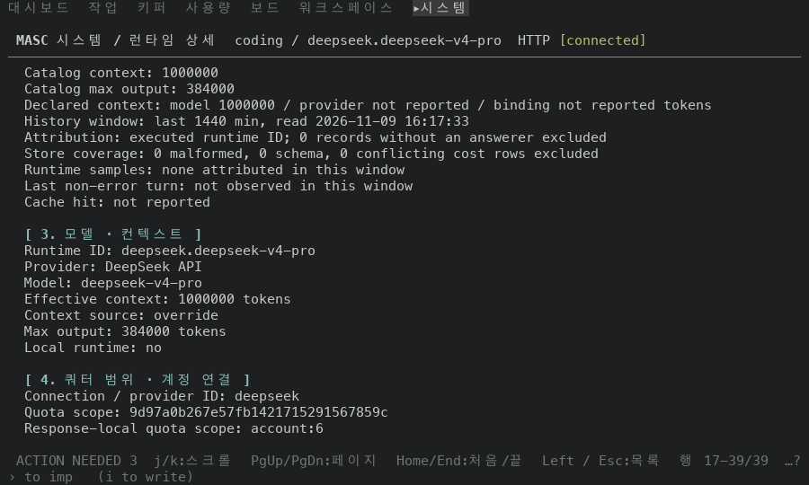
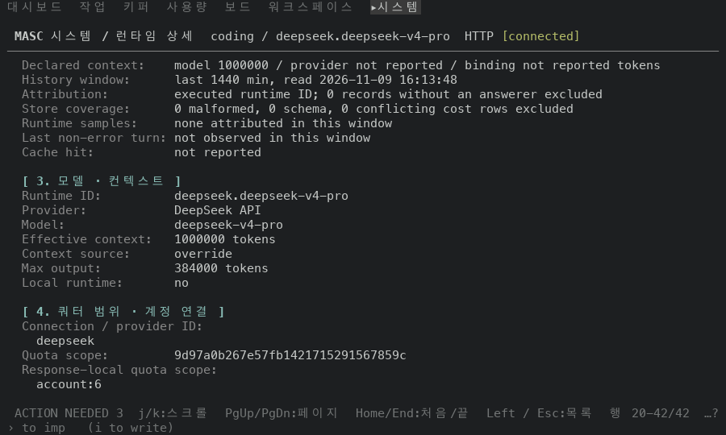
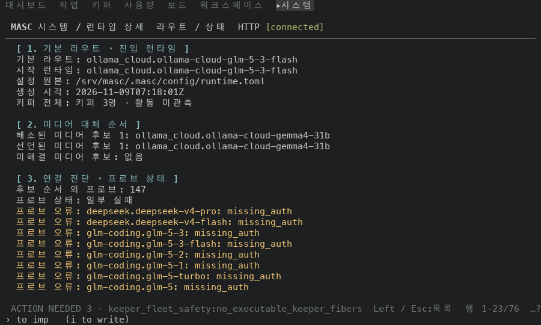
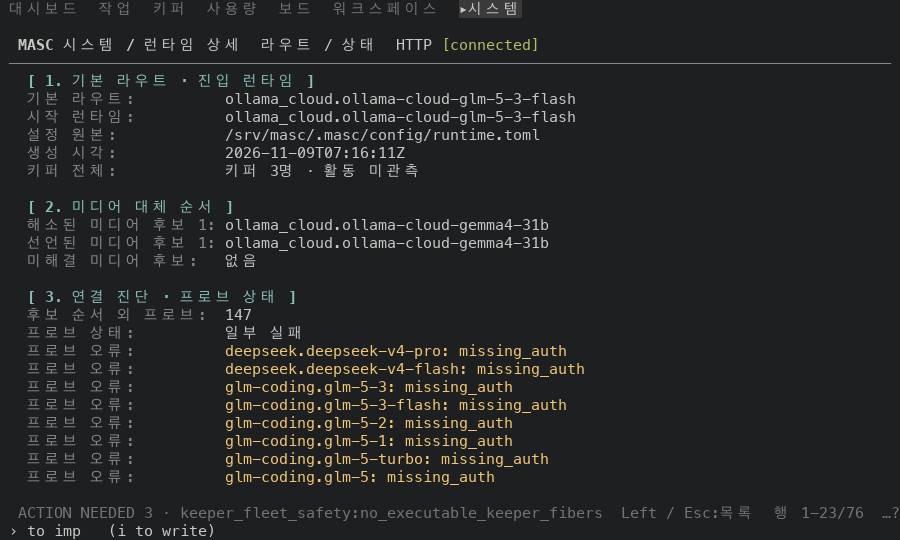
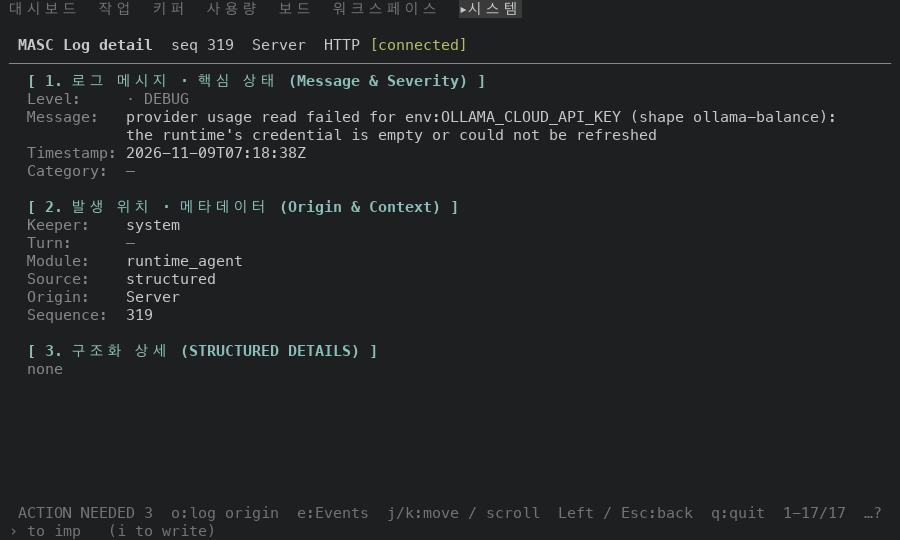
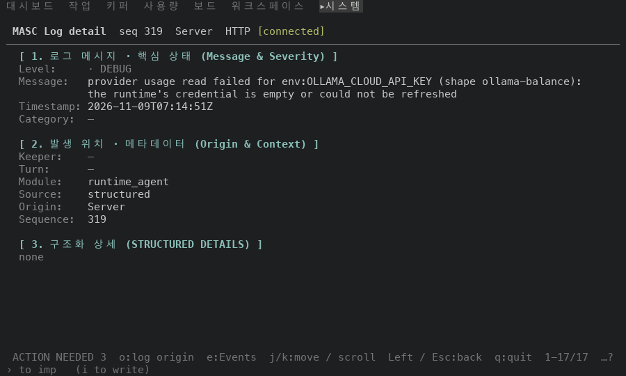

# Runtime 상세와 Routes 페이지를 라벨 칸 하나로 맞춰 그리기

## 실측

고정 서버 위에서 증명 빌드 둘로 같은 화면을 찍었어요. 앞은 main `adf667d6cf0e`(run `42577126964`), 뒤는 그 위에 이 PR 의 커밋 6개를 얹은 코드 끝(run `42576642226`)이에요. 두 빌드의 소스는 파일 12개만 달라요(`git diff --name-only` 로 확인했어요). 아래 값은 찍은 text·ANSI 에서 읽었어요.

### Runtime 상세

Runtime 화면에서 첫 후보 행(`coding / deepseek.deepseek-v4-pro`)의 상세를 열고 PageDown 으로 끝까지 읽었어요.

| 잰 것 | 앞 | 뒤 |
|---|---|---|
| 값이 라벨 옆에서 시작하는 칸(30개 필드 중) | 15곳 (10, 13, 14, 15, 16, 17, 18, 19, 20, 21, 22, 23, 24, 29, 31) | 1곳 (24) |
| 라벨이 혼자 한 행을 쓰고 값이 밑으로 내려간 필드 | 없음 | 2개 (`Connection / provider ID`, `Response-local quota scope`) |
| `Probe error` 행의 라벨 색 / 값 색 | 밝은 빨강 / 밝은 빨강 | 회색(256색 102) / 밝은 빨강 |
| 페이지 전체 행 수 | 39 | 42 |
| 값이 감겨 다음 행으로 이어진 필드(1행 → 4행) | `Probe limitation` | `Connection / provider ID`, `Probe error`, `Probe limitation`, `Response-local quota scope` |

제목 4줄·구역 사이 빈 줄 3줄·필드 31줄은 앞뒤가 같아요. 페이지가 3행 늘어난 것은 값이 감긴 행이 1행에서 4행이 된 만큼이에요: 값 칸이 오른쪽으로 옮겨서 `Probe error` 값이 한 행 더 감기고, 긴 라벨 둘의 값이 라벨 밑으로 내려가요.

### Routes 페이지

Runtime 목록에서 `v` 로 연 페이지를 PageDown 과 End 로 끝까지 읽었어요. `설정 원본` 경로는 찍은 서버의 임시 폴더라서 프록시가 `/srv/masc` 로 바꿔서 보여 줘요(앞뒤 모두).

| 잰 것 | 앞 | 뒤 |
|---|---|---|
| 값이 라벨 옆에서 시작하는 칸(12개 라벨 중) | 5곳 (14, 16, 23, 24, 25) | 1곳 (25) |
| `프로브 오류` 행의 라벨 색 / 값 색 | 밝은 노랑 / 밝은 노랑 | 회색(256색 102) / 밝은 노랑 |
| 페이지 전체 행 수 | 76 | 76 |

제목 3줄·구역 사이 빈 줄 2줄·필드 70줄은 앞뒤가 같아요.

### Logs 상세

Keeper 가 없는 debug 줄의 `Keeper` 행을 main(#50455)은 `system` 이라고 적고, 이 PR 은 `—` 로 그려요. 로그 목록은 앞뒤 모두 같은 줄의 Keeper 칸에 `—` 를 그려요.

안 잰 것: 폭 100 만 봤어요. 쿼터 소진·속도 제한·마지막 실패·계정 한도 행과 Routes 의 작업 결과 알림(`Info` 톤)은 고정 서버에서 낼 수 없어서 찍지 않았어요. 알림 색은 전과 같다는 것을 코드 대조로만 확인했어요(실패 = bad, 대기·후속 필요 = warn, 그 밖의 반영 = info).

| 앞 | 뒤 |
|---|---|
| Runtime 상세 · 위  |   |
| Runtime 상세 · 아래  |   |
| Routes 페이지 · 위  |   |
| Logs 상세 · Keeper 없는 debug 줄  |   |
