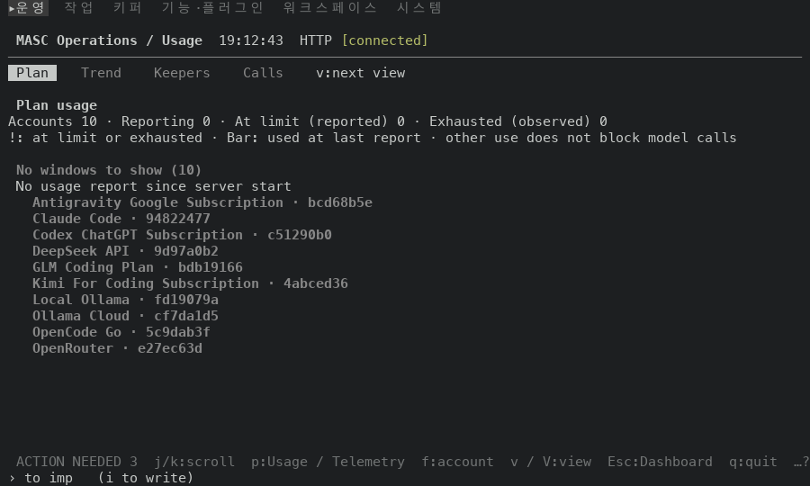
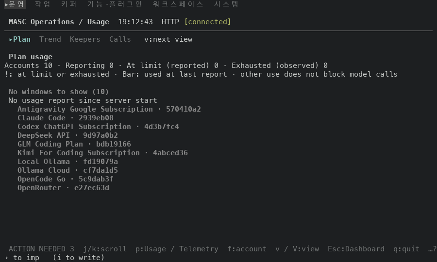
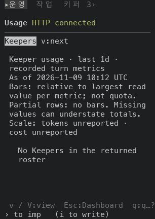
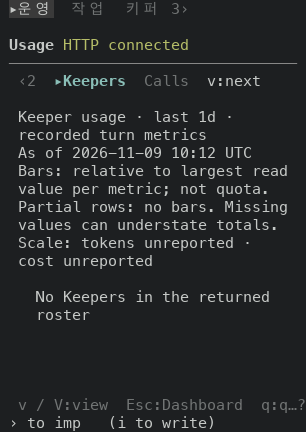

# Operations / Usage 구역 strip 을 모든 화면이 쓰는 strip 으로 그리기

## 실측

고정 서버 위에서 증명 빌드 둘로 같은 키 순서를 눌러 찍었어요. 앞은 main `78e52290002a`(run `42597455862`), 뒤는 그 위에 이 PR 의 코드 커밋을 얹어 빌드한 `ebfe14c7fd15`(run `42597407945`) 이에요. 두 빌드의 소스는 코드 파일 1개만 달라요(`git diff --name-only` 로 확인했어요). `:` 팔레트에서 `go Usage` 로 열고 `v` 를 세 번 눌러 Plan → Trend → Keepers → Calls 를 차례로 찍었어요. 폭 100(높이 30), 44, 34(높이 24)에서 같은 순서를 찍었고, 아래 값은 찍은 text·ANSI 에서 읽었어요.

| 폭, 읽는 구역 | 앞(strip 줄) | 뒤(strip 줄) |
|---|---|---|
| 100칸, `Keepers` 를 읽는 중 | `Plan    Trend    Keepers    Calls    v:next view` | `Plan  Trend  ▸Keepers  Calls   v:next view` |
| 44칸, `Keepers` 를 읽는 중 | `Plan   Trend   Keepers   Calls  v:next` | `Plan  Trend  ▸Keepers  Calls  v:next` |
| 34칸, `Keepers` 를 읽는 중 | `Keepers v:next` | `‹2  ▸Keepers  Calls  v:next` |

| 잰 것 | 앞 | 뒤 |
|---|---|---|
| 읽는 구역의 표시(폭 100, 네 구역 모두) | 반전(`7`) 한 칸 | `▸` + 굵게 + 밝은 청록(`1`·`96`) |
| 읽지 않는 구역의 색(폭 100) | 회색(256색 102) | 흐림(`2`) |
| 키 안내(폭 100 / 44 / 34) | v:next view / v:next / v:next | v:next view / v:next / v:next |
| 칸이 모자라 구역을 숨기는 폭(34) 표시 | 없음 | 있음(`‹n`·`n›`) |

strip 줄을 뺀 나머지 줄은 12장(폭 3개 × 구역 4개) 모두 앞뒤가 같아요. 찍을 때마다 달라지는 값(시각, 8자리 계정 번호, 고정 서버가 재는 ms 지연)은 가리고 비교했어요.

안 잰 것: 데이터가 있는 Usage 화면은 고정 서버에 없어서(계정 10개, 보고 0건) 읽는 구역 안쪽 표는 같은 빈 상태만 봤어요. strip 줄에 마우스 누름 대상은 없어요(앞에도 없었어요).

| 앞 | 뒤 |
|---|---|
| 폭 100, Plan  |   |
| 폭 34, Keepers  |   |
