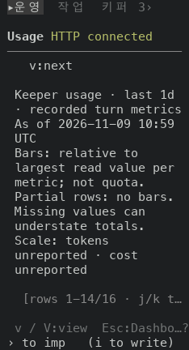
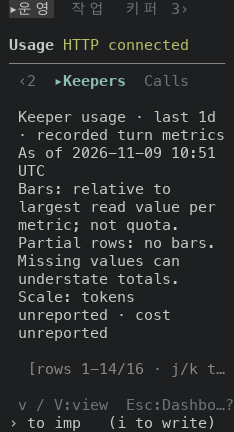
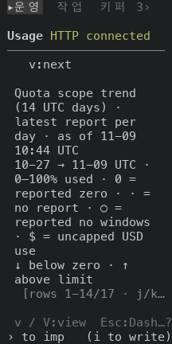
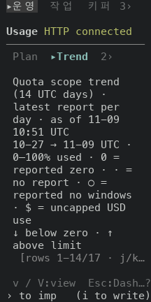

# Operations / Usage 구역 strip 을 모든 화면이 쓰는 strip 으로 그리기

## 실측

고정 서버 위에서 증명 빌드 둘로 같은 키 순서를 눌러 찍었어요. 앞은 main `78e52290002a`(run `42597455862`), 뒤는 그 위에 이 PR 의 코드 커밋을 얹어 빌드한 `e0196f24df37`(run `42602228421`) 이에요. 두 빌드의 코드는 파일 1개만 달라요(`git diff --name-only` 로 확인했어요. 문서와 changelog 는 빌드에 안 들어가요). `:` 팔레트에서 `go Usage` 로 열고 `v` 를 세 번 눌러 Plan → Trend → Keepers → Calls 를 차례로 찍었어요. 폭 100(높이 30), 44, 34(높이 24)에서 같은 순서를 찍었고, 아래 값은 찍은 text·ANSI 에서 읽었어요.

| 폭, 읽는 구역 | 앞(strip 줄) | 뒤(strip 줄) |
|---|---|---|
| 100칸, `Keepers` 를 읽는 중 | `Plan    Trend    Keepers    Calls    v:next view` | `Plan  Trend  ▸Keepers  Calls   v:next view` |
| 44칸, `Keepers` 를 읽는 중 | `Plan   Trend   Keepers   Calls  v:next` | `Plan  Trend  ▸Keepers  Calls  v:next` |
| 34칸, `Keepers` 를 읽는 중 | `Keepers v:next` | `‹2  ▸Keepers  Calls  v:next` |

| 잰 것 | 앞 | 뒤 |
|---|---|---|
| 읽는 구역의 표시(폭 100, 네 구역 모두) | 반전(`7`) 한 칸 | `▸` + 굵게 + 밝은 청록(`1`·`96`) |
| 읽지 않는 구역의 색(폭 100) | 회색(256색 102) | 흐림(`2`) |
| 키 안내(폭 100 / 44 / 34) | v:next view / v:next / v:next | v:next view / v:next / v:next |
| 칸이 모자라 구역을 숨기는 폭(34) 표시 | 없음 | 있음(`‹n`·`n›`) |

strip 줄을 뺀 나머지 줄은 12장(폭 3개 × 구역 4개) 모두 앞뒤가 같아요. 찍을 때마다 달라지는 값(시각, 8자리 계정 번호, 고정 서버가 재는 ms 지연)은 가리고 비교했어요. Calls 화면은 지연 값의 자릿수에 따라 표의 열 간격과 잘리는 자리가 달라져서 그 화면만 공백 길이와 `…` 앞 공백을 무시하고 비교했어요.

안 잰 것: 데이터가 있는 Usage 화면은 고정 서버에 없어서(계정 10개, 보고 0건) 읽는 구역 안쪽 표는 같은 빈 상태만 봤어요. strip 줄에 마우스 누름 대상은 없어요(앞에도 없었어요).

| 앞 | 뒤 |
|---|---|
| 폭 100, Plan  |   |
| 폭 34, Keepers  |   |

## 좁은 폭(리뷰 반영)

리뷰어 셋이 폭이 좁으면 읽는 구역 이름이 줄에서 사라진다고 짚었어요(폭 26 의 Keepers 가 예였어요). 그 폭을 직접 쟀어요. 같은 키 순서(`go Usage`, `v` 세 번)로 폭 27~10(높이 24) 12가지를 세 빌드로 찍었어요. main `78e52290002a`(run `42597455862`), 리뷰를 받은 코드 `ebfe14c7fd15`(run `42597407945`), 고친 코드 `e0196f24df37`(run `42602228421`)예요. 고친 코드는 strip 이 지킬 칸(읽는 구역과 숨긴 개수 표시가 들어가는 최소 폭)을 먼저 잡고, `v:next` 는 남는 칸에 들어갈 때만 그려요. strip 이 최소 폭보다 좁으면 읽는 구역 이름만 그려요.

| 폭 | main | 리뷰받은 코드 | 고친 코드 |
|---|---|---|---|
| 27칸, `Keepers` 를 읽는 중 | `Keepers v:next` | `‹2  ▸Keepers  1›  v:next` | `‹2  ▸Keepers  1›  v:next` |
| 26칸, `Keepers` 를 읽는 중 | `Keepers v:next` | `v:next` | `‹2  ▸Keepers  Calls` |
| 25칸, `Keepers` 를 읽는 중 | `Keepers v:next` | `v:next` | `‹2  ▸Keepers  Calls` |
| 24칸, `Keepers` 를 읽는 중 | `Keepers v:next` | `v:next` | `‹2  ▸Keepers  Calls` |
| 22칸, `Keepers` 를 읽는 중 | `Keepers v:next` | `v:next` | `‹2  ▸Keepers  Calls` |
| 20칸, `Keepers` 를 읽는 중 | `Keepers v:next` | `v:next` | `‹2  ▸Keepers  1›` |
| 19칸, `Keepers` 를 읽는 중 | `Keepers v:next` | `v:next` | `‹2  ▸Keepers  1›` |
| 18칸, `Keepers` 를 읽는 중 | `Keepers v:next` | `v:next` | `▸Keepers` |
| 16칸, `Keepers` 를 읽는 중 | `Keepers v:next` | `v:next` | `▸Keepers` |
| 12칸, `Keepers` 를 읽는 중 | `Keepers v` | `v:next` | `▸Keepers` |
| 11칸, `Keepers` 를 읽는 중 | `Keepers v` | `v:next` | `▸Keepers` |
| 10칸, `Keepers` 를 읽는 중 | `Keepe… v` | `v:ne…` | (빈 줄) |

읽는 구역 이름이 줄에 없는 폭이에요(찍은 폭 중, 네 구역 각각).

| 읽는 구역 | main | 리뷰받은 코드 | 고친 코드 |
|---|---|---|---|
| Plan | 없음 | 19 이하 전부 | 없음 |
| Trend | 없음 | 24 이하 전부 | 없음 |
| Keepers | 10 | 26 이하 전부 | 10 |
| Calls | 없음 | 20 이하 전부 | 없음 |

- 고친 코드는 폭 11 이상에서 네 구역 모두 이름이 있어요. 폭 10 에서는 Keepers 의 이름이 없어요(읽는 구역 이름과 `▸` 가 들어갈 칸이 모자라요).
- 좁은 폭 12가지 중 고친 코드가 `v:next` 를 그리는 폭은 27 하나예요. 26 이하에서는 strip 이 그 칸을 써요. 푸터 줄에 `v / V:` 가 있는 곳은 찍은 모든 폭에서 네 구역 모두예요(좁아서 뒤가 잘려도 앞은 남아요).
- 폭 27 과 100·44·34 에서는 리뷰받은 코드와 고친 코드의 strip 줄이 글자와 색까지 같아요(구역 4개 × 폭 4가지).
- strip 줄을 뺀 나머지 줄은 두 빌드가 모두 같아요(60장 = 구역 4개 × 폭 15가지, 시각·8자리 계정 번호·고정 서버가 재는 ms 지연은 가리고, Calls 화면은 공백 길이와 `…` 앞 공백을 무시하고 비교했어요).
- 단점: 폭 26 이하에서는 줄에서 `v:next` 가 빠져요. 키는 푸터가 말해요. 이름 하나만 그리는 폭에서는 이웃 구역과 숨긴 개수가 안 보여요.

안 잰 것: 폭 10 아래와 높이 24 밖, 데이터가 있는 Usage 화면.

| 앞(리뷰받은 코드) | 뒤(고친 코드) |
|---|---|
| 폭 26, Keepers  |   |
| 폭 24, Trend  |   |
