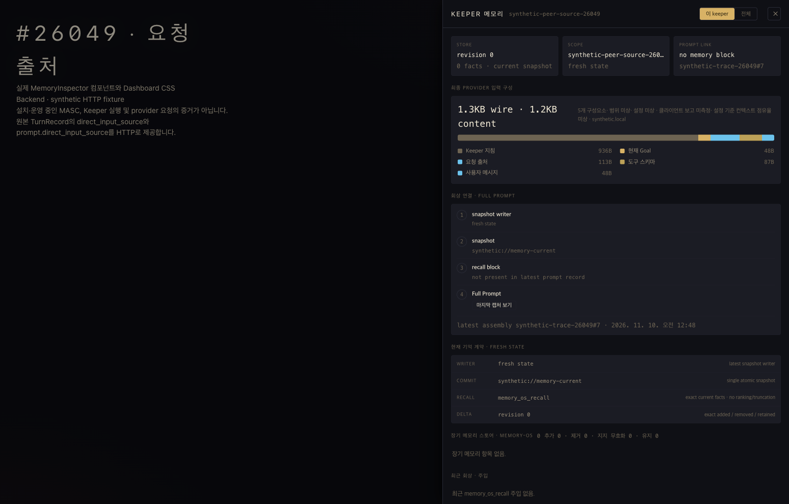

# Admitted request source: observed scope

Issue: [#26049](https://github.com/jeong-sik/masc/issues/26049). Native Stack #50720, PRs [#50718](https://github.com/jeong-sik/masc/pull/50718) and [#50719](https://github.com/jeong-sik/masc/pull/50719).

A Keeper request already had typed, immutable sender metadata, but that metadata
is deliberately excluded from provider messages. The change derives a separate
observation naming the admitted operation and sender. It does not grant operator
authority, Task ownership or permission to act. Unattributed local input is named
`local_request`; an official-client Host resume cue does not replace the source
of the admitted operation.

## Browser observation

On 2026-11-09 at 15:52 UTC, Ego Lite Chromium rendered the actual
`MemoryInspector`, strict production TurnRecord decoder and imported dashboard
CSS with a standalone synthetic HTTP backend. The visible legend showed
**요청 출처 · 113B**. The screenshot is unmodified:



The exact payload, DOM, browser receipt, HTTP requests and fixture source are
retained in [browser/](browser/README.md). The source facts, 1,232 content bytes
and 1,343 request-body bytes are synthetic. This verifies the component and
decoder with that input; it does not verify the backend producer, a live peer
delegation, model behavior, complete production dashboard, installed runtime or
deployment. The visible legend uses `input_components`; the strict decoder also
accepted the corresponding `blocks` ID.

The first invalid fixture was rejected by the decoder. Only fixture data was
corrected. Its refusal remains in the local run directory; the retained bundle
contains the corrected observation. Both owned fixture servers were stopped and
the dedicated browser TaskSpace 44 was finished. Other spaces were not touched.

## Source binding and retained paths

Capture-time files are copied byte for byte, including absolute host paths in
the raw manifests and fixture. Those paths describe the capture environment.
The UI source was committed during capture as
`0480843d4793d5379f9df916534893fea2a33a8f`; the 64 explicit source/CSS hashes
were stable across capture and were individually checked against that commit.
Its dashboard Git tree is `70ae81a7c2da78fbb631673a9f09541f1851980d`.
The loaded-source manifest has a broader, explicitly stated 274-file scope.
[After the whole-stack rebase](source-binding-after-rebase.json), that complete
Dashboard tree was unchanged, so the frontend checks and browser capture were
not repeated. Backend integration with main's proof-state owner routing was
reviewed separately.

[current-locations.json](current-locations.json) locates retained captures and
the 64 historical source blobs. [retained-sha256.json](retained-sha256.json) was
assembled after capture to map their original repository-relative addresses;
it is not a new browser observation. Check the mapping from the repository root:

```sh
python3 scripts/check-evidence-locations.py docs/evidence/2026-11-10-direct-input-source/current-locations.json
```

For a new reproduction, copy the fixture into a new `artifacts/` run, substitute
the current repository/dashboard/run paths in that copy, and use the existing
dashboard dependencies. Keep new server logs, caches, ownership records and
captures in the new run. Editing that copy does not change the meaning of these
raw capture digests.

## Other verification and limits

- [158 frontend tests in two files](frontend-tests.txt) passed. The existing
  strict block-ID decoder cases include `direct_input_source`.
- Full dashboard `tsc --noEmit` and targeted ESLint passed in the same worktree.
- [25 changed OCaml files parsed](backend-parse-before-rebase.json) using
  OCaml 5.5.1 before the main rebase. The repository targets 5.5.2. Parsing is
  neither type/warning checking nor execution of the authored backend tests.
- After integrating main's proof-state delivery change, [all 27 changed OCaml
  files parsed again](backend-parse-main-integration.json). The source and proof
  owner-fallback regression was extended, but its behavior was not executed.
- Backend HTTP tool-loop and official-client Start/Resume regression cases were
  authored but not executed. No local Dune build, CI, live multi-Keeper acceptance
  run, installation or deployment was performed for this change.

Repeated denied-tool execution remains tracked by
[#50329](https://github.com/jeong-sik/masc/issues/50329). Source attribution does
not establish that a model will never invent authority.
