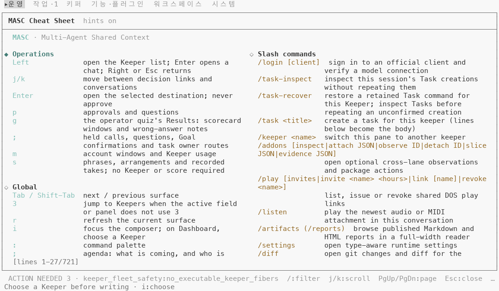
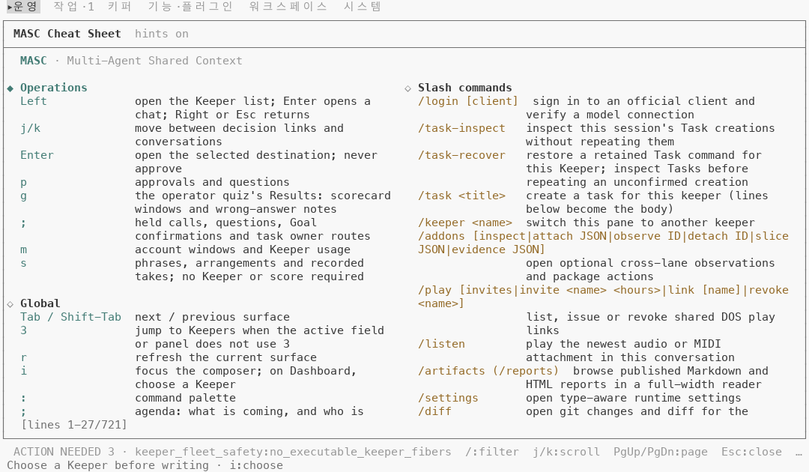
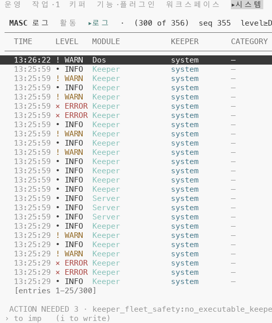
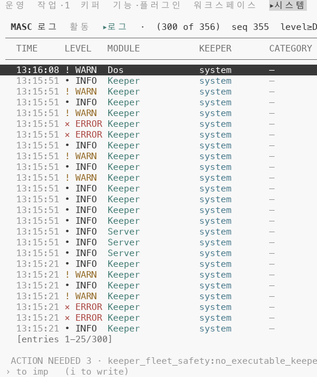
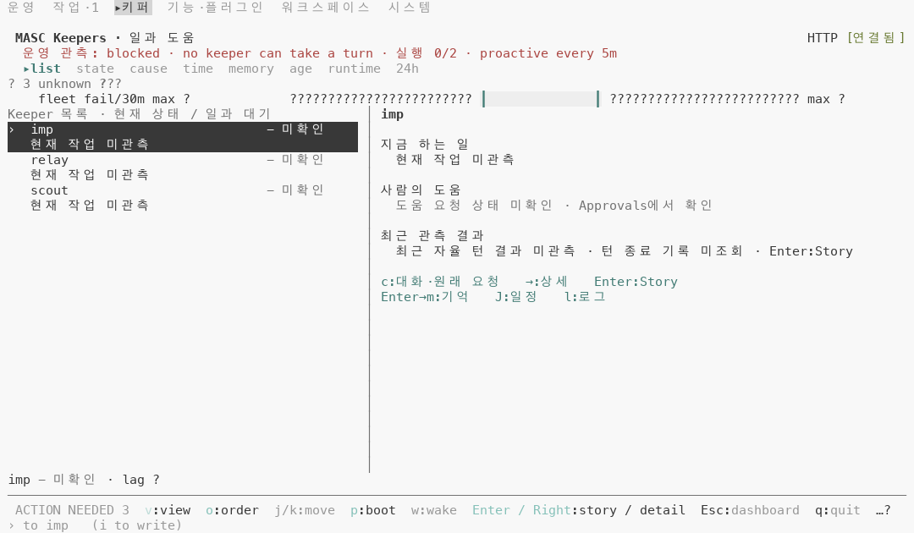
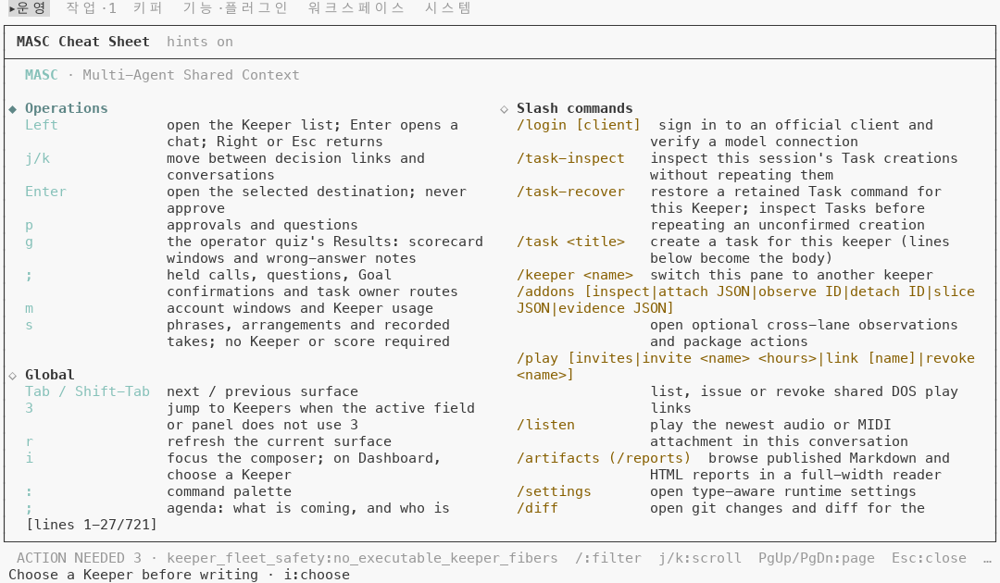
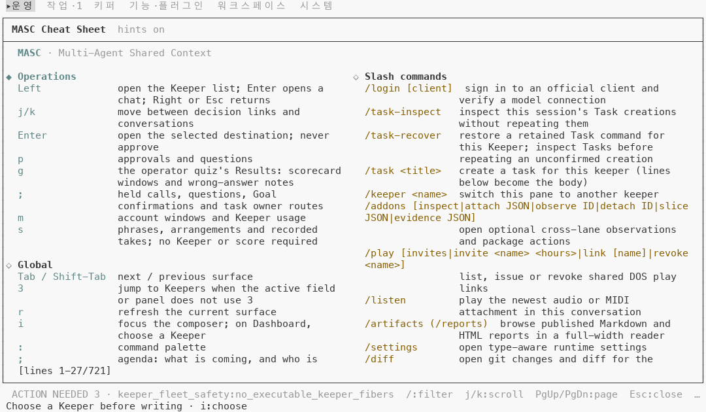

# 프레임의 강조색이 배경에 묻히지 않게 그리기

## 무엇이 달라지나요

- 도움말 시트의 키 열, 화면 아래 안내줄의 키, Logs 표의 MODULE 열은 `Masc_tui_theme.tone Accent` 로 그렸어요. 이 함수는 밝은 시안 SGR 코드(96)를 그대로 돌려줘서, 상태·출처·문법 색이 거치는 가독성 올림을 건너뛰었어요.
- 이 PR 은 호출 55곳 중 26곳(`masc_tui_render_prim` 20, `masc_tui_render_overlays` 3, `masc_tui_render_repositories` 2, `masc_tui_render_activity` 1)을 `Masc_tui_ansi.Theme.accent ()` 로 바꿔요. 나머지 29곳(파일 9개)은 이 위 층들이 옮겨요.
- `Theme.accent ()` 는 `Theme.hue_cyan` 과 같은 값이에요. 같은 화면의 `info` 안내 색도 이 시안이에요. 한 화면에 시안이 둘이면 어느 쪽이 강조인지 알 수 없어서 새 색을 만들지 않았어요.
- 터미널이 알려 준 시안이 배경과 4.5:1 이상이면 SGR 96 그대로 나가요. 4.5:1 미만이면 Oklab 의 밝기만 올리거나 내려서 4.5:1 에 맞춰요(색 성분 a·b 는 그대로). 터미널이 팔레트를 안 알려 주면 SGR 96 그대로예요.

## 실측

고정 서버(예시 글 아홉 개, 키퍼 셋) 위에서 증명 빌드 둘로 같은 키 순서를 눌러 120x35 로 36장씩 찍었어요(화면 24곳 서베이, 그리고 Board·Keepers·Code·Runtime·Fusion·도움말·댓글 쓰기 걷기 12장). 앞은 main `737807fd7863`(run `42753256924`), 뒤는 이 PR 의 코드 커밋 `2b16277c29a3`(run `42753324868`)이에요. 터미널 설정 셋으로 찍었어요: 기본 팔레트(Tomorrow Night) 트루컬러, `default-light` 트루컬러, `default-light` 256색.

### 번들 테마 53개에서 시안의 대비

`config/themes` 53개 파일마다 시안 칸(`base0C`)과 배경(`base00`)의 WCAG 대비를 쟀어요. 올린 값은 `lift_for_contrast` 를 파이썬으로 옮겨 계산했고, 옮긴 계산이 `default-light` 캡처의 올린 색(`#437c75`)과 같은 값을 내는 것을 먼저 확인했어요(그 한 칸으로만 맞춰 봤어요).

- 4.5:1 미만인 테마는 11 / 53 이고 모두 라이트 테마예요. 가장 낮은 것은 `default-light` 1.91:1 이에요.
- 올린 뒤에는 트루컬러에서 11개 모두 4.51~4.55:1 이에요.
- 256색표로 옮기면 11개 중 9개가 4.5:1 미만이에요. 그중 둘(`one-light`, `gruvbox-material-light-medium`)은 올리기 전보다 낮아요.
- 나머지 42개 테마는 시안이 이미 4.5:1 이상이라 SGR 96 이 그대로 나가요.

| 테마 | 앞 | 올린 뒤(트루컬러) | 올린 뒤(256색) |
|---|---|---|---|
| default-light | 1.91:1 | 4.52:1 | 3.73:1 |
| ayu-light | 2.16:1 | 4.51:1 | 4.30:1 |
| solarized-light | 2.93:1 | 4.53:1 | 4.04:1 |
| selenized-light | 3.27:1 | 4.54:1 | 4.09:1 |
| atelier-heath-light | 3.40:1 | 4.52:1 | 3.97:1 |
| selenized-white | 3.51:1 | 4.55:1 | 4.36:1 |
| papercolor-light | 3.56:1 | 4.55:1 | 3.56:1 |
| one-light | 4.00:1 | 4.55:1 | 3.96:1 |
| horizon-light | 4.16:1 | 4.51:1 | 4.85:1 |
| tokyo-night-light | 4.22:1 | 4.55:1 | 4.90:1 |
| gruvbox-material-light-medium | 4.36:1 | 4.55:1 | 3.62:1 |

### 기본 팔레트: 앞뒤가 같아요

기본 팔레트(Tomorrow Night)에서 시안은 이미 4.5:1 이상이에요. 36쌍을 칸 단위로 견줬고 색이 바뀐 칸은 0이에요. 글자가 다른 8쌍(`04-usage`, `05-board`, `07-system`, `20-logs`, `a01-board-list`, `a02-board-read`, `a05-keeper-chat`, `b01-reply`)은 실행마다 달라지는 값(글 id 해시, 시각, 포트, 빌드 SHA, 로그 줄, 읽어 오는 중 문구)이 달라서예요.

### default-light 트루컬러

글자가 같은 칸 중 전경색이 바뀐 칸은 36장 중 7장에서 225칸이에요. 그중 6장의 223칸이 bright cyan `#86c1b9`(배경 `#f8f8f8` 위 1.91:1)에서 `#437c75`(4.52:1)로 가요. 나머지 2칸은 Keepers 채팅(`a05-keeper-chat`)의 상태 줄 문구가 실행마다 달라서(`history load failed` / `loading older messages`) 우연히 같은 글자가 놓인 칸이에요. 공백 칸은 세지 않았어요.

| 화면 | 바뀐 칸 | 글자 |
|---|---|---|
| Logs(`20-logs`) | 144 | MODULE 열(`Keeper`, `Server`) |
| 도움말 시트(`a11-help`) | 39 | 제목 `MASC`, 키 열 |
| Keepers 목록(`03-keepers`, `a03-keepers`) | 14 + 14 | 아래 안내줄의 `v`, `o`, `p`, `Enter / Right` |
| Keepers 상세(`a04-keepers-detail`) | 11 | 아래 안내줄의 `Enter / Right`(흐림) |
| 아티팩트·리소스(`14-artifacts-resources`) | 1 | 제목줄의 `▌` |

흐림(SGR 2)으로 그린 13칸(Keepers 목록 1 + 1, 상세 11)이 223칸에 들어 있어요. 흐린 칸은 1.37:1 에서 1.95:1 이 돼요.

Keepers 화면에서 같은 줄 오른쪽 안내(`c:대화·원래 요청`)의 `info` 색은 앞에도 `#437c75` 였어요. 아래 안내줄의 `Enter / Right` 만 `#86c1b9` 였다가 뒤에 같은 색이 돼요.

글자 칸(흐림 제외) 중 4.5:1 미만인 칸은 앞 227칸에서 뒤 18칸이 됐어요.

- 앞 227칸: 시안 220칸(1.91:1)과 이 PR 과 상관없는 7칸(`#727272` 글자가 `#eeeeee` 바탕에서 4.15:1).
- 뒤 18칸: 위 층이 옮길 시안 11칸(Board 읽기의 `@system` 7칸, 댓글 쓰기 제목 4칸)과 같은 7칸.

### default-light 256색

36장 중 6장에서 205칸이 SGR 96 에서 256색 66(`#5f8787`)으로 바뀌었어요. 흐리지 않은 192칸은 1.91:1 에서 3.73:1 이 돼요. 흐림 13칸은 1.37:1 에서 1.79:1 이에요.

글자 칸(흐림 제외) 중 4.5:1 미만인 칸은 앞뒤 모두 1090칸이에요. 올린 색(3.73:1)이 256색표에서 4.5:1 에 못 닿아서 칸 수는 그대로예요. 이 투영은 #47482 가 다뤄요.

## 단점

- 256색에서는 올려도 4.5:1 에 못 닿아요(`default-light` 3.73:1, 192칸). 번들 테마 11개 중 9개가 같아요. 둘은 올리기 전보다 낮아져요(`one-light` 4.00:1 에서 3.96:1, `gruvbox-material-light-medium` 4.36:1 에서 3.62:1).
- 흐림으로 그린 강조색 13칸은 올려도 1.95:1 이에요. 이 PR 은 흐림을 안 건드렸어요.
- 라이트 팔레트에서 앞에는 강조(옅은 시안)와 `info`(올린 시안)가 서로 다른 밝기였는데, 뒤에는 같은 색이에요. 강조와 정보를 색으로 가를 수 없어요.
- 시안이 이미 읽히는 팔레트(53개 중 42개)에서는 아무것도 안 바뀌어요.

안 잰 것: 실제 터미널(iTerm2, Terminal.app 등)에서 본 모습은 안 봤어요. 위 대비는 캡처 도구가 알려 준 팔레트와 xterm 256색표로 계산한 값이에요. 팔레트는 기본과 `default-light` 둘만 찍었고, 나머지 51개 테마는 색 계산만 했어요. 26곳 중 화면에서 바뀐 것을 본 곳은 도움말 시트, Logs MODULE 열, Keepers 안내줄, 아티팩트·리소스 제목줄이에요. 검색 표시, 슬래시 안내, 오버레이, 저장소 화면 등 나머지 호출처는 이 걷기에서 화면에 안 나왔어요.

| 앞 | 뒤 |
|---|---|
| 도움말 시트, default-light, 트루컬러  |   |
| Logs, default-light, 트루컬러(오른쪽 MESSAGE 열은 이 장비의 경로가 찍혀 있어서 잘랐어요)  |   |
| Keepers, default-light, 트루컬러  |   |
| 도움말 시트, default-light, 256색  |   |
