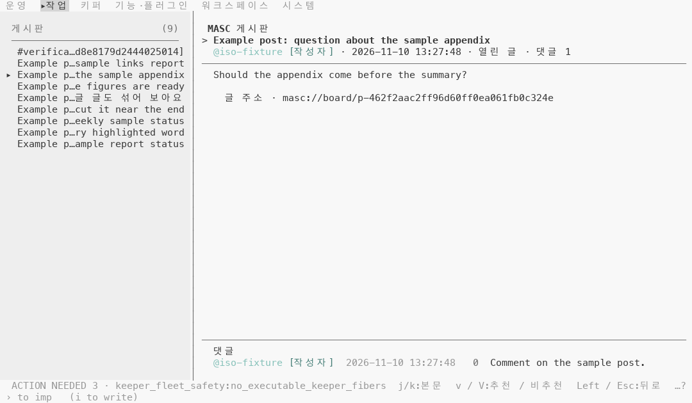
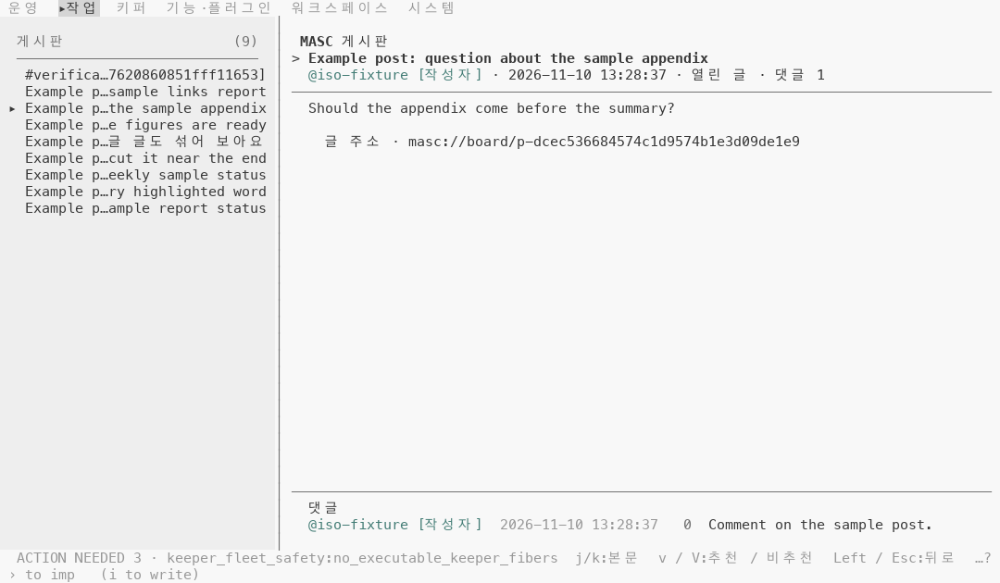
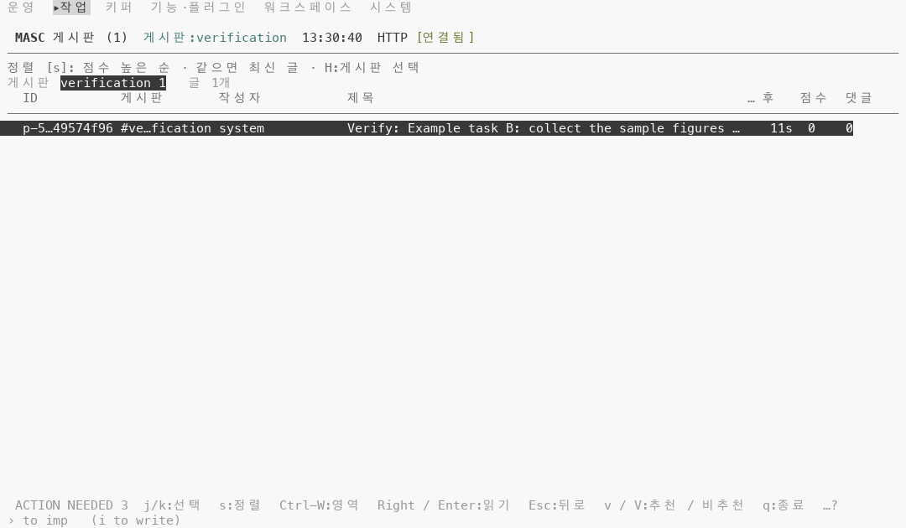
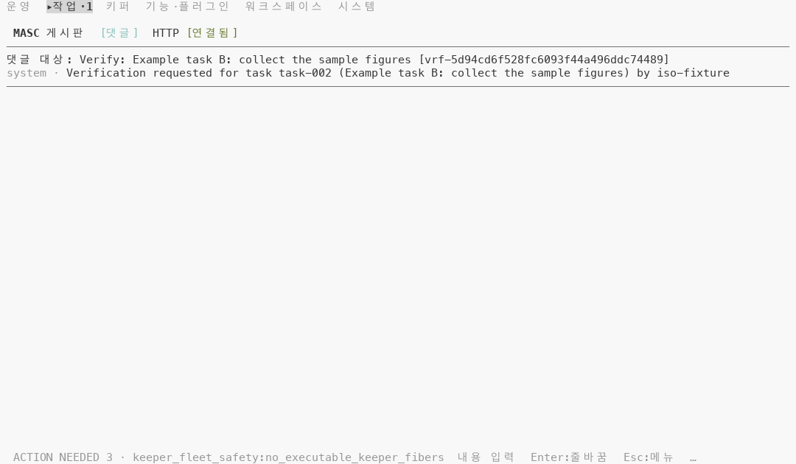

# 화면별 강조색 27곳도 배경에 묻히지 않게 그리기

## 무엇이 달라지나요

- 아래 층이 만든 `Masc_tui_ansi.Theme.accent ()` 로 `Masc_tui_theme.tone Accent` 호출 27곳(파일 7개)을 옮겨요. 화면마다 따로 쓰던 강조 표시가 가독성 올림을 거치게 돼요.
- 옮기는 곳: `masc_tui_render_board` 9, `masc_tui_board_composer` 2, `masc_tui_render_chat` 5, `masc_tui_render_code` 3, `masc_tui_render_config` 2, `masc_tui_render_fusion` 3, `masc_tui_render_keepers` 3.
- 화면에 나오는 글자로 풀면 이래요.
  - Board: 글 작성자와 댓글 작성자의 `@이름`, 선택한 댓글 앞의 `>`, 게시판 필터 줄(`게시판:이름`), 댓글 쓰기 제목(`[댓글]`), 받는 사람 안내줄. 글 레이아웃 캐시 키의 마지막 항목도 같이 옮겨요. 화면에 그리는 글자가 아니라, 팔레트가 바뀌면 캐시를 다시 만들게 하는 값이에요.
  - 채팅: 도구 상세 트리의 라벨, 메시지의 키퍼 이름, 진행 제목, 녹음 중 dB 줄.
  - Code: LSP 메모 글자, 메모 작성자, 메모가 있는 줄의 `●`.
  - Runtime 매개변수: 그룹 제목, 값을 덮어쓴 행.
  - Fusion: 실행 중 요약, `[called]` 도구 호출 줄, 상세의 `Caller: @키퍼`.
  - Keepers: 샌드박스 칸의 Docker 글자, 게이트 모드 글자, 레인 순서 글자.
- 이 PR 뒤에 `tone Accent` 를 부르는 곳은 2곳(`masc_tui_chart`, `masc_tui_lane_addons`)이 남아요.
- 색 규칙은 아래 층과 같아요. 터미널이 알려 준 시안이 배경과 4.5:1 이상이면 SGR 96 그대로, 4.5:1 미만이면 Oklab 밝기만 조정, 팔레트를 안 알려 주면 SGR 96 그대로예요.

## 실측

고정 서버(예시 글 아홉 개, 키퍼 셋) 위에서 증명 빌드 둘로 같은 키 순서를 눌러 찍었어요. 앞은 아래 층의 코드 커밋 `2b16277c29a3`(run `42753324868`), 뒤는 이 PR 의 코드 커밋 `926b19d8c216`(run `42753643402`)이에요. 번들 테마 53개에서 시안의 대비는 아래 층 README 에 있어요(4.5:1 미만 11 / 53, 올린 뒤 트루컬러 4.51~4.55:1).

찍은 것은 셋이에요.

- 서베이: 아래 층과 같은 36장(120x35). 기본 팔레트 트루컬러, `default-light` 트루컬러, `default-light` 256색.
- Board 걷기: 글 아홉 개를 하나씩 읽고 `j` 를 한 번 더 누른 18장과 목록·게시판 메뉴 2장(`default-light` 트루컬러, 120x35).
- 게시판 필터: 목록을 둘째 게시판(`verification`)으로 좁힌 1장(`default-light` 트루컬러).

### 기본 팔레트: 앞뒤가 같아요

기본 팔레트(Tomorrow Night)에서 시안은 이미 4.5:1 이상이에요. 36쌍 중 35쌍은 칸 단위로 견줬고 색이 바뀐 칸은 0이에요. 나머지 한 쌍(`a08-runtime`)은 뒤 캡처에서 상태 줄이 한 줄 늘어 표가 한 줄 밀려서 칸 단위로 견줄 수 없었어요.

### default-light 트루컬러: 서베이

36장 중 2장에서 11칸이 바뀌어요. 모두 bright cyan `#86c1b9`(1.91:1)에서 `#437c75`(4.52:1)로 가요.

| 화면 | 바뀐 칸 | 글자 |
|---|---|---|
| Board 읽기(`a02-board-read`) | 7 | 글 작성자 `@system` |
| 댓글 쓰기(`b01-reply`) | 4 | 제목의 `[댓글]` |

글자 칸(흐림 제외) 중 4.5:1 미만인 칸은 앞 18칸에서 뒤 7칸이 됐어요. 남은 7칸은 이 PR 과 상관없는 칸이에요(`#727272` 글자가 `#eeeeee` 바탕에서 4.15:1).

### default-light 트루컬러: Board 걷기

글 아홉 개를 읽는 18장에서 302칸이 같은 색으로 바뀌어요(1.91:1 에서 4.52:1). 글마다 두 장(읽기, `j` 한 번 뒤)씩 찍어서 같은 칸을 두 번 센 값이에요. 글 작성자가 `@system` 인 글 1개는 7칸이고, 작성자가 `@iso-fixture` 인 글은 12칸이에요. 댓글이 달린 글(4개)은 댓글 작성자 12칸이 더해져요.

글자 칸(흐림 제외) 중 4.5:1 미만인 칸은 20장에서 앞 410칸에서 뒤 108칸이 됐어요. 남은 108칸은 이 PR 과 상관없는 칸이에요(`#727272` 글자가 `#eeeeee` 바탕에서 4.15:1, 왼쪽 목록의 `게시판` 머리글).

### default-light 트루컬러: 게시판 필터

필터 줄 `게시판:verification` 16칸이 1.91:1 에서 4.52:1 이 돼요. 글자 칸(흐림 제외) 중 4.5:1 미만인 칸은 앞 16칸에서 뒤 0칸이에요(보이는 칸 1392).

### default-light 256색

서베이 36장 중 2장에서 11칸이 SGR 96 에서 256색 66(`#5f8787`)으로 바뀌고, 1.91:1 에서 3.73:1 이 돼요. 글자 칸(흐림 제외) 중 4.5:1 미만인 칸은 앞뒤 모두 1090칸이에요. 256색표에서 올린 색이 4.5:1 에 못 닿아서 칸 수는 그대로예요(#47482).

## 단점

- 256색에서는 올려도 4.5:1 에 못 닿아요(3.73:1). 번들 테마별 값은 아래 층 README 에 있어요.
- 강조와 `info` 가 같은 색이 돼서, Board 읽기에서 작성자 `@이름` 과 `info` 색 글자를 색으로 가를 수 없어요.
- 27곳 중 화면에서 바뀐 것을 본 곳은 5곳뿐이에요.

안 잰 것: 실제 터미널(iTerm2, Terminal.app 등)에서 본 모습은 안 봤어요. 27곳 중 화면에서 바뀐 것을 본 곳은 Board 글 작성자 둘(`@system`, `@iso-fixture`), 댓글 작성자, 게시판 필터 줄, 댓글 쓰기 제목이에요. 나머지 22곳 중 1곳은 그리는 글자가 아니라 글 레이아웃 캐시 키예요. 21곳은 이 고정 서버로 화면에 못 불러냈어요: 자동 게시 글 작성자, 선택한 댓글의 `>`, 받는 사람 안내줄, 채팅(도구 상세 라벨, 키퍼 이름, 진행 제목, 녹음 줄), Code(LSP 메모, 메모, 메모 점), Runtime 매개변수, Fusion(실행 중 요약, 도구 호출 줄, `Caller`), Keepers(샌드박스, 게이트 모드, 레인 순서). 이 21곳은 증명 빌드의 컴파일과 시험이 통과했다는 것까지만 확인했어요. 팔레트는 기본과 `default-light` 둘만 찍었어요.

| 앞 | 뒤 |
|---|---|
| Board 글 읽기(댓글 1개), default-light, 트루컬러  |   |
| 게시판 필터, default-light, 트루컬러  |   |
| 댓글 쓰기, default-light, 트루컬러  |   |
