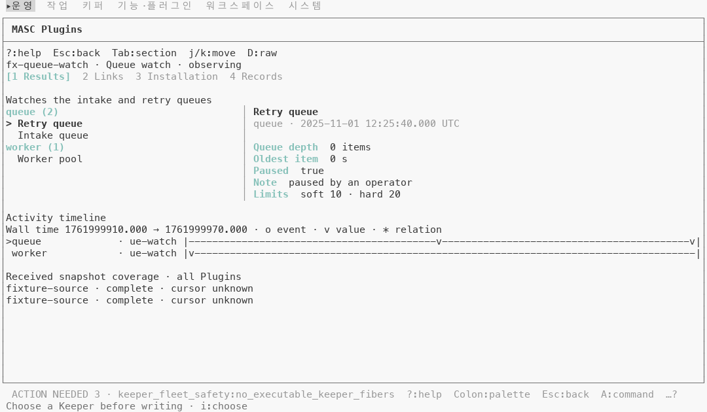
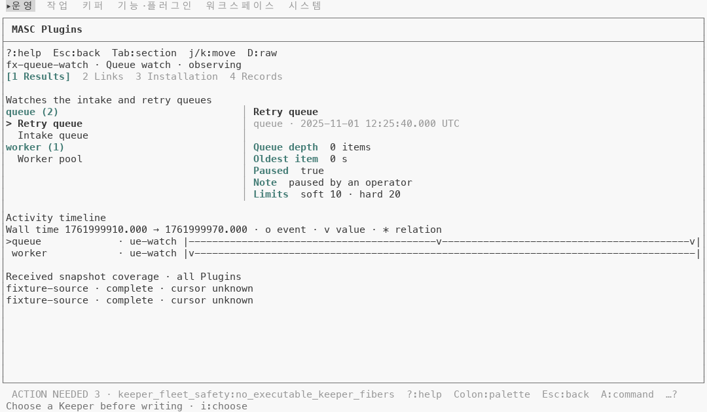
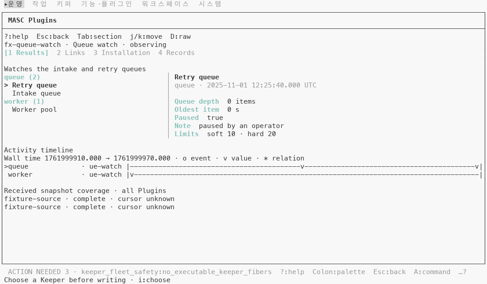
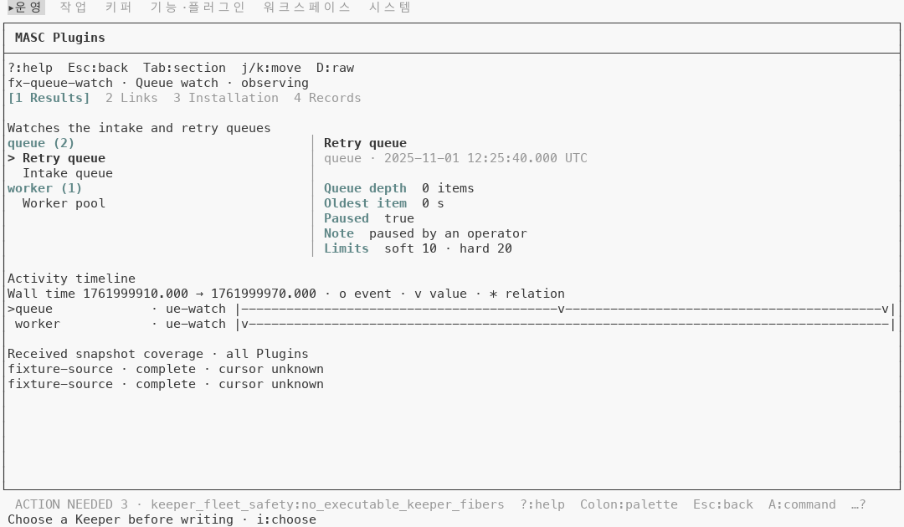

# Plugins 라벨 강조색도 배경에 묻히지 않게 그리고 `Masc_tui_theme.tone` 지우기

## 무엇이 달라지나요

- `masc_tui_lane_addons` 의 라벨 색이 `Masc_tui_theme.tone Accent` 대신 `Masc_tui_ansi.Theme.accent ()` 를 써요. Plugins 상세 화면에서 이 색을 쓰는 곳은 셋이에요: 선택한 탭(`[1 Results]`), 레인 그룹 제목(`queue (2)`), 읽기 이름(`Queue depth`).
- `bin/dune` 에서 `masc_tui_lane_addons` 의 `libraries` 에 `masc_tui_ansi` 가 한 줄 늘어요. `masc_tui_ansi` 는 lane add-on 라이브러리에 닿지 않아서 순환은 안 생겨요.
- `Masc_tui_chart.bar_item.style` 은 `status option` 이었고, `None` 이면 강조색으로 막대를 그렸어요. 부르는 곳 3곳(`render_metrics`, `render_tools`, `render_fusion`)이 모두 `Some` 을 넘겨서 지금 코드에서는 `None` 갈래를 타는 길이 없었어요. `option` 을 지우고 `style` 을 `status` 로 바꿨어요.
- `tone Normal` 2곳과 `tone Dim` 3곳은 `tone` 이 돌려주던 값(`""`, `Sgr.dim`)을 그 자리에 적었어요.
- 부르는 곳이 없어진 `Masc_tui_theme.tone` 과 `tone` 타입을 지웠어요. 이 이름을 쓰던 주석은 코드가 하는 일을 그대로 적도록 고쳤어요.
- 코드는 파일 13개, +30 -61 이에요.
- 이 PR 로 `tone Accent` 를 부르는 곳이 0곳이 돼요. 스택 세 층이 `Theme.accent` 로 옮긴 곳은 26 + 27 + 1 = 54곳이고, 차트의 1곳은 갈래째 지웠어요.
- 색 규칙은 아래 층과 같아요. 터미널이 알려 준 시안이 배경과 4.5:1 이상이면 SGR 96 그대로, 4.5:1 미만이면 Oklab 밝기만 조정, 팔레트를 안 알려 주면 SGR 96 그대로예요.

## 실측

고정 서버 위에서 증명 빌드 둘로 같은 키 순서를 눌러 찍었어요. 앞은 아래 층의 코드 커밋 `926b19d8c216`(run `42753643402`), 뒤는 이 PR 의 코드 diff 를 담은 증명 전용 브랜치 `tui-ux45/78b-tone-leaves-the-theme-proof` 의 커밋 `2ce6c0a13ae4`(run `42760745323`)예요. 번들 테마 53개에서 시안의 대비는 맨 아래 층 README 에 있어요(4.5:1 미만 11 / 53, 올린 뒤 트루컬러 4.51~4.55:1).

고정 서버에는 Plugins 가 하나도 없어서 Plugins 화면이 빈 상태예요. 캡처용으로 응답을 바꿔 Plugins 둘을 넣었어요: `Queue watch`(관찰 중, 결과 3개)와 `Health probe`(실패, 결과 1개). 이 응답은 직접 만든 값이고 저장소에는 없어요.

찍은 것은 둘이에요.

- Plugins 걷기 8장(120x35): 목록, 상세의 결과·링크·설치·기록 탭, 다음 결과, 실패한 Plugin 상세, 도움말. 기본 팔레트 트루컬러, `default-light` 트루컬러, `default-light` 256색.
- 서베이: 아래 층과 같은 36장(120x35). 같은 세 가지.

### 기본 팔레트: 앞뒤가 같아요

Plugins 8장은 칸 단위로 글자와 색이 모두 같아요. 기본 팔레트(Tomorrow Night)에서 시안은 이미 4.5:1 이상이라서 올릴 게 없어요.

### default-light 트루컬러: Plugins

8장 중 6장에서 190칸이 bright cyan `#86c1b9`(1.91:1)에서 `#437c75`(4.52:1)로 바뀌어요. 글자는 한 칸도 안 바뀌어요.

| 화면 | 바뀐 칸 | 글자 |
|---|---|---|
| 결과(`p02`, `p06`) | 각 63 | 탭 `[1 Results]`, 그룹 제목 `queue (2)`·`worker (1)`, 읽기 이름 다섯(`Queue depth`, `Oldest item`, `Paused`, `Note`, `Limits`) |
| 링크(`p03`) | 8 | 탭 `[2 Links]` |
| 설치(`p04`) | 15 | 탭 `[3 Installation]` |
| 기록(`p05`) | 10 | 탭 `[4 Records]` |
| 실패한 Plugin 결과(`p07`) | 31 | 탭 `[1 Results]`, 그룹 제목 `probe (1)`, 읽기 이름 둘(`Latency`, `Target`) |
| 목록(`p01`), 도움말(`p08`) | 0 | |

칸 수는 공백을 뺀 값이에요. 글자 칸(흐림 제외) 중 4.5:1 미만인 칸은 앞 190칸에서 뒤 0칸이에요(8장에서 보이는 칸 10041).

### default-light 256색: Plugins

같은 190칸이 SGR 96 에서 256색 66(`#5f8787`)으로 바뀌고, 1.91:1 에서 3.73:1 이 돼요. 글자 칸(흐림 제외) 중 4.5:1 미만인 칸은 앞뒤 모두 191칸이에요. 256색표에서 올린 색이 4.5:1 에 못 닿아서 칸 수는 그대로예요(#47482).

### 서베이 36장: 색이 바뀐 칸이 없어요

서베이에는 Plugins 화면이 없어요. 이 PR 이 건드린 나머지 곳(차트 막대, 도구 줄, Keepers 격자, Code blame)은 같은 문자열이 나오게 적은 거라 색이 안 바뀌어야 해요. 앞(아래 층 빌드)과 뒤(이 PR 빌드)를 세 가지 모두 36쌍씩 견줬어요.

- 글자가 같은 칸끼리 견주면 기본 팔레트 28쌍, `default-light` 트루컬러 28쌍, 256색 29쌍이 글자와 색이 모두 같아요. 나머지 쌍은 글자가 달라서(글 id 는 실행마다 새로 만들어져요. 그 밖에 사용량 숫자, 임시 폴더 이름, 서버 로그 줄 순서) 그 칸들은 견줄 수 없어요.
- 글자와 상관없이, 두 캡처 모두 글자가 보이는 칸의 색과 글자 속성(굵게, 흐리게 등)만 견주면 세 가지 모두 36쌍 중 35쌍이 같아요.
- 남은 1쌍은 기본 팔레트와 트루컬러에서는 Runtime 화면(`a08-runtime`, `16-runtime`)이에요. 한쪽 캡처에만 `마지막 관측 · 조회 중` 줄이 붙어 표가 한 줄 밀렸어요. 256색에서는 Logs 화면(`20-logs`)이에요. 서버 로그 줄이 다른 순서로 찍혔어요.

## 단점

- 256색에서는 올려도 4.5:1 에 못 닿아요(3.73:1). 번들 테마별 값은 맨 아래 층 README 에 있어요.
- 차트는 `masc_tui_ansi` 에 기댈 수 없어서(반대로 `masc_tui_ansi` 가 차트를 불러요) 강조색 막대를 못 그려요. 막대 색은 `status` 로 골라야 해요.
- `masc_tui_lane_addons` 가 기대는 라이브러리가 하나 늘어요(`masc_tui_ansi`).

## 안 잰 것

- 실제 터미널(iTerm2, Terminal.app 등)에서 본 모습은 안 봤어요.
- Plugins 응답은 직접 만든 값이에요. 실제 Plugin 이 보내는 값으로는 안 찍었어요.
- `tone Normal` 2곳, `tone Dim` 3곳, 차트 막대 3곳은 같은 문자열이 나오도록 적은 거예요(`tone Normal` 은 `""`, `tone Dim` 은 `Sgr.dim`). 서베이에서 색이 안 바뀐 것은 봤지만, 이 자리들이 36장 중 어느 장에 그려지는지는 하나씩 확인하지 않았어요.
- 팔레트는 기본과 `default-light` 둘만 찍었어요.

| 앞 | 뒤 |
|---|---|
| Plugins 상세 결과, default-light, 트루컬러  |   |
| Plugins 상세 결과, default-light, 256색  |   |
