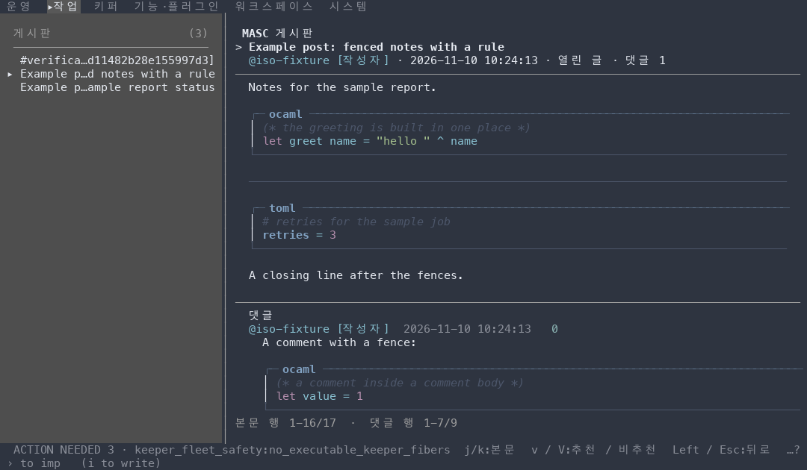
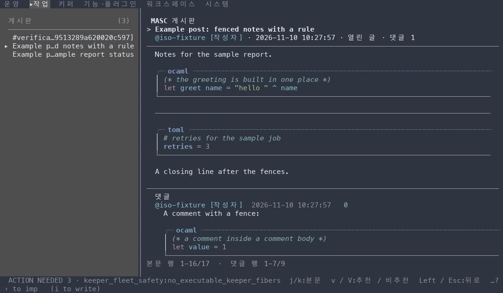
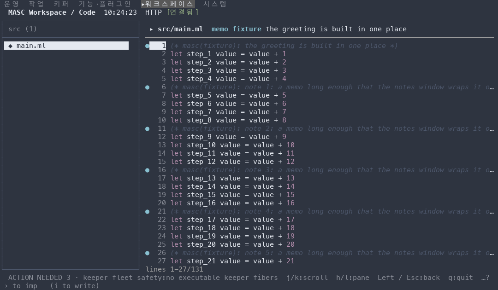
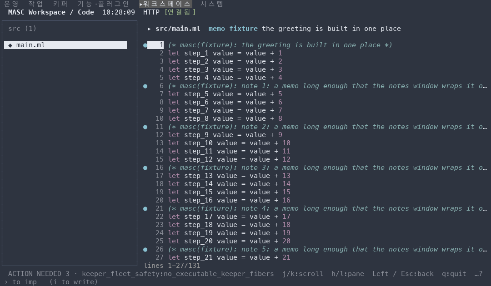
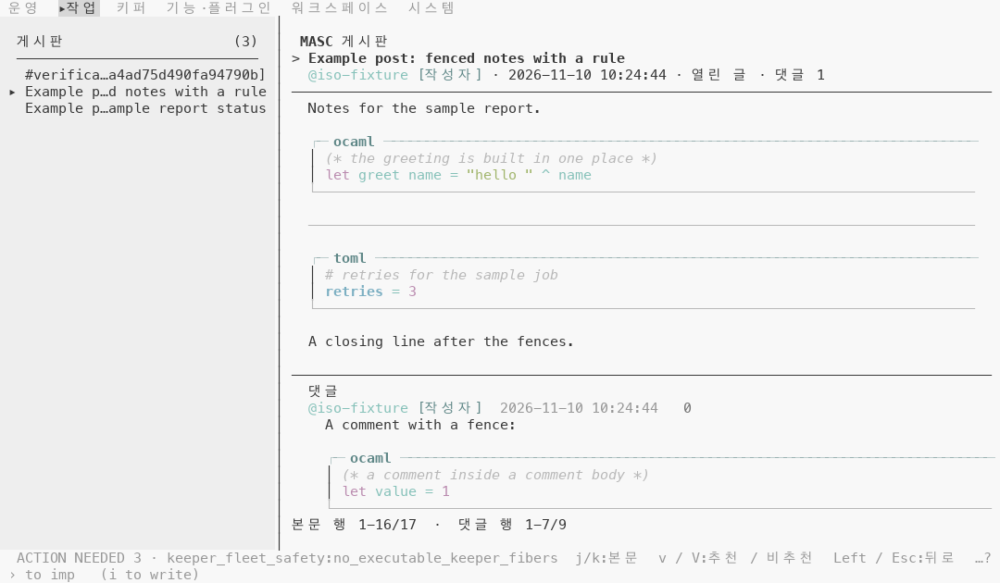
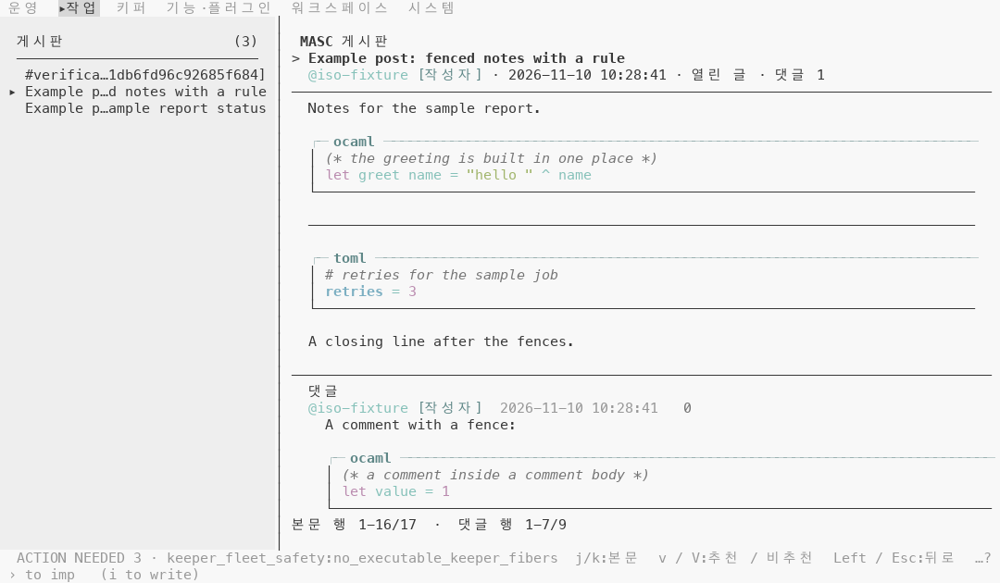
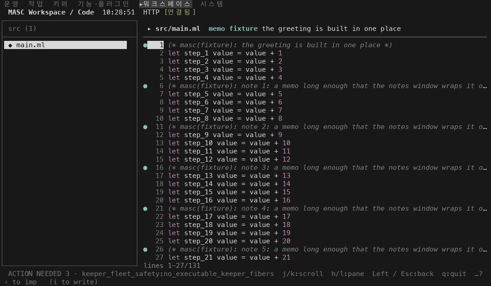
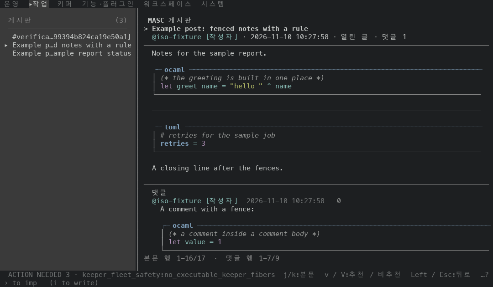
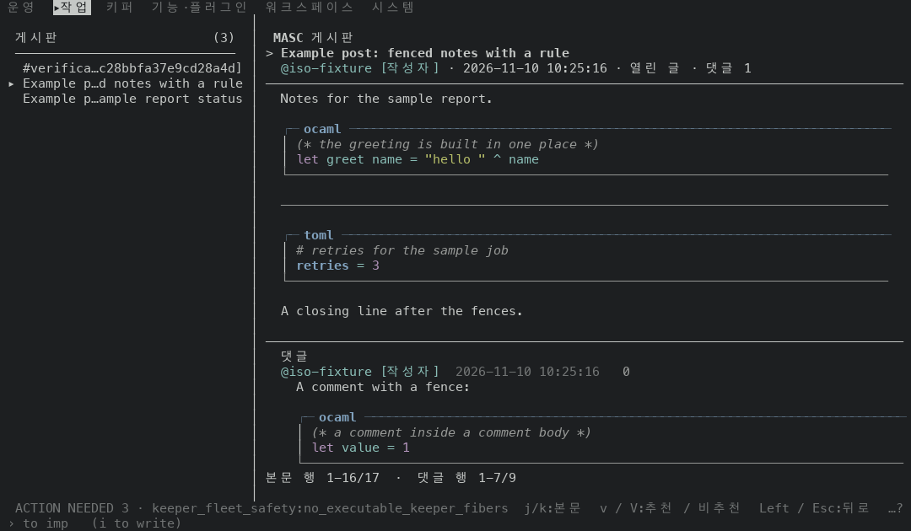
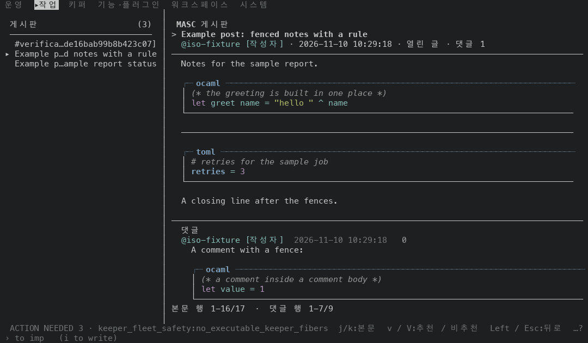

# 코드 주석과 문서 구분선이 배경에 묻히지 않게 그리기

## 무엇이 달라지나요

- 코드 주석(Code 화면과 마크다운 코드 블록)은 기울임 + SGR 90 이었어요. 이제 기울임 + 채팅의 Tool·Local·Thinking 출처 글자가 쓰는 색(`quiet_origin`)으로 그려요. 터미널이 알려 준 bright black 이 배경과 4.5:1 이상이면 SGR 90 그대로이고, 아니면 4.5:1 까지 밝기를 올려요.
- `---` 구분선과 코드 블록 아래 테두리(`└───`)는 SGR 90 이었어요. 이제 패널 테두리와 같은 recede 색으로 그려요.
- 코드 블록 위 테두리(`┌─ ocaml`, SGR 94 굵게)와 옆 세로줄(기본 전경색)은 그대로예요.

## 실측

고정 서버 위에서 증명 빌드 둘로 같은 키 순서를 눌러 찍었어요. 앞은 main `22cd69dd8e66`(run `42731492292`), 뒤는 그 위에 이 PR 의 코드 커밋 한 개를 얹은 `802051eaf1f2`(run `42734458095`)이에요. 두 빌드의 소스는 파일 5개(`bin/masc_tui_ansi.ml`, `bin/masc_tui_markdown_theme.ml`, `bin/masc_tui_render_prim.ml`, `bin/masc_tui_theme.ml`, `bin/masc_tui_theme.mli`)만 달라요(`git diff --name-only` 로 확인했어요). 문서와 changelog 는 빌드에 들어가지 않아요.

### 번들 테마 53개에서 SGR 90 의 대비

SGR 90 은 터미널의 bright black 이고, 이 저장소의 테마 파일에서는 `base03` 이 그 자리에 놓여요(`ansi_slot`). `config/themes` 의 53개 파일마다 `base03` 과 배경 `base00` 의 WCAG 대비(밝은 쪽 + 0.05) ÷ (어두운 쪽 + 0.05)를 계산했어요.

| 구분 | 테마 수 |
|---|---|
| 4.5:1 미만 | 51 / 53 |
| 3:1 미만 | 38 / 53 |
| 라이트 테마 중 4.5:1 미만 | 13 / 13 |
| 4.5:1 이상 | 2 / 53: `norton-commander` 5.11:1, `tomorrow-night` 5.69:1 |
| 가장 낮은 테마 | `nord` 1.69:1 |

### 화면 두 장, 팔레트 다섯 가지

Code 파일 화면(`src/main.ml`, 주석 6줄)과 Board 글 한 개(OCaml 코드 블록 주석, `---` 구분선, TOML 코드 블록 주석, 댓글 안의 코드 블록 주석)를 120x35 로 찍었어요. 팔레트는 캡처 도구의 기본(Tomorrow Night)과, 이 저장소의 `nord`·`default-light`·`default-dark` 테마 파일을 masc 가 읽는 방식(전경 `base05`, 배경 `base00`, ANSI 슬롯은 `ansi_slot`)으로 터미널 응답에 실어 보낸 것이에요. 팔레트를 알려 주지 않는 터미널은 응답을 안 보낸 경우예요. 칸마다 그릴 때 켜져 있던 전경색을 세어 앞뒤를 견줬어요.

| 팔레트 | 주석 칸(Code 화면 + Board 글) | 구분선 1줄 + 코드 블록 아래 테두리 3줄 |
|---|---|---|
| 기본(Tomorrow Night) | SGR 90 ×545 → SGR 90 ×545 | SGR 90 ×320 → 256색 102 ×320 |
| Nord | SGR 90 ×545 → 256색 109 ×545 | SGR 90 ×320 → 256색 247 ×320 |
| default-light | SGR 90 ×545 → 256색 243 ×545 | SGR 90 ×320 → 기본 전경색 ×320 |
| default-dark | SGR 90 ×545 → 256색 244 ×545 | SGR 90 ×320 → 256색 245 ×320 |
| 팔레트를 알려 주지 않음 | SGR 90 ×545 → SGR 90 ×545 | SGR 90 ×320 → 기본 전경색 ×320 |

10장 모두 글자가 앞뒤로 같고, 위 칸들의 전경색을 빼면 글자와 나머지 색·굵기도 같아요(시각·개수·id 는 `#` 로 가리고 견줬어요). 주석은 앞뒤로 모두 기울임이에요. 구분선과 테두리는 모든 팔레트에서 같은 화면의 패널 구분선(글 제목 아래 줄)과 같은 색이 됐어요.

### 배경과의 대비

칸에 켜져 있던 색을 캡처 도구가 알려 준 팔레트에 놓고 WCAG 대비를 계산했어요. 이 캡처의 TUI 는 `COLORTERM` 없이 떠서 256색표로 내려 써요. 256색표에서 가장 가까운 색으로 옮기는 단계 때문에 목표(4.5:1)보다 낮은 값이 나올 수 있어요.

| 팔레트 | 배경 | 앞: 주석·구분선·테두리 | 뒤: 주석 | 뒤: 구분선·테두리 |
|---|---|---|---|---|
| 기본(Tomorrow Night) | #1d1f21 | SGR 90 = `#969896`, 5.69:1 | SGR 90 = `#969896`, 5.69:1 | 256색 102 = `#878787`, 4.60:1 |
| Nord | #2e3440 | SGR 90 = `#4c566a`, 1.69:1 | 256색 109 = `#87afaf`, 5.22:1 | 256색 247 = `#9e9e9e`, 4.66:1 |
| default-light | #f8f8f8 | SGR 90 = `#b8b8b8`, 1.87:1 | 256색 243 = `#767676`, 4.28:1 | 기본 전경색 = `#383838`, 11.04:1 |
| default-dark | #181818 | SGR 90 = `#585858`, 2.50:1 | 256색 244 = `#808080`, 4.50:1 | 256색 245 = `#8a8a8a`, 5.14:1 |
| 팔레트를 알려 주지 않음 | #1d1f21 | SGR 90 = `#969896`, 5.69:1 | SGR 90 = `#969896`, 5.69:1 | 기본 전경색 = `#c5c8c6`, 9.80:1 |

마지막 줄은 터미널이 팔레트를 안 알려 준 경우라서 색과 배경은 캡처 도구가 그린 값이에요. 실제 터미널의 값은 달라요.

### 트루컬러 터미널

`COLORTERM=truecolor` 를 켠 터미널에서는 올린 색이 256색표로 옮겨지지 않고 그대로 나가요. 같은 Code 화면을 다시 찍어 주석 칸의 색을 읽었어요.

앞(SGR 90)은 팔레트 값 그대로라서 256색 캡처와 같아요. 같은 검사(글자와 나머지 색·굵기가 앞뒤로 같은지, 구분선·테두리가 패널 구분선과 같은 색인지)를 이 8장에도 했고 모두 맞았어요.

| 팔레트 | 배경 | 주석 색(뒤) | 대비 |
|---|---|---|---|
| 기본(Tomorrow Night) | #1d1f21 | SGR 90 그대로 | 5.69:1 |
| Nord | #2e3440 | 트루컬러 144,156,178 = `#909cb2` | 4.51:1 |
| default-light | #f8f8f8 | 트루컬러 114,114,114 = `#727272` | 4.53:1 |
| default-dark | #181818 | 트루컬러 129,129,129 = `#818181` | 4.56:1 |

### 단점

- 밝은 배경의 `default-light` 에서 256색표로 쓰면 주석이 4.28:1 이에요. 트루컬러에서는 `#727272`(4.53:1)가 나가는데 256색표에는 그 색이 없어서 `#767676` 로 옮겨져요.
- 구분선과 테두리는 패널 구분선과 같은 색이 되므로 팔레트에 따라 달라져요. 기본(Tomorrow Night)에서는 5.69:1 에서 4.60:1 로 조금 어두워지고, `default-light` 에서는 기본 전경색(11.04:1)이 돼서 앞(1.87:1)보다 진해져요.
- 팔레트를 알려 주지 않는 터미널에서 구분선과 테두리가 SGR 90 에서 기본 전경색으로 바뀌어요(캡처 도구가 그린 값으로 5.69:1 에서 9.80:1). 글자와 같은 밝기라서 앞보다 진해 보여요. 이 경우 주석은 SGR 90 그대로예요. 알려 주지 않은 팔레트에서는 SGR 90 이 보이는지 알 수 없어서 주석은 건드리지 않았어요.
- 어두운 배경에서 주석이 앞보다 훨씬 밝아져요(Nord 에서 1.69:1 → 5.22:1). 읽히지만 앞의 '거의 안 보이는' 상태보다 코드에 가까운 밝기예요. 기울임은 그대로 남아서 주석인 것은 구분돼요.

### 이 PR 이 안 건드린 색

키워드·문자열·숫자·타입·링크 같은 나머지 문법 색은 이 PR 에서 그대로예요. 테마 파일 기준으로 배경과 4.5:1 미만인 테마 수는 다음과 같아요(올리지 않는 상수라서 값이 그대로 나가요).

| 문법 색 | 4.5:1 미만 테마 수 |
|---|---|
| keyword·number·literal(bright magenta) | 10 / 53 |
| string(bright green) | 13 / 53 |
| type·link(bright blue) | 9 / 53 |
| span·key(bright cyan) | 11 / 53 |
| json number(bright yellow) | 13 / 53 |

안 잰 것: 실제 터미널(iTerm2, Terminal.app 등)에서 본 모습은 안 봤어요. 위 대비는 캡처 도구가 알려 준 팔레트와 xterm 256색표로 계산한 값이에요. Code 화면은 OCaml 파일 하나, Board 글은 글 하나만 찍었어요. 채팅 안의 코드 블록과 설정 화면의 TOML 주석, 설정 문서 화면은 안 찍었어요. 어두운 글자(SGR 2, 흐리게)는 이 PR 에서 안 건드렸어요.

| 앞 | 뒤 |
|---|---|
| Board 글, Nord  |   |
| Code 파일 화면, Nord  |   |
| Board 글, default-light  |   |
| Code 파일 화면, default-dark  |   |
| Board 글, 기본 팔레트  |   |
| Board 글, 팔레트를 알려 주지 않음  |   |
