# Collab 화면의 글을 자르지 않고 줄바꿈하기

## 무엇이 달라지나요

Collab 은 공유 기계(DOS, MSX)를 지켜보고 초대 링크를 만드는 화면이에요. `:` 팔레트에서 `go Collab` 으로 열어요. 이 화면은 본문의 모든 줄을 `fit_width` 로 프레임 끝에서 잘라서, 창이 글보다 좁으면 줄이 `…` 로 끝났어요.

- 80칸: 끝 안내문이 `…Enter opens the retained QR/lin…` 에서 끊겨요.
- 60칸: 컨트롤러 설명(`DOS controller unknown: No attached shared Add-on provide…`)과 해제 확인 문장(`Revoke margaret? Their link stops working and their contr…`)이 끊겨요.
- 44칸: 제목 아래 안내문, 단축키 줄(`m  Watch MSX     d  Watch DOS     g  Choo…`), 초대 줄도 끊겨요.

끊긴 끝이 중요한 말이에요. 해제 확인의 끝은 "컨트롤러가 풀린다"이고, 컨트롤러 설명의 끝은 "왜 모르는지"예요.

이 PR 은 `Masc_tui_collab.lines ~height ~width` 로 본문을 창 너비에 맞춰 만들어요.

- 글마다 공백에서 줄을 바꿔요(`Masc_tui_message_layout.wrap_words`). 줄에 넣기 전에 `sanitize_terminal_text` 를 거쳐서, 센 폭과 그려지는 폭이 같아요.
- 단축키 셋(`m`, `d`, `g`)은 한 줄에 들어가면 한 줄에, 아니면 줄마다 하나씩 그려요.
- 초대는 글이 필요한 줄만큼 차지하고, 둘째 줄부터는 이름 밑에 들여써요.
- 창이 낮아서 다 안 들어가면 고정 문장이 물러나요. 맨 끝의 끝 안내문은 `lines` 가 늘 돌려주고, 프레임이 맨 아래에서 잘라 내며 `+N rows not shown` 으로 알려요. 더 낮아지면 `lines` 가 머리말을 줄여요. 설명 두 문장과 빈 줄을 한꺼번에 빼고 단축키만 남겨요. 그래도 모자라면 단축키도 빼요. 이름 입력 폼, 알림, 선택한 초대는 남아요. 초대 목록은 선택한 초대와 이웃을 남은 줄만큼 보여요.
- 다 들어가는 넓은 창(120x35)에서는 앞과 같은 글자와 색이에요.

코드는 파일 4개(`masc_tui_collab.ml`, `masc_tui_collab.mli`, `masc_tui_render_overlays.ml`, `bin/dune`), `+85 -28`, 커밋 하나예요. `bin/dune` 은 collab 라이브러리에 `masc_tui_message_layout` 을 더해요.

## 실측

고정 서버에서 증명 빌드 둘로 찍었어요. 앞은 main `2464200f4c4d`(run `42815079636`), 뒤는 이 PR 의 코드 머리 `23081469bd59`(run `42822564722`)예요. 두 빌드 모두 안의 시험 3개가 통과했어요. 기본 팔레트, truecolor 이고 창은 120x35, 80x24, 60x24, 44x24 와 짧은 창 60x16, 44x15 예요. TUI 는 15줄 아래에서는 화면을 안 그려요.

걷기는 둘이에요.

- 빈 상태: 고정 서버 그대로(초대 없음, 컨트롤러 모름)에서 Collab 을 열고, `n` 으로 이름 입력 폼을 열어 40자 이름을 쳐요. 장 둘이에요.
- 초대 넷: 초대 넷과 컨트롤러를 쥔 사람 하나가 있는 상태에서 목록, 선택 이동 둘, `x` 해제 확인이에요. 장 넷이에요.

짧은 창은 두 걷기를 다 찍었어요.

| 창 | 걷기 | 장 | 글자가 든 줄(앞 -> 뒤) | `…` 로 잘린 줄(앞 -> 뒤) | `+N rows not shown` 이 뜬 장(앞 -> 뒤) | 선택한 초대·입력한 이름이 그려진 장(앞 -> 뒤) |
|---|---|---|---|---|---|---|
| 120x35 | 빈 상태, 이름 입력 | 2 | 14 -> 14 | 0 -> 0 | 0 -> 0 | 1 -> 1 (모두 1) |
| 120x35 | 초대 넷, 선택 이동, 해제 확인 | 4 | 37 -> 37 | 0 -> 0 | 0 -> 0 | 4 -> 4 (모두 4) |
| 80x24 | 빈 상태, 이름 입력 | 2 | 14 -> 16 | 2 -> 0 | 0 -> 0 | 1 -> 1 (모두 1) |
| 80x24 | 초대 넷, 선택 이동, 해제 확인 | 4 | 37 -> 41 | 4 -> 0 | 0 -> 0 | 4 -> 4 (모두 4) |
| 60x24 | 빈 상태, 이름 입력 | 2 | 14 -> 18 | 4 -> 0 | 0 -> 0 | 1 -> 1 (모두 1) |
| 60x24 | 초대 넷, 선택 이동, 해제 확인 | 4 | 37 -> 42 | 5 -> 0 | 0 -> 0 | 4 -> 4 (모두 4) |
| 44x24 | 빈 상태, 이름 입력 | 2 | 14 -> 27 | 12 -> 0 | 0 -> 1 | 1 -> 1 (모두 1) |
| 44x24 | 초대 넷, 선택 이동, 해제 확인 | 4 | 37 -> 61 | 21 -> 0 | 0 -> 1 | 4 -> 4 (모두 4) |
| 60x16 | 빈 상태, 이름 입력 | 2 | 14 -> 15 | 3 -> 0 | 1 -> 1 | 1 -> 1 (모두 1) |
| 60x16 | 초대 넷, 선택 이동, 해제 확인 | 4 | 28 -> 32 | 5 -> 0 | 0 -> 4 | 4 -> 4 (모두 4) |
| 44x15 | 빈 상태, 이름 입력 | 2 | 14 -> 16 | 11 -> 0 | 1 -> 1 | 1 -> 1 (모두 1) |
| 44x15 | 초대 넷, 선택 이동, 해제 확인 | 4 | 28 -> 36 | 19 -> 0 | 0 -> 4 | 4 -> 4 (모두 4) |

열은 이렇게 셌어요. 프레임 안 본문에서 글자가 든 줄을 세고, 그 가운데 끝이 `…` 인 줄을 따로 세요. `+N rows not shown` 은 높이가 모자라 프레임이 줄을 잘랐다고 알린 장이에요. 마지막 열은 초대 걷기에서는 선택 표시(`› `)가 그려진 장, 이름 걷기에서는 입력한 이름이 그려진 장이에요.

- 120x35 는 장 6개 모두 글자와 색이 앞과 한 칸도 안 달라요.
- 80칸 이하에서 `…` 로 잘린 줄이 모두 0이 돼요.
- 모든 창에서 선택한 초대와 입력한 이름이 그려져요.

## 그림

왼쪽이 앞이고 오른쪽이 뒤예요. 44x24 초대 목록이에요.

| 앞 | 뒤 |
|---|---|
| 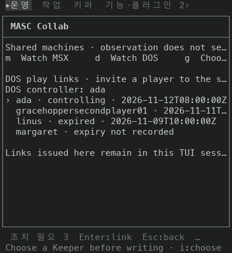 | 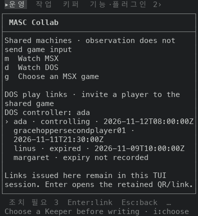 |

60x24 해제 확인이에요. 앞에서는 `Revoke margaret? Their link stops working and their contr…` 에서 끊겼어요.

| 앞 | 뒤 |
|---|---|
| 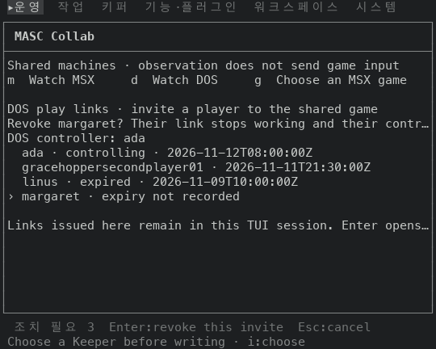 | 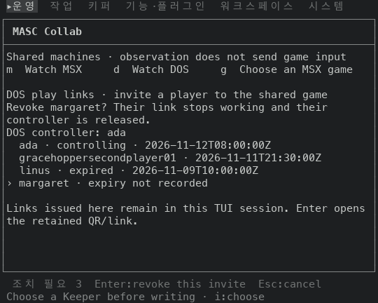 |

80x24 목록이에요. 끝 안내문이 두 줄이 돼요.

| 앞 | 뒤 |
|---|---|
| 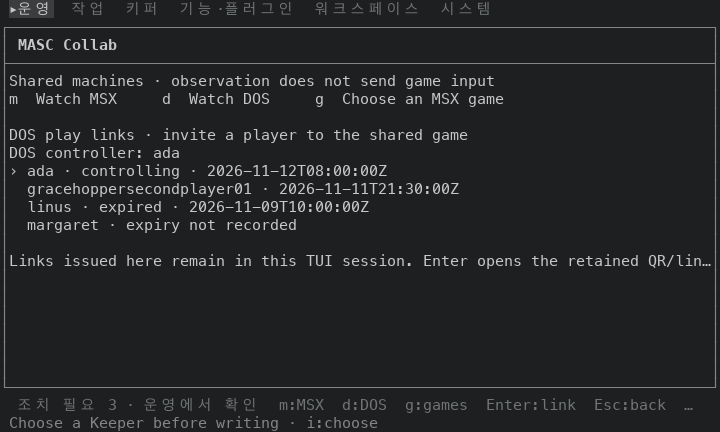 | 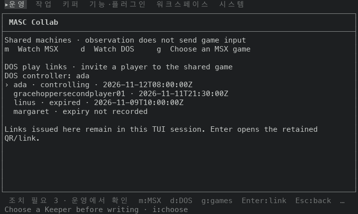 |

44x24 이름 입력이에요. 줄이 늘어서 끝 안내문이 가려지고 프레임이 `+2 rows not shown` 으로 알려요.

| 앞 | 뒤 |
|---|---|
| 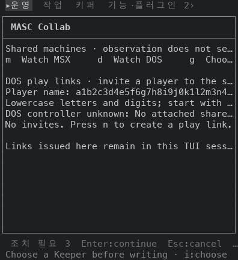 | 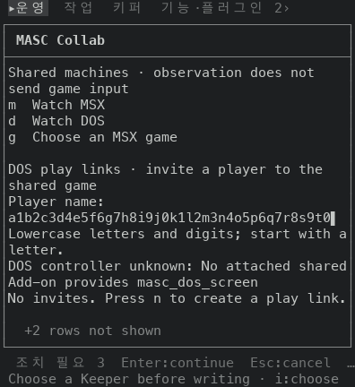 |

짧은 창 60x16 초대 목록이에요.

| 앞 | 뒤 |
|---|---|
| 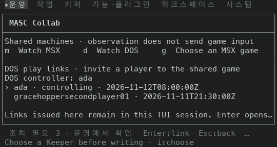 | 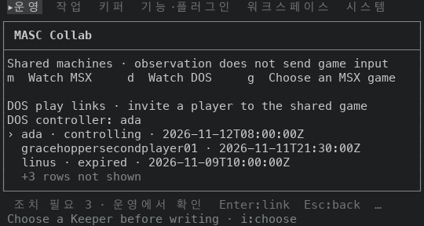 |

짧은 창 44x15 초대 목록이에요. 앞에서는 줄마다 끝이 잘렸고, 뒤에서는 머리말 설명 두 문장이 물러나고 단축키와 선택한 초대가 남아요.

| 앞 | 뒤 |
|---|---|
| 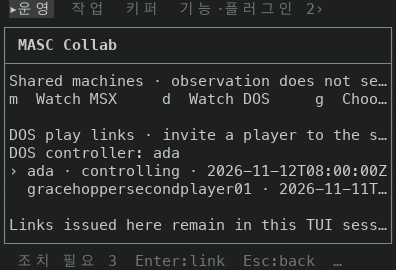 | 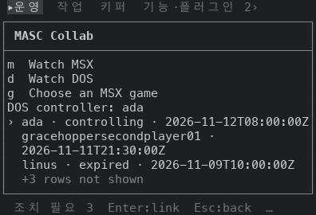 |

공백이 없는 52자 이름을 44x24 폼에 쳤을 때(뒤)예요. 낱말을 나눌 곳이 없어서 칸 수대로 두 줄로 쪼개져요.

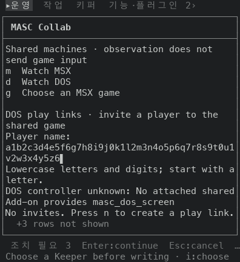

## 장점과 단점

- 장점: 80칸 이하에서 `…` 로 잘린 줄이 0이에요. 앞에서는 두 걷기를 합쳐 80칸 6줄, 60칸 9줄, 44칸 33줄이 잘렸어요.
- 장점: 해제 확인의 끝(`…their controller is released.`)과 컨트롤러 설명, 끝 안내문의 끝이 보여요.
- 단점: 줄이 늘어서 낮은 창에서는 아래 글이 밀려나요. 44x24 이름 입력에서는 끝 안내문이, 44x15 에서는 머리말의 설명 문장도 가려져요. 프레임이 가려진 줄 수는 알려도 어느 줄인지는 안 알려요.
- 단점: 공백이 없는 긴 글은 줄에 들어가는 마지막 `_ : / . -` 뒤에서 끊어요. 그 자리가 줄의 절반 이상 찬 곳일 때만이고, 아니면 칸 수대로 쪼개요(`split_word` 의 규칙이에요. `wrap_words` 가 폭보다 넓은 낱말에 불러요). 52자 이름에는 그런 글자가 없어서 칸 수대로 쪼개졌어요. 이름 입력 폼은 길이를 막지 않고 Enter 에서 32자 제한을 검사해서, 52자를 치면 폼에서 두 줄로 쪼개져 그려져요.
- 단점: 머리말의 설명 문장이나 단축키 줄이 물러나도, 남은 줄이 다 들어가면 프레임이 줄을 하나도 안 잘라서 `+N rows not shown` 이 안 떠요. 코드를 읽고 줄 수를 손으로 센 예예요. 44칸에서 초대가 없고 DOS 컨트롤러가 비어 있는 상태예요. 고정 문장은 `No invites. Press n to create a play link.` 한 줄이고 폼과 알림은 없어요. 머리말은 8줄(설명 2줄, 단축키 3줄, 빈 줄, 설명 2줄)이고 끝 안내문은 2줄이에요.
  - 본문이 11줄(창 17줄)이면 머리말이 그대로이고 끝 안내문이 잘려서 `+2 rows not shown` 이 떠요. 10줄(창 16줄)이면 `+3 rows not shown` 이에요.
  - 9줄(창 15줄)이면 머리말에서 설명 두 문장과 빈 줄(5줄)이 물러나 단축키 세 줄만 남아요. 남은 7줄이 다 들어가서 알림이 없고, 끝 안내문은 도로 두 줄이 다 보여요.
  - 창 줄 수는 본문 줄 수 + 6이에요. 입력 줄 1(`Masc_tui_composer.rows_for`)과 프레임 5(`framed_chrome_rows`)를 더한 값이고, 일정 띠(`agenda_chrome_rows`)가 없을 때예요. 44x15 캡처의 본문이 9줄인 것과 맞아요.
  - 위 줄 수는 같은 계산을 라벨 줄로 옮겨 돌려서도 맞춰 봤어요. 그 파일은 저장소에 안 넣었어요. 이 상태를 찍은 장은 이 README 에 없어요.
- 단점: 목록이 창보다 길면 선택한 초대와 이웃만 보여요. 목록이 더 있다는 표시는 없어요. 앞에도 없었어요.
- 단점: 끝 안내문이 가려진 창에서도 그 앞의 빈 줄은 남아요(44x24 이름 입력 그림). 이 줄은 안 줄였어요.

## 안 잰 것

- 실제 터미널(iTerm2, Terminal.app 등)에서 본 모습은 안 봤어요.
- 쓰기가 막힌 상태(`Pending`, `Read_only`, `Uncertain`), `u` 로 여는 미확인 결과 확인 화면(`Confirm_resolution`), 초대를 못 읽은 상태(`Failed`)는 안 찍었어요. 서버 상태를 만들어야 해요. 해제 확인에서 Enter 를 눌러 실제로 해제하는 것도 안 눌렀어요.
- 40칸 아래 창은 안 찍었어요. 15줄 아래 창은 TUI 가 안 그려요.
- 머리말이 줄었는데 `+N rows not shown` 이 안 뜨는 화면은 안 찍었어요. 위 단점의 줄 수는 코드를 읽고 센 값이에요.
- 힌트 줄(`n:invite x:revoke`)은 80칸에서 안 보여요. 프레임 바깥이라 이 PR 범위 밖이에요.
- 영어 화면은 안 찍었어요. Collab 본문은 영어 글이라 UI 언어와 상관없지만, 탭 줄과 맨 아래 줄은 언어에 따라 폭이 달라요.
- 초대가 열 개 넘게 있는 목록과 이름이 긴 초대(32자)는 안 찍었어요.
- 시험은 안 늘렸어요. 화면 글자·배치를 못 박는 시험은 `docs/constitution.xml` 이 막고 있어요. 로컬 `dune` 은 안 돌렸고, 증명 빌드가 타입 검사를 대신해요.

## 검증

- 증명 빌드가 성공했어요(native-tui macos, 시나리오 `workspace-files`): 앞 `2464200f4c4d` run `42815079636`, 뒤 `23081469bd59` run `42822564722`. 두 빌드 모두 안의 시험 3개가 통과했어요.
- 목록 창의 계산(`visible_invites` 와 높이별 `lines` 의 뒷부분)만 따로 떼어 높이 9~36, 모든 선택에서 선택한 초대가 그려지는지 돌려 봤어요. 실패 0이에요. 이 확인용 파일은 저장소에 안 넣었어요.
- 줄바꿈이 센 폭과 그려지는 폭이 어긋나지 않게 하려고 `sanitize_terminal_text` 를 먼저 거쳐요. 제어 문자가 든 입력을 넣어 본 것은 아니에요.
