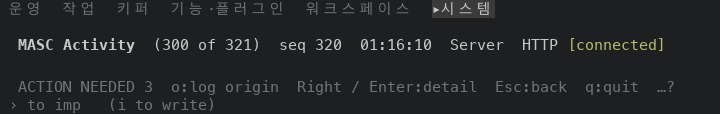
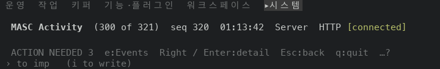
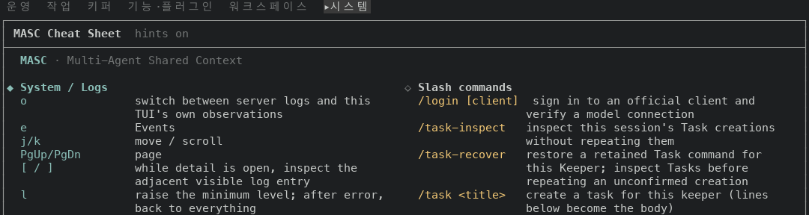
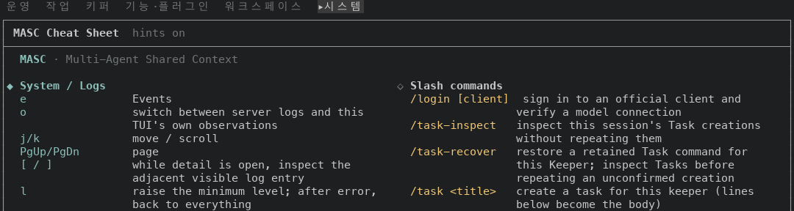

# Logs 화면 푸터가 e:Events 를 o:log origin 보다 먼저 남겨요

## 실측

고정 서버 위에서 증명 빌드 둘로 같은 화면을 찍었어요. 앞은 main `c9f811b28417`(run `42650000191`), 뒤는 그 위에 이 PR 의 코드 커밋 한 개를 얹은 `2c6bb4d71bdd`(run `42648902947`)이에요. 두 빌드의 소스는 `bin/masc_tui_keys.ml` 하나만 달라요(`git diff --name-only` 로 확인했어요). `docs/guides/TUI-KEYS.md` 는 키 표에서 만든 문서라 같이 고쳤고, 빌드에는 들어가지 않아요.

### Logs 화면의 푸터

`System / Logs` 첫 화면을 폭 36~120(4칸 간격), 높이 24 로 찍고, 마지막에서 두 번째 줄(키 줄)을 읽었어요. 운영자 알림 줄(`ACTION NEEDED`)이 있는 상태예요. 앞과 뒤가 다른 폭에는 `*` 를 붙였어요.

찍는 순간 로그를 아직 읽는 중(`(reading…)`)이던 폭 80 은 푸터가 데이터 상태에 따라 달라서 표에서 뺐어요. 폭 80 은 아래 목적지 서베이의 80x24 에 있어요.

| 폭 | 앞(main) | 뒤(이 PR) |
|---|---|---|
| 36 | `Right / Enter:detail  Esc:back  …?` | `Right / Enter:detail  Esc:back  …?` |
| 40 | `Right / Enter:detail  Esc:back  q:qu…?` | `Right / Enter:detail  Esc:back  q:qu…?` |
| 44 | `Right / Enter:detail  Esc:back  q:quit  …?` | `Right / Enter:detail  Esc:back  q:quit  …?` |
| 48 | `Right / Enter:detail  Esc:back  q:quit  …?` | `Right / Enter:detail  Esc:back  q:quit  …?` |
| 52 | `Right / Enter:detail  Esc:back  q:quit  …?` | `Right / Enter:detail  Esc:back  q:quit  …?` |
| 56 * | `Right / Enter:detail  Esc:back  q:quit  …?` | `e:Events  Right / Enter:detail  Esc:back  q:quit  …?` |
| 60 * | `o:log origin  Right / Enter:detail  Esc:back  q:quit  …?` | `e:Events  Right / Enter:detail  Esc:back  q:quit  …?` |
| 64 | `ACTION NEEDED 3  Right / Enter:detail  Esc:back  q:quit  …?` | `ACTION NEEDED 3  Right / Enter:detail  Esc:back  q:quit  …?` |
| 68 | `ACTION NEEDED 3  Right / Enter:detail  Esc:back  q:quit  …?` | `ACTION NEEDED 3  Right / Enter:detail  Esc:back  q:quit  …?` |
| 72 * | `ACTION NEEDED 3  Right / Enter:detail  Esc:back  q:quit  …?` | `ACTION NEEDED 3  e:Events  Right / Enter:detail  Esc:back  q:quit  …?` |
| 76 * | `ACTION NEEDED 3  o:log origin  Right / Enter:detail  Esc:back  q:quit  …?` | `ACTION NEEDED 3  e:Events  Right / Enter:detail  Esc:back  q:quit  …?` |
| 84 * | `ACTION NEEDED 3  o:log origin  Right / Enter:detail  Esc:back  q:quit  …?` | `ACTION NEEDED 3  e:Events  Right / Enter:detail  Esc:back  q:quit  …?` |
| 88 * | `ACTION NEEDED 3  o:log origin  e:Events  Right / Enter:detail  Esc:back  q:quit  …?` | `ACTION NEEDED 3  e:Events  o:log origin  Right / Enter:detail  Esc:back  q:quit  …?` |
| 92 * | `ACTION NEEDED 3  o:log origin  e:Events  Right / Enter:detail  Esc:back  q:quit  …?` | `ACTION NEEDED 3  e:Events  o:log origin  Right / Enter:detail  Esc:back  q:quit  …?` |
| 96 * | `ACTION NEEDED 3  o:log origin  e:Events  Right / Enter:detail  Esc:back  q:quit  …?` | `ACTION NEEDED 3  e:Events  o:log origin  Right / Enter:detail  Esc:back  q:quit  …?` |
| 100 * | `ACTION NEEDED 3  o:log origin  e:Events  Right / Enter:detail  Esc:back  q:quit  …?` | `ACTION NEEDED 3  e:Events  o:log origin  Right / Enter:detail  Esc:back  q:quit  …?` |
| 104 * | `ACTION NEEDED 3  o:log origin  e:Events  j/k:move / scroll  Right / Enter:detail  Esc:back  q:quit  …?` | `ACTION NEEDED 3  e:Events  o:log origin  j/k:move / scroll  Right / Enter:detail  Esc:back  q:quit  …?` |
| 108 * | `ACTION NEEDED 3  o:log origin  e:Events  j/k:move / scroll  Right / Enter:detail  Esc:back  q:quit  …?` | `ACTION NEEDED 3  e:Events  o:log origin  j/k:move / scroll  Right / Enter:detail  Esc:back  q:quit  …?` |
| 112 | `ACTION NEEDED 3 · keeper_fleet_safety:no_executable_keeper_fibers  Right / Enter:detail  Esc:back  q:quit  …?` | `ACTION NEEDED 3 · keeper_fleet_safety:no_executable_keeper_fibers  Right / Enter:detail  Esc:back  q:quit  …?` |
| 116 | `ACTION NEEDED 3 · keeper_fleet_safety:no_executable_keeper_fibers  Right / Enter:detail  Esc:back  q:quit  …?` | `ACTION NEEDED 3 · keeper_fleet_safety:no_executable_keeper_fibers  Right / Enter:detail  Esc:back  q:quit  …?` |
| 120 | `ACTION NEEDED 3 · keeper_fleet_safety:no_executable_keeper_fibers  Right / Enter:detail  Esc:back  q:quit  …?` | `ACTION NEEDED 3 · keeper_fleet_safety:no_executable_keeper_fibers  Right / Enter:detail  Esc:back  q:quit  …?` |

찍은 21개 폭 중 푸터가 달라진 폭은 11곳(56, 60, 72, 76, 84, 88, 92, 96, 100, 104, 108)이에요.
`e:Events` 가 푸터에 보이는 폭은 앞 6곳(가장 좁은 폭 88), 뒤 11곳(가장 좁은 폭 56)이에요.
뒤에 새로 보이는 키 `e`: 폭 56, 60, 72, 76, 84.
뒤에서 푸터를 떠난 키 `o`: 폭 60, 76, 84.

### 폭 80 의 제목 줄

폭 80(높이 24)의 Logs 제목 줄은 앞뒤가 같고(시각·개수는 `#` 로 가렸어요) `MASC Activity  (# of #)  seq #  #:#:#  Server  HTTP [connected]` 예요. 줄에 `Events` 나 `Logs` 라는 이름이 없어요. 이 폭의 화면 전체에서 `Events` 라는 글자가 나오는 줄은 앞이 0개, 뒤가 푸터 1개(`e:Events`)예요.

### 목적지 35곳의 첫 화면

`:` 팔레트의 목적지 35곳을 각각 한 번 열어 첫 화면만 찍었어요. 앞뒤는 서버를 따로 띄워 찍어서, 서버가 자기를 적는 글(캡처 이름이 든 경로, 커밋 해시, 시각·개수)은 `#` 로 가리고 견줬어요.

#### 120x35

Events 읽기(`s21-system-activity`)는 글자와 나머지 색·굵기가 앞뒤로 같아요. 글자와 나머지 색·굵기가 앞뒤로 같은 화면은 모두 33곳이에요. 나머지 2곳 중 `s22-system-logs` 는 이 PR 이 푸터를 바꾼 화면이고, 그 밖의 1곳(`s07-work-board`)은 서버를 띄울 때마다 달라지는 글(fixture id, 로그 줄 순서, 설정을 읽는 순간)이 있어서 글자를 견주지 못했어요. 이 화면들도 틀 글자가 놓인 칸은 앞뒤가 같아요.

| `s22-system-logs` 푸터 | 줄 |
|---|---|
| 앞 | `ACTION NEEDED 3 · keeper_fleet_safety:no_executable_keeper_fibers  Right / Enter:detail  Esc:back  q:quit  …?` |
| 뒤 | `ACTION NEEDED 3 · keeper_fleet_safety:no_executable_keeper_fibers  Right / Enter:detail  Esc:back  q:quit  …?` |

폭 120 에서는 운영자 알림 줄이 자리를 차지해서 `e` 도 `o` 도 푸터에 안 들어가고, 푸터가 앞뒤로 같아요.

#### 80x24

Events 읽기(`s21-system-activity`)는 글자와 나머지 색·굵기가 앞뒤로 같아요. 글자와 나머지 색·굵기가 앞뒤로 같은 화면은 모두 32곳이에요. 나머지 3곳 중 `s22-system-logs` 는 이 PR 이 푸터를 바꾼 화면이고, 그 밖의 2곳(`s07-work-board`, `s31-system-voice`)은 서버를 띄울 때마다 달라지는 글(fixture id, 로그 줄 순서, 설정을 읽는 순간)이 있어서 글자를 견주지 못했어요. 이 화면들도 틀 글자가 놓인 칸은 앞뒤가 같아요.

| `s22-system-logs` 푸터 | 줄 |
|---|---|
| 앞 | `ACTION NEEDED 3  o:log origin  Right / Enter:detail  Esc:back  q:quit  …?` |
| 뒤 | `ACTION NEEDED 3  e:Events  Right / Enter:detail  Esc:back  q:quit  …?` |

### 도움말 시트의 System / Logs 줄

`System / Logs` 에서 `?` 를 누르면 도움말 시트가 그 화면의 키 표 구역으로 시작해요. 구역의 처음 두 줄이 어떻게 바뀌었는지 찍었어요(폭 120x35, 80x24).

| 폭 | 앞 | 뒤 |
|---|---|---|
| 120x35 | `o switch between server logs and this` / `TUI's own observations` | `e Events` / `o switch between server logs and this` |
| 80x24 | `o switch between server logs and this TUI's own observations` / `e Events` | `e Events` / `o switch between server logs and this TUI's own observations` |

### 키 표에서 만든 문서

두 증명 빌드가 키 표에서 만든 `key-reference.md` 는 같은 줄을 담고 순서만 달라요. 다른 줄 번호는 804, 805 로, `e` 줄과 `o` 줄이 자리를 바꿨어요.

이 PR 의 `docs/guides/TUI-KEYS.md` 에만 있는 줄은 3개, 생성한 문서에만 있는 줄은 0개예요.
- 문서에만: `| `/memory` | cycle Memory journal summary / full / hidden |`
- 문서에만: `| `/memory status` | read the selected Keeper's current memory health, including its last processing observation and waiting reason |`
- 문서에만: `| `/memory sync` | request catch-up on the existing Memory lane, including for a paused Keeper; acceptance does not mean completion |`

문서에만 있는 줄은 main 에 이미 있던 `/memory` 줄이에요(이슈 #50726). 이 PR 이 옮긴 두 줄은 생성한 문서와 같은 순서예요.

안 잰 것: 푸터는 폭 36~120 을 4칸 간격으로만 봤고 높이는 24 로 고정했어요. Events 읽기는 폭을 바꿔 가며 찍지 않았어요(fixture 이벤트가 서버를 띄울 때마다 달라서 화면 글자를 견줄 수 없었어요). 목적지 35곳 중 `s21-system-activity` 를 두 폭에서 견줬고, 키 표 문서는 `e`·`o` 두 줄이 자리를 바꾼 것 말고는 같아요. 운영자 알림 줄이 있는 상태에서만 찍었어요(알림이 없으면 키가 더 들어가요). 로그가 읽힌 뒤의 화면만 견줬어요. `e` 와 `o` 를 눌러 본 동작은 이 PR 이 안 바꿨고 다시 안 눌렀어요.

| 앞(main) | 뒤(이 PR) |
|---|---|
| Logs, 폭 80 · 위쪽 3줄과 아래쪽 3줄  |   |
| 도움말 시트의 System / Logs 구역, 폭 120  |   |
