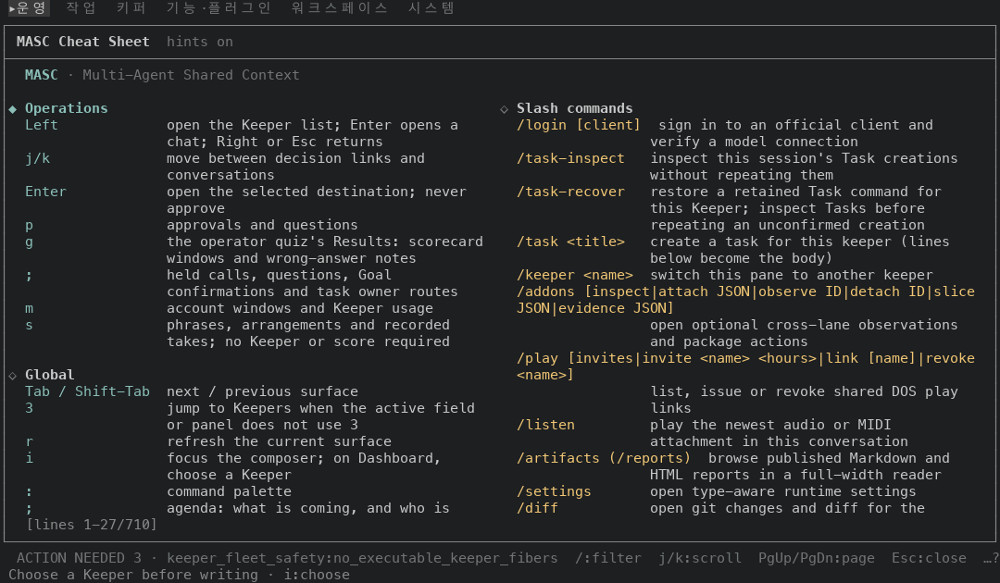
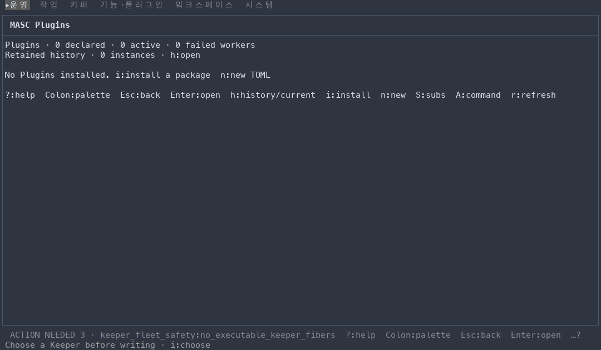
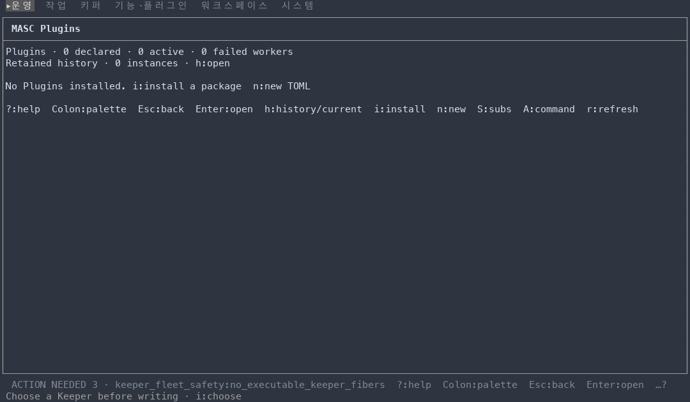
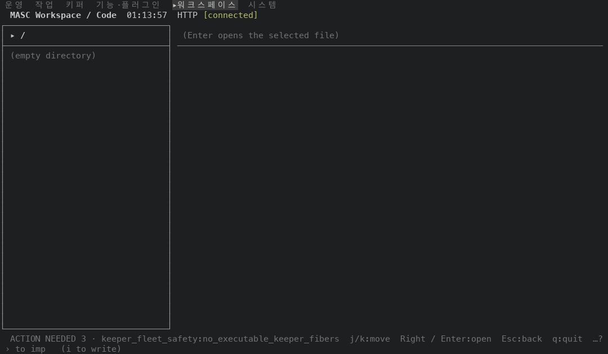
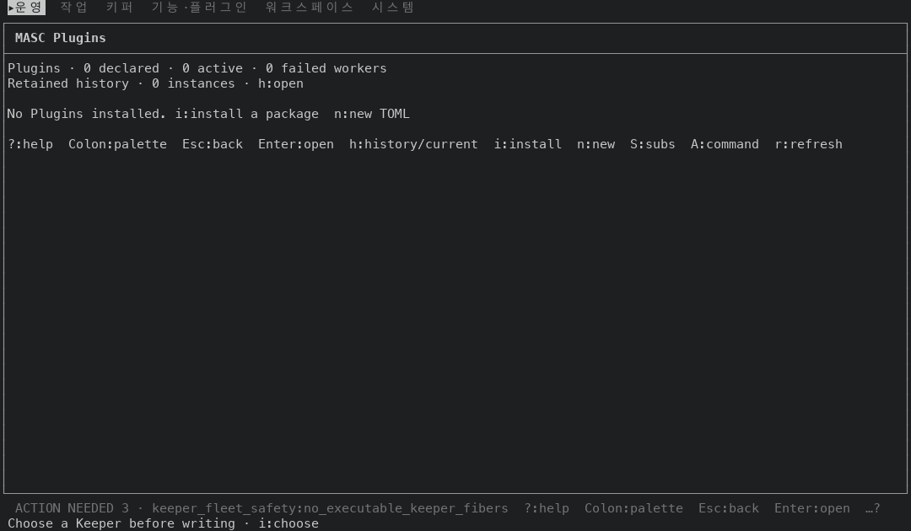
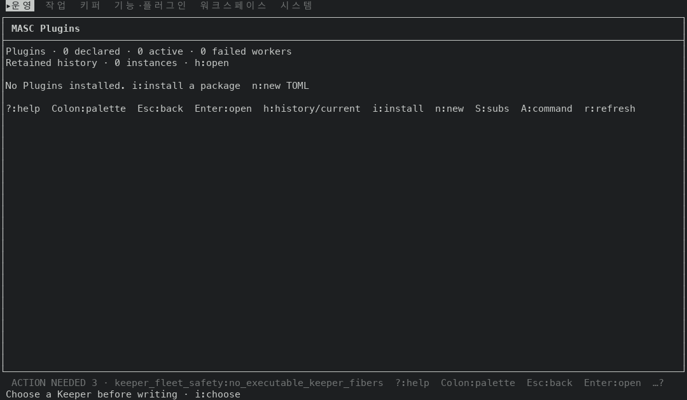
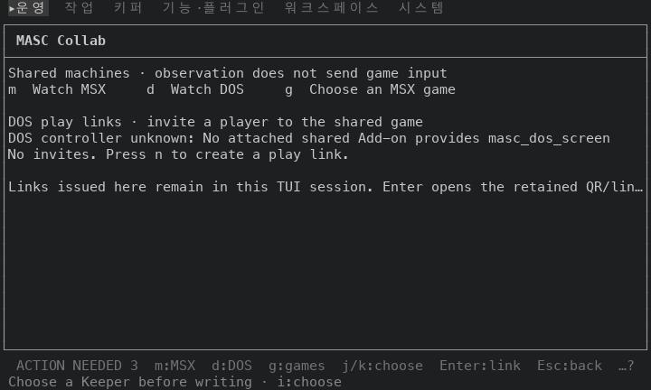
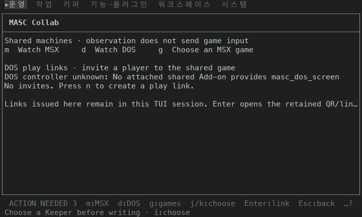

# 오버레이 틀을 패널 테두리와 같은 recede 색으로 그리기

## 실측

고정 서버 위에서 증명 빌드 둘로 같은 키 순서를 눌러 찍었어요. 앞은 main `c9f811b28417`(run `42650000191`), 뒤는 그 위에 이 PR 의 코드 커밋 한 개를 얹은 `57ae5ad166d0`(run `42648792778`)이에요. 두 빌드의 소스는 파일 2개(`bin/masc_tui_ansi.ml`, `bin/masc_tui_render_prim.ml`)만 달라요(`git diff --name-only` 로 확인했어요). 문서와 changelog 는 빌드에 들어가지 않아요.

### 오버레이 여섯 화면

도움말(`?`)·팔레트(`:`)·Agenda(`;`)를 열고, 팔레트에서 `go Plugins`·`go Play / Links`·`go Code` 로 연 화면까지 여섯 장을 네 가지 터미널 조건으로 찍었어요. 틀 글자(`│ ┌ ┐ └ ┘ ├ ┤ ─`)마다 그릴 때 켜져 있던 전경색을 세어 앞뒤를 견줬어요.

| 화면 | 기본 팔레트, 120x35 | 기본 팔레트, 80x24 | Nord 팔레트, 120x35 | 팔레트를 알려 주지 않음, 120x35 |
|---|---|---|---|---|
| 도움말 `?` | SGR 90 ×418 → 256색 102 ×418 | SGR 90 ×276 → 256색 102 ×276 | SGR 90 ×418 → 256색 247 ×418 | SGR 90 ×418 → 기본 전경색 ×418 |
| 팔레트 `:` | SGR 90 ×418 → 256색 102 ×418 | SGR 90 ×276 → 256색 102 ×276 | SGR 90 ×418 → 256색 247 ×418 | SGR 90 ×418 → 기본 전경색 ×418 |
| Agenda `;` | SGR 90 ×418 → 256색 102 ×418 | SGR 90 ×276 → 256색 102 ×276 | SGR 90 ×418 → 256색 247 ×418 | SGR 90 ×418 → 기본 전경색 ×418 |
| Plugins | SGR 90 ×418 → 256색 102 ×418 | SGR 90 ×276 → 256색 102 ×276 | SGR 90 ×418 → 256색 247 ×418 | SGR 90 ×418 → 기본 전경색 ×418 |
| Collab | SGR 90 ×418 → 256색 102 ×418 | SGR 90 ×276 → 256색 102 ×276 | SGR 90 ×418 → 256색 247 ×418 | SGR 90 ×418 → 기본 전경색 ×418 |
| Code 왼쪽 패널 | SGR 90 ×158, 256색 102 ×84 → 256색 102 ×242 | 256색 102 ×78 → 256색 102 ×78 | SGR 90 ×158, 256색 247 ×84 → 256색 247 ×242 | SGR 90 ×158, 기본 전경색 ×84 → 기본 전경색 ×242 |

24장 모두 틀 글자 수가 앞뒤로 같고, 뒤에는 SGR 90 으로 그려진 틀 글자가 0개예요. 틀 글자의 전경색을 빼고 보면 글자와 나머지 색·굵기가 24장 모두 앞뒤로 같아요(시각·개수·8자리 번호는 `#` 로 가리고 견줬어요).

### 목적지 35곳의 첫 화면

`:` 팔레트의 목적지 35곳을 각각 한 번 열어 첫 화면만 찍었어요(기본 팔레트). 앞뒤는 서버를 따로 띄워 찍어서, 서버가 자기를 적는 글(캡처 이름이 든 경로, 커밋 해시, 시각·개수)은 `#` 로 가리고 견줬어요.

#### 120x35

| 틀 글자의 전경색 | 앞 | 뒤 |
|---|---|---|
| 256색 102 | 7639 | 8633 |
| SGR 90 | 994 | 0 |
| SGR 96 | 218 | 218 |
| 기본 전경색 | 19 | 19 |

틀 글자 색이 달라진 화면은 3곳이에요: `s16-workspace-code`, `s24-features-plugins-plugins`, `s32-play-links`.
글자와 나머지 색·굵기가 앞뒤로 같은 화면은 31곳이에요. 나머지 4곳(`s05-system`, `s07-work-board`, `s22-system-logs`, `s25-system-runtime-toml`)은 서버를 띄울 때마다 달라지는 글이 있어서 글자를 견주지 못했어요. 이 화면들도 틀 글자가 놓인 칸은 앞뒤가 같아요.

#### 80x24

| 틀 글자의 전경색 | 앞 | 뒤 |
|---|---|---|
| 256색 102 | 4877 | 5429 |
| SGR 90 | 552 | 0 |
| SGR 96 | 159 | 159 |
| 기본 전경색 | 6 | 6 |

틀 글자 색이 달라진 화면은 2곳이에요: `s24-features-plugins-plugins`, `s32-play-links`.
글자와 나머지 색·굵기가 앞뒤로 같은 화면은 32곳이에요. 나머지 3곳(`s07-work-board`, `s22-system-logs`, `s31-system-voice`)은 서버를 띄울 때마다 달라지는 글이 있어서 글자를 견주지 못했어요. 이 화면들도 틀 글자가 놓인 칸은 앞뒤가 같아요.

### 배경과의 대비

틀 글자에 켜져 있던 색을 캡처 도구가 알려 준 팔레트에 놓고 WCAG 대비(밝은 쪽 + 0.05) ÷ (어두운 쪽 + 0.05)를 계산했어요. 앞의 SGR 90 은 터미널의 bright black(색 번호 8)이고, 뒤의 256색 번호는 xterm 256색표 값이에요.

| 팔레트 | 배경 | 앞: 틀 색 | 앞 대비 | 뒤: 틀 색 | 뒤 대비 |
|---|---|---|---|---|---|
| 기본 | `#1d1f21` | SGR 90 = `#969896` | 5.69:1 | 256색 102 = `#878787` | 4.60:1 |
| Nord | `#2e3440` | SGR 90 = `#4c566a` | 1.69:1 | 256색 247 = `#9e9e9e` | 4.66:1 |

기본 팔레트에서는 틀이 조금 어두워지고, Nord 에서는 배경에 묻히던 틀이 보이게 돼요. 팔레트를 알려 주지 않는 터미널에서는 틀이 기본 전경색으로 그려져요. 앞은 그 터미널의 bright black 이었어요. 캡처 도구가 그린 값으로는 `#969896`(5.69:1)에서 `#c5c8c6`(9.80:1)로 밝아져요. 실제 터미널의 값은 달라요.

안 잰 것: 실제 터미널(iTerm2, Terminal.app 등)에서 본 모습은 안 봤어요. 위 대비는 캡처 도구의 팔레트와 xterm 256색표로 계산한 값이에요. 오버레이는 고정 서버의 빈 상태(Plugins 0개, Agenda 비어 있음, Code 는 빈 디렉터리)에서만 찍었어요. 목적지 35곳은 첫 화면만 봤고, 안에서 키를 눌러 연 화면은 안 봤어요. 라이트 팔레트는 안 찍었어요.

| 앞 | 뒤 |
|---|---|
| 도움말, 기본 팔레트  |   |
| Plugins, Nord 팔레트  |   |
| Code 왼쪽 패널, 기본 팔레트  |   |
| Plugins, 팔레트를 알려 주지 않음  |   |
| Collab, 폭 80  |   |
