# Plugins 도움말을 라벨 열과 강조색으로 그리기

## 무엇이 달라지나요

Plugins 화면에서 `?` 를 누르면 나오는 도움말이 바뀌어요.

- 앞: 도움말 16줄이 모두 기본 글자색의 문자열이에요. `List: j/k select …` 처럼 라벨과 키가 한 줄에 붙어 있고, 좁은 화면에서는 낱말 중간에서 줄이 끊겨요.
- 뒤: 제목과 라벨(`List`, `Detail`, `Both`, `Actions`, …)이 강조색이고, 라벨이 한 열에 모여서 키 설명이 같은 칸에서 시작해요. 라벨 아래의 부연 설명(`TOML-managed removal …`)도 그 칸에서 시작해요. 줄바꿈은 공백에서 해요.
- 낱말은 그대로예요. 라벨 뒤 콜론 10개(`List:` → `List`)만 없어졌어요.
- 창이 좁아서 라벨 열(14칸)이 폭의 절반을 넘으면(안쪽 폭 28칸 미만) 라벨이 따로 한 줄이고, 키와 부연이 두 칸 들여써서 이어져요. 글자는 하나도 안 잘려요.
- 코드는 `bin/masc_tui_lane_addons.ml` 한 파일이에요(+56 -21, 커밋 셋).
  - 도움말 16줄이 `help_rows`(제목·설명·키·부연 네 종류의 `help_row`)로 바뀌고, `help_lines ~width` 가 그려요.
  - `led_rows` 가 줄 자르는 함수 `?split` 를 선택으로 받아요. 안 주면 전과 같이 칸에서 잘라서, 다른 호출처 6곳은 그대로예요. 도움말만 공백에서 잘라요.
  - `help_lines` 가 라벨 열이 폭의 절반을 넘는지 보고(`beside`), 넘으면 라벨 행과 키 행을 따로 그려요.

## 실측

고정 서버 위에서 증명 빌드로 같은 키 순서를 눌러 찍었어요. 앞은 main `8e488e04c8d5`(run `42765175806`), 뒤는 이 PR 의 코드 머리 `d3f396dee892`(run `42779403621`)예요. 이전 머리 `f13f129eb3db`(run `42773117820`)도 찍어서 견줬어요. 세 빌드 모두 영수증 시험 3개가 통과했어요. 고정 서버에는 Plugins 가 없어서 캡처용으로 응답을 바꿔 Plugins 둘을 넣었어요. 이 응답은 직접 만든 값이고 저장소에는 없어요.

### 넓은 화면

Plugins 걷기 8장(목록, 상세의 결과·링크·설치·기록 탭, 다음 결과, 실패한 Plugin 상세, 도움말)을 네 조건에서 찍고, 칸 단위로 글자와 색을 견줬어요.

| 조건 | main 대비 바뀐 장 | 같은 장 | 이전 머리 대비 |
|---|---|---|---|
| 120x35, 기본 팔레트, 트루컬러 | 1(도움말) | 7 | 8장 모두 같아요 |
| 120x35, `default-light`, 트루컬러 | 1(도움말) | 7 | 8장 모두 같아요 |
| 120x35, `default-light`, 256색 | 1(도움말) | 7 | 8장 모두 같아요 |
| 80x24, 기본 팔레트, 트루컬러 | 1(도움말) | 7 | 8장 모두 같아요 |

도움말 한 장(120x35, 기본 팔레트, 트루컬러)에서 센 값이에요. 테두리 글리프는 글자 칸에서 뺐어요. 이전 머리와 이번 머리의 값이 같아요.

| 항목 | 앞 | 뒤 |
|---|---|---|
| 글자가 있는 행 | 20 | 20 |
| 보이는 글자 칸 | 982 | 972 |
| 강조색(`ansi6`) 칸 | 0 | 91 |
| 기본 글자색 칸 | 947 | 846 |
| 굵은 칸 | 14 | 105 |

보이는 글자 칸이 10 줄어든 것은 콜론 10개예요. 강조색 91칸은 제목 21칸과 라벨 70칸이에요.

도움말이 차지하는 줄 수는 폭에 따라 달라요. 80x40 에서 도움말이 다 들어가게 찍어서 셌어요.

| 폭 | 앞 | 뒤 |
|---|---|---|
| 120칸 | 16줄 | 16줄 |
| 80칸 | 20줄 | 23줄 |

80칸에서 낱말이 중간에서 끊긴 곳은 앞 3곳(`paths`, `evidence`, `state`), 뒤 0곳이에요.

80x24 에서는 도움말 첫 화면이 17줄이에요. 앞은 20줄 중 `Links` 까지, 뒤는 23줄 중 `Installation` 의 첫 줄까지 보여요. 뒤 빌드에서 `J` 를 여섯 번 누르면 마지막 줄(`ID)`)까지 내려가요(`help-80x24-scrolled-after.png`).

### 좁은 창(리뷰 P2)

라벨 열은 14칸이에요. 이전 머리는 안쪽 폭이 14칸 이하일 때 키 설명을 전부 잘라 냈고(`Span.truncate` 가 라벨 열 뒤를 잘라요), 15~27칸에서는 키 설명이 1~13칸 조각으로 쪼개졌어요. 이번 머리는 라벨 열이 폭의 절반을 넘으면 라벨을 따로 한 줄로 그리고 키와 부연을 두 칸 들여서 이어요.

도움말 전체가 한 화면에 들어가게 세로로 긴 창(24x100, 16x160)에서 찍고, 콜론을 뺀 글자 흐름(공백과 테두리는 뺐어요)을 견줬어요. 줄은 제목 줄, 탭 줄, 바닥 힌트를 포함한 글자가 있는 행이에요.

| 창 | main | 이전 머리 `f13f129eb3db` | 이번 머리 `d3f396dee892` |
|---|---|---|---|
| 24x100(안쪽 22칸) | 924자, 61줄 | 683자, 97줄(창 아래에서 잘려 끝이 안 보여요) | 924자, 71줄 |
| 16x160(안쪽 14칸) | 913자, 85줄 | 155자, 18줄(키 설명이 없어요) | 913자, 113줄 |

main 과 이번 머리의 글자 흐름이 같아요. 아래 그림은 24x30, 16x30 의 첫 화면이에요.

| 앞(main, 24x30) | 이전 머리 | 이번 머리 |
|---|---|---|
| 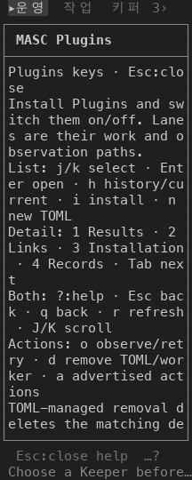 | 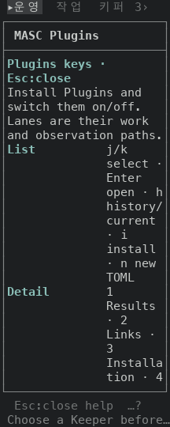 | 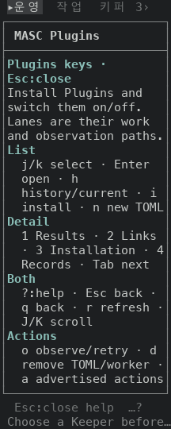 |

| 앞(main, 16x30) | 이전 머리 | 이번 머리 |
|---|---|---|
| 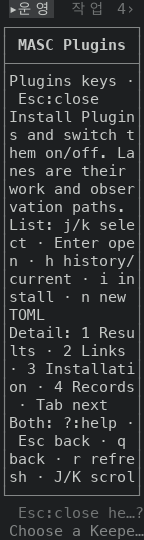 | 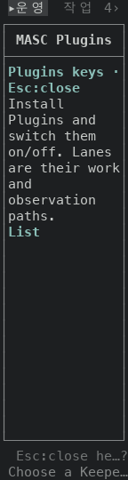 | 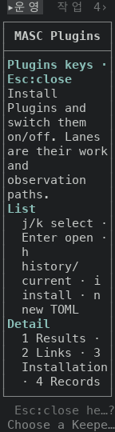 |

## 단점

- 80칸에서 도움말이 20줄에서 23줄로 늘어요. 라벨 열이 14칸을 차지해서 키 설명이 쓸 수 있는 폭이 줄고, 공백에서 자르면 칸에서 자를 때보다 줄이 더 나와요. 80x24 첫 화면에서 보이는 키 그룹이 하나 줄어요(앞 `Links` 까지, 뒤 `Installation` 까지). 나머지는 `J` 로 내려서 봐요.
- 안쪽 폭이 28칸 미만이면 라벨이 한 줄을 따로 써서 줄 수가 늘어요(24x100 에서 61줄 → 71줄, 16x160 에서 85줄 → 113줄).
- `default-light` 에서 강조색 91칸의 대비가 1.91:1 이에요(기본 팔레트는 7.97:1). 앞은 기본 글자색이었어요. Results 탭의 라벨도 같은 강조색이라 같은 값이에요. 밝은 테마의 강조색을 올리는 스택(#50922 → #50923 → #50964)이 따로 열려 있고, 이 PR 은 그 스택과 독립이에요.
- 라벨 뒤 콜론이 없어졌어요. 라벨이 열에 모여서 콜론 없이도 구분돼요.
- `led_rows` 는 앞머리가 줄 폭 이상이면 본문이 안 보이는 구조예요. 앞머리가 긴 다른 호출처(`value_row_spans`, `reading_spans`)는 이 PR 이 안 고쳐요. 좁은 창에서 실제로 글자를 잃는지는 안 쟀고, 이슈 #51036 에 적어 뒀어요.

## 안 잰 것

- 실제 터미널(iTerm2, Terminal.app 등)에서 본 모습은 안 봤어요.
- Plugins 응답은 직접 만든 값이에요. 도움말 글자는 응답과 상관없는 고정 목록(`help_rows`)이에요.
- 폭 16 미만, 그리고 기본 팔레트와 `default-light` 말고 다른 팔레트는 안 찍었어요.
- 라벨 열과 쌓은 배치가 바뀌는 폭(안쪽 28칸, 창 30칸 안팎)은 안 찍었어요. 좁은 창은 16칸과 24칸만 비교했어요.
- 도움말 안의 키(`J` 말고)가 눌렸을 때 반응은 안 눌러 봤어요. 이 PR 은 그림만 바꿔요.
- 시험은 읽기만 했어요. Plugins 도움말을 여는 시험은 못 찾았어요. 로컬 `dune` 은 안 돌렸고, CI 가 돌려요.

| 앞 | 뒤 |
|---|---|
| 도움말, 120x35, 기본 팔레트 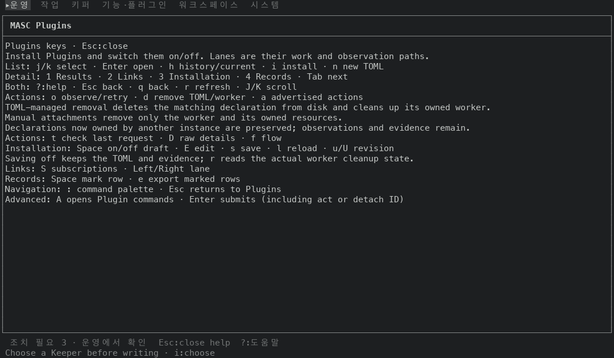 |  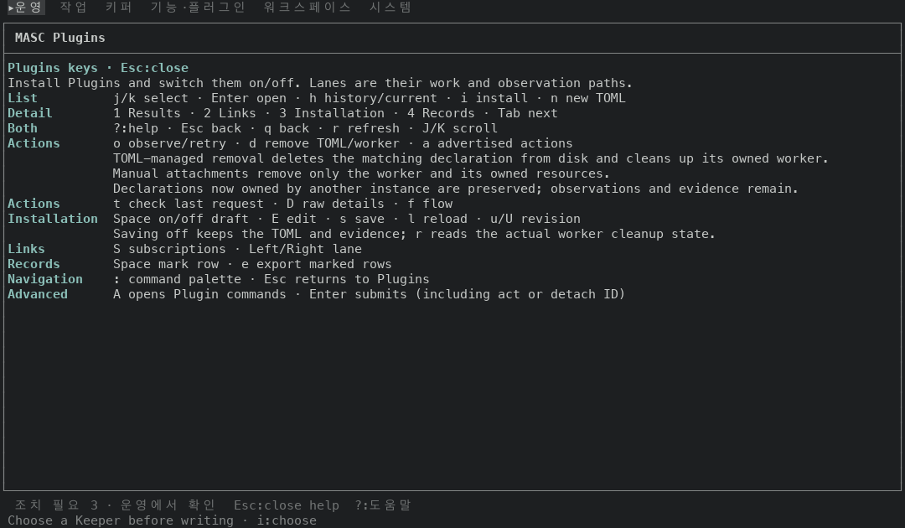 |
| 도움말, 120x35, `default-light` 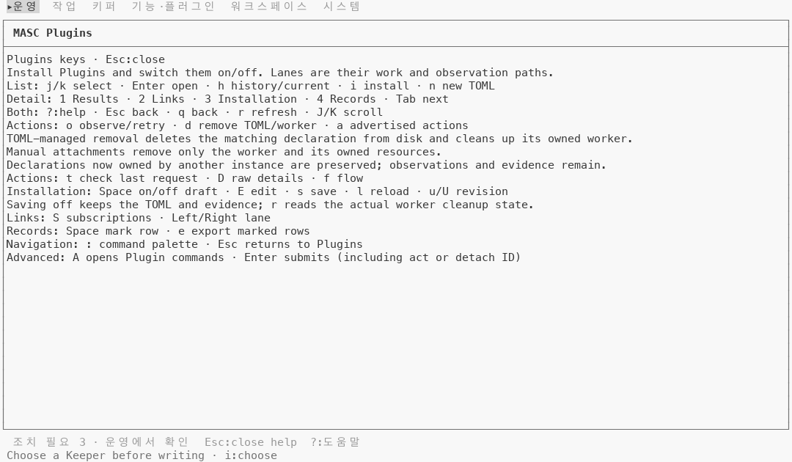 |  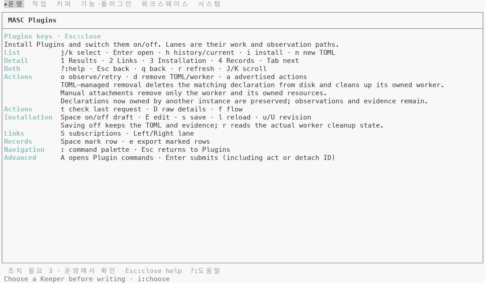 |
| 도움말, 80x40, 기본 팔레트 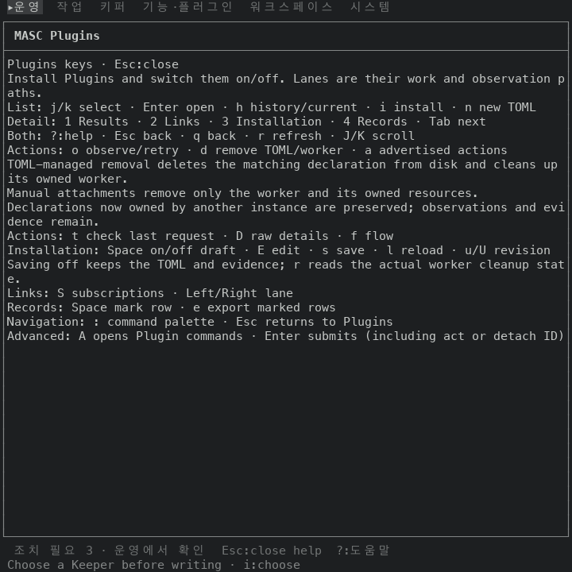 |  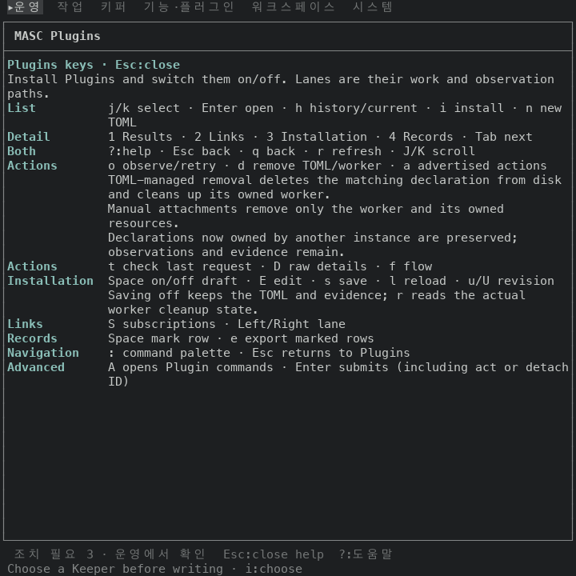 |
| 도움말, 80x24, 기본 팔레트(첫 화면) 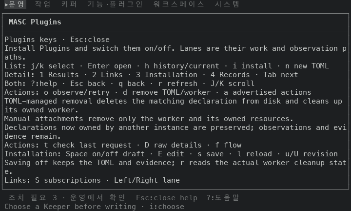 |  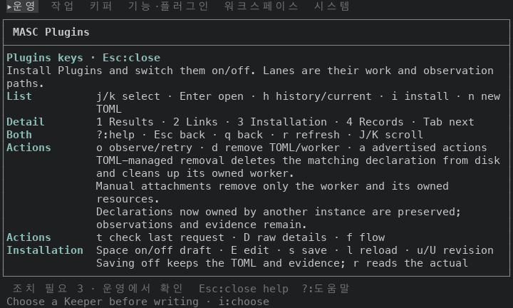 |
| 뒤, 80x24, `J` 여섯 번 누른 뒤 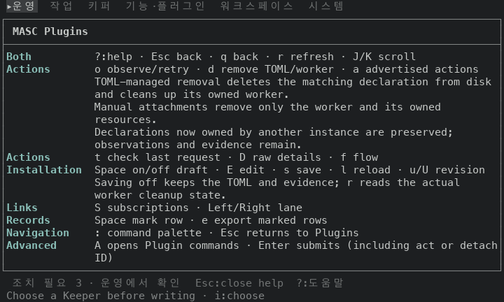 | |
