# Plugins Installation 탭을 강조색 라벨 열로 그리기

## 무엇이 달라지나요

Plugins 상세의 `3 Installation` 탭이 바뀌어요.

- 앞: 탭이 문자열 나열이에요. `Source: /config/…` 처럼 라벨과 값이 같은 글자색이고, 긴 값(TOML 경로)은 줄이 바뀌면 왼쪽 끝에서 다시 시작해요. 워커 칸(`installation`, `incarnation`, `TOML`, `installed revision`)도 들여쓴 문자열이에요.
- 뒤: 라벨(`Source:`, `Revision:`, `Instance:`, `Incarnation:`, `Current declaration:`, `Desired:`, `Applied:`, `Issue:`, 워커 칸 넷)과 묶음 제목(`Host requests`, `Workers with this installation ID`, `Other installation IDs at this TOML path`)이 강조색이에요. 같은 들여쓰기의 라벨은 한 열에 모여서 값이 같은 칸에서 시작하고, 긴 값은 그 칸 아래로 이어져요.
- 창이 좁아서 라벨 열이 폭의 절반을 넘으면 라벨이 따로 한 줄이고, 값이 두 칸 들여서 그 아래에 이어져요. 글자는 하나도 안 잘려요.
- 낱말과 콜론은 그대로예요. 달라진 것은 색, 칸, 줄바꿈이에요.
- 코드는 `bin/masc_tui_lane_addons.ml` 한 파일이에요(+75 -33, 커밋 둘).
  - 탭이 `fact_row` 목록이에요. `Fact_heading`(묶음 제목), `Fact_fields`(들여쓰기와 라벨·값 쌍), `Fact_text`(문장, 자기 들여쓰기를 가져요) 세 종류예요. `fact_spans ~width` 가 그려요.
  - `host_request_lines`, `connection_worker_lines` 는 이름 그대로 `fact_row list` 를 돌려주고, `Configurations` 갈래가 `fact_spans` 를 불러요.
  - 줄바꿈 함수 `led_rows` 는 안 바꿨어요.
  - 첫 커밋 `dec539b8599a` 가 라벨 열을 만들고, 둘째 커밋 `ce9ee8201d16` 이 좁은 창의 쌓는 배치를 더해요. 첫 커밋은 24칸 창에서 값이 한 글자씩 한 줄에 써졌어요(아래 「좁은 창」).

## 실측

고정 서버 위에서 증명 빌드로 같은 키 순서를 눌러 찍었어요. 앞은 main `227056a94eed`(run `42775066509`), 뒤는 이 PR 의 코드 머리 `ce9ee8201d16`(run `42779525501`)이에요. 첫 커밋 `dec539b8599a`(run `42775673678`)도 좁은 창에서 견주려고 찍었어요. 세 빌드 모두 영수증 시험 3개가 통과했어요. 고정 서버에는 Plugins 가 없어서 캡처용으로 응답을 바꿔 Plugins 셋(`fx-queue-watch`, `fx-queue-copy`, `fx-health-probe`)을 넣었어요. 이 응답은 직접 만든 값이고 저장소에는 없어요.

### 넓은 화면

Plugins 걷기 10장(목록, 상세의 결과·링크·설치·기록 탭, 다음 결과, 실패한 Plugin 상세, 도움말, 설치 탭 둘)을 칸 단위로 글자와 색을 견줬어요. 일곱 번 찍은 걷기 모두에서 10장 중 7장은 main 과 글자·색이 같고, 바뀐 3장은 Installation 탭이에요(`fx-queue-watch`, `fx-queue-copy`, `fx-health-probe`).

| 조건 | 같은 장 | 바뀐 장 |
|---|---|---|
| 120x35, 기본 팔레트, 트루컬러 | 7 | 3(설치 탭) |
| 120x35, 기본 팔레트, 트루컬러(한 번 더) | 7 | 3(설치 탭) |
| 120x35, `default-light`, 트루컬러 | 7 | 3(설치 탭) |
| 120x35, `default-light`, 256색 | 7 | 3(설치 탭) |
| 80x24, 기본 팔레트, 트루컬러 | 7 | 3(설치 탭) |
| 120x50, 기본 팔레트, 트루컬러 | 7 | 3(설치 탭) |
| 80x50, 기본 팔레트, 트루컬러 | 7 | 3(설치 탭) |

설치 탭은 페이지가 창보다 길어요. 120x35, 80x24 에서는 화면 아래가 잘려서 글자 수를 견줄 수 없어서, 페이지가 다 들어가는 120x50, 80x50 에서 셌어요. 공백과 테두리를 뺀 글자 흐름이 main 과 같아요(`fx-queue-watch` 120칸 1320자, 80칸 1286자).

120x50, 기본 팔레트, 트루컬러에서 센 값이에요. 테두리 글리프는 글자 칸에서 뺐어요.

| 장 | 글자가 있는 행 | 보이는 글자 칸 | 강조색(`ansi6`) 칸 | 굵은 칸 |
|---|---|---|---|---|
| `fx-queue-watch` | 33 -> 36 | 1320 -> 1320 | 15 -> 351 | 29 -> 365 |
| `fx-queue-copy` | 31 -> 34 | 1250 -> 1250 | 15 -> 320 | 29 -> 334 |
| `fx-health-probe` | 18 -> 18 | 680 -> 680 | 15 -> 159 | 29 -> 173 |

줄 수는 폭에 따라 달라요.

| 장 | 120칸 | 80칸 |
|---|---|---|
| `fx-queue-watch` | 33 -> 36 | 37 -> 37 |
| `fx-queue-copy` | 31 -> 34 | 35 -> 35 |
| `fx-health-probe` | 18 -> 18 | 18 -> 18 |

120칸에서 3줄 늘어난 곳은 긴 TOML 경로 셋(`Source` 와 워커 둘의 `TOML`)이에요. 앞에서는 한 줄이었고, 뒤에서는 값 칸이 라벨 열만큼 좁아서 두 줄이에요. 경로는 값 칸에서 칸 단위로 잘려요(`installati|on-name.toml`).

### 좁은 창

첫 커밋은 라벨 열 뒤에 값이 쓸 폭이 모자라요. 24칸 창(안쪽 22칸)에서 `Source` 부터 `Issue` 까지는 라벨 열이 21칸이라 값 칸이 1칸이고, 값이 한 글자씩 한 줄에 써져요. 창 높이(130행) 안에는 글자 1202개 중 286개만 들어왔어요.

앞머리가 안쪽 폭 이상이면 `Span.truncate` 가 값을 통째로 자른다고 코드로 읽었어요. 설치 탭에서는 안 찍었어요. #51013(Plugins 도움말)에서 같은 구조를 16칸 창에서 찍었고, 그 리뷰에서 P2 로 나왔어요. 이 PR 은 같은 문제를 처음부터 재서 둘째 커밋으로 고쳤어요.

둘째 커밋은 라벨 열이 안쪽 폭의 절반을 넘으면(`2 * (들여쓰기 + 라벨 열) > 폭`인 묶음이 하나라도 있으면) 탭 전체에서 라벨을 따로 한 줄로 그리고 값을 두 칸 들여서 이어요.

세로로 긴 창(24x130, 44x90)에서 탭 전체를 찍고, 공백과 테두리를 뺀 글자 수와 글자가 있는 행 수를 견줬어요.

| 장 | 창 | main | 첫 커밋 `dec539b8599a` | 이번 머리 `ce9ee8201d16` |
|---|---|---|---|---|
| `fx-queue-watch` | 24x130 | 1202자, 79행 | 286자, 126행 | 1202자, 90행 |
| `fx-queue-copy` | 24x130 | 1132자, 74행 | 288자, 126행 | 1132자, 85행 |
| `fx-health-probe` | 24x130 | 562자, 38행 | 483자, 36행 | 562자, 41행 |
| `fx-queue-watch` | 44x90 | 1246자, 46행 | 1246자, 56행 | 1246자, 62행 |
| `fx-queue-copy` | 44x90 | 1176자, 44행 | 1176자, 54행 | 1176자, 60행 |
| `fx-health-probe` | 44x90 | 606자, 25행 | 606자, 26행 | 606자, 32행 |

24칸에서 첫 커밋의 126행은 창을 가득 채운 값이에요(값이 한 글자씩 한 줄이라 탭이 창보다 길어요). 이번 머리는 글자가 main 과 모두 같아요.

44칸에서는 첫 커밋(라벨 열 옆에 값)도 글자를 다 그려요. 다만 값 칸이 좁아서 `Source` 의 경로가 6행으로 쪼개져요(main 3행). 이번 머리는 라벨 행 1개와 값 3행으로 4행이에요. 대신 모든 라벨이 한 행씩 쓰므로 탭 전체는 56행에서 62행으로 늘어요.

아래 그림은 24x40, 44x40 의 첫 화면이에요.

| 앞(main, 24x40) | 뒤(24x40) |
|---|---|
| 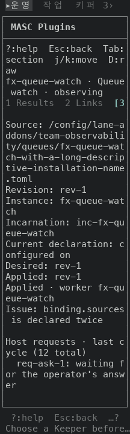 | 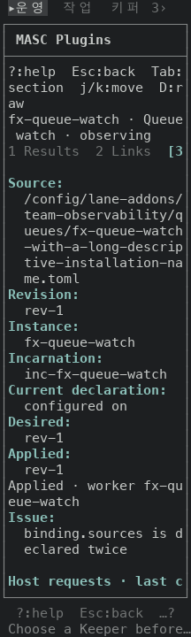 |

| 앞(main, 44x40) | 뒤(44x40) |
|---|---|
| 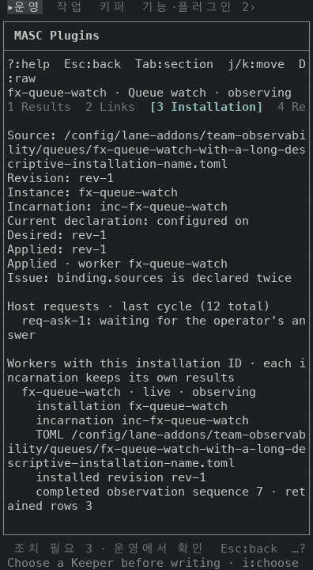 | 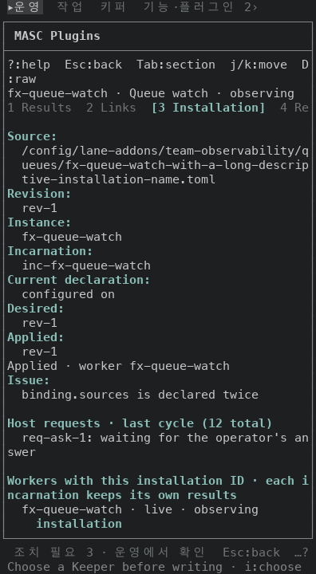 |

### 두 칸 글자(리뷰 P2)

anyang-keepers 가 P2 로 짚었어요. 쌓는 배치에서 값 앞의 들여쓰기가 `폭 - 1` 칸까지 자리를 쓰면 값 칸이 1칸만 남아요. 그러면 두 칸 글자(`한`)가 `Span.truncate` 에 떨어져요. 안쪽 폭이 3칸이면 `Source` 값(들여쓰기 0)이 그래요. 들여쓰기가 4인 워커 값은 코드로 따지면 7칸 이하에서 값 칸이 1칸이에요. 이쪽은 안 찍었어요.

셋째 커밋 `4e3818466142` 는 들여쓰기를 `폭 - 2` 칸까지만 쓰게 해서 값 칸을 2칸 이상 남겨요. 바뀐 곳은 `fact_spans` 의 `spaces` 한 줄이에요.

고정 서버의 Plugins 하나에 TOML 경로 `한국어/config/lane-addons/…` 를 주고 5x60 창(안쪽 3칸)에서 설치 탭을 찍었어요. 아래 그림은 `Source` 값 근처 17행을 잘라 3배로 키운 것이에요.

| 앞(`ce9ee8201d16`) | 뒤(`4e3818466142`) |
|---|---|
| 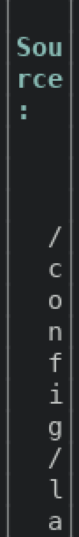 | 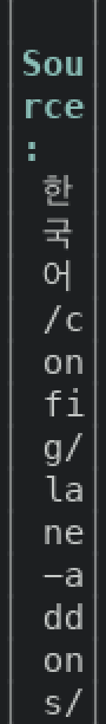 |

- 앞: `Source:` 아래 `한`, `국`, `어` 자리가 빈 줄 셋이에요. 그다음 줄부터 `/`, `c`, `o` 가 한 글자씩 써져요.
- 뒤: 같은 자리에 `한`, `국`, `어` 가 한 줄에 하나씩 보여요. 이어서 두 글자씩(`/c`, `on`, `fi`) 써져요.

이 수정이 다른 화면을 바꾸지 않는지는 이전 머리(`ce9ee8201d16`)와 견줬어요. 위 표의 넓은 화면 여섯 조건과 좁은 창 세 조건(24x40, 44x40, 60x40)에서 걷기 열 장씩 모두 90장을 찍었고, 90장 모두 칸 단위 글자와 색이 같아요. 위 좁은 창 표의 글자 수와 행 수는 `ce9ee8201d16` 에서 쟀어요. 들여쓰기가 줄어드는 곳은 안쪽 폭 7칸 이하(들여쓰기가 4인 워커 값 기준, 들여쓰기가 0인 값은 3칸 이하)라서, 찍은 창(안쪽 22칸 이상)에서는 `폭 - 2` 와 `폭 - 1` 이 같은 값이에요. 증명 빌드는 run `42787911079` 이고 안의 시험 3개가 통과했어요.

## 단점

- 120칸에서 설치 탭이 3줄 길어져요(33 -> 36). 긴 TOML 경로가 라벨 열 뒤의 좁은 값 칸에서 두 줄로 쪼개져요. 80칸에서는 줄 수가 같아요(37 -> 37).
- 좁은 창에서 줄이 늘어요(24x130 에서 79 -> 90행, 44x90 에서 46 -> 62행). 44칸에서는 나란히 그리는 배치가 56행이라 쌓는 배치가 6행 더 써요.
- 묶음 제목(`Workers with this installation ID · …`)은 앞과 같이 칸에서 잘려서 낱말 중간에서 줄이 바뀌어요(`each i|ncarnation`). 강조색이 되어서 더 눈에 띄어요.
- Plugins 도움말(#51013)의 라벨 열은 14칸이고 이 탭의 라벨 열은 21칸이라, 두 화면에서 값이 시작하는 칸이 달라요.
- `default-light` 에서 강조색 대비가 1.91:1 이에요(기본 팔레트는 7.97:1). 앞에서는 라벨이 기본 글자색이었어요. 강조색을 올리는 스택(#50922 -> #50923 -> #50964)이 따로 열려 있고, 이 PR 은 그 스택과 독립이에요.
- 같은 모양의 라벨 열 그리기가 `Masc_tui_page_reading` 에도 있어요(라벨을 흐린색으로, 라벨 열 상한 24칸, 값 칸이 16칸 미만이면 쌓기). `masc_tui_lane_addons` 가 그 모듈을 쓰지 않고, 라벨 색(강조색 대 흐린색)이 달라서 이 PR 은 따로 그렸어요. 합치는 일과 `led_rows` 의 구조 문제는 이슈 #51036 에 적어 뒀어요.

## 안 잰 것

- 실제 터미널(iTerm2, Terminal.app 등)에서 본 모습은 안 봤어요.
- Plugins 응답은 직접 만든 값이에요. 이 걷기에 안 나오는 줄이 있어요: `Host requests: unreadable`, `Installation inventory unavailable`, `waiting status incomplete`, `nothing reported waiting`.
- 폭 24 미만은 5칸 창(위 두 칸 글자 비교)만 찍었어요. 4칸 이하, 들여쓰기가 4인 워커 값의 두 칸 글자, 기본 팔레트와 `default-light` 말고 다른 팔레트는 안 찍었어요.
- 배치가 바뀌는 폭(창 48칸 안팎)은 안 찍었어요. 좁은 창은 24칸과 44칸만 비교했어요.
- 설치 탭 안의 키(`j/k`, `D`)가 눌렸을 때 반응은 안 눌러 봤어요. 이 PR 은 그림만 바꿔요.
- 시험은 읽기만 했어요. 설치 탭을 여는 시험은 못 찾았어요. 로컬 `dune` 은 안 돌렸고, CI 가 돌려요.

## 그림

| 앞 | 뒤 |
|---|---|
| 120x50, 기본 팔레트 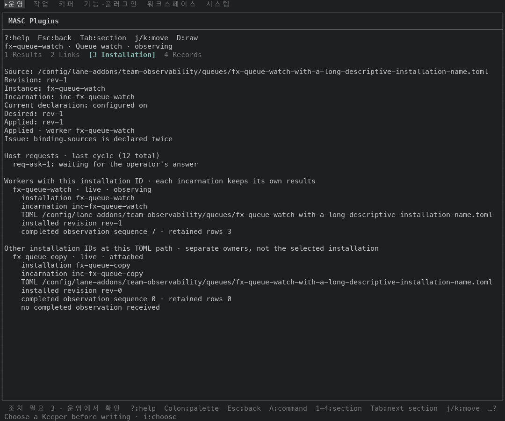 |  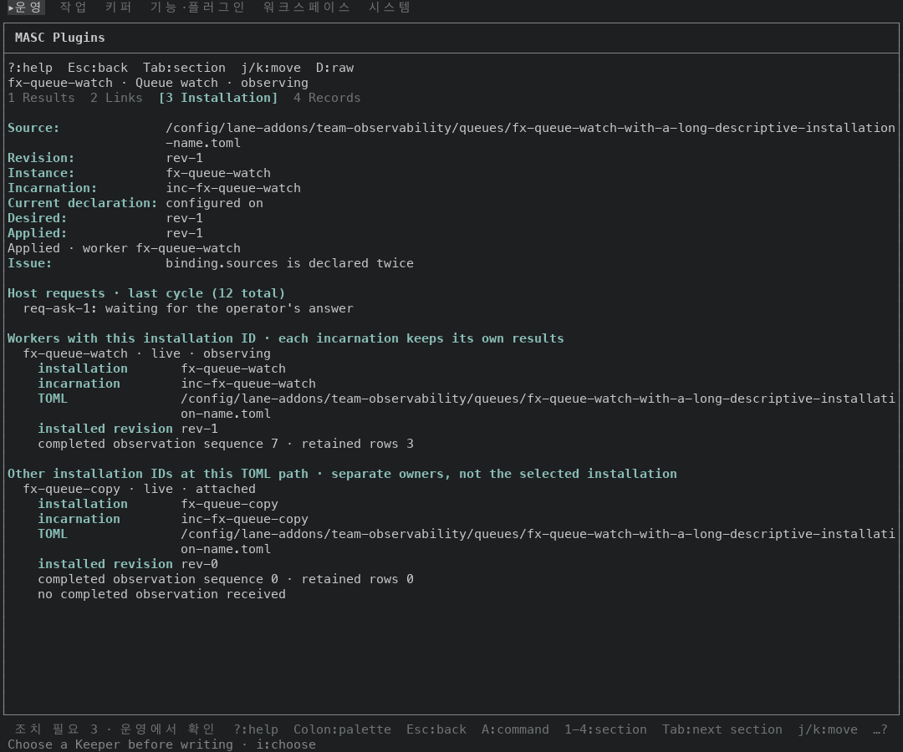 |
| 80x50, 기본 팔레트 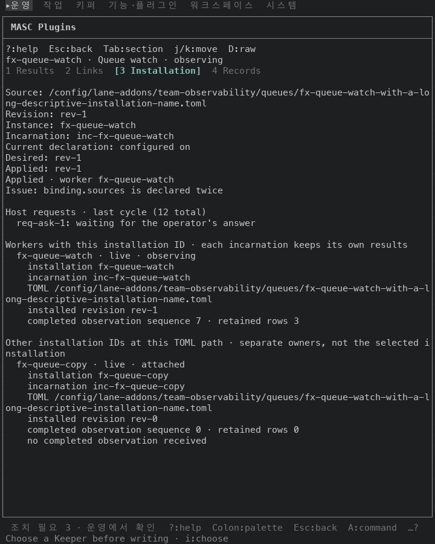 |  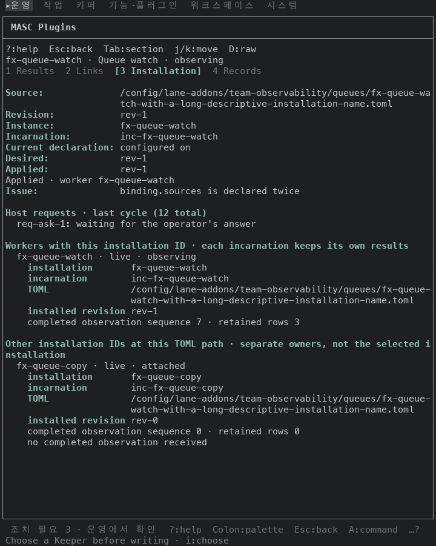 |
| 80x24, 기본 팔레트(첫 화면) 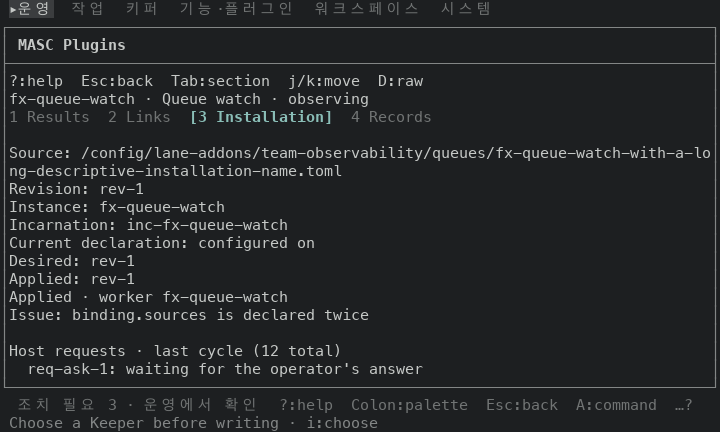 |  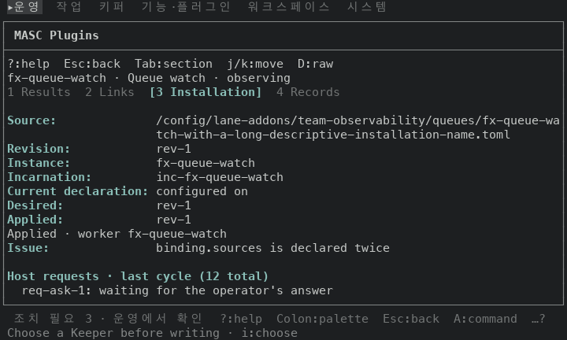 |
| 120x35, `default-light` 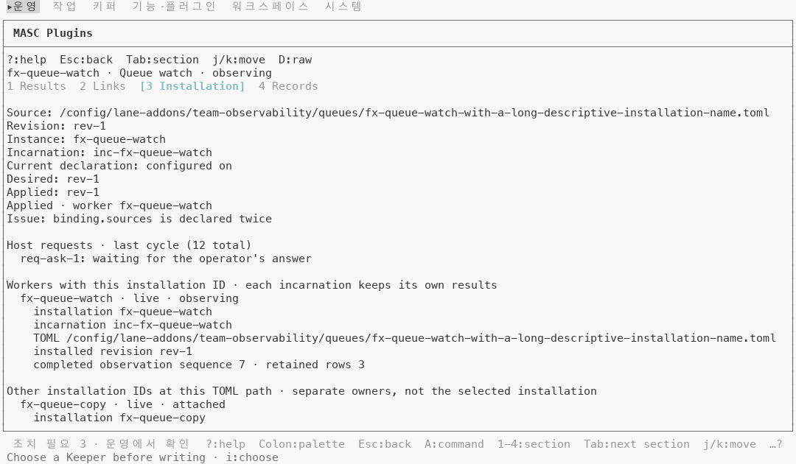 |  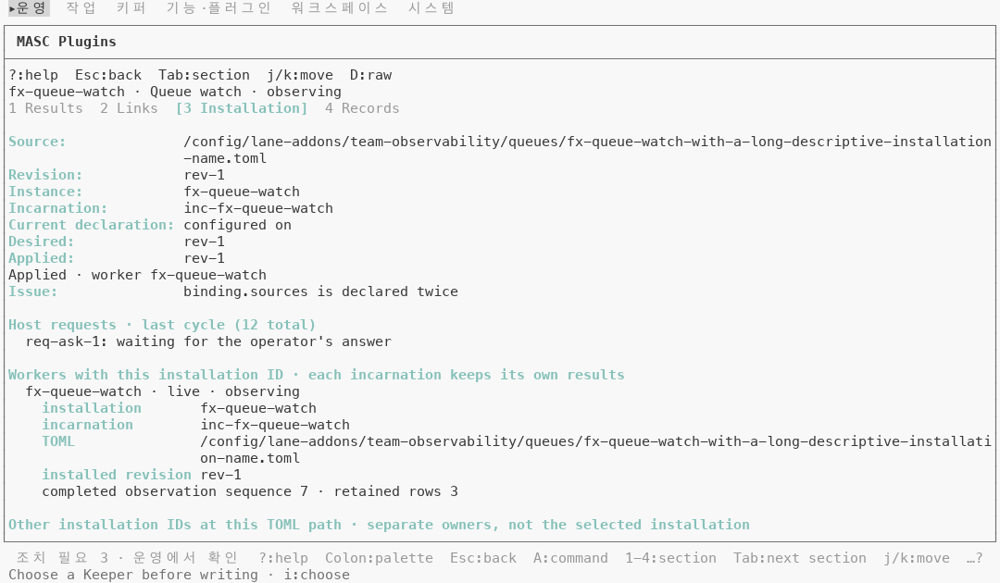 |
| `fx-health-probe`, 120x50, 기본 팔레트 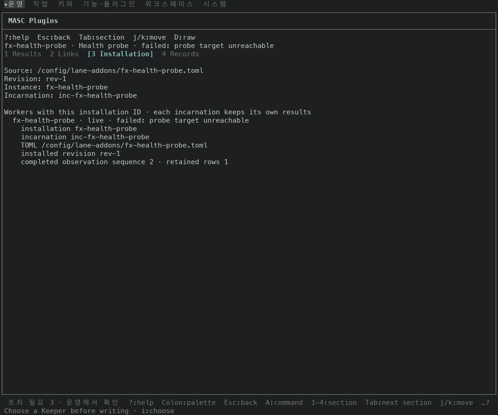 |  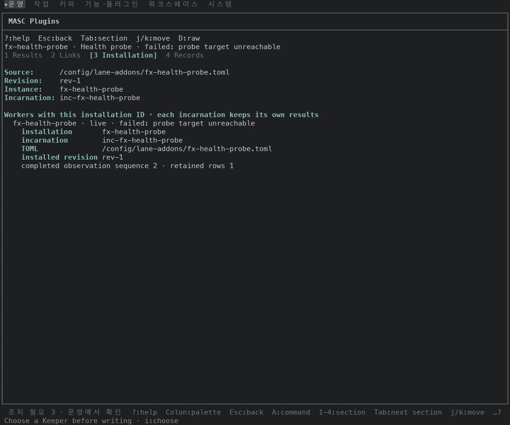 |
