# Plugins Links 탭과 전체 흐름을 굵은 제목과 라벨 열로 그리기

## 무엇이 달라지나요

Plugins 상세의 `2 Links` 탭과 그 탭에서 `f` 로 여는 전체 흐름은 문자열 나열이에요. 제목(`Declared Add-on layers · …`, `Layer 0`)과 필드(`Input:`, `Action target:`)가 같은 글자색이고, `Input:` 값과 `Action target:` 값이 서로 다른 칸에서 시작해요.

이 PR 은 두 화면을 `fact_row` 목록으로 바꿔서 #51047(Installation 탭)과 같은 방식으로 그려요.

- 제목 여섯 가지(`Declared Add-on layers · last received snapshot`, `Bound external inputs · declared sources`, `Add-on layers · worker state and latest completed result summary`, `Declared inputs and outputs`, `Result -> retained evidence -> …`, `Last evidence sharing receipt · this session`)와 `Layer N`, `Layer unavailable: …` 가 굵은 글씨예요.
- `Action target:`, `Read:`, `Input binding:`, `Input:`, `Output:` 은 라벨이 굵은 글씨이고, 페이지의 가장 긴 라벨에 한 칸을 더한 한 열에서 값이 시작해요.
- 제목 아래 줄(`[fx-queue-watch]  |  [fx-health-probe]`, 워커 상태, 입력 소스 줄)은 문장 그대로예요. 앞 공백과 낱말을 안 바꿨어요.
- Links 탭의 `Input:`·`Output:` 줄은 `detail_lines` 가, 흐름은 `lines` 가 따로 줄바꿈해서 두 묶음의 값이 시작하는 칸이 달랐어요. 이제 `links_lines` 한 곳에서 `fact_spans` 를 한 번 불러요.
- 낱말은 그대로예요. 제목·라벨의 강조와 값이 시작하는 칸을 바꿔요.

## 대비 지적 후 보완

초기 후보는 공통 `label_style`의 밝은 cyan Accent를 제목과 라벨에 더 넓게 썼어요. 아래 `default-light` 캡처의 대비는 1.91:1이었어요. 별도 수리 #50964를 합친 증명 빌드의 측정은 이 후보에 그 수리가 들어있다는 증거가 아니에요.

후속 수정은 기존 `bold_style`을 공통 `label_style`에서도 재사용해요. 색을 지정하지 않고 독자의 기본 글자색에서 굵기만 바꿔요. Links·전체 흐름뿐 아니라 같은 함수를 쓰는 Installation·도움말·선택 탭·읽기 라벨에도 적용해요. 값·오류 상태의 색과 줄바꿈 계산은 바꾸지 않아요. 새 색상 상수·설정·테마 의존성을 추가하지 않아요.

현재 main 위의 rebase에서는 #51013의 폭을 받는 `help_lines ~width`를 보존하고, 전체 흐름만 `fact_spans ~width (flow_rows view)`로 그려요. 후속 후보는 구문·diff·changelog 검사와 소스 검토 범위이며 새 빌드·화면·대비 측정은 없어요. 아래 그림과 수치는 초기 색상 후보의 기록이에요.

## 초기 후보의 실측

고정 서버 위에서 증명 빌드로 같은 키 순서를 눌러 찍었어요. 앞은 #51047 의 코드 머리 `4e3818466142`(run `42787911079`)이고, 뒤는 이 코드를 main 위로 옮기기 전 머리 `83cdefa5d1de`(run `42788074374`)예요. main 위로 옮긴 코드 머리 `a2b4831ccd1e`(run `42794208207`)로는 120x50과 24x60 두 조건의 7장씩 14장을 다시 찍어, 뒤 화면과 칸 단위로 같은 것(글자와 색 모두)을 확인했어요. 세 빌드 모두 안의 시험 3개가 통과했어요.

고정 서버에는 Plugins 가 없어서 캡처용으로 응답을 바꿨어요. Plugins 셋(`fx-queue-watch`, `fx-health-probe`, `fx-queue-copy`)에 `binding.sources` 를 올바른 값으로 줬어요(파일 둘, MSX 캡처 하나, 다른 Plugin 의 출력 하나). 잘못된 `binding` 을 주는 쪽(`Input binding:` 오류 줄)도 같은 순서로 찍었어요.

걷기는 7장이에요: Plugins 목록, 첫 Plugin 의 Links 탭, 전체 흐름(`f`), 한 번 내림(`J`), Escape 뒤 화면, 실패한 Plugin 의 Links 탭과 전체 흐름.

### 넓은 화면

여섯 조건(120x35 기본 팔레트 트루컬러, 120x35 `default-light` 트루컬러, 120x35 `default-light` 256색, 80x24, 120x50, 80x50)에서 7장씩 모두 42장을 칸 단위로 견줬어요.

| 결과 | 장 수 |
|---|---|
| 글자와 색이 모두 같아요(Plugins 목록) | 6 |
| 글자는 같고 색만 바뀌었어요(전체 흐름 셋) | 18 |
| 글자 칸과 색이 바뀌었어요(Links 탭 셋) | 18 |
| 낱말이 달라졌어요 | 0 |
| 글자가 있는 행 수가 달라졌어요 | 0 |

Links 탭에서 글자 칸이 바뀌는 곳은 `Input:`, `Output:` 값이에요. 앞에서는 `Input: ` 뒤(7칸)에서 시작했고, 뒤에서는 `Action target:` 에 맞춰 15칸에서 시작해요.

120x35, 기본 팔레트, 트루컬러에서 센 값이에요.

| 장 | 행 | 보이는 글자 칸 | 강조색(`ansi6`) 칸 | 굵은 칸 |
|---|---|---|---|---|
| Links 탭 | 27 -> 27 | 1199 -> 1199 | 8 -> 207 | 22 -> 221 |
| 전체 흐름 | 28 -> 28 | 1304 -> 1304 | 0 -> 204 | 14 -> 218 |
| Links 탭(실패한 Plugin) | 26 -> 26 | 1209 -> 1209 | 8 -> 201 | 22 -> 215 |
| 전체 흐름(실패한 Plugin) | 28 -> 28 | 1306 -> 1306 | 0 -> 204 | 14 -> 218 |

120x50 에서는 Links 탭이 40행(강조색 8 -> 298칸), 전체 흐름이 36행(0 -> 271칸)이고, 행 수와 글자 칸 수는 앞과 같아요. 앞의 강조색 8칸은 선택된 탭 이름(`[2 Links]`)이에요.

잘못된 `binding` 을 주는 쪽(120x50)도 낱말이 같고(Links 탭 300낱말, 40행 -> 40행, 전체 흐름 270낱말, 35행 -> 35행) 같은 방식으로 바뀌어요.

### 좁은 창

세로로 긴 창(24x150, 44x110)에서 페이지 전체를 찍고, 공백과 테두리를 뺀 글자 흐름을 견줬어요.

| 장 | 창 | 글자 | 행(앞 -> 뒤) |
|---|---|---|---|
| Links 탭 | 24x150 | 1739 -> 1739 | 109 -> 113 |
| 전체 흐름 | 24x150 | 1576 -> 1576 | 98 -> 99 |
| Links 탭 | 44x110 | 1783 -> 1783 | 67 -> 67 |
| 전체 흐름 | 44x110 | 1604 -> 1604 | 59 -> 59 |

7장 모두 글자가 같아요. 24칸(안쪽 22칸)에서는 `Action target:` 가 14글자라서 라벨 열이 안쪽 폭의 절반을 넘고, 라벨을 따로 한 행에 그려요. 그래서 Links 탭이 4행 길어져요. 44칸(안쪽 42칸)에서는 값이 라벨 옆에 오고 행 수가 같아요.

## 그림

| 앞 | 뒤 |
|---|---|
| Links 탭, 120x50 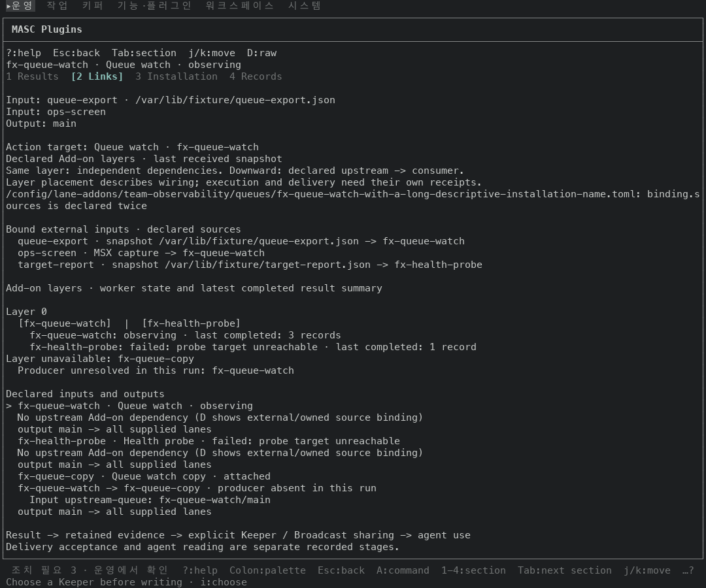 |  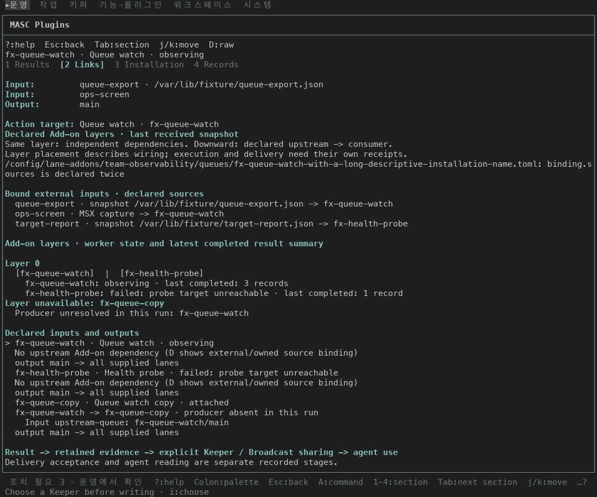 |
| 전체 흐름, 120x50 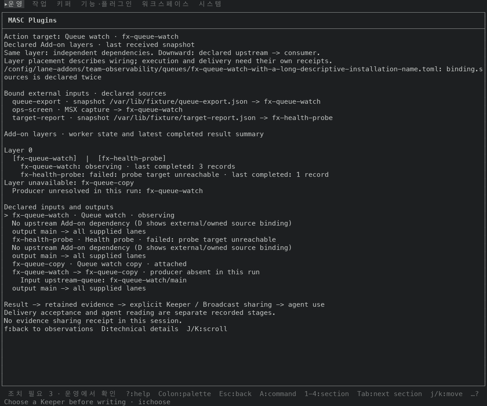 |  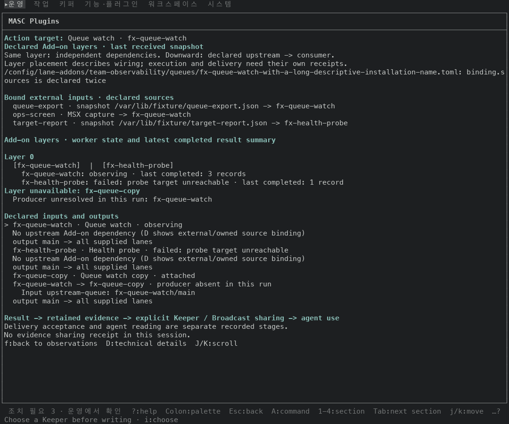 |
| Links 탭, 120x35 `default-light` 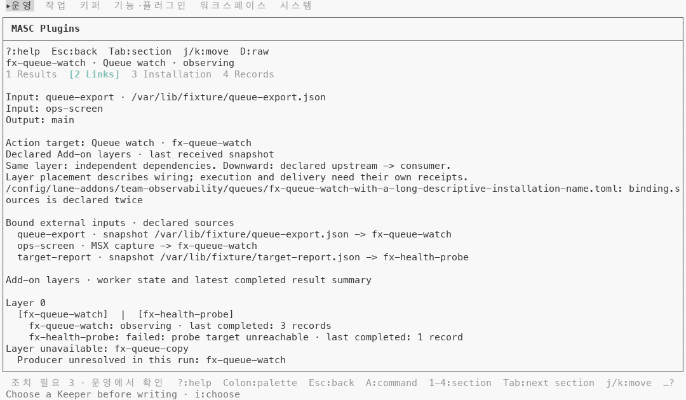 |  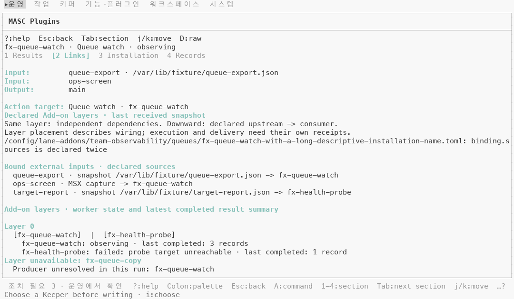 |
| Links 탭, 44x60 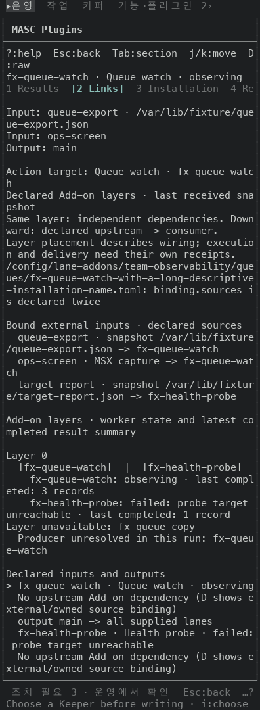 |  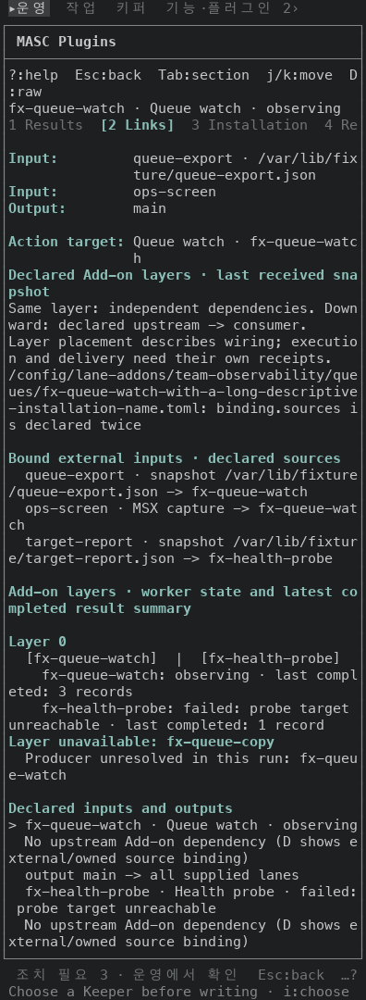 |
| Links 탭, 24x60 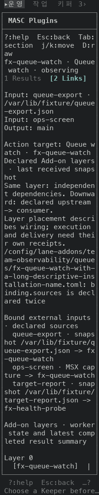 |  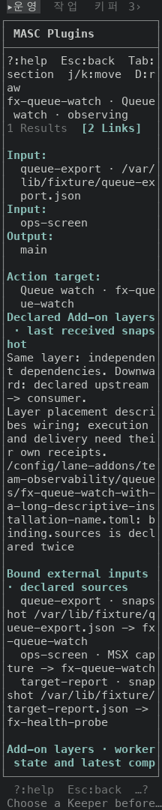 |
| Links 탭, 잘못된 `binding`, 120x50 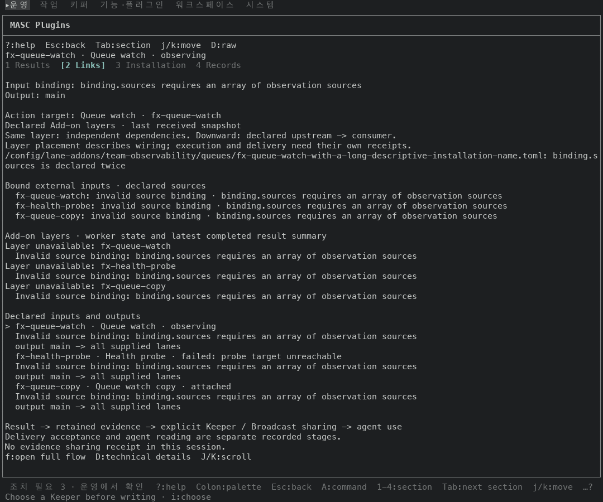 |  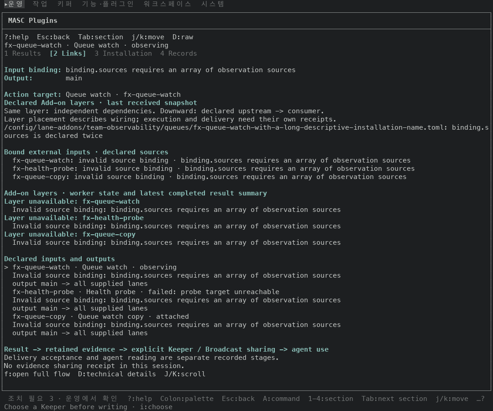 |

## 단점

- 넓은 화면에서 `Input:`, `Output:` 값이 앞보다 8칸 오른쪽에서 시작해요(7칸 -> 15칸). 라벨은 짧은데 값이 멀어 보일 수 있어요.
- 24칸에서 Links 탭이 4행 길어져요(109 -> 113). 라벨이 따로 행을 쓰기 때문이에요.
- 제목 아래 줄은 아직 문자열이에요. `Layer 0` 아래 `[fx-queue-watch]  |  [fx-health-probe]` 와 워커 상태 줄, `Declared inputs and outputs` 아래 목록은 기본 글자색 그대로예요. 이 PR 은 제목과 필드만 바꿔요.
- 초기 후보의 `default-light` 강조색 대비는 1.91:1이었어요(기본 팔레트는 7.97:1). 후속 수정은 그 색을 지정하지 않지만 새 대비 수치는 측정하지 않았어요. 기본 글자색을 유지해도 터미널 자체의 전경·배경 설정까지 보장하지는 않아요.
- 같은 모양의 라벨 열 그리기가 `Masc_tui_page_reading` 에도 있어요. 후속 후보의 라벨은 굵은 기본색, 그쪽은 흐린색이에요. 합치는 일은 이슈 #51036 에 적어 뒀어요.

## 안 잰 것

- 실제 터미널(iTerm2, Terminal.app 등)에서 본 모습은 안 봤어요.
- Plugins 응답은 직접 만든 값이에요. 이 걷기에 안 나오는 줄이 있어요: `Read:`(스냅샷을 못 읽었을 때), `Last evidence sharing receipt`, 순환 의존 문구(`Cyclic or unresolved upstream dependency`), 저장된 binding 만 있는 `Stored bindings`.
- 전체 흐름에서 `J`/`K` 로 끝까지 내려 본 화면은 안 찍었어요(한 번 내린 화면만 찍었어요).
- 기술 화면(`D`)과 Installation 탭은 초기 캡처에서 찍지 않았어요. 공통 라벨 스타일을 바꾼 후속 후보도 아직 화면으로 보지 않았어요.
- 시험은 읽기만 했어요. 초기 빌드 기록은 위에 명시한 커밋만 검증해요. 후속 후보의 로컬 `dune`·타입 검사·시험·CI/Actions 조회나 실행은 하지 않았어요.
