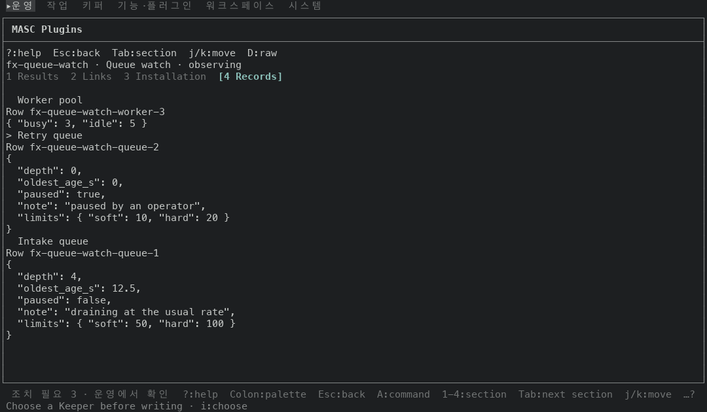
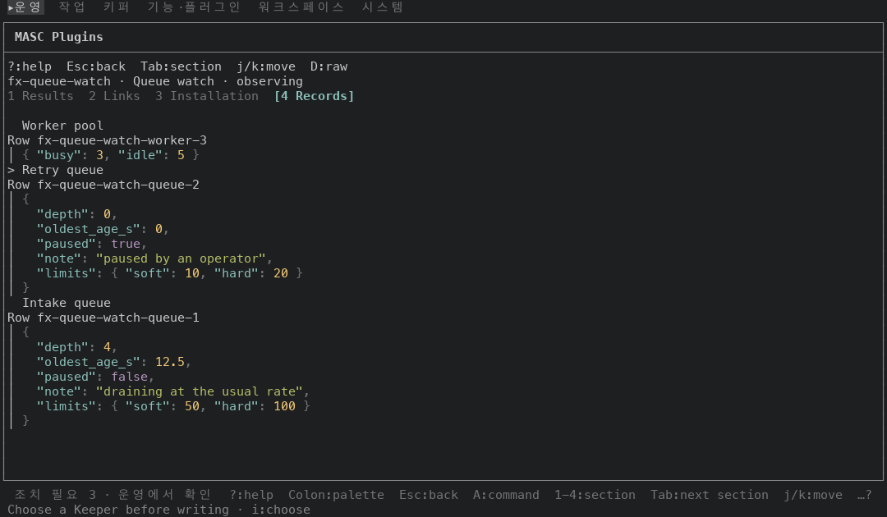
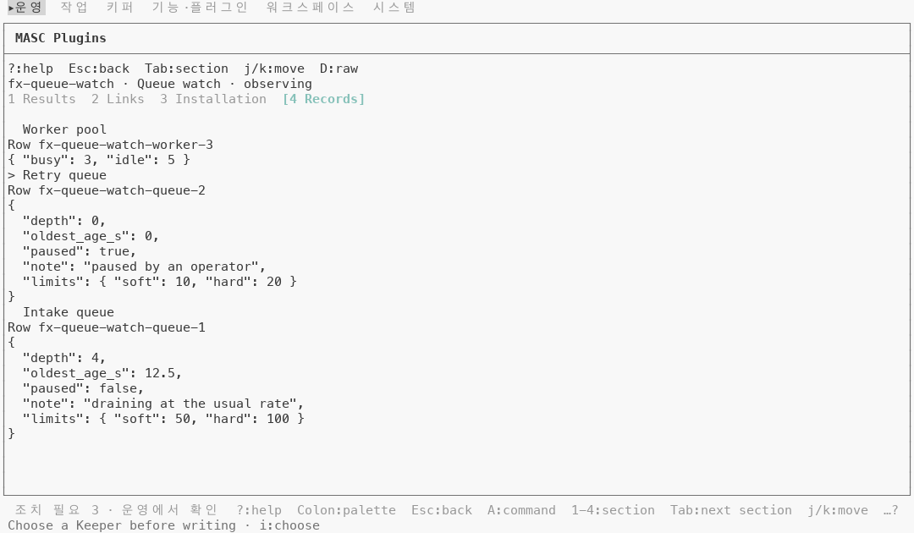
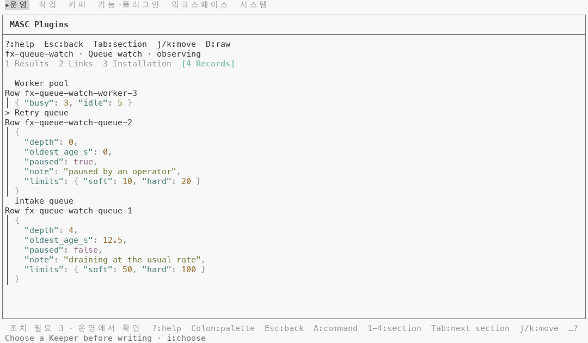
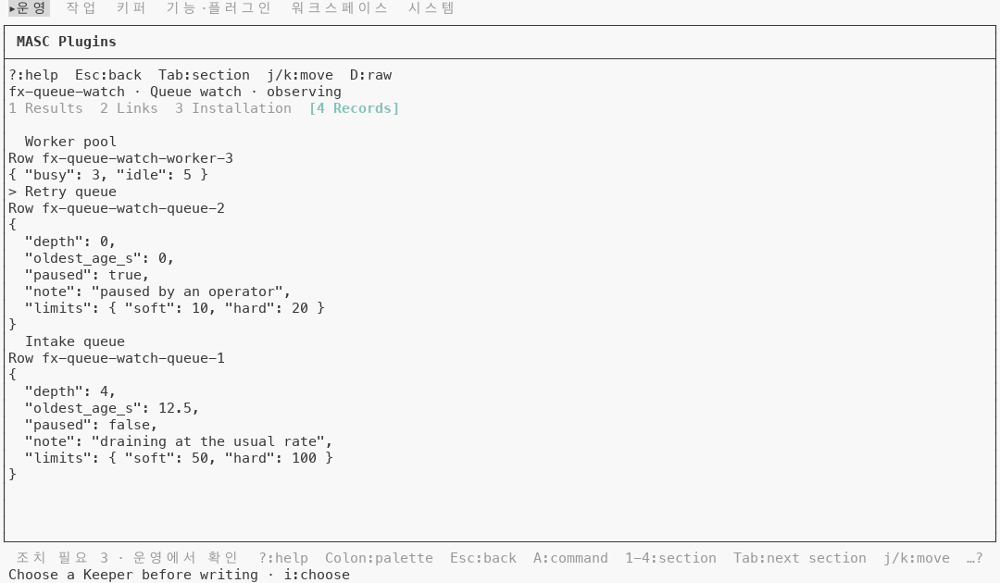
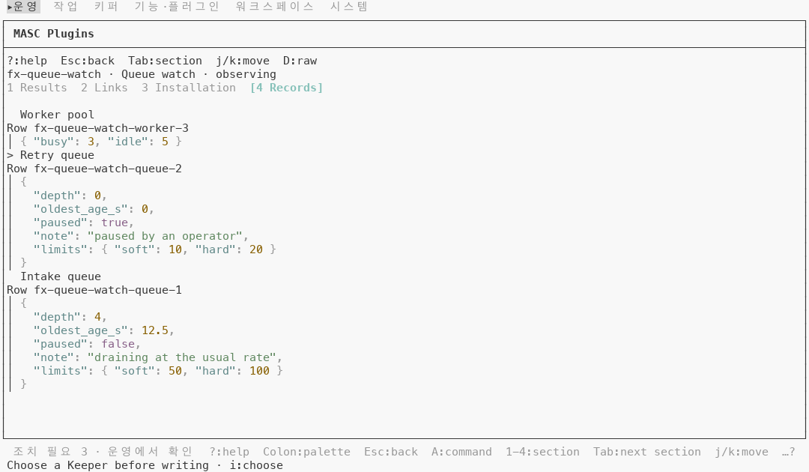
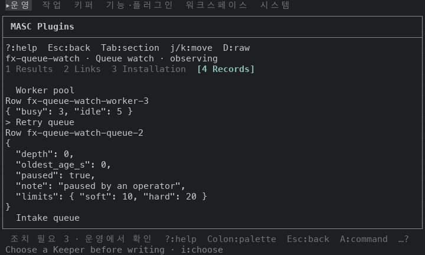
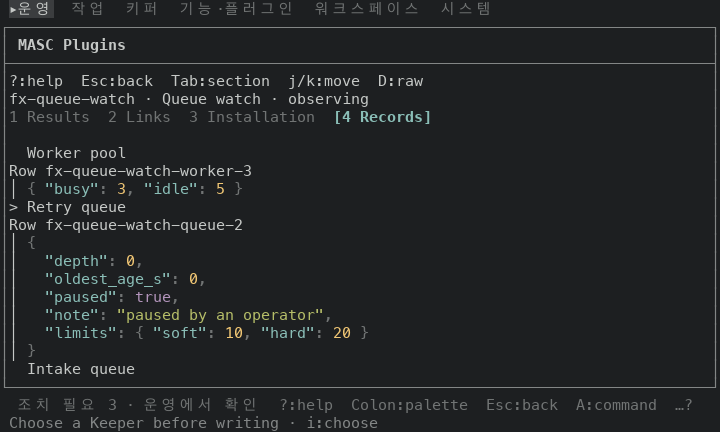

# Plugins 기록 탭의 JSON 을 문법 색으로 그리기

## 무엇이 달라지나요

Plugins 상세 화면의 `4 Records` 탭이 바뀌어요.

- 기록의 필드(JSON)를 문법 색으로 그려요. 키는 시안, 문자열은 초록, 숫자는 노랑, `true`·`false`·`null` 은 자홍이고 괄호와 쉼표는 흐려요. 왼쪽에 `│` 줄이 붙어요.
  - 앞: 한 가지 색 글자.
  - 뒤: 원본 보기(`D`)가 이미 쓰는 그림(`Masc_tui_markdown_theme.code ~language:"json"`)과 같아요.
- 글자는 그대로예요. 제목 줄(`> Retry queue`), `Row <id>` 줄, 증거 줄(`Evidence …`)도 그대로예요.
- 코드는 `bin/masc_tui_lane_addons.ml` 한 파일이에요(+33 -30).
  - `technical_lines` 안에 있던 부품 그리기 함수 `render` 를 `technical_rows` 로 꺼냈어요. 내용은 그대로예요.
  - 증거 줄 글자를 만드는 곳이 둘이었어요(원본 보기와 기록 탭). `evidence_text` 하나로 합쳤어요.
  - 기록 탭이 각 기록을 원본 보기와 같은 부품(`Technical_text`, `Technical_json`)으로 만들고 `technical_rows` 로 그려요.

## 실측

고정 서버 위에서 증명 빌드 둘로 같은 키 순서를 눌러 찍었어요. 앞은 main `8e488e04c8d5`(run `42765175806`), 뒤는 이 PR 의 코드 커밋 `938edee46340`(run `42770510682`)이에요. 고정 서버에는 Plugins 가 없어서 캡처용으로 응답을 바꿔 Plugins 둘(`Queue watch` 관찰 중, `Health probe` 실패)을 넣었어요. 이 응답은 직접 만든 값이고 저장소에는 없어요.

Plugins 걷기 8장(목록, 상세의 결과·링크·설치·기록 탭, 다음 결과, 실패한 Plugin 상세, 도움말)을 네 조건에서 찍고, 칸 단위로 글자와 색을 견줬어요.

| 조건 | 바뀐 장 | 같은 장 |
|---|---|---|
| 120x35, 기본 팔레트, 트루컬러 | 1(기록 탭) | 7 |
| 120x35, `default-light`, 트루컬러 | 1(기록 탭) | 7 |
| 120x35, `default-light`, 256색 | 1(기록 탭) | 7 |
| 80x24, 기본 팔레트, 트루컬러 | 1(기록 탭) | 7 |

기록 탭 한 장(120x35, 기본 팔레트, 트루컬러)에서 센 값이에요. 테두리 글리프는 글자 칸에서 뺐어요.

| 항목 | 앞 | 뒤 |
|---|---|---|
| 글자가 있는 행 | 28 | 28 |
| 보이는 글자 칸 | 601 | 601 |
| 왼쪽 `│` 칸 | 0 | 15 |
| 기본 글자색 칸(흐림 포함) | 556 | 363 |
| 시안 칸(키 122 + 선택한 탭 이름 10) | 10 | 132 |
| 초록 칸(문자열) | 0 | 44 |
| 노랑 칸(숫자) | 0 | 18 |
| 자홍 칸(`true`·`false`) | 0 | 9 |
| 흐림(faint) 칸 | 131 | 168 |

새 색의 대비는 `default-light` 에서 아래와 같아요(배경 대비, 같은 화면의 칸에서 읽었어요).

| 조건 | 키 | 문자열 | 숫자 | `true`·`false` |
|---|---|---|---|---|
| 트루컬러 | `#437c75` 4.52:1 | `#687931` 4.53:1 | `#946b28` 4.50:1 | `#906486` 4.54:1 |
| 256색 | `#5f8787` 3.73:1 | `#5f875f` 3.86:1 | 4.5:1 이상 | 4.5:1 이상 |

4.5:1 미만인 글자 칸(흐림은 반쯤 섞은 값으로 쟀어요)은 아래와 같이 달라요.

| 조건 | 앞 | 뒤 |
|---|---|---|
| 기본 팔레트, 트루컬러 | 131 | 168 |
| `default-light`, 트루컬러 | 141 | 178 |
| `default-light`, 256색 | 141 | 344 |

세 조건 모두 늘어난 37칸은 괄호와 쉼표의 흐림 칸이에요. 256색에서 더 늘어난 166칸은 키(122)와 문자열(44)이에요(#47482).

## 단점

- 256색의 밝은 테마에서 키와 문자열이 3.73:1 과 3.86:1 이에요. 앞은 기본 글자색이었어요. 원본 보기와 도구 화면의 JSON 도 같은 함수(`Masc_tui_markdown_theme.code`)로 그려서 같은 색이에요.
- 괄호와 쉼표 37칸이 흐림이라 모델로 잰 대비가 4.5:1 미만이에요. 흐림 표현은 터미널마다 달라요.
- 왼쪽에 `│` 와 공백 두 칸이 붙어서 JSON 이 두 칸 오른쪽으로 가요. 가장 긴 줄이 (폭 - 2)칸에 안 들어가는 좁은 화면에서는 전처럼 색 없이 그려요. 원본 보기와 같은 규칙이에요.

## 안 잰 것

- 실제 터미널(iTerm2, Terminal.app 등)에서 본 모습은 안 봤어요.
- Plugins 응답은 직접 만든 값이에요. 실제 Plugin 이 보내는 기록으로는 안 찍었어요.
- 폭 80 미만, 그리고 기본 팔레트와 `default-light` 말고 다른 팔레트는 안 찍었어요.
- 긴 JSON 줄이 줄바꿈 되는 모습, 깊게 중첩된 JSON, 필드가 수십 개인 기록은 안 찍었어요.
- 시험은 읽기만 했어요. `UI.lines` 를 부르는 시험 10곳 중 읽은 범위에서 기록 탭을 그리는 곳은 하나예요(폭 40 에서 줄 너비와 터미널 제어 문자 확인). 새 그림도 그 조건을 지킨다고 읽었지만 돌려 보지는 않았어요. 로컬 `dune` 은 안 돌렸고, CI 가 돌려요.

| 앞 | 뒤 |
|---|---|
| 기록 탭, 120x35, 기본 팔레트  |   |
| 기록 탭, 120x35, `default-light`  |   |
| 기록 탭, 120x35, `default-light` 256색  |   |
| 기록 탭, 80x24, 기본 팔레트  |   |
