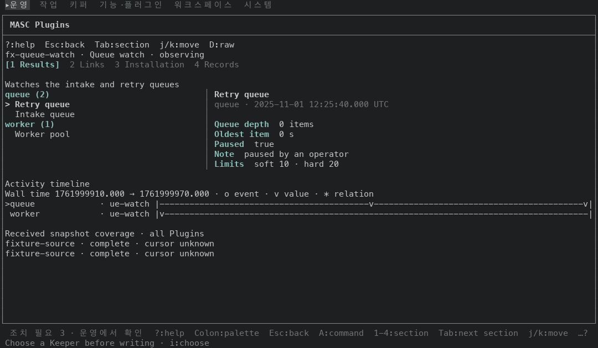
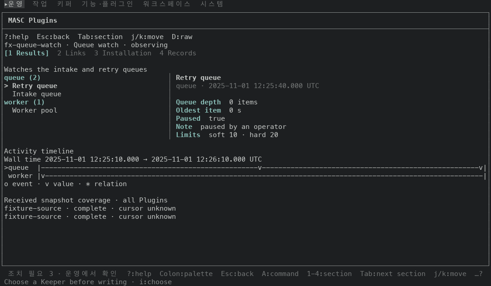
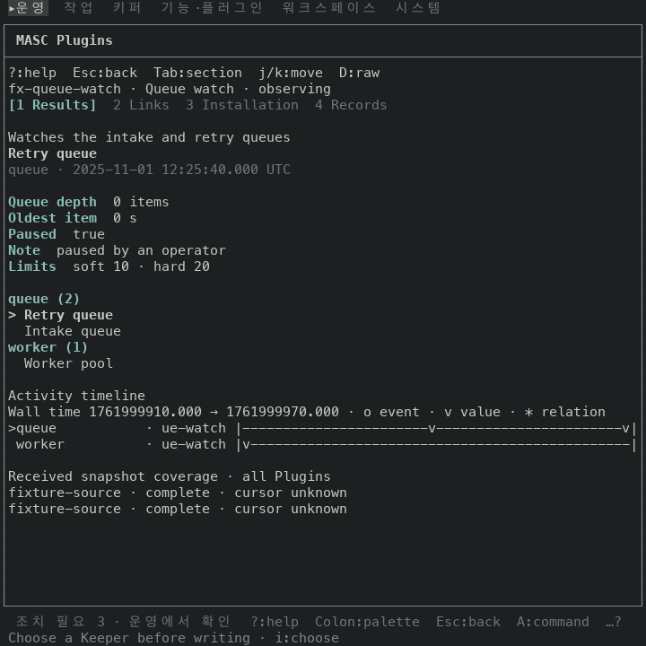
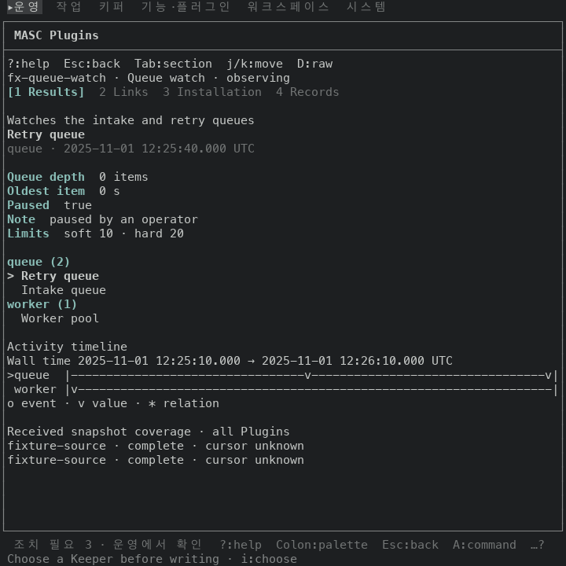
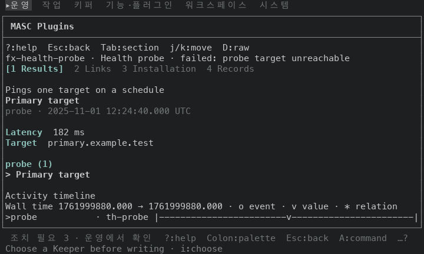
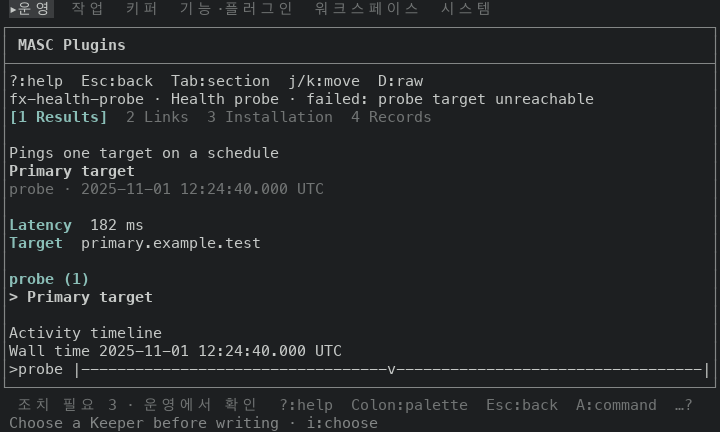
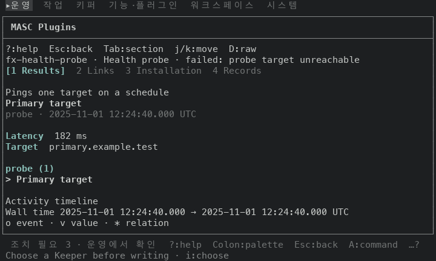

# Plugins 타임라인 머리줄을 UTC 로 읽고 줄 이름의 반복 꼬리표 지우기

## 무엇이 달라지나요

Plugins 상세 화면의 `Activity timeline` 이 바뀌어요.

- 머리줄이 epoch 초 대신 UTC 날짜와 시각이에요. 시각은 같은 파일의 `utc_stamp` 로 그려서, 읽기 칸의 `queue · 2025-11-01 12:25:40.000 UTC` 와 같은 모양이에요.
  - 앞: `Wall time 1761999910.000 → 1761999970.000 · o event · v value · * relation`
  - 뒤: `Wall time 2025-11-01 12:25:10.000 → 2025-11-01 12:26:10.000 UTC`
  - 두 끝이 같은 시각이면 한 번만 적어요: `Wall time 2025-11-01 12:24:40.000 UTC`.
- 범례(`o event · v value · * relation`)는 머리줄에서 빠져 줄들 아래 한 행으로 가요.
- 줄 이름 뒤에 붙던 인스턴스 id 끝 8글자를 지워요. 앞: `queue             · ue-watch`, 뒤: `queue`. 상세 화면은 인스턴스 하나만 그리고, 위 머리줄이 이미 `fx-queue-watch` 를 적고 있어서 줄마다 같은 꼬리표가 붙고 있었어요.
- 줄 이름 칸은 가장 긴 이름까지만 잡아요. 상한은 전과 같아요(폭의 3분의 1, 8칸 이상 28칸 이하). 남는 칸은 축이 가져요.
- 코드는 `timeline_lines` 한 함수예요. 파일 1개, +16 -11 이에요(커밋 둘).

## 실측

고정 서버 위에서 증명 빌드 둘로 같은 키 순서를 눌러 찍었어요. 앞은 main `8e488e04c8d5`(run `42765175806`), 뒤는 이 PR 의 코드 커밋 `6be72966df68`(run `42766958970`)이에요. 고정 서버에는 Plugins 가 없어서 캡처용으로 응답을 바꿔 Plugins 둘(`Queue watch` 관찰 중, `Health probe` 실패)을 넣었어요. 이 응답은 직접 만든 값이고 저장소에는 없어요.

Plugins 걷기 8장(목록, 상세의 결과·링크·설치·기록 탭, 다음 결과, 실패한 Plugin 상세, 도움말)을 기본 팔레트 트루컬러로 세 크기(120x35, 80x24, 80x40)에서 찍었어요. 칸 단위로 글자와 색을 견줬어요.

| 크기 | 바뀐 장 | 같은 장 | 색이 바뀐 칸 |
|---|---|---|---|
| 120x35 | 3(결과, 다음 결과, 실패한 Plugin) | 5 | 0 |
| 80x40 | 3(같은 장) | 5 | 0 |
| 80x24 | 1(실패한 Plugin) | 7 | 0 |

80x24 에서는 결과 화면의 타임라인이 화면 아래로 밀려 안 보여서, 보이는 장은 실패한 Plugin 상세 하나예요.

화면 위치와 폭은 캡처 글자에서 읽었어요.

| 크기 | 머리줄 행 | 줄 행 | 범례 행 | 축 폭(칸) |
|---|---|---|---|---|
| 120x35, 앞 | 20 | 21, 22 | (머리줄에 붙음) | 86 |
| 120x35, 뒤 | 20 | 21, 22 | 23 | 108 |
| 80x40, 앞 | 26 | 27, 28 | (머리줄에 붙음) | 48 |
| 80x40, 뒤 | 26 | 27, 28 | 29 | 68 |

머리줄과 줄 행은 제자리에 있고, 범례가 줄 아래 한 행을 차지해요. 축이 120 열에서 86칸에서 108칸, 80 열에서 48칸에서 68칸이 돼요. 80 열에서도 머리줄이 한 줄에 들어와요(63칸).

### 범례를 줄 아래에 두는 까닭

첫 안(`341adf25b08a`)은 범례를 머리줄 바로 아래에 뒀어요. 80x24 에서 실패한 Plugin 상세를 찍으니 머리줄이 20행, 범례가 21행에 들어가고 줄 행은 22행으로 밀려 화면 밖으로 나갔어요(`failed-80x24-legend-under-header.png`). 범례를 줄 아래로 옮기면 머리줄과 줄이 앞과 같은 20, 21행에 있어요(`failed-80x24-after.png`). 둘째 커밋(`6be72966df68`)이 이 고침이에요.

## 단점

- 줄 이름만 남아서, 여러 인스턴스를 한 타임라인에 그리면 같은 이름의 줄을 가를 수 없어요. 지금은 상세 화면(인스턴스 하나)만 이 함수를 불러요(호출처 1곳).
- 범례 때문에 타임라인이 한 행 늘어요. 그 아래 `Received snapshot coverage` 줄이 한 행 밀려요.
- 머리줄은 63칸이에요(날짜와 밀리초까지 적어요). 63칸보다 좁은 터미널에서는 줄바꿈이 나요. 안 찍었어요.

## 안 잰 것

- 실제 터미널(iTerm2, Terminal.app 등)에서 본 모습은 안 봤어요.
- Plugins 응답은 직접 만든 값이에요. 실제 Plugin 이 보내는 값으로는 안 찍었어요.
- 줄 이름이 상한(28칸)보다 긴 경우와 줄이 셋 넘는 타임라인은 안 찍었어요.
- 폭 80 미만과 기본 팔레트 말고 다른 팔레트는 안 찍었어요. 이 변경은 색을 건드리지 않아요.

| 앞 | 뒤 |
|---|---|
| Plugins 결과 타임라인, 120x35  |   |
| Plugins 결과 타임라인, 80x40  |   |
| 실패한 Plugin 상세, 80x24  |   |

첫 안(범례를 머리줄 아래에 둠), 실패한 Plugin 상세, 80x24:

