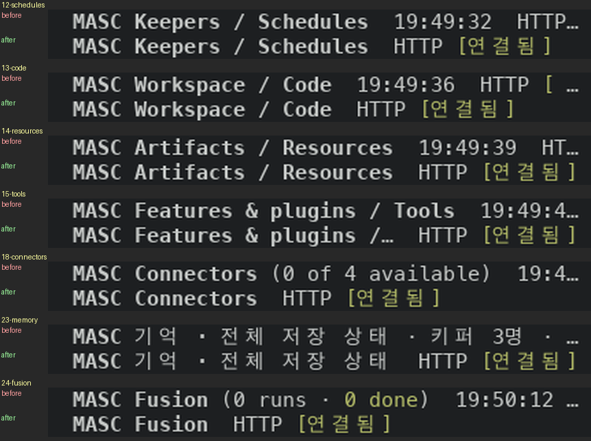
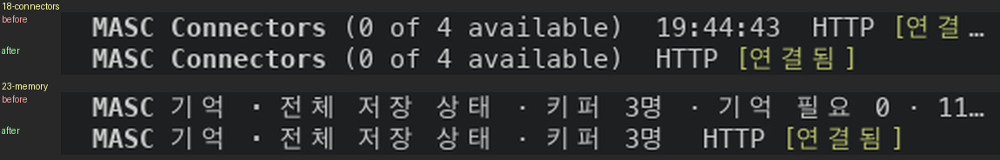
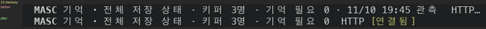
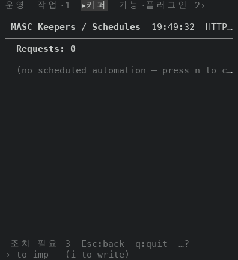
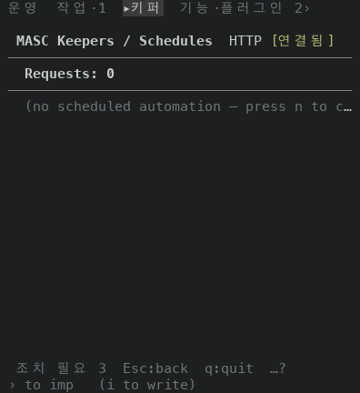
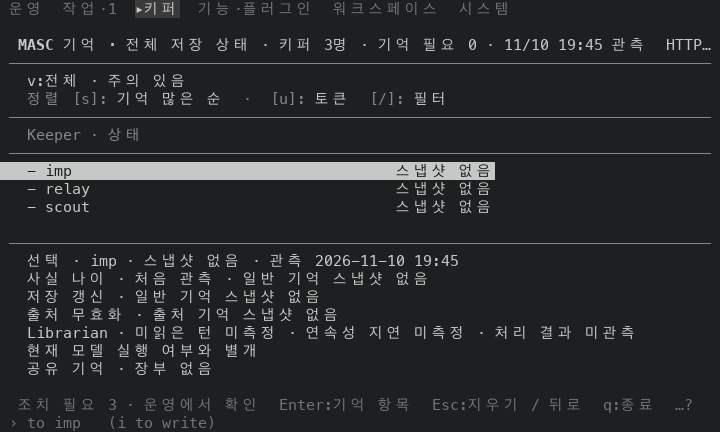
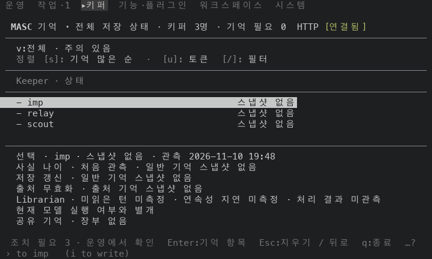

# 좁은 제목 줄에 연결·작업 공간 상태 남기기

## 무엇이 달라지나요

화면 맨 위 제목 줄은 제목, 읽을거리(개수, 시계), 연결 칩(`HTTP [연결됨]`) 순서예요. 연결 칩은 서버에 연결됐는지와 이 서버가 이 작업 공간을 같이 쓰는지(`[작업 공간 불일치]`)를 알려요.

초기 수정 대상인 Memory, Connectors, Schedules, Tools, Fusion, Code, Resources 일곱 화면은 이 줄을 `Printf.sprintf` 로 이어 붙여 `box_line` 에 넘겼어요. `box_line` 은 칸을 넘는 꼬리부터 자르니까, 창이 좁으면 칩이 먼저 `HTTP…`, `HTTP [ …` 로 잘리거나 사라졌어요.

이 PR 은 `masc_tui_render_prim.ml` 에 `surface_title_row ~cols state ~lead ~readings` 를 만들어요. 현재 main 위에 다시 올린 후보에서는 Memory, Schedules, Fusion, Code 네 화면이 이걸로 제목 줄을 짜요. 안쪽은 다른 화면이 이미 쓰는 `detail_heading` 이에요.

Channels(기존 Connectors), Tools & Skills, Resources는 main의 #51023에서 이미 `feature_child_heading`으로 바뀌었어요. 정상 HTTP·시계를 덜어내고 예외 상태만 표시하는 그 제목 체계를 그대로 보존해요. 이 PR의 예전 제목·시계를 되살리지 않아요. 아래 일곱 화면의 캡처는 그 main 변경 전의 초기 증거예요.

- 칩이 들어갈 때는 통째로 그려요.
- 칩 자체가 너무 길면 작업 공간·조회 상태를 먼저 남기고, 이벤트 유실과 HTTP 상태는 들어가는 만큼 남겨요. 생략한 내용은 `…`로 표시해요.
- 첫 상태 문구도 들어가지 않는 폭에서는 `!`만 남겨요. 테두리와 간격을 빼고 상태를 쓸 한 칸도 없으면 상태를 표시할 수 없어요. 모든 폭에서 모든 알림을 보장하지는 않아요.
- 읽을거리는 끝에서부터 통째로 빼요. 앞에 빈 조각을 하나 두어서 시계가 `1…` 처럼 반만 남지 않아요.
- 제목은 맨 나중에 잘라요.
- 다 들어가는 넓은 창에서는 앞과 같은 글자예요.

같은 `sprintf` 가 일곱 곳에 있어서 헬퍼 하나로 모았어요. 처음 수정은 코드 파일 7개(`.ml` 6개와 `masc_tui_render_prim.mli`), `+59 -43`이었어요. 그 뒤 리뷰에서 전체 칩 자체가 44칸 제목 줄보다 길 수 있다는 지적을 받아, 실제 안쪽 폭과 두 칸 간격을 뺀 예산 안에서 개별 상태를 고르도록 보완했어요. 작업 공간 불일치는 HTTP나 긴 조회 내역 뒤에 가려지지 않아요. 이 후속 변경은 소스 검토와 구문 검사 범위이며, 아래 캡처에 포함되지 않아요.

## 초기 수정의 실측

고정 서버 위에서 증명 빌드 둘로, 팔레트 목적지 24곳을 `:` 팔레트의 `go <이름>` 으로 하나씩 열어 찍었어요. 앞은 main `b62d86a9b7c3`(run `42799646082`), 뒤는 이 PR 의 코드 머리 `df74dd1db5a8`(run `42799559267`)이에요. 두 빌드 모두 안의 시험 3개가 통과했어요. 기본 팔레트, 256색이고 창은 120x35, 80x24, 60x24, 44x24 네 가지예요. 24장 x 4 x 2 로 192장이에요.

제목 줄(처음 여덟 줄 가운데 `MASC` 가 든 첫 줄)과 나머지 줄을 따로 견줬어요. 시계와 개수는 실행마다 달라서 숫자는 뺐어요.

| 창 | 칩이 없는 제목 줄(앞 -> 뒤) | 제목 줄이 바뀐 화면 | 제목 줄 밖이 바뀐 화면 |
|---|---|---|---|
| 120x35 | 2 -> 2 | 0 | 4 |
| 80x24 | 3 -> 2 | 1(Memory) | 3 |
| 60x24 | 4 -> 2 | 2(Connectors, Memory) | 3 |
| 44x24 | 9 -> 2 | 7(Schedules, Code, Resources, Tools, Connectors, Memory, Fusion) | 2 |

- 뒤에도 남는 둘은 Board(정상일 때는 칩을 안 그리는 화면)와 Collab(칩이 없는 화면)이에요. 120x35 에서도 앞뒤가 같아요.
- 제목 줄 밖이 바뀐 화면은 04 Usage(계정 ID), 05 Board(임의 작업 ID, 120x35 만), 07 System(빌드 커밋과 캡처 폴더 이름), 20 Logs(Keeper 시작 로그 줄의 순서)예요. 실행마다 값이 달라지는 곳이라 이 PR 과 무관해요.
- 넓은 창(120x35)에서는 일곱 화면의 제목 줄이 앞과 같아요.

바뀐 제목 줄을 글자로 옮기면 이래요. 시계는 그 캡처의 시각이에요.

| 창 | 화면 | 앞 | 뒤 |
|---|---|---|---|
| 44x24 | Schedules | `MASC Keepers / Schedules  19:49:32  HTTP…` | `MASC Keepers / Schedules  HTTP [연결됨]` |
| 44x24 | Code | `MASC Workspace / Code  19:49:36  HTTP [ …` | `MASC Workspace / Code  HTTP [연결됨]` |
| 44x24 | Resources | `MASC Artifacts / Resources  19:49:39  HT…` | `MASC Artifacts / Resources  HTTP [연결됨]` |
| 44x24 | Tools | `MASC Features & plugins / Tools  19:49:4…` | `MASC Features & plugins /…  HTTP [연결됨]` |
| 44x24 | Connectors | `MASC Connectors (0 of 4 available)  19:4…` | `MASC Connectors  HTTP [연결됨]` |
| 44x24 | Memory | `MASC 기억 · 전체 저장 상태 · 키퍼 3명 · …` | `MASC 기억 · 전체 저장 상태  HTTP [연결됨]` |
| 44x24 | Fusion | `MASC Fusion (0 runs · 0 done)  19:50:12 …` | `MASC Fusion  HTTP [연결됨]` |
| 60x24 | Connectors | `MASC Connectors (0 of 4 available)  19:44:43  HTTP [연결…` | `MASC Connectors (0 of 4 available)  HTTP [연결됨]` |
| 60x24 | Memory | `MASC 기억 · 전체 저장 상태 · 키퍼 3명 · 기억 필요 0 · 11…` | `MASC 기억 · 전체 저장 상태 · 키퍼 3명  HTTP [연결됨]` |
| 80x24 | Memory | `MASC 기억 · 전체 저장 상태 · 키퍼 3명 · 기억 필요 0 · 11/10 19:45 관측  HTTP…` | `MASC 기억 · 전체 저장 상태 · 키퍼 3명 · 기억 필요 0  HTTP [연결됨]` |

## 그림

44x24 에서 제목 줄만 잘라 앞(위)과 뒤(아래)를 쌓았어요.

60x24(Connectors, Memory)와 80x24(Memory)예요.

| 앞 | 뒤 |
|---|---|
| Schedules, 44x24  |   |
| Memory, 80x24  |   |

## 장점과 단점

- 장점: 초기 캡처의 짧은 정상 연결 칩은 일곱 화면에서 44칸까지 끝까지 보여요. 긴 복합 칩의 작업 공간 불일치는 후속 수정에서 우선 표시하도록 보완했지만, 그 상태의 새 캡처는 없어요.
- 장점: 제목 줄을 짜는 곳이 한 곳이에요. 앞에서는 화면마다 `sprintf` 를 따로 써서 같은 실수가 일곱 곳에 있었어요.
- 단점: 좁은 창에서 읽을거리가 통째로 빠져요. 44칸에서 Connectors 의 `(0 of 4 available)`, Fusion 의 `(0 runs · 0 done)`, Memory 의 `키퍼 3명` 이 앞에서는 보였는데 뒤에서는 없어요. 60칸에서 Memory 는 `기억 필요 0` 과 관측 시각을, 80칸에서는 관측 시각을 잃어요.
- 단점: 상태에 공간을 먼저 주므로 제목이 더 잘릴 수 있어요. 초기 캡처의 44칸 Tools 는 `MASC Features & plugins /…` 가 돼요. 복합 상태가 길면 후속 수정도 낮은 우선순위의 상태와 세부 내역을 생략해요.
- 단점: 같은 모양으로 이어 붙인 제목이 아직 남아 있어요. 이슈 #51111 에 적었어요.

## 안 잰 것

- 실제 터미널(iTerm2, Terminal.app 등)에서 본 모습은 안 봤어요.
- `[작업 공간 불일치]` 같은 긴 칩이 붙은 상태는 안 찍었어요. 고정 서버가 작업 공간 일치 상태라서 가장 짧은 칩(`HTTP [연결됨]`)만 봤어요. 긴 칩을 줄이는 후속 변경도 아직 실제 화면으로 검증하지 않았어요.
- 영어 화면은 안 찍었어요. 제목과 칩의 글자 수가 달라요.
- 40칸 아래 창은 안 찍었어요.
- 서베이에 없는 화면(상세 화면, 오버레이)은 안 찍었어요. 손으로 이어 붙인 제목이 더 남아 있어요. 이슈 #51111 에 줄 번호로 적었어요.
- 화면 글자·배치를 못 박는 시험은 `docs/constitution.xml` 이 막고 있어요. 로컬 `dune` 은 안 돌렸어요. 위 증명 빌드는 초기 캡처의 커밋만 검증하며, 후속 변경의 타입 검사나 실제 화면 증거를 대신하지 않아요.
