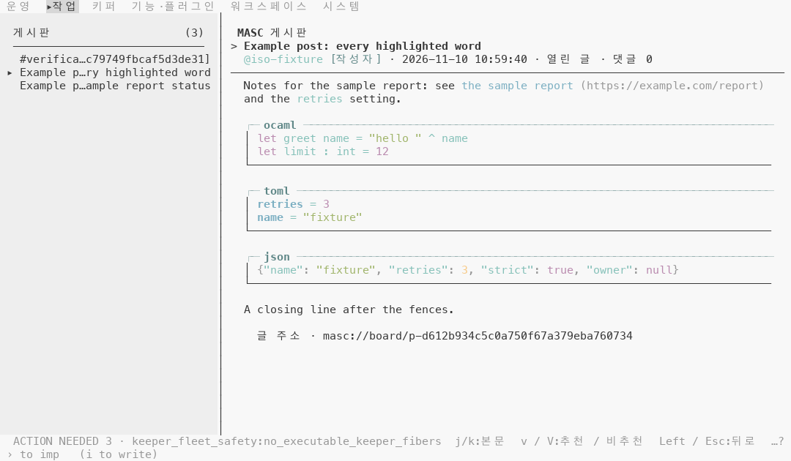
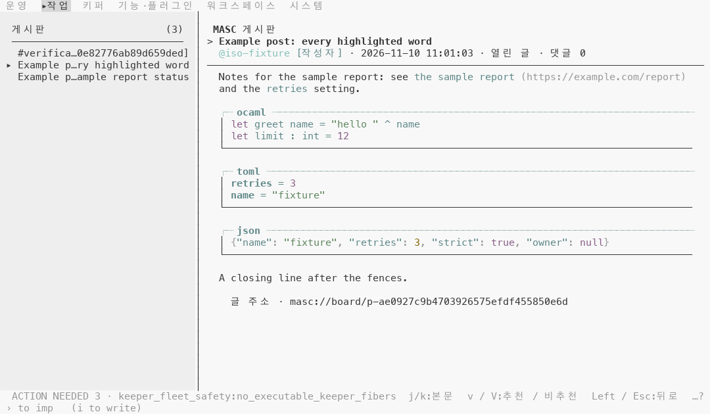
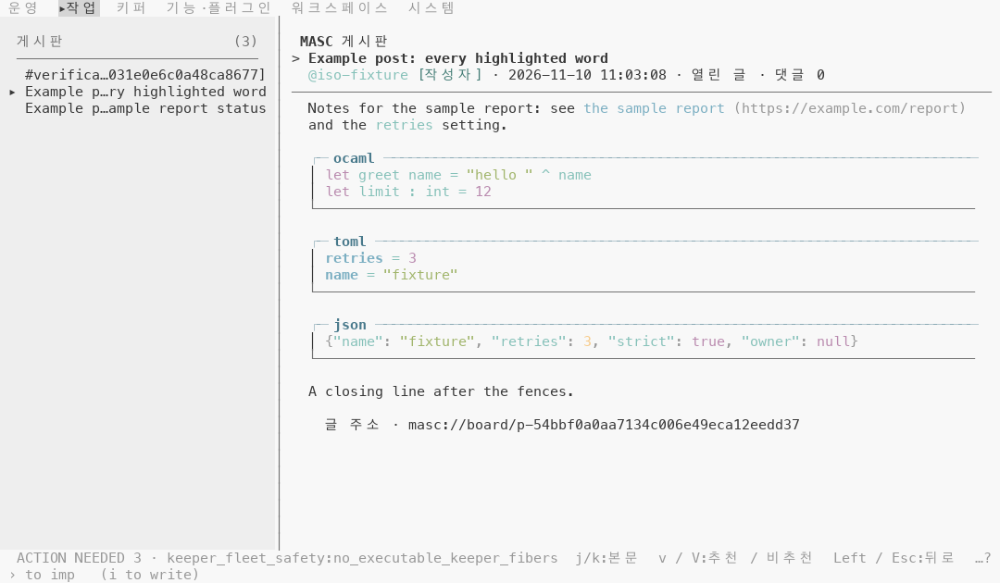
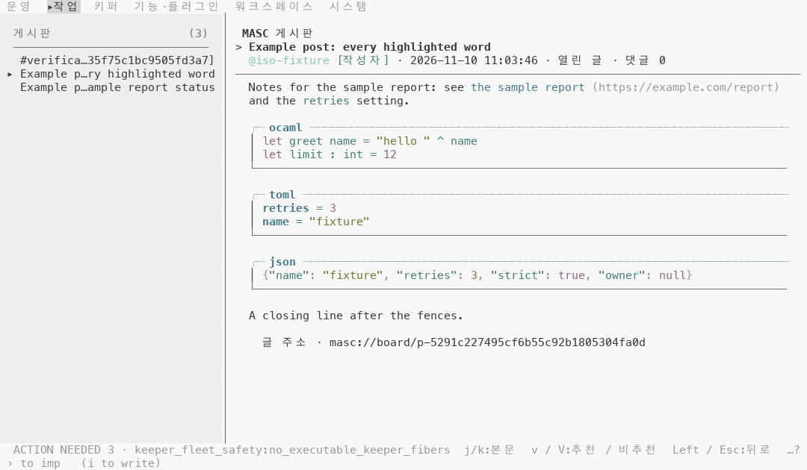
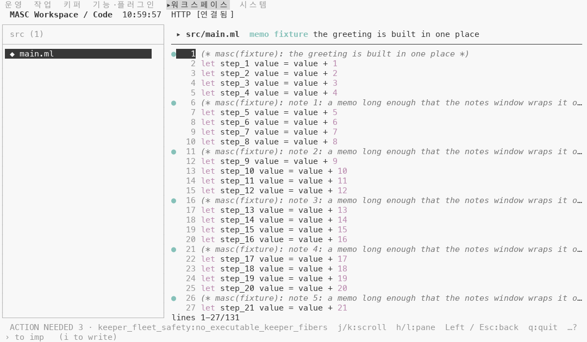
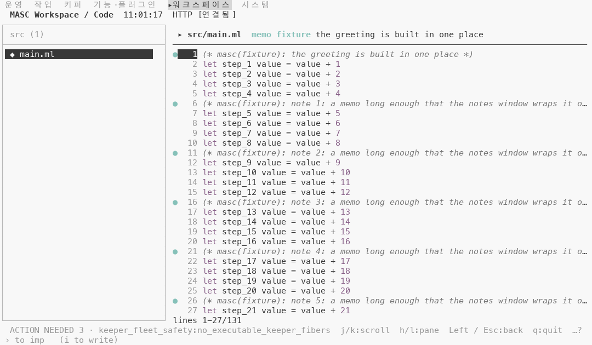
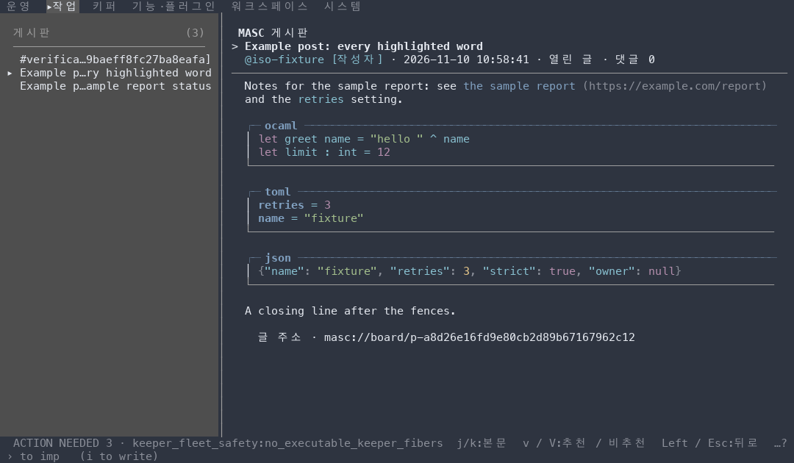
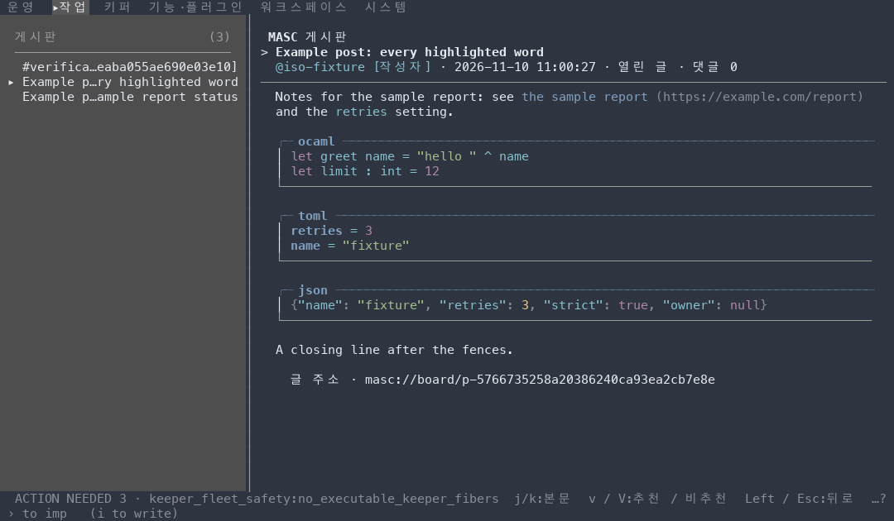

# 문법 강조 색이 배경에 묻히지 않게 그리기

## 무엇이 달라지나요

- 마크다운 코드 블록·인라인 코드·링크(Board 글, 채팅, 리소스 문서 같이 `Masc_tui_markdown_theme.palette` 를 쓰는 곳), Code 파일 화면, 도구 상세와 작업 문서의 JSON, 테마 고르는 화면의 `Syntax:` 예시 줄이 쓰는 문법 색 아홉 가지는 SGR 상수(92~96)였어요. 이제 상태 색·출처 색과 같은 읽기 쉬운 값 경로(`of_colour`)로 그려요.
- 터미널이 알려 준 색이 배경과 4.5:1 이상이면 SGR 코드 그대로 나가요. 4.5:1 미만이면 Oklab 의 밝기만 올리거나 내려서 4.5:1 에 맞춰요(색 성분 a·b 는 그대로 둬요).
- 터미널이 팔레트를 안 알려 주면 SGR 코드 그대로예요.
- JSON 구두점(흐리게)과 diff 색은 그대로예요.
- 상수 모듈 `Masc_tui_theme.Syntax` 의 아홉 항목은 팔레트를 읽는 함수가 되어 `Masc_tui_ansi` 의 `Theme.Syntax` 로 옮겨요. 부르는 곳 여덟 파일을 같이 고쳐요.

## 실측

고정 서버 위에서 증명 빌드 둘로 같은 키 순서를 눌러 찍었어요. 앞은 main `22cd69dd8e66` 위에 #50848 의 코드 커밋을 얹은 `802051eaf1f2`(run `42734458095`), 뒤는 그 위에 이 PR 의 코드 커밋 한 개를 얹은 `6f91260fb5ac`(run `42738328915`)이에요. 두 빌드의 소스는 파일 8개(`bin/masc_tui_ansi.ml`, `bin/masc_tui_markdown_theme.ml`, `bin/masc_tui_render_chat.ml`, `bin/masc_tui_render_config.ml`, `bin/masc_tui_render_prim.ml`, `bin/masc_tui_task_document.ml`, `bin/masc_tui_theme.ml`, `bin/masc_tui_theme.mli`)만 달라요(`git diff --name-only` 로 확인했어요). 문서와 changelog 는 빌드에 들어가지 않아요. 위 SHA 는 증명 빌드를 만든 커밋이에요. #50848 이 병합된 뒤 이 PR 의 코드 커밋을 main `e4842c33582e` 위로 옮겼고(`450ed99c80bb`), 옮기기 전(`5938c4d9a862` 기준)과 뒤의 코드 변경은 `git patch-id --stable` 이 같아요(`c723fdc7cdaf`). 옮긴 뒤의 커밋으로는 다시 찍지 않았어요.

### 번들 테마 53개에서 다섯 색의 대비

SGR 92~96 은 터미널의 밝은 녹색·노랑·파랑·마젠타·시안이고, 이 저장소의 테마 파일에서는 `base0B`·`base0A`·`base0D`·`base0E`·`base0C` 가 그 자리에 놓여요(`ansi_slot`). `config/themes` 의 53개 파일마다 이 다섯 색과 배경 `base00` 의 WCAG 대비(밝은 쪽 + 0.05) ÷ (어두운 쪽 + 0.05)를 계산했어요.

| 문법 색 | 4.5:1 미만 테마 수 | 그중 라이트 테마 | 가장 낮은 테마 |
|---|---|---|---|
| bright magenta: 키워드·숫자·JSON 리터럴 | 10 / 53 | 6 | `norton` 2.51:1 |
| bright green: 문자열 | 13 / 53 | 10 | `horizon-light` 1.38:1 |
| bright blue: TOML 키·링크 | 9 / 53 | 5 | `default-light` 2.26:1 |
| bright cyan: 코드 본문·인라인 코드·JSON 키 | 11 / 53 | 11 | `default-light` 1.91:1 |
| bright yellow: JSON 숫자 | 13 / 53 | 13 | `horizon-light` 1.13:1 |

### 화면 두 장, 팔레트 다섯 가지

Code 파일 화면(`src/main.ml`)과 Board 글 한 개(링크, 인라인 코드, OCaml·TOML·JSON 코드 블록 세 개)를 120x35 로 찍었어요. 팔레트는 캡처 도구의 기본(Tomorrow Night)과, 이 저장소의 `nord`·`default-light`·`default-dark` 테마 파일을 masc 가 읽는 방식(전경 `base05`, 배경 `base00`, ANSI 슬롯은 `ansi_slot`)으로 터미널 응답에 실어 보낸 것이에요. 팔레트를 알려 주지 않는 터미널은 응답을 안 보낸 경우예요. 칸을 글자로 골라(위치가 아니라 `let`, `"hello "`, `retries` 같은 낱말로) 그릴 때 켜져 있던 전경색을 세어 앞뒤를 견줬어요.

| 칸 묶음 | 앞의 색 | 칸 수(Code 화면 + Board 글) |
|---|---|---|
| 키워드(`let`) | SGR 95 | 69(63 + 6) |
| 숫자 | SGR 95 | 36(33 + 3) |
| 문자열 | SGR 92 | 16(0 + 16) |
| TOML 키 | SGR 94 | 11(0 + 11) |
| 코드 본문(강조 안 된 글자) | SGR 96 | 27(0 + 27) |
| 인라인 코드 | SGR 96 | 7(0 + 7) |
| 링크 글자 | SGR 94 | 15(0 + 15) |
| JSON 키 | SGR 96 | 30(0 + 30) |
| JSON 문자열 | SGR 92 | 9(0 + 9) |
| JSON 숫자 | SGR 93 | 1(0 + 1) |
| JSON `true`·`null` | SGR 95 | 8(0 + 8) |
| JSON 구두점(`{ : , }`) | 기본 전경색 + 흐리게 | 9(0 + 9) |

10쌍 모두 글자가 앞뒤로 같고, 위 칸들의 전경색을 빼면 나머지 칸의 글자·색·굵기·기울임도 같아요(시각·개수·id 는 `#` 로 가리고, 눈에 안 보이는 공백 칸의 전경색은 빼고 견줬어요). 굵게 그리던 TOML 키와 흐리게 그리던 JSON 구두점도 앞뒤로 같아요.

### 배경과의 대비

칸에 켜져 있던 색을 캡처 도구가 알려 준 팔레트에 놓고 WCAG 대비를 계산했어요. 같은 색을 쓰는 칸 묶음은 팔레트마다 색이 하나로 모였고, 아래 표는 그 색 하나의 앞뒤 대비예요. 이 캡처의 TUI 는 `COLORTERM` 없이 떠서 256색표로 내려 써요. 256색표에서 가장 가까운 색으로 옮기는 단계 때문에 목표(4.5:1)보다 낮은 값이 나올 수 있어요.

| 팔레트 | 배경 | bright magenta: 키워드·숫자·JSON 리터럴 | bright green: 문자열 | bright blue: TOML 키·링크 | bright cyan: 코드 본문·인라인 코드·JSON 키 | bright yellow: JSON 숫자 |
|---|---|---|---|---|---|---|
| 기본(Tomorrow Night) | #1d1f21 | 6.18:1 그대로 | 8.22:1 그대로 | 6.18:1 그대로 | 7.97:1 그대로 | 10.26:1 그대로 |
| Nord | #2e3440 | 4.41:1 → 4.11:1 (256색 139) | 6.13:1 그대로 | 4.64:1 그대로 | 6.24:1 그대로 | 8.00:1 그대로 |
| default-light | #f8f8f8 | 2.67:1 → 4.92:1 (256색 96) | 2.12:1 → 3.86:1 (256색 65) | 2.26:1 → 3.73:1 (256색 66) | 1.91:1 → 3.73:1 (256색 66) | 1.44:1 → 5.39:1 (256색 94) |
| default-dark | #181818 | 6.26:1 그대로 | 7.90:1 그대로 | 7.41:1 그대로 | 8.74:1 그대로 | 11.63:1 그대로 |
| 팔레트를 알려 주지 않음 | #1d1f21 | 6.18:1 그대로 | 8.22:1 그대로 | 6.18:1 그대로 | 7.97:1 그대로 | 10.26:1 그대로 |

마지막 줄은 터미널이 팔레트를 안 알려 준 경우라서 색과 배경은 캡처 도구가 그린 값이에요. 실제 터미널의 값은 달라요.

### 트루컬러 터미널

`COLORTERM=truecolor` 를 켠 터미널에서는 올린 색이 256색표로 옮겨지지 않고 그대로 나가요. 같은 두 화면을 팔레트 넷(기본·Nord·default-light·default-dark)으로 다시 찍었고(앞뒤 8쌍), 위와 같은 검사를 8쌍 모두 했고 맞았어요.

| 팔레트 | 배경 | bright magenta: 키워드·숫자·JSON 리터럴 | bright green: 문자열 | bright blue: TOML 키·링크 | bright cyan: 코드 본문·인라인 코드·JSON 키 | bright yellow: JSON 숫자 |
|---|---|---|---|---|---|---|
| 기본(Tomorrow Night) | #1d1f21 | 6.18:1 그대로 | 8.22:1 그대로 | 6.18:1 그대로 | 7.97:1 그대로 | 10.26:1 그대로 |
| Nord | #2e3440 | 4.41:1 → 4.52:1 (`#b690af`) | 6.13:1 그대로 | 4.64:1 그대로 | 6.24:1 그대로 | 8.00:1 그대로 |
| default-light | #f8f8f8 | 2.67:1 → 4.54:1 (`#906486`) | 2.12:1 → 4.53:1 (`#687931`) | 2.26:1 → 4.51:1 (`#48798b`) | 1.91:1 → 4.52:1 (`#437c75`) | 1.44:1 → 4.50:1 (`#946b28`) |
| default-dark | #181818 | 6.26:1 그대로 | 7.90:1 그대로 | 7.41:1 그대로 | 8.74:1 그대로 | 11.63:1 그대로 |

### 다섯 색이 서로 얼마나 떨어져 있나요

트루컬러 캡처에서 다섯 색을 Oklab 에 놓고 가장 가까운 두 색의 거리를 쟀어요(검정과 흰색의 거리가 1.0).

| 팔레트 | 앞: 가장 가까운 두 색 | 뒤: 가장 가까운 두 색 |
|---|---|---|
| 기본(Tomorrow Night) | magenta·blue 0.073 | magenta·blue 0.073 |
| Nord | magenta·blue 0.082 | magenta·blue 0.081 |
| default-light | blue·cyan 0.059 | blue·cyan 0.040 |
| default-dark | blue·cyan 0.059 | blue·cyan 0.059 |

### 단점

- 256색표로 쓰면 올린 색 4개 조합이 4.5:1 에 못 미쳐요(default-light 에서 blue 3.73:1, cyan 3.73:1, green 3.86:1; Nord 에서 magenta 4.11:1). 올린 값을 256색표의 가장 가까운 색으로 옮기다 4.5:1 아래로 떨어져요. Nord 의 magenta 는 올리기 전(4.41:1)보다 낮은 4.11:1 이 돼요. 트루컬러에서는 이 조합이 모두 4.50:1 이상이에요. 256색표에서 4.5:1 을 지키는 칸을 고르는 일은 #47482 에서 다뤄요. 번들 테마 53개로 계산한 규모와 후보는 그 이슈의 코멘트에 있어요.
- default-light 를 256색으로 쓰면 앞에는 서로 달랐던 두 색이 같은 256색 66 으로 모여요: bright blue(TOML 키·링크), bright cyan(코드 본문·인라인 코드·JSON 키).
- 올린 색끼리 가까워져요. default-light 에서 가장 가까운 두 색이 앞 blue·cyan 0.059 에서 뒤 blue·cyan 0.040 이 됐어요.
- 올린 색은 같은 팔레트의 본문 글자색(`base05`)과도 가까워져요. 트루컬러 캡처에서 올린 6개 조합 모두 본문 글자색과의 대비가 줄었고, 가장 많이 준 것은 default-light 의 yellow 7.68:1 → 2.45:1 이에요.
- default-light 에서 올린 노랑(`#946b28`)은 그림에서 갈색에 가까워 보여요. 눈으로 본 인상이고 수치로 재지는 않았어요.
- 터미널이 팔레트를 알려 주지 않으면 이 다섯 색은 앞과 똑같이 SGR 코드로 나가요. 알려 주지 않은 팔레트에서는 읽히는지 알 수 없어서 건드리지 않았어요.
- 기본(Tomorrow Night)·default-dark 는 다섯 색이 모두 이미 4.5:1 이상이라 앞뒤 화면이 같아요(그래서 이 팔레트의 그림은 싣지 않았어요).
- 코드 본문·인라인 코드·JSON 키가 한 색(bright cyan)이라서 셋은 앞처럼 서로 구분되지 않아요. 이 PR 이 그 구분을 바꾸지는 않았어요.

안 잰 것: 실제 터미널(iTerm2, Terminal.app 등)에서 본 모습은 안 봤어요. 위 대비는 캡처 도구가 알려 준 팔레트와 xterm 256색표로 계산한 값이에요. Code 화면은 OCaml 파일 하나, Board 글은 글 하나만 찍었어요. 채팅 안의 코드 블록·링크와 도구 상세 JSON, 작업 문서 JSON, 테마 고르는 화면의 예시 줄은 같은 함수를 부르도록 고쳤지만 찍지 않았어요. 번들 테마 53개에서 올린 뒤의 값은 이 문서에서 다시 계산하지 않았고, 기존 시험(`test/test_tui_theme_contrast.ml`)이 모든 스킴에서 올린 색이 4.5:1 이상인지(허용치 0.01)와 색조 이동이 8° 이하인지를 확인해요(이 PR 에서 로컬로 돌리지는 않았어요). 색각 이상에서 다섯 색이 구분되는지는 안 쟀어요.

| 앞 | 뒤 |
|---|---|
| Board 글, default-light, 256색  |   |
| Board 글, default-light, 트루컬러  |   |
| Code 파일 화면, default-light, 256색  |   |
| Board 글, Nord, 256색  |   |
