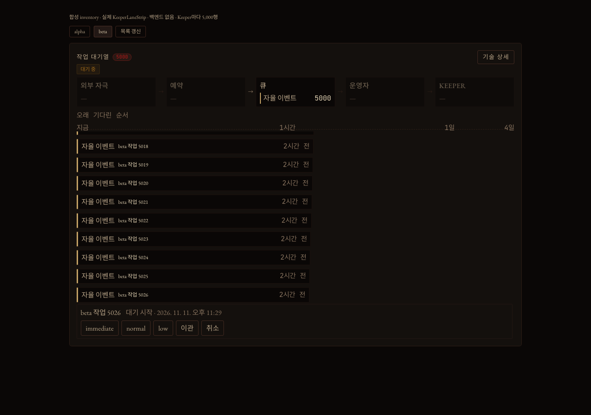
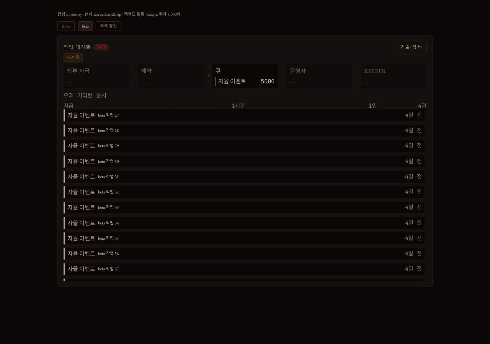
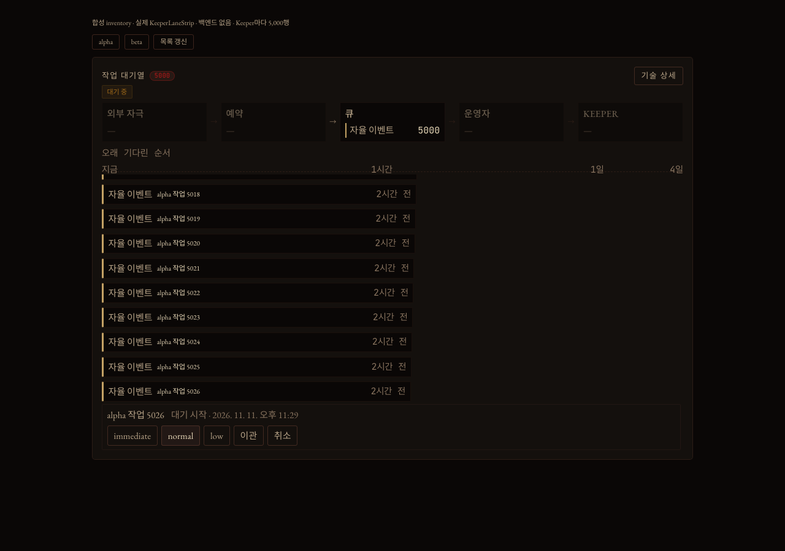

# 작업 대기열 목록: 5,000행이어도 화면 근처 행만 그려요

이슈 #26606 을 브라우저에서 재현하고, 고친 뒤 다시 잰 기록이에요.

Keeper 작업 화면의 "작업 대기열"은 서버가 준 대기 행을 전부 DOM 에 그렸어요. 서버는 행 수를 자르지 않아요. 다른 Keeper 를 골라도 목록의 스크롤 위치와 열어 둔 행 자리가 그대로 남았어요.

## 무엇으로 쟀나요

`dashboard/fixtures/2026-11-11-keeper-lane-window/` 가 실제 `KeeperLaneStrip` 에 만든 대기 목록을 넣어요. Keeper 는 alpha 와 beta 둘이고, 자율 이벤트가 5,000행씩 있어요. 백엔드는 없어요.

`browser.mjs` 가 headless Chromium 으로 이 화면을 움직여요. 기대값을 검사하기 전에 측정값을 `measurements.json` 에 먼저 써요. 그래서 고치기 전 코드에서도 같은 스크립트로 숫자가 남아요.

같은 `fixture.ts` 와 `browser.mjs` 로 두 번 돌렸어요.

| | 소스 | 결과 파일 |
|---|---|---|
| 앞 | main `7ba926ef4f60` | [`before-main-7ba926ef4f60/measurements.json`](before-main-7ba926ef4f60/measurements.json) |
| 뒤 | 브랜치 `fix/26606-lane-inventory-window` 커밋 `6e205532e94d` (main `7ba926ef4f60` 위) | [`after-6e205532e94d/browser-result.json`](after-6e205532e94d/browser-result.json) |

환경은 macOS 27.2, Apple M3 Max(16코어), Playwright 1.61.1 이 띄운 Chromium 149.0.7827.55 headless, 창 1280×900, vite dev 서버예요. 두 실행은 이어서 돌렸고, 그동안 장비의 1분 load average 는 33~39 였어요. 시간은 실행마다 달라요. 이 장비에서 같은 날 앞을 여러 번 쟀을 때 render 와 layout 의 중앙값은 600~942 ms 사이였고, load average 와 나란히 움직이지는 않았어요.

## 결과

| 항목 | 앞 (main) | 뒤 |
|---|---|---|
| 처음 열었을 때 DOM 에 있는 대기 행 | 5,000 | 17 |
| 그중 목록 높이 하나보다 멀리 있는 행 | 4,977 | 0 |
| 목록 갱신 한 번의 render 와 layout, 9번의 중앙값 | 647 ms (624~700) | 3.6 ms (3.3~5.7) |
| 목록 갱신 한 번에 main thread 가 일한 시간, 9번의 중앙값 | 712 ms (694~858) | 12.5 ms (10.5~24.5) |
| 끝으로 한 번 스크롤했을 때 맨 끝 행이 보이나요 | 예 | 예 |
| 맨 끝 행에서 누른 `normal` 이 보낸 주소 | 맨 끝 행의 주소 | 맨 끝 행의 주소 |
| 포커스를 둔 행이 화면 밖으로 나간 뒤 포커스 위치 | 그 행 (DOM 에 남아 있어요) | 목록 |
| 열어 둔 첫 행이 화면 밖에 나갔다 돌아온 뒤 | 열려 있어요 | 열려 있어요 |
| 큐가 이벤트 주소를 바꾼 뒤, 열고 포커스를 둔 행 | 열려 있고 포커스도 그대로예요 | 열려 있고 포커스도 그대로예요 |
| 그 행에서 누른 `normal` 이 보낸 주소 | 바뀐 주소 | 바뀐 주소 |
| beta 로 바꾼 뒤 스크롤 위치 | 200,947 px (alpha 에서 내린 그대로) | 0 px |
| beta 로 바꾼 뒤 첫 행이 보이나요 | 아니요 | 예 |
| beta 로 바꾼 뒤 열려 있는 행 | 2 | 0 |
| 끝까지 내린 목록에서 200행이 한꺼번에 빠진 다음 프레임에 보이는 행 | 12 | 11 |
| 그 프레임에 목록 아래쪽이 빈 높이 | 0.4 px | 11.25 px |
| 목록이 축 아래 몇 px 에서 시작하나요 | 3.75 px | 3.75 px |
| 축 라벨 글자가 축 아래로 내려오는 높이 | 2.05 px | 2.05 px |
| 목록 높이 | 450 px | 450 px |

- "목록 갱신 한 번"은 fixture 가 다음 서버 응답처럼 행 객체를 모두 새로 만들어 다시 그리는 일이에요. 앞의 3행이 빠지고 뒤에 3행이 붙어요.
- "render 와 layout"은 fixture 가 잰 시간이에요. 동기 render 와 바로 뒤의 강제 layout 까지예요.
- "main thread 가 일한 시간"은 갱신을 부르기 전부터 두 프레임과 100 ms 가 지날 때까지 페이지의 main thread 가 쓴 시간이에요. Chromium 의 `Performance.getMetrics` 가 주는 `TaskDuration` 의 차이예요. render 뒤에 도는 effect, 행 높이 측정, paint 가 들어 있어요. 갱신 없이 같은 시간만 기다리면 앞은 0.4 ms, 뒤는 1.5 ms 였어요.
- "큐가 이벤트 주소를 바꾼 뒤"는 fixture 가 모든 이벤트의 `source_incarnation` 을 새 값으로 바꿔 다시 그린 것이에요. 서버는 이벤트를 보류하거나 우선순위를 바꿀 때 이 값을 바꿔요.
- 앞에서 beta 에 열려 있던 2행은 alpha 에서 연 첫 행과 끝 행의 자리예요. beta 에서는 아무 행도 열지 않았어요.
- "200행이 한꺼번에 빠진 다음 프레임"은 Keeper 가 대기 행을 묶어서 소비한 직후예요. 목록을 끝까지 내려 둔 채 가장 오래된 200행을 빼고, 바로 다음 animation frame 안에서 목록에 보이는 행을 셌어요. 뒤에서 11.25 px 가 비는 것은 새로 그린 15행의 높이를 아직 재지 않아서예요. 재기 전에는 한 행을 41 px 로 잡는데 실제는 40.25 px 예요. 같은 순서를 여덟 프레임 동안 따로 쟀더니 두 프레임까지 11.25 px 가 비었고, 세 번째 프레임부터는 0 px 에 12행이 보였어요.
- 축 라벨("지금", "1시간")은 축 상자 아래로 2.05 px 내려와 그려져요. 라벨의 글자 기준선과 글자가 그 아래로 내려가는 높이를 더한 값이에요. 스크린샷에서 라벨의 가장 아래 픽셀은 축 아래 약 2 px 였어요. 스크롤로 목록 위에 걸친 행은 목록 위 끝에서 잘리니까, 목록이 이 높이보다 아래에서 시작해야 잘린 행의 글자가 라벨에 닿지 않아요. 스크립트가 이것을 확인해요. 목록을 축에 붙여 본 구조(이 브랜치의 앞선 커밋 `ab588a390433`)에서는 거리가 0 px 라서 이 확인이 실패해요.
- 목록의 자리와 크기는 앞뒤가 같아요. 행 좌표는 임시 스크립트로 5,000행, 30행, 5행에서 따로 비교했고 같았어요. 앞 세 행의 위쪽이 284.81, 325.06, 365.31 px 이고 목록 아래 끝이 734.81 px(5행일 때 482.31 px)예요.
- 40행 이하인 목록은 행마다 자기 상자 안에서만 그려져요. 그래서 대기 행을 5개로 줄이고 Tab 으로 둘째 행의 막대에 포커스를 둔 뒤, 막대와 그 상자 사이의 여유를 쟀어요(`shortList`). 위, 오른쪽, 아래 모두 3.75 px 이고 포커스 링은 막대 밖으로 2 px 나가요. 앞은 목록 전체가 한 상자예요. 앞의 값은 위 115.6 px, 아래 124.5 px 인데, 첫 행이 열린 채로 잰 값이에요. 앞은 alpha 에서 연 첫 행 자리가 beta 에 남아 있어서예요.

고치기 전, alpha 목록을 끝까지 내리고 beta 를 고른 직후예요. beta 의 끝 행이 보이고, 열지 않은 행이 열려 있어요.



고친 뒤 같은 순서예요. beta 의 첫 행부터 보여요.



고친 뒤 alpha 목록의 끝이에요. 5,000번째 행을 열어 동작 버튼을 눌렀어요.



## 치른 값

- 화면 밖 행은 DOM 에 없어요. 그래서 브라우저 찾기(Ctrl-F)는 화면 근처 행만 찾아요. 40행 이하인 목록은 전처럼 모든 행이 DOM 에 있어요.
- 대기 행이 40행과 41행 사이를 오가면 목록이 행을 모두 다시 만들어요. 열어 둔 행은 열려 있고, 행 안에 있던 포커스는 목록으로 가요. 이 경계는 `VirtualList` 의 고정값이에요. 목록이 끝에 있을 때 40행에서 41행으로 늘면 보이던 행이 1.75 px 내려가요(리뷰어가 정적 빌드에서 잰 값이고, main 은 0 px 예요). `VirtualList` 가 잰 높이를 정수로 반올림해 두기 때문이에요. #51389 에 남겼어요.
- 41행 이상인 목록이 화면에 있는 동안 `VirtualList` 가 프레임마다 콜백 하나를 돌려 초당 프레임 수를 세요(`utils/fps-adaptive.ts`). 프레임 수가 45 아래로 떨어지면 화면 밖에 미리 그려 두는 행을 줄여요. 그래서 DOM 에 있는 행 수 17 은 프레임 수가 45 이상일 때의 값이에요. 갱신 없이 기다린 시간이 0.4 ms 에서 1.5 ms 로 늘었는데, 이 콜백 때문인지는 따로 재지 않았어요.
- 행이 한꺼번에 많이 빠지면 새로 그린 행의 높이를 잴 때까지 두 프레임 동안 목록 아래쪽이 11.25 px 비어요.
- 공용 `VirtualList` 를 고쳐서 Tools 화면의 전체 도구 목록(`tools/tool-full-inventory.ts`)도 달라져요. 이 목록은 `VirtualList` 가 스크롤 상자가 아니라서 원래도 모든 행을 그려요. 전에는 첫 paint 에 30행을 먼저 그렸고, 이제는 처음부터 전체를 그려요. 첫 paint 가 얼마나 늦어지는지는 재지 않았어요. #51397 에 남겼어요.

## 그대로 둔 것

- 열어 둔 행은 전처럼 행의 종류와 자리를 따라가요. 위쪽 행이 소비되어 한 칸씩 당겨지면 열린 자리에 다음 행이 보여요. 그 행의 버튼에 포커스가 있었다면 버튼도 다음 행의 것이 되고, 누르면 다음 행의 이벤트에 동작이 가요. 서버가 행마다 안 바뀌는 이름을 내려 주지 않아서예요. main `7ba926ef4f60` 과 이 브랜치에서 vitest 로 같은 결과를 봤어요.
- 첫 행 막대의 위쪽 여유는 앞뒤 모두 0 px 예요(`shortList.firstRowRoomAbovePx`). 첫 행에 키보드 포커스가 가면 링의 위쪽 변이 전처럼 목록 경계 밖에 놓여요.
- 포커스 링의 왼쪽 변은 어느 행에서나 전처럼 목록 경계에 잘려요. 스크립트는 위, 오른쪽, 아래만 봐요.
- Keeper 작업 화면의 같은 열에는 대기 행을 그리는 목록이 하나 더 있어요(`lanes/lane-queue-panel.ts` 의 `WaitAges`). 이 목록은 여전히 모든 행을 그리고 5초마다 다시 그려요. 위 표의 "5,000 → 17"은 고친 목록 하나의 숫자예요. #51359 에 남겼어요.

## 확인하지 않은 것

- 실제 서버와 실제 Keeper 의 대기 행으로는 보지 않았어요. 운영 서버가 지금 Keeper 하나에 몇 행을 주는지도 재지 않았어요.
- 대기 목록 store 와 서버가 밀어 주는 갱신은 fixture 에 없어요. fixture 가 새 목록을 직접 넣어요.
- Tools 화면과 예약 화면의 같은 목록은 브라우저로 열어 보지 않았어요. 두 화면도 같은 `LaneWaitingRows` 를 쓰고, vitest 시험 하나가 Tools 패널에서 2,000행 중 일부만 그려지는지 봐요.
- fixture 는 앱이 불러오는 스타일 중 다섯 개만 `main.ts` 순서로 불러요. 행 간격(40.25 px), 키보드 포커스 링(1 px, 띄움 1 px), root 글자 크기(15 px)는 `main.ts` 의 스타일을 모두 불러온 임시 페이지에서 쟀을 때도 같았어요. 그 밖의 모양은 비교하지 않았어요.
- 이 스크립트는 CI 에서 돌지 않아요. vitest 시험은 happy-dom 에서 돌아서 스크롤 높이와 행 위치를 보지 못해요. 목록이 실제로 스크롤되는지, 화면 근처 행만 그리는지는 이 스크립트를 손으로 돌려야 확인돼요. 줄어든 목록이 다음 프레임 전에 그릴 범위를 옮기는지는 `virtual-list.test.ts` 의 시험 4개가 CI 에서 봐요.
- `VirtualList` 를 쓰는 다른 목록 네 곳(`tools/tool-full-inventory.ts`, `keeper-workspace/keeper-workspace-roster.ts`, `logs.ts`, `work.ts`)은 브라우저로 열어 보지 않았어요. 네 곳의 vitest 시험 파일을 돌렸어요. 그중 `logs.test.ts` 의 9개는 이 장비에서 main `7ba926ef4f60` 도 같은 자리에서 시간 초과로 실패해서, 로그 목록은 그 시험으로 확인하지 못했어요.
- Chromium 에서만 봤어요.

## 다시 돌리기

```bash
cd dashboard
node fixtures/2026-11-11-keeper-lane-window/browser.mjs
```

결과는 `artifacts/dashboard/2026-11-11-keeper-lane-window/run-*/` 에 생겨요. Keeper 하나의 행 수는 `LANE_WINDOW_ROWS` 로 바꿔요. 241 이상이어야 해요. 그보다 적으면 200행을 뺀 뒤 목록이 모든 행을 그리는 쪽으로 넘어가서, 스크립트가 그 단계에서 실패로 끝나요.

앞의 숫자는 main `7ba926ef4f60` 을 꺼낸 폴더에 이 fixture 폴더를 넣고 같은 명령을 돌린 값이에요. 그 실행은 측정값을 쓴 다음 첫 기대값에서 실패로 끝나요.
