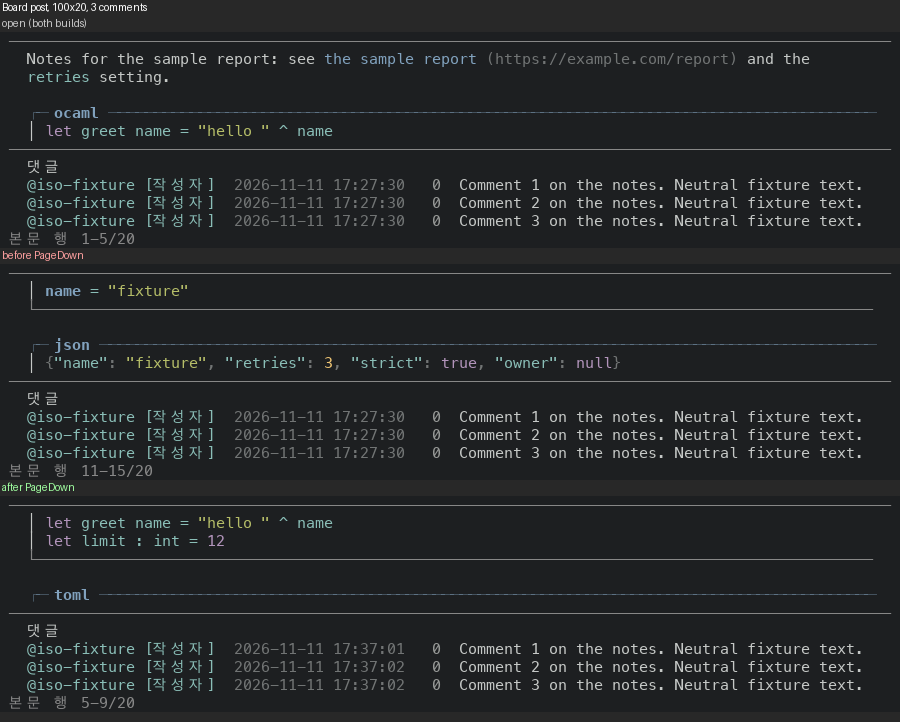

# Board 글 본문: PageDown 이 그린 창만큼 넘겨요

Board 글을 열고 PageDown 을 누르면 키 처리가 쪽 크기를 `surface_page_rows`(화면 줄 수 − 8)로 짐작해요. 본문 창의 높이는 그릴 때 `Layout.allocate_board_read` 가 정하고, 댓글이 달린 글은 댓글이 창의 줄을 가져가서 짐작한 값보다 작아요. 쪽 크기가 창보다 크면 PageDown 한 번에 창보다 많이 넘어가고, 건너뛴 줄은 화면에 한 번도 안 나와요.

- 댓글 3개·100x20: 창 5줄, 전체 20줄. PageDown 한 번이 앞 1-5 → 11-15, 뒤 1-5 → 5-9 예요. 앞은 5줄(6-10)이 안 나와요.
- 댓글 3개·100x16: 창 1줄. PageDown 두 번이 앞 1-1 → 7-7 → 13-13, 뒤 1-1 → 2-2 → 3-3 예요.
- 댓글 없는 글·100x16: 짐작한 값과 창 높이가 같아서(6줄) 건너뛰는 줄은 없어요. 앞은 1-6 → 7-12 로 읽던 마지막 줄이 남지 않고, 뒤는 1-6 → 6-11 로 한 줄이 남아요.
- 이 PR 은 그릴 때 본문과 댓글의 줄 수·창 높이를 상태에 적어 두고(`board_read_presented_frame`), 키 처리가 그 창으로 `Masc_tui_scroll.page_down`·`page_up` 을 불러요.

## 실측

고정 서버 위에서 증명 빌드 둘로 같은 키를 눌러 찍었어요. 앞은 main `8574837d0b24`(run `42969563516`)이고, 뒤는 이 PR 의 코드 커밋 `231db656c511`(run `42986502362`)예요. 글 `Example post: every highlighted word`(본문 20줄)를 목록에서 열어 PageDown, PageDown, PageUp, End, Home 순서로 눌러 6걸음을 찍었어요. 읽는 값은 화면의 `본문 행 처음-끝/전체` 줄이에요. 댓글 3개는 같은 서버에 `masc_board_comment` 로 달았어요. 사례마다 높이와 폭, 글에 댓글이 있는지만 다르고 키 순서는 같아요. `wide20` 만 글을 연 뒤 `z` 로 본문을 넓은 배치로 바꿨어요.

댓글 없는 글·100x16 — 창 6줄, 전체 20줄:

| 걸음 | 누른 키 | 앞 | 뒤 |
|---|---|---|---|
| 00 | 연 직후 | 1-6/20 | 1-6/20 |
| 01 | PageDown | 7-12/20 | 6-11/20 |
| 02 | PageDown | 13-18/20 | 11-16/20 |
| 03 | PageUp | 7-12/20 | 6-11/20 |
| 04 | End | 15-20/20 | 15-20/20 |
| 05 | Home | 1-6/20 | 1-6/20 |

댓글 3개·100x16 — 창 1줄, 전체 20줄:

| 걸음 | 누른 키 | 앞 | 뒤 |
|---|---|---|---|
| 00 | 연 직후 | 1-1/20 | 1-1/20 |
| 01 | PageDown | 7-7/20 | 2-2/20 |
| 02 | PageDown | 13-13/20 | 3-3/20 |
| 03 | PageUp | 7-7/20 | 2-2/20 |
| 04 | End | 20-20/20 | 20-20/20 |
| 05 | Home | 1-1/20 | 1-1/20 |

댓글 3개·100x20 — 창 5줄, 전체 20줄:

| 걸음 | 누른 키 | 앞 | 뒤 |
|---|---|---|---|
| 00 | 연 직후 | 1-5/20 | 1-5/20 |
| 01 | PageDown | 11-15/20 | 5-9/20 |
| 02 | PageDown | 16-20/20 | 9-13/20 |
| 03 | PageUp | 6-10/20 | 5-9/20 |
| 04 | End | 16-20/20 | 16-20/20 |
| 05 | Home | 1-5/20 | 1-5/20 |

댓글 3개·100x28 — 창 13줄, 전체 20줄:

| 걸음 | 누른 키 | 앞 | 뒤 |
|---|---|---|---|
| 00 | 연 직후 | 1-13/20 | 1-13/20 |
| 01 | PageDown | 8-20/20 | 8-20/20 |
| 02 | PageDown | 8-20/20 | 8-20/20 |
| 03 | PageUp | 1-13/20 | 1-13/20 |
| 04 | End | 8-20/20 | 8-20/20 |
| 05 | Home | 1-13/20 | 1-13/20 |

댓글 3개·130x20(본문 옆에 댓글) — 창 10줄, 전체 20줄:

| 걸음 | 누른 키 | 앞 | 뒤 |
|---|---|---|---|
| 00 | 연 직후 | 1-10/20 | 1-10/20 |
| 01 | PageDown | 11-20/20 | 10-19/20 |
| 02 | PageDown | 11-20/20 | 11-20/20 |
| 03 | PageUp | 1-10/20 | 2-11/20 |
| 04 | End | 11-20/20 | 11-20/20 |
| 05 | Home | 1-10/20 | 1-10/20 |

- 건너뜀은 PageDown 뒤 화면의 첫 줄 번호에서 앞 화면의 마지막 줄 번호를 뺀 값에서 1을 뺀 거예요. 겹침은 반대로 앞 화면의 마지막 줄 번호가 새 화면에도 있는 줄 수예요.
- 앞 빌드에서 PageDown 한 번에 건너뛴 줄은 댓글 3개·100x16 5줄, 댓글 3개·100x20 5줄이에요.
- 뒤 빌드는 모든 사례에서 건너뛴 줄이 0 이에요. 창이 2줄 이상이면 한 줄을 겹쳐요(댓글 없는 글·100x16 1줄, 댓글 3개·100x20 1줄, 댓글 3개·130x20(본문 옆에 댓글) 1줄). 창이 한 줄(`thread16`)이면 겹칠 줄이 없어서 한 줄씩 넘어가요(`page_step` 의 최소는 1).
- 겹친 줄이 정말 같은 줄인지 화면 글자로도 견줬어요. 뒤 빌드에서 PageDown 뒤 화면의 첫 본문 줄이 앞 화면의 마지막 본문 줄과 글자까지 같아요. 글자를 견준 곳은 4쌍이에요(`wide20` 은 본문 옆에 댓글이 있어서 줄 번호로만 견줬어요).
- `thread28` 은 창 13줄이 문서 20줄에 거의 다 들어가서, PageDown 이 둘 다 끝에서 멈춰요. 앞뒤가 같아요.
- End 와 Home 은 모든 사례에서 앞뒤가 같아요.



그림은 `thread20` 이에요. 위에서 아래로 연 직후(앞뒤가 같아요), 앞 빌드의 PageDown, 뒤 빌드의 PageDown 이에요.

## 무엇을 바꿨나요

- `Masc_tui_types.board_read_presented` 는 글 번호, 본문의 줄 수·창 높이, 댓글의 줄 수·창 높이예요. `board_read_pane` 이 그릴 때마다 `board_read_presented_frame` 으로 적어요. 한 열 배치와 본문 옆에 댓글을 두는 배치가 같은 함수를 지나요.
- `page_board_read` 는 지금 열린 글의 기록이 있을 때만 `Masc_tui_scroll.page_down`·`page_up` 으로 본문 위치(댓글에 키가 있으면 댓글 위치)를 옮겨요. 다른 글에서 적은 기록이나 읽기 화면 밖에서는 아무것도 안 해요(`current_board_read_presented`).
- `masc_tui.ml` 의 PageDown·PageUp 처리에서 Board 글 쪽 한 줄이 `move_board_read_scroll state ~by:(direction * page)` 대신 `page_board_read` 를 불러요. 본문의 `j`·`k` 와 휠은 그대로 `move_board_read_scroll` 로 줄 단위로 움직여요.
- 바뀐 파일은 4개(+87/−2줄)예요. 시험은 `test_tui_board_read_layout`(+33/−1줄)이에요.

## 다시 세는 법

이 폴더에서 아래 코드를 돌리면 위 표의 숫자가 나와요(파이썬 표준 라이브러리만 써요).

```python
import re
READING = re.compile(r"본문 행 (\d+)-(\d+)/(\d+)")
CASES = ["plain16", "thread16", "thread20", "thread28", "wide20"]
STEPS = ["00-open", "01-pgdn", "02-pgdn2", "03-pgup", "04-end", "05-home"]
def reading(side, case, step):
    text = open(f"captures/{side}/{case}-{step}.txt", encoding="utf-8").read()
    return tuple(int(x) for x in READING.search(text).groups())
for case in CASES:
    previous = {}
    for step in STEPS:
        out = []
        for side in ("before", "after"):
            first, last, count = reading(side, case, step)
            paged = step in ("01-pgdn", "02-pgdn2")
            skipped = max(0, first - previous[side] - 1) if paged else "-"
            overlap = max(0, previous[side] - first + 1) if paged else "-"
            previous[side] = last
            out.append(f"{first}-{last} 건너뜀 {skipped} 겹침 {overlap}")
        print(f"{case:9s} {step:8s} 앞 {out[0]:26s} 뒤 {out[1]}")
```

```
plain16   00-open  앞 1-6 건너뜀 - 겹침 -             뒤 1-6 건너뜀 - 겹침 -
plain16   01-pgdn  앞 7-12 건너뜀 0 겹침 0            뒤 6-11 건너뜀 0 겹침 1
plain16   02-pgdn2 앞 13-18 건너뜀 0 겹침 0           뒤 11-16 건너뜀 0 겹침 1
plain16   03-pgup  앞 7-12 건너뜀 - 겹침 -            뒤 6-11 건너뜀 - 겹침 -
plain16   04-end   앞 15-20 건너뜀 - 겹침 -           뒤 15-20 건너뜀 - 겹침 -
plain16   05-home  앞 1-6 건너뜀 - 겹침 -             뒤 1-6 건너뜀 - 겹침 -
thread16  00-open  앞 1-1 건너뜀 - 겹침 -             뒤 1-1 건너뜀 - 겹침 -
thread16  01-pgdn  앞 7-7 건너뜀 5 겹침 0             뒤 2-2 건너뜀 0 겹침 0
thread16  02-pgdn2 앞 13-13 건너뜀 5 겹침 0           뒤 3-3 건너뜀 0 겹침 0
thread16  03-pgup  앞 7-7 건너뜀 - 겹침 -             뒤 2-2 건너뜀 - 겹침 -
thread16  04-end   앞 20-20 건너뜀 - 겹침 -           뒤 20-20 건너뜀 - 겹침 -
thread16  05-home  앞 1-1 건너뜀 - 겹침 -             뒤 1-1 건너뜀 - 겹침 -
thread20  00-open  앞 1-5 건너뜀 - 겹침 -             뒤 1-5 건너뜀 - 겹침 -
thread20  01-pgdn  앞 11-15 건너뜀 5 겹침 0           뒤 5-9 건너뜀 0 겹침 1
thread20  02-pgdn2 앞 16-20 건너뜀 0 겹침 0           뒤 9-13 건너뜀 0 겹침 1
thread20  03-pgup  앞 6-10 건너뜀 - 겹침 -            뒤 5-9 건너뜀 - 겹침 -
thread20  04-end   앞 16-20 건너뜀 - 겹침 -           뒤 16-20 건너뜀 - 겹침 -
thread20  05-home  앞 1-5 건너뜀 - 겹침 -             뒤 1-5 건너뜀 - 겹침 -
thread28  00-open  앞 1-13 건너뜀 - 겹침 -            뒤 1-13 건너뜀 - 겹침 -
thread28  01-pgdn  앞 8-20 건너뜀 0 겹침 6            뒤 8-20 건너뜀 0 겹침 6
thread28  02-pgdn2 앞 8-20 건너뜀 0 겹침 13           뒤 8-20 건너뜀 0 겹침 13
thread28  03-pgup  앞 1-13 건너뜀 - 겹침 -            뒤 1-13 건너뜀 - 겹침 -
thread28  04-end   앞 8-20 건너뜀 - 겹침 -            뒤 8-20 건너뜀 - 겹침 -
thread28  05-home  앞 1-13 건너뜀 - 겹침 -            뒤 1-13 건너뜀 - 겹침 -
wide20    00-open  앞 1-10 건너뜀 - 겹침 -            뒤 1-10 건너뜀 - 겹침 -
wide20    01-pgdn  앞 11-20 건너뜀 0 겹침 0           뒤 10-19 건너뜀 0 겹침 1
wide20    02-pgdn2 앞 11-20 건너뜀 0 겹침 10          뒤 11-20 건너뜀 0 겹침 9
wide20    03-pgup  앞 1-10 건너뜀 - 겹침 -            뒤 2-11 건너뜀 - 겹침 -
wide20    04-end   앞 11-20 건너뜀 - 겹침 -           뒤 11-20 건너뜀 - 겹침 -
wide20    05-home  앞 1-10 건너뜀 - 겹침 -            뒤 1-10 건너뜀 - 겹침 -
```

## 시험과 문서

- 증명 빌드(run `42986502362`)가 컴파일을 통과했고 `test_tui_workspace_entries`·`test_workspace_file_confidentiality` 의 종료 코드가 0 이에요. `test_repo_git` 은 종료 코드가 1 이에요. 29개 중 15개가 `Unix.waitpid` 의 EINTR 로 끝나요(`test/test_repo_git.ml:35`). #50867 이 main 에 들어온 뒤 만든 증명 빌드가 같은 자리에서 깨졌어요. 앞 증명 빌드(run `42969563516`, main `8574837d0b24`)에서는 통과했어요. 원인과 증거는 이슈 #51254 에 적었어요. 이 시험은 Board 읽기 화면과 상관없고 이 변경의 동작을 시험으로 증명한 게 아니에요. 동작은 위 화면으로 봤어요.
- 새 시험은 화면 글자가 아니라 산술만 확인해요. 기록이 없는 상태, 기록이 있는 상태(본문 PageDown 세 번과 PageUp 한 번이 0 → 5 → 10 → 14 → 9), 댓글에 키가 있을 때(댓글만 3줄 가고 본문은 그대로), 다른 글의 기록, 읽기 화면 밖을 봐요. 헌법(354~355행)이 막는 화면 글자와 배치 확인은 안 했어요.
- 새 시험은 `masc` 라이브러리 전체가 필요해서 로컬에서는 타입 검사까지만 했어요. CI 시험에 맡겨요.
- 바뀐 `bin/` 파일 세 개(`masc_tui.ml` 포함)와 시험 파일을 dune 개발 프로파일의 컴파일 옵션(`-warn-error +a` 포함)으로 `ocamlfind ocamlc -stop-after typing` 해서 통과했어요.
- 앞 빌드(main `8574837d0b24`)와 이 PR 의 기반(`f45e70258c29`) 사이에서 `bin/` 의 6개 파일이 달라요(`masc_tui.ml`·`masc_tui_model_runtime_table.ml`·`masc_tui_model_runtime_table.mli`·`masc_tui_render_config.ml`·`masc_tui_render_prim.ml`·`masc_tui_render_prim.mli`). Board 글 읽기와 쪽 넘김 코드는 안 달라요(`masc_tui_scroll.ml`·`masc_tui_scroll.mli`·`masc_tui_layout.ml`·`masc_tui_render_board.ml`·`masc_tui_board_read_layout.ml`·`masc_tui_board_detail.ml` 가 같고, 달라진 줄에 `board_scroll`·`board_read` 가 없어요).

## 장단점

- 장점: 본문 창이 몇 줄이든 쪽 크기가 그 창에서 나와서, 댓글이 있는 글도 줄을 건너뛰지 않고 읽던 마지막 줄이 남아요. Planning 의 작업 상세와 같은 방식이에요(`task_detail_presented_viewport`). 쪽 크기를 `surface_page_rows` 로 짐작하는 곳이 Board 글 읽기에서 없어져요.
- 단점: 댓글이 창 줄을 가져가서 본문 창이 한 줄까지 줄면(`thread16`) PageDown 이 한 줄씩만 가요. 이 PR 이 정한 게 아니라 `allocate_board_read` 의 배분이에요. 이 배분은 안 바꿨어요.
- 단점: 글을 연 직후 첫 그림이 나오기 전에 들어온 PageDown 은 아무것도 안 해요. 창 높이를 아직 모르기 때문이에요. 시험이 이 동작을 고정해요.

## 안 잰 것

- 높이 16·20·28, 폭 100과 130 두 가지만 찍었어요. 글은 본문 20줄, 댓글 3개(각 한 줄) 하나뿐이에요. 댓글이 많거나 길어서 댓글 창도 넘치는 글은 안 찍었어요.
- 댓글에 키가 있을 때(`b` 로 옮긴 뒤)의 PageDown 은 화면이 아니라 시험으로만 확인했어요.
- 한국어 화면만 찍었어요.
- 설치된 TUI 에서 본 화면이 아니에요. 증명 빌드의 receipt 는 `visible_ui_verified` 와 `installed_runtime_verified` 가 둘 다 `false` 예요.
- 캡처를 만든 스크립트와 `.ansi` 원본은 저장소에 안 넣었어요. 눌러 본 순서는 위에 적었어요.
- 로컬 `dune` 은 안 돌렸어요. 컴파일은 증명 빌드와 `type-check` 로 확인해요.
