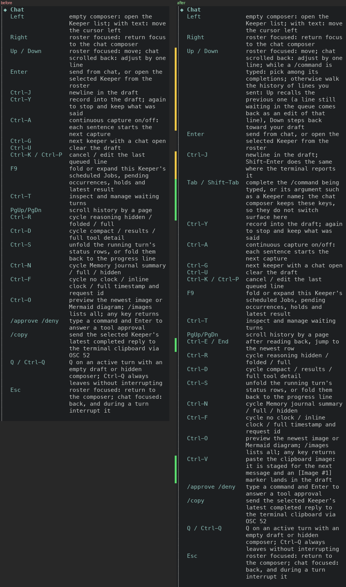
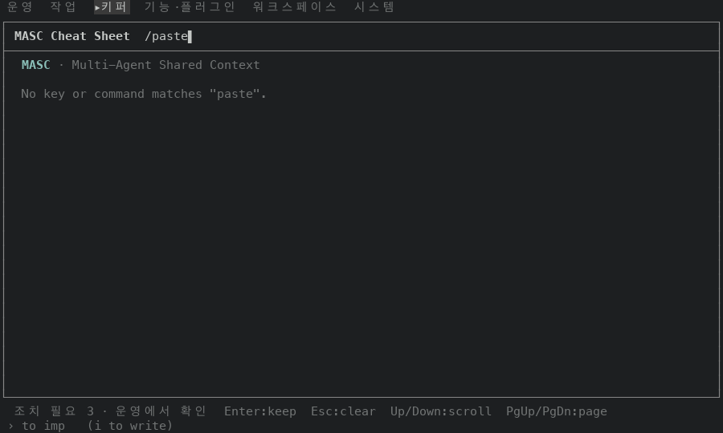
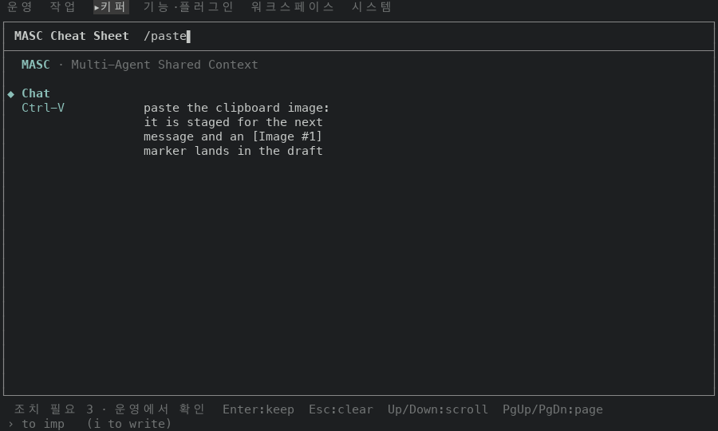
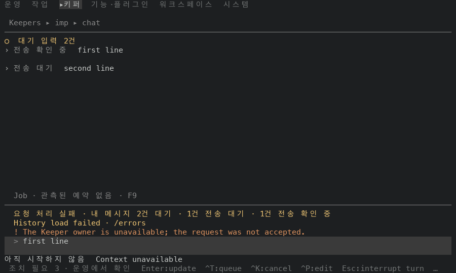

# 채팅에서 동작하지만 `?` 시트에 없던 키를 적어요

## 실측

고정 서버 위에서 증명 빌드 둘로 같은 화면을 찍었어요. 앞은 main `7bda02e85ad4`(run `42924893851`)이고, 뒤는 이 PR 의 코드 커밋 셋을 얹은 `39c579a5cbe0`(run `42946586695`)이에요. 뒤 빌드의 바탕 main `77fe58210219` 는 앞 빌드보다 11커밋 앞서 있어요. 두 빌드에서 TUI 소스(`bin/masc_tui*.ml`)가 다른 파일은 셋이에요. `bin/masc_tui_keys.ml` 은 이 PR 이 바꿨고, `bin/masc_tui_render_keepers.ml` 와 `bin/masc_tui_render_work.ml` 은 #50968(키퍼 상세 장애 JSON 펼침)이 바꿨어요. 채팅 키를 처리하는 `bin/masc_tui.ml` 과 채팅 푸터 `bin/masc_tui_footer.ml` 은 두 빌드가 같아요(`git diff --name-only` 로 확인했어요).

표와 숫자가 읽은 화면의 글자는 이 폴더의 `captures/` 에 있어요(57개). `before` 는 앞 빌드, `after` 는 뒤 빌드, `first-commit` 은 첫 커밋 빌드에서 찍은 한 장이에요. 파일 이름은 `<묶음>-<장 번호>-<이름>.txt` 예요. 묶음은 `rt100`(시트, 높이 100), `rw`(시트 검색어), `rc`(보낸 줄 되부르기), `rt`(Tab 과 맥락 보기), `re`(큐 줄 수정), `rf`(첫 커밋 빌드의 시트 검색)예요.

`docs/guides/TUI-KEYS.md` 는 키 표에서 만드는 문서예요. 이 PR 에서는 손으로 고쳤고, 증명 빌드가 키 표에서 만든 `key-reference.md` 와 `diff` 해서 같음을 봤어요. 빌드에는 들어가지 않아요.

코드 커밋은 셋이에요. 첫 커밋(`e2d377ba7d5e`, run `42944004227`)이 키 줄을 더하고, 둘째 커밋(`a05801607a8a`)과 셋째 커밋(`39c579a5cbe0`)이 시트 검색에서 낱말이 안 걸리는 곳을 고쳤어요. 첫 커밋의 Ctrl-V 설명은 `stage the clipboard image` 로 시작해서 `paste` 로 찾으면 줄이 안 나왔어요(그 빌드에서 `No key or command matches "paste"` 를 봤어요). 둘째 커밋이 이 설명을 `paste` 로 시작하게 고쳤어요. 셋째 커밋은 Up / Down 설명에 `history` 가 없어서 넣었어요(설명 글을 읽고 알았고, 그 빌드에서 `history` 검색은 안 찍었어요). 아래 숫자는 모두 셋째 커밋 빌드에서 잰 값이에요.

### 시트의 Chat 구역

채팅에서 `?` 를 누르면 도움말 시트가 Chat 구역으로 시작해요. 폭 100, 높이 100 에서 구역의 키 줄을 읽었어요. 키 줄은 23줄에서 26줄이 됐고, 구역이 차지하는 화면 줄은 59줄에서 83줄이 됐어요(화면 글자를 센 값이에요). 뒤 시트의 Chat 구역 26줄은 `docs/guides/TUI-KEYS.md` 의 `## Chat` 표 26줄과 글자까지 같아요. 앞 시트도 앞 빌드 문서의 표 23줄과 같았어요.

| 키 | 앞 | 뒤 |
|---|---|---|
| `Up / Down` | roster focused: move; chat scrolled back: adjust by one line | roster focused: move; chat scrolled back: adjust by one line; while a /command is typed: pick among its completions; otherwise walk the history of lines you sent: Up recalls the previous one (a line still waiting in the queue comes back as an edit of that line), Down steps back toward your draft |
| `Ctrl-J` | newline in the draft | newline in the draft; Shift-Enter does the same where the terminal reports it |
| `Tab / Shift-Tab` | (줄 없음) | complete the /command being typed, or its argument such as a Keeper name; the chat composer keeps these keys, so they do not switch surface here |
| `Ctrl-E / End` | (줄 없음) | after reading back, jump to the newest row |
| `Ctrl-V` | (줄 없음) | paste the clipboard image: it is staged for the next message and an [Image #1] marker lands in the draft |

`## Global` 표의 `Tab / Shift-Tab` 줄도 설명이 길어졌어요. 앞은 `next / previous surface`, 뒤는 `next / previous surface; the chat composer keeps them to complete a /command` 예요. 채팅 작성칸이 Tab 을 화면 이동이 아니라 완성에 쓰는 것을 전역 줄에서도 읽게 한 것이에요. 빈 작성칸에서 Tab 과 Shift-Tab 을 눌러도 화면이 그대로인 것을 확인했어요(아래 표).

### 키를 눌러 본 동작은 앞뒤가 같아요

새 설명이 말하는 동작을 두 빌드에서 같은 순서로 눌렀어요. Keeper 소유자가 없는 서버라서 보낸 두 줄은 둘 다 큐에서 기다려요. 표는 뒤 빌드의 작성칸과 푸터 키 안내예요. 푸터는 알림 칩과 `Esc:interrupt turn` 을 뺐어요.

| 누른 것 | 작성칸 | 푸터 키 안내 |
|---|---|---|
| 두 줄(`first line`, `second line`)을 보낸 뒤 | `>` | `Enter:update` |
| Up | `> second line` | `Enter:replace  ^U:leave queued  /:commands` |
| Up | `> first line` | `Enter:update  ^T:queue  ^K:cancel  ^P:edit` |
| Down | `> second line` | `Enter:replace  ^U:leave queued  /:commands` |
| Down | `>` | `Enter:update  ^T:queue  ^K:cancel  ^P:edit` |
| `/ke` 입력 | `> /ke` | `↑/↓:select  Tab/Enter:insert` |
| Tab | `> /keeper` | `/keeper <name> — switch this pane to another keeper` |

큐에 두 줄이 있을 때 Up 으로 `second line` 을 불러 ` v2` 를 붙이고 Enter 를 누르면 큐의 둘째 줄이 `second line v2` 로 바뀌고 `대기 입력` 은 2건 그대로예요. 푸터에는 `Updated queued NEXT for imp` 가 떠요.

위 순서를 포함한 20장(두 빌드 각각)을 견주었어요. 채팅의 읽기 상태 줄과 맥락 머리말의 시계(`History load failed`, `Keeper owner is unavailable`, `Loading conversation history`, `loading older messages`, `read Ns ago`)처럼 찍는 시각에 따라 달라지는 줄을 빼면 20장 모두 글자가 같아요. 글자까지 통째로 같은 장은 18장이에요. 빈 작성칸에서 Tab, Shift-Tab 을 누른 두 장은 누르기 전 장과 같아요.

### 시트 검색

시트에서 `/` 를 누르고 낱말을 쳐서 Chat 구역에 걸리는 줄을 읽었어요(폭 100, 높이 30). 앞 빌드에서 새 줄을 못 찾던 낱말 7개가 모두 새 줄을 찾아요. 앞 빌드에서 `paste` 를 치면 Chat 구역은 없고 `No key or command matches "paste"` 가 나와요(`captures/before/rw-80-filter-paste.txt`).

| 검색어 | 앞: 걸린 Chat 줄 | 뒤: 걸린 Chat 줄 |
|---|---|---|
| `paste` | 없음 | `Ctrl-V` |
| `clipboard` | `/copy` | `Ctrl-V`, `/copy` |
| `recall` | 없음 | `Up / Down` |
| `history` | `PgUp/PgDn` | `Up / Down`, `PgUp/PgDn` |
| `complete` | `/copy` | `Tab / Shift-Tab`, `/copy` |
| `newest` | `Ctrl-O` | `Ctrl-E / End`, `Ctrl-O` |
| `shift` | 없음 | `Ctrl-J`, `Tab / Shift-Tab` |

### 다시 세는 법

`captures/` 의 글자 파일에서 Chat 구역의 키 수와 위 표를 다시 셀 수 있어요. 이 폴더에서 아래 코드를 돌리면 8줄이 나와요. 첫 줄은 Chat 구역의 키 수(앞, 뒤)이고, 나머지는 위 표의 `검색어 | 앞 | 뒤` 예요.

```python
import glob

WORDS = ["paste", "clipboard", "recall", "history", "complete", "newest", "shift"]


def chat_keys(path):
    """Chat 구역의 키: 왼쪽 칸(테두리 안쪽 48칸)에서 `◆ Chat` 제목 밑, 다음 제목 앞까지예요. 키는 3~18째 칸이고, 설명이 줄바꿈된 줄은 그 칸이 비어요."""
    keys, inside = [], False
    for line in open(path, encoding="utf-8").read().split("\n"):
        left = line[1:49] if line.startswith("│") else ""
        if left[:1] in ("◆", "◇"):
            inside = left[1:].strip() == "Chat"
        elif inside and left[:18].strip():
            keys.append(left[2:18].strip())
    return keys


print("Chat 키", *(len(chat_keys(f"captures/{side}/rt100-60-sheet-over-chat.txt")) for side in ("before", "after")))
for word in WORDS:
    cells = [", ".join(chat_keys(glob.glob(f"captures/{side}/rw-*-filter-{word}.txt")[0])) or "없음" for side in ("before", "after")]
    print(word, *cells, sep=" | ")
```

작성칸은 채팅 장에서 `>` 로 시작하는 마지막 줄이고, 푸터는 장의 마지막 줄이에요. 앞뒤 빌드의 채팅 장 20쌍은 `History load failed`, `Keeper owner is unavailable`, `Loading conversation history`, `loading older messages`, `read Ns ago` 가 든 줄을 빼고 견주면 글자가 같아요.

### 시험과 문서

증명 빌드가 돌린 시험 셋(`test_repo_git`, `test_tui_workspace_entries`, `test_workspace_file_confidentiality`)은 종료 코드 0 이에요. 이 셋은 키 표를 읽지 않아요(세 시험 파일에 `tui_keys` 가 안 나와요). 키 표와 문서가 같은지는 `key-reference.md` 와 `docs/guides/TUI-KEYS.md` 를 `diff` 해서 봤고 다른 줄이 없었어요. 로컬 `dune` 은 안 돌렸어요.

## 장단점

- 장점: 채팅 시트와 키 문서에서 보낸 줄 되부르기, 명령·이름 완성, 맨 끝 이동, 이미지 붙이기 키를 찾아요. 위 낱말 7개로 검색하면 모두 걸려요. 키를 처리하는 코드는 안 바꿔서 키 동작은 그대로예요.
- 단점: Chat 구역이 59줄에서 83줄로 길어져요(폭 100). 좁은 창에서는 줄바꿈이 더 늘어요(안 쟀어요). `Up / Down` 한 줄의 설명만 폭 100 에서 12줄이에요. 한 키가 일을 넷(roster 이동, 스크롤, 완성 메뉴, 되부르기)이라 길어요.
- 단점: 채팅 푸터는 키 표를 안 읽고 글자를 직접 써서 이 키들이 푸터에는 안 나와요. 키 표와 키 처리기가 따로 쓰인 두 목록이라 같은 누락이 다시 생길 수 있어요. 이 PR 은 줄을 손으로 더한 call site 패치이고 근본 해결 후보는 이슈 #51219 에 있어요.

## 안 잰 것

- Ctrl-V 와 Ctrl-E / End 는 코드(`bin/masc_tui.ml` 의 채팅 키 처리)를 읽고 설명을 썼고 효과를 눌러 보지 않았어요. Ctrl-E 와 End 는 눌렀지만 맥락 보기(Ctrl-X)가 열린 화면이라 두 키는 아무것도 안 바꿨어요. 클립보드 이미지는 고정 서버로 만들지 않았어요.
- Shift-Enter 를 터미널이 알려 주는지는 안 쟀어요. Ctrl-J 설명에 `where the terminal reports it` 라고 적었어요.
- 시트는 폭 100 에서만 찍었어요. 좁은 폭의 시트는 안 찍었어요.
- Ctrl-X(맥락 보기)는 시트에 안 넣었어요. 키 표의 코드 주석이 이 키를 맥락 머리말에만 이름을 단다고 적고 있어서예요.
- `captures/` 의 글자 파일을 만든 캡처 스크립트와 `.ansi` 원본은 저장소에 없어요. 그래서 이 글자 파일이 그 빌드에서 나온 것인지는 이 폴더만으로 확인할 수 없어요. 눌러 본 순서는 이래요: `masc-tui` 를 폭 100 으로 열고 `:` → `go Keepers` → Enter → `c` 로 채팅을 열어요. 두 줄을 보내고 Up, Up, Down, Down 을 눌러요. `/ke` 를 치고 Tab 을 눌러요. 시트는 `?` 로 열고 `/` 로 낱말을 쳐요.

시트의 Chat 구역(폭 100)이에요. 왼쪽이 앞, 오른쪽이 뒤이고, 초록 띠는 새 줄, 노란 띠는 설명이 바뀐 줄이에요.



| 앞(main) | 뒤(이 PR) |
|---|---|
| 시트 검색 `paste`, 폭 100x30<br> | <br> |

두 줄을 보낸 뒤 Up 을 두 번 누른 화면(뒤 빌드, 폭 100x30)이에요.


