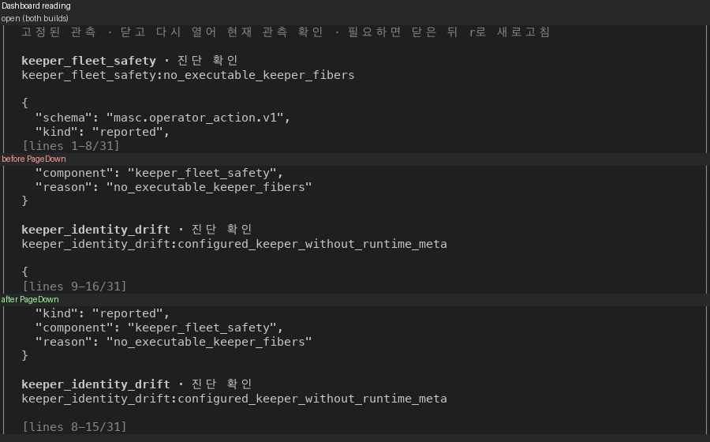

# 상세 읽기 화면: PageDown 이 읽던 마지막 줄을 남겨요

Dashboard 의 읽기 화면(`조치가 필요한 이유`)에서 PageDown 은 창 높이만큼 통째로 넘겨요. 방금 화면 맨 아래에 있던 줄이 새 화면에 없어요. 목록, Agenda, Help 시트는 같은 키가 한 줄을 겹쳐 넘겨요(`Masc_tui_scroll.page_down`).

- Dashboard 읽기: 창 8줄, 전체 31줄. PageDown 두 번이 앞 9-16 → 17-24, 뒤 8-15 → 15-22 예요.
- 이 PR 은 `Masc_tui_detail_reading` 을 쓰는 읽기 화면의 PageDown·PageUp 이 `By 창높이` 대신 `Page_down`·`Page_up` 을 넘기게 하고, 쪽 크기는 `Masc_tui_scroll.page_step`(창 높이 − 1)이 정해요.
- Board 글 본문 화면은 이 PR 이 안 바꿔요. 같은 증상이 남아 있고 고치는 곳이 달라요. 아래 「안 바뀐 화면」에 적었어요.

## 실측

고정 서버 위에서 증명 빌드 둘로 같은 키를 눌러 찍었어요. 앞은 main `8574837d0b24`(run `42969563516`)이고, 뒤는 이 PR 의 코드 커밋 `495394c596bc`(run `42983067295`)예요. 폭 100, 높이 16에서 Dashboard 의 읽기 화면을 열어 PageDown, PageDown, PageUp, End, Home 을 눌렀어요. 읽는 값은 화면 아래 `[lines 처음-끝/전체]` 줄이에요.

Dashboard 읽기 (창 8줄, 전체 31줄):

| 걸음 | 누른 키 | 앞 | 뒤 |
|---|---|---|---|
| 00 | 연 직후 | 1-8/31 | 1-8/31 |
| 01 | PageDown | 9-16/31 | 8-15/31 |
| 02 | PageDown | 17-24/31 | 15-22/31 |
| 03 | PageUp | 9-16/31 | 8-15/31 |
| 04 | End | 24-31/31 | 24-31/31 |
| 05 | Home | 1-8/31 | 1-8/31 |

- PageDown 뒤 화면의 첫 줄 번호를 앞 화면의 마지막 줄 번호와 견줬어요. 앞 빌드는 늘 하나 더 커서(9 = 8 + 1) 겹치는 줄이 없고, 뒤 빌드는 같아서(8 = 8) 한 줄이 겹쳐요.
- 겹친 줄이 정말 같은 줄인지 화면 글자로도 견줬어요. 뒤 빌드에서 PageDown 뒤 화면의 첫 본문 줄이 앞 화면의 마지막 본문 줄과 글자까지 같아요. PageDown 두 번이라 2쌍이에요.
- PageUp 은 PageDown 이 간 길을 되돌아가요. `03` 의 창이 `01` 의 창과 같아요(앞뒤 빌드 모두). End 와 Home 은 앞뒤가 같아요.



그림은 위에서 아래로 연 직후(앞뒤가 같아요), 앞 빌드의 PageDown, 뒤 빌드의 PageDown 이에요. 연 직후 화면의 마지막 줄은 `"kind": "reported",` 예요. 뒤 빌드의 PageDown 화면만 그 줄로 시작해요.

## 안 바뀐 화면

Board 글 본문(`본문 행 처음-끝/전체`)은 `Masc_tui_detail_reading` 이 아니라 `board_scroll` 오프셋을 써서 이 PR 이 안 바꿔요. 같은 6걸음을 앞뒤 빌드로 찍었더니 읽는 값이 모두 같고, PageDown 은 1-6 → 7-12 → 13-18 로 한 줄도 안 겹쳐요(창 6줄, 전체 20줄).

| 걸음 | 누른 키 | 앞 | 뒤 |
|---|---|---|---|
| 00 | 연 직후 | 1-6/20 | 1-6/20 |
| 01 | PageDown | 7-12/20 | 7-12/20 |
| 02 | PageDown | 13-18/20 | 13-18/20 |
| 03 | PageUp | 7-12/20 | 7-12/20 |
| 04 | End | 15-20/20 | 15-20/20 |
| 05 | Home | 1-6/20 | 1-6/20 |

쪽 크기는 공통 쪽 넘김 핸들러가 정해요. `masc_tui.ml` 의 `move_board_read_scroll state ~by:(direction * page)` 에서 `page` 는 `surface_page_rows`(화면 줄 수 − 8)로 짐작한 값이에요. 본문 창의 진짜 높이는 그릴 때 `Layout.allocate_board_read` 가 정하고, 댓글이 있으면 달라져요. 키 처리가 그 높이를 몰라서 `Masc_tui_scroll.page_down` 을 못 써요. 짐작한 값에서 1을 빼는 식으로 고치면 짐작이 어긋나는 화면(댓글이 있는 글, 넓은 화면의 좌우 배치)에서 틀릴 수 있고, 그런 화면은 안 찍었어요. Planning 의 작업 상세처럼(`task_detail_presented_viewport`) 그린 창 높이를 키 처리가 읽게 해야 해서 다음 층으로 미뤘어요.

## 무엇을 바꿨나요

- `Masc_tui_scroll.Position.movement` 에 `Page_down` 과 `Page_up` 을 더했고 `Position.move` 가 `page_step`(창 높이 − 1, 최소 1)으로 풀어요. `page_step` 은 `Position` 위로 올렸어요.
- `Masc_tui_detail_reading.movement` 도 두 갈래를 더하고 `Position` 으로 넘겨요.
- 키 처리 세 곳(`masc_tui.ml` 의 Board 글 첨부 읽기, 작업 상세 읽기, 일반 상세 읽기)이 `By height`·`By (-height)` 대신 `Page_down`·`Page_up` 을 넘겨요. 호출처가 창 높이로 쪽을 계산하지 않아요.
- 바뀐 파일은 7개(+84/−27줄)예요. 시험은 `test_tui_detail_reading`(+17/−0줄)과 `test_tui_scroll`(+33/−4줄)이에요.

## 다시 세는 법

이 폴더에서 아래 코드를 돌리면 위 표의 숫자가 나와요(파이썬 표준 라이브러리만 써요).

```python
import re
PATTERNS = {"dashboard": re.compile(r"\[lines (\d+)-(\d+)/(\d+)\]"), "board": re.compile(r"본문 행 (\d+)-(\d+)/(\d+)")}
STEPS = ["00-open", "01-pgdn", "02-pgdn2", "03-pgup", "04-end", "05-home"]
def reading(side, surface, step):
    text = open(f"captures/{side}/{surface}-{step}.txt", encoding="utf-8").read()
    return tuple(int(x) for x in PATTERNS[surface].search(text).groups())
for surface in PATTERNS:
    previous = {}
    for step in STEPS:
        out = []
        for side in ("before", "after"):
            first, last, count = reading(side, surface, step)
            paged = step.endswith("pgdn") or step.endswith("pgdn2")
            overlap = str(max(0, previous[side] - first + 1)) if paged else "-"
            previous[side] = last
            out.append((f"{first}-{last}", overlap))
        print(f"{surface:9s} {step:8s} 앞 {out[0][0]:6s} 겹침 {out[0][1]}  뒤 {out[1][0]:6s} 겹침 {out[1][1]}  (전체 {count}줄)")
```

```
dashboard 00-open  앞 1-8    겹침 -  뒤 1-8    겹침 -  (전체 31줄)
dashboard 01-pgdn  앞 9-16   겹침 0  뒤 8-15   겹침 1  (전체 31줄)
dashboard 02-pgdn2 앞 17-24  겹침 0  뒤 15-22  겹침 1  (전체 31줄)
dashboard 03-pgup  앞 9-16   겹침 -  뒤 8-15   겹침 -  (전체 31줄)
dashboard 04-end   앞 24-31  겹침 -  뒤 24-31  겹침 -  (전체 31줄)
dashboard 05-home  앞 1-8    겹침 -  뒤 1-8    겹침 -  (전체 31줄)
board     00-open  앞 1-6    겹침 -  뒤 1-6    겹침 -  (전체 20줄)
board     01-pgdn  앞 7-12   겹침 0  뒤 7-12   겹침 0  (전체 20줄)
board     02-pgdn2 앞 13-18  겹침 0  뒤 13-18  겹침 0  (전체 20줄)
board     03-pgup  앞 7-12   겹침 -  뒤 7-12   겹침 -  (전체 20줄)
board     04-end   앞 15-20  겹침 -  뒤 15-20  겹침 -  (전체 20줄)
board     05-home  앞 1-6    겹침 -  뒤 1-6    겹침 -  (전체 20줄)
```

## 시험과 문서

- 증명 빌드(run `42983067295`)가 컴파일을 통과했고 `test_tui_workspace_entries`·`test_workspace_file_confidentiality` 의 종료 코드가 0 이에요. `test_repo_git` 은 종료 코드가 1 이에요. 29개 중 15개가 `Unix.waitpid` 의 EINTR 로 끝나요(`test/test_repo_git.ml:35`). #50867 이 main 에 들어온 뒤 만든 증명 빌드가 같은 자리에서 깨졌어요. 앞 증명 빌드(run `42969563516`, main `8574837d0b24`)에서는 통과했어요. 원인과 증거는 이슈 #51254 에 적었어요. 이 시험은 읽기 화면과 상관없고 이 변경의 동작을 시험으로 증명한 게 아니에요. 동작은 위 화면으로 봤어요.
- 새 시험은 화면 글자가 아니라 판정과 산술만 확인해요. `test_tui_detail_reading` 은 한 쪽이 창에서 한 줄을 남기는지, 한 쪽 위가 한 쪽 아래를 되돌리는지, 문서 끝 근처에서 마지막 창에 멈추는지, End 에서 올라가면 끝 고정이 풀리는지 봐요. `test_tui_scroll` 은 창 높이 1~12, 줄 수 0~30, 시작 위치 0~30 모든 조합에서 읽기 화면의 쪽이 목록의 `page_down`·`page_up` 이 가는 곳과 같은지 세어요. 헌법(354~355행)이 막는 화면 글자와 배치 확인은 안 했어요.
- `test_tui_scroll` 12개(새 시험 하나 포함)를 dune 없이 `ocamlfind ocamlc` 로 따로 컴파일해 돌렸고 모두 통과했어요. `test_tui_detail_reading` 의 새 시험은 `masc` 라이브러리 전체가 필요해서 로컬에서는 타입 검사까지만 했어요. CI 시험에 맡겨요.
- 바뀐 `bin/` 파일 다섯 개(`masc_tui.ml` 포함)와 시험 파일 `test_tui_detail_reading.ml` 을 dune 과 같은 경고 설정(`-warn-error +a -w +4+32+69`)으로 `ocamlfind ocamlc -stop-after typing` 해서 통과했어요. 이 변경으로 인터페이스가 바뀐 `Masc_tui_scroll`·`Masc_tui_detail_reading` 을 쓰는 `masc_tui_board_reader`·`masc_tui_original_task_read`·`masc_tui_chat_call_reader`·`masc_tui_types` 도 같은 방법으로 통과했어요.

## 장단점

- 장점: 읽다 멈춘 줄이 다음 화면 맨 위에 남아서, 쪽을 넘겨도 어디까지 읽었는지 이어져요. 목록·Agenda·Help 시트와 같은 규칙이에요. 쪽 크기를 호출처가 정하지 않아서, 새 읽기 화면이 `By height` 를 되풀이하지 않아요.
- 단점: 한 번에 새로 보이는 줄이 한 줄 줄어요. 창이 8줄이면 7줄씩 나가요. 31줄 문서를 PageDown 만으로 끝까지 읽으면 앞 3번, 뒤 4번이에요. 이 횟수는 창 크기와 문서 길이로 계산한 값이고, 앞 두 걸음이 이 계산과 캡처에서 같아요.

## 안 잰 것

- Board 글 첨부 읽기(`masc_tui_board_reader`)와 작업 상세 읽기(`masc_tui_original_task_read`)는 화면을 안 찍었어요. 같은 `Masc_tui_detail_reading` 의 움직임을 넘기는 것을 코드로만 확인했어요.
- 채팅 호출 읽기(`masc_tui_chat_call_reader`)는 이 PR 이 안 바꿔요. 아직 `By height` 로 쪽을 계산해요. 다음 층에서 같은 움직임으로 바꿔요.
- 창이 한 줄인 읽기 화면과 문서 끝 근처의 PageDown 은 화면이 아니라 시험으로만 확인했어요.
- 폭 100, 높이 16 한 가지만 찍었어요. 한국어 화면만 찍었어요.
- 설치된 TUI 에서 본 화면이 아니에요. 증명 빌드의 receipt 는 `visible_ui_verified` 와 `installed_runtime_verified` 가 둘 다 `false` 예요.
- 캡처를 만든 스크립트와 `.ansi` 원본은 저장소에 안 넣었어요. 눌러 본 순서는 위에 적었어요.
- 로컬 `dune` 은 안 돌렸어요. 컴파일은 증명 빌드와 `type-check` 로 확인해요.
