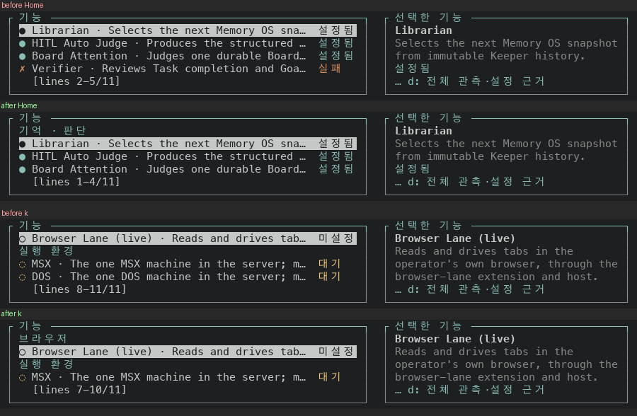

# Features 목록: Home 과 k 가 그룹 제목을 가리지 않아요

Features 목록은 `기억 · 판단`, `브라우저`, `실행 환경` 같은 그룹 제목 아래에 기능을 늘어놓아요. 목록은 고른 줄을 따라 창을 움직이는데, 제목은 고를 수 없는 줄이라 창이 제목까지 따라가지 않아요. 그룹의 첫 줄을 고르면 그 위 제목이 창 밖에 남아요.

- Home 은 `Librarian`(`기억 · 판단` 의 첫 줄)을 골라요. 제목 `기억 · 판단` 이 창 위로 나가요.
- k 로 올라가다 `Browser Lane (live)`(`브라우저` 의 첫 줄)에 닿으면 제목 `브라우저` 가 창 위로 나가요.
- 이 PR 은 그룹의 첫 줄을 고르면 그 위 제목까지 창에 넣어요.

## 실측

고정 서버 위에서 증명 빌드 둘로 같은 키를 눌러 찍었어요. 앞은 main `8574837d0b24`(run `42969563516`)이고, 뒤는 이 PR 의 코드 커밋 `2e671e513189`(run `42977212782`)예요. 폭 100, 높이 16(목록 창 4줄, 전체 11줄)에서 Features 를 열고 End, Home, End, k 여덟 번, End 와 PageUp, PageUp, Home 과 j, k 순서로 눌러 16걸음을 찍었어요. 읽는 값은 목록 아래 `[lines 처음-끝/전체]` 줄이에요.

앞 빌드와 이 PR 의 바탕 커밋(`f45e70258c29`) 사이에 바뀐 `bin/` 파일은 `bin/masc_tui.ml`, `bin/masc_tui_model_runtime_table.ml`, `bin/masc_tui_model_runtime_table.mli`, `bin/masc_tui_render_config.ml`, `bin/masc_tui_render_prim.ml`, `bin/masc_tui_render_prim.mli`예요. 바뀐 줄에 `lane` 이 한 번도 안 나오고, `masc_tui.ml` 은 Config 의 Models 화면에서 PageDown 이 가는 줄 수를 정하는 네 줄이에요. Features 목록의 코드(`masc_tui_render_lanes.ml`, `masc_tui_lane_inventory.ml` 외 넷)는 하나도 안 바뀌었어요(`git diff` 로 센 값이에요).

고른 줄이 그룹의 첫 줄인 걸음은 7걸음이에요. 그 걸음에서 제목이 창에 있는지 글자로 견줬어요.

| 걸음 | 누른 키 | 고른 줄 | 앞 | 뒤 |
|---|---|---|---|---|
| 00 | 연 직후 | Librarian | 1-4/11 제목 보임 | 1-4/11 제목 보임 |
| 02 | Home | Librarian | 2-5/11 제목 가려짐 | 1-4/11 제목 보임 |
| 04 | k | MSX | 8-11/11 제목 보임 | 8-11/11 제목 보임 |
| 05 | k | Browser Lane (live) | 8-11/11 제목 가려짐 | 7-10/11 제목 보임 |
| 10 | k | Librarian | 2-5/11 제목 가려짐 | 1-4/11 제목 보임 |
| 11 | k | Librarian | 2-5/11 제목 가려짐 | 1-4/11 제목 보임 |
| 15 | k | Librarian | 2-5/11 제목 가려짐 | 1-4/11 제목 보임 |

- 제목이 가려진 걸음은 앞 5걸음, 뒤 0걸음이에요.
- 나머지 9걸음은 고른 줄이 그룹의 첫 줄이 아니라서 제목과 상관이 없어요. 고른 줄은 앞뒤 모두 늘 창 안에 있어요.
- 창이 앞과 달라진 걸음은 6걸음이에요. 제목이 걸린 걸음 5걸음(번호 `02`, `05`, `10`, `11`, `15`)과, Home 으로 창이 한 줄 위에 있는 채 j 를 누른 `14` 예요. 나머지 10걸음은 앞뒤 창이 같아요.
- 100x30 에서는 목록 11줄이 창에 다 들어가서 제목이 밀려날 일이 없어요. 연 직후 화면은 앞뒤가 같아요(`captures/*/100x30-00-open.txt`).

그림은 위가 앞, 아래가 뒤예요. 위 블록은 Home, 아래 블록은 End 에서 k 로 올라가 `Browser Lane (live)` 에 닿은 때예요.



## 무엇을 바꿨나요

- `Masc_tui_scroll.ensure_visible_with_lead` 는 고른 줄을 창에 넣은 뒤(`ensure_visible` 과 같아요), 그 줄 위에 붙은 줄 `lead` 개가 창 밖이면 창을 위로 더 밀어요. `lead` 는 고른 줄의 위치와 창 높이 − 1 을 넘지 않게 줄여서, 고른 줄이 창을 벗어나는 일이 없어요. `lead` 가 0 이면 `ensure_visible` 그대로예요.
- `Masc_tui_lane_inventory.row_lead` 는 그룹의 첫 줄이면 1, 아니면 0 이에요. 제목은 `overview_entries` 목록에서 그 줄 바로 앞 항목이에요.
- `Masc_tui_types.lane_inventory_lead` 는 고른 기능의 `row_lead` 예요.
- 키 처리(`masc_tui.ml` 의 `row_list` 안 `follow`)는 `?lead` 를 받고, Features 의 줄 고르기가 `lane_inventory_lead` 를 넘겨요. 그림(`masc_tui_render_lanes.ml`)도 같은 값으로 창을 맞춰서 키를 누른 뒤의 창과 다음 그림의 창이 같아요. 다른 목록은 `lead` 를 안 넘겨서 0 이고, 움직임이 그대로예요.
- 바뀐 파일은 9개(+88/−5줄)예요. 시험은 창 산술(+25/−0줄)과 `row_lead`(+17/−0줄)예요.

## 다시 세는 법

이 폴더에서 아래 코드를 돌리면 위 표의 숫자가 나와요(파이썬 표준 라이브러리만 써요).

```python
import glob, re
READING = re.compile(r"\[lines (\d+)-(\d+)/(\d+)\]")
MARKS = "●○✗◌"
def cells(path):
    out = []
    for line in open(path, encoding="utf-8").read().split("\n"):
        if line.lstrip().startswith("│"):
            parts = line.split("│")
            out.append((parts[1].strip(), parts[3].strip() if len(parts) > 3 else ""))
    return out
def name(cell):
    return cell[1:].strip().split(" · ")[0] if cell[0] in MARKS else cell
full = [c for c, _ in cells("captures/before/100x30-00-open.txt") if c]
print(len(full), "entries:", " | ".join(name(c) for c in full))
for number in range(16):
    out = []
    for side in ("before", "after"):
        path = glob.glob(f"captures/{side}/100x16-{number:02d}-*.txt")[0]
        rows = cells(path)
        first, last, count = (int(x) for x in READING.search(open(path, encoding="utf-8").read()).groups())
        shown = [c for c, _ in rows if c and not READING.search(c)]
        selected = rows[0][1]
        index = [name(c) for c in full].index(selected)
        opens = full[index - 1][0] not in MARKS
        out.append((selected, f"{first}-{last}", "-" if not opens else ("보임" if full[index - 1] in shown else "가려짐")))
    print(f"{number:02d} {out[0][0]:20s} 앞 {out[0][1]:5s} {out[0][2]:4s} 뒤 {out[1][1]:5s} {out[1][2]}")
```

```
11 entries: 기억 · 판단 | Librarian | HITL Auto Judge | Board Attention | Verifier | Candle Appraiser | 브라우저 | Browser Lane (live) | 실행 환경 | MSX | DOS
00 Librarian            앞 1-4   보임   뒤 1-4   보임
01 DOS                  앞 8-11  -    뒤 8-11  -
02 Librarian            앞 2-5   가려짐  뒤 1-4   보임
03 DOS                  앞 8-11  -    뒤 8-11  -
04 MSX                  앞 8-11  보임   뒤 8-11  보임
05 Browser Lane (live)  앞 8-11  가려짐  뒤 7-10  보임
06 Candle Appraiser     앞 6-9   -    뒤 6-9   -
07 Verifier             앞 5-8   -    뒤 5-8   -
08 Board Attention      앞 4-7   -    뒤 4-7   -
09 HITL Auto Judge      앞 3-6   -    뒤 3-6   -
10 Librarian            앞 2-5   가려짐  뒤 1-4   보임
11 Librarian            앞 2-5   가려짐  뒤 1-4   보임
12 Candle Appraiser     앞 6-9   -    뒤 6-9   -
13 HITL Auto Judge      앞 3-6   -    뒤 3-6   -
14 HITL Auto Judge      앞 2-5   -    뒤 1-4   -
15 Librarian            앞 2-5   가려짐  뒤 1-4   보임
```

## 시험과 문서

- 증명 빌드(run `42977212782`)가 컴파일을 통과했고 `test_tui_workspace_entries`·`test_workspace_file_confidentiality` 의 종료 코드가 0 이에요. `test_repo_git` 은 종료 코드가 1 이에요. 29개 중 15개가 `Unix.waitpid` 의 EINTR 로 끝나요(`test/test_repo_git.ml:35`). #50867 이 main 에 들어온 뒤 만든 증명 빌드라서, 같은 소스를 두 번 돌렸고(다른 run `42978676061`) 둘 다 같은 자리에서 깨졌어요. 앞 증명 빌드(run `42969563516`, main `8574837d0b24`)에서는 통과했어요. 원인과 증거는 이슈 #51254 에 적었어요. 이 시험은 Features 목록과 상관없고 이 변경의 동작을 시험으로 증명한 게 아니에요. 동작은 위 화면으로 봤어요.
- 새 시험은 화면 글자가 아니라 판정과 산술만 확인해요. `ensure_visible_with_lead` 는 제목을 같이 끌어오는지, 둘 다 보이면 창을 그대로 두는지, 창이 한 줄일 때와 `lead` 가 창보다 클 때 고른 줄이 남는지 봐요. `row_lead` 는 카테고리마다 첫 줄 하나만 1 인지 봐요. 헌법(354~355행)이 막는 화면 글자와 배치 확인은 안 했어요.
- `test_tui_scroll` 12개(새 시험 하나 포함)를 dune 없이 `ocamlfind ocamlc` 로 따로 컴파일해 돌렸고 모두 통과했어요. `test_tui_lane_inventory` 의 새 시험은 `masc` 라이브러리 전체가 필요해서 로컬에서 안 돌렸어요. CI 시험에 맡겨요.
- 바뀐 `bin/` 파일 일곱 개(`masc_tui.ml` 포함)를 dune 과 같은 경고 설정(`-warn-error +a -w +4+32+69`)으로 `ocamlfind ocamlc -stop-after typing` 해서 통과했어요. 시험 파일 `test_tui_lane_inventory.ml` 은 같은 방법으로 검사하면 이 변경 전부터 있던 줄의 fragile-match 경고(warning 4) 여덟 군데에서 멈추고, 새 시험 줄에서는 경고도 타입 오류도 안 났어요.

## 장단점

- 장점: 그룹의 첫 줄을 고르면 그 그룹 이름이 늘 같이 보여요. Home 이든 k 든 PageUp 이든 같아요. 키 처리와 그림이 같은 값을 써서 어긋나지 않아요.
- 단점: 첫 줄을 고르면 제목이 창 한 줄을 차지해서 항목이 한 줄 덜 보여요. 창이 4줄이면 항목 3개와 제목이에요.
- 단점: 제목을 가진 목록은 지금 Features 하나만 이 규칙을 써요. Keeper 목록처럼 그룹이 접히는 다른 목록은 안 바꿨어요.

## 안 잰 것

- 폭 100 한 가지만 찍었어요. 좁은 폭에서 목록이 한 칸으로 접힐 때는 안 봤어요.
- 고정 서버의 기능 목록은 11줄이에요. 실제 서버의 긴 목록은 안 봤어요.
- 한국어 화면만 찍었어요.
- 설치된 TUI 에서 본 화면이 아니에요. 증명 빌드의 receipt 는 `visible_ui_verified` 와 `installed_runtime_verified` 가 둘 다 `false` 예요.
- 캡처를 만든 스크립트와 `.ansi` 원본은 저장소에 안 넣었어요. 눌러 본 순서는 위에 적었어요.
- 로컬 `dune` 은 안 돌렸어요. 컴파일은 증명 빌드와 `type-check` 로 확인해요.
