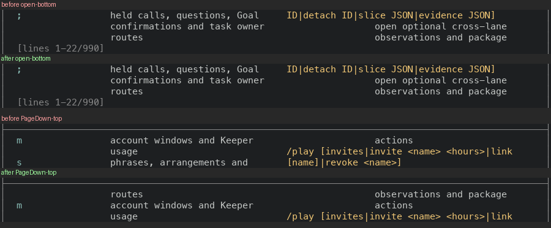

# Help 시트: PageDown 이 한 줄을 겹치고 Home·End 가 처음과 끝으로 가요

`?` 로 여는 Help 시트(cheat sheet)는 PageDown 한 번에 창 높이만큼 넘겨요. 방금 화면 맨 아래에 있던 줄이 새 화면 위로 이어지지 않고 사라져요. End 와 Home 은 아무 일도 안 해요. 같은 키가 Agenda 에서는 한 줄을 겹쳐 넘기고 Home 과 End 도 받아요(아래 「Agenda 와 휠」).

- 이 PR 은 Help 시트만 바꿔요. Agenda 는 이미 맞아서 안 건드려요.
- `Masc_tui_scroll` 에 키 이름 표 하나(`move_of_key`)와 그 움직임을 실행하는 함수(`apply_move`)를 더했어요. Help 가 첫 부르는 곳이에요.

## 실측

고정 서버 위에서 증명 빌드 둘로 같은 키를 눌러 찍었어요. 앞은 main `8574837d0b24`(run `42969563516`)이고, 뒤는 이 PR 의 코드 커밋 `5f4dcfa32796`(run `42972952460`)예요. 폭 두 가지(100x30, 60x24)에서 `?` 로 시트를 열고 PageDown, PageDown, PageUp, End, Home 을 한 번씩 눌렀어요. 읽는 값은 시트 맨 아래 `[lines 처음-끝/전체]` 줄이에요.

앞 빌드와 이 PR 의 바탕 커밋(`c43c6df210bd`) 사이에 바뀐 `bin/` 파일은 `bin/masc_tui.ml`, `bin/masc_tui_model_runtime_table.ml`, `bin/masc_tui_model_runtime_table.mli`, `bin/masc_tui_render_config.ml`, `bin/masc_tui_render_prim.ml`, `bin/masc_tui_render_prim.mli`예요. Help 시트의 코드(`bin/masc_tui_help.ml, bin/masc_tui_help.mli 외 둘`)는 하나도 안 바뀌었어요(`git diff --name-only` 로 센 값이에요).

| 폭 | 누른 키 | 앞 | 뒤 |
|---|---|---|---|
| 100x30 | 연 직후 | 1-22 | 1-22 |
| 100x30 | PageDown | 23-44 | 22-43 |
| 100x30 | PageDown 한 번 더 | 45-66 | 43-64 |
| 100x30 | PageUp | 23-44 | 22-43 |
| 100x30 | End | 23-44 | 969-990 |
| 100x30 | Home | 23-44 | 1-22 |
| 60x24 | 연 직후 | 1-16 | 1-16 |
| 60x24 | PageDown | 17-32 | 16-31 |
| 60x24 | PageDown 한 번 더 | 33-48 | 31-46 |
| 60x24 | PageUp | 17-32 | 16-31 |
| 60x24 | End | 17-32 | 1494-1509 |
| 60x24 | Home | 17-32 | 1-16 |

- 창은 100x30 에서 22줄, 60x24 에서 16줄이에요. 시트는 각각 990줄과 1509줄이에요(넓으면 두 칸으로 접혀서 줄 수가 달라요).
- PageDown 한 번에 앞은 창 높이만큼(22줄, 16줄), 뒤는 한 줄 모자라게(21줄, 15줄) 가요.
- End 는 앞에서 화면이 그대로였고, 뒤에서는 마지막 창(969-990)으로 가요. Home 은 앞에서 화면이 그대로였고, 뒤에서는 첫 창(1-22)으로 가요.
- PageUp 은 PageDown 을 되돌려요. 앞에서도 뒤에서도 한 번 내려갔다 올라오면 같은 창이에요.

### PageDown 뒤에도 방금 본 마지막 줄이 남아요

100x30 에서 연 직후 화면의 마지막 본문 줄이 PageDown 한 번 뒤 화면에 있는지 글자로 견줬어요(두 칸으로 접힌 줄이라 왼쪽 칸과 오른쪽 칸 글자가 한 줄에 있어요).

| | 앞 | 뒤 |
|---|---|---|
| 연 직후 마지막 본문 줄이 PageDown 뒤 화면에 있나요 | 없어요 | 있어요 |
| PageDown 뒤 첫 본문 줄이 그 줄과 같나요 | 달라요 | 같아요 |

그림은 100x30 에서 위가 앞, 아래가 뒤예요. 위 블록은 연 직후 화면의 아래쪽(앞뒤가 같아요), 아래 블록은 PageDown 한 번 뒤 화면의 위쪽이에요. 아래 블록에서 뒤 빌드만 연 직후의 마지막 줄로 시작해요.



### Agenda 와 휠

- Agenda 는 앞 빌드에서 100x16 으로 찍었어요(`captures/reference/`). 창은 8줄, 내용은 17줄이에요. 연 직후 1-8/17, PageDown 한 번 뒤 8-15/17이라 한 줄을 겹쳐요. Help 가 뒤에서 맞춘 모양이 이거예요.
- 마우스 휠은 이 변경과 상관없이 같아요. 100x30 에서 휠 세 칸을 내리면 앞뒤 모두 1-22 → 4-25 이고, 세 칸을 올리면 처음 창(1-22)으로 돌아와요.

## 무엇을 바꿨나요

- `Masc_tui_scroll.move_of_key` 는 `j`·`k`·화살표·PageUp·PageDown·`g`·`G`·Home·End 를 줄·쪽·처음·끝으로 나누어요. `apply_move` 는 그 움직임을 `down`·`up`·`page_down`·`page_up` 의 같은 범위 규칙으로 실행해요.
- `Masc_tui_help.step` 은 `Scroll of Masc_tui_scroll.key_move` 하나를 돌려줘요. 옛 `Scroll`·`Scroll_to_top`·`Scroll_to_end` 세 갈래가 이것 하나로 줄었어요. 필터를 치는 중에는 화살표와 PageUp·PageDown 만 스크롤이고 나머지 키는 글자이거나 아무 일도 안 해요(옛 동작 그대로예요).
- `masc_tui.ml` 의 `handle_help_key` 에서 창 높이만큼 `down`·`up` 을 되풀이하던 `scroll_help` 가 사라지고, `help_viewport` 로 잰 `count`·`height` 에 `apply_move` 를 한 번 불러요.
- 바뀐 파일은 9개(+146/−59줄)예요. 시험은 키 이름 표와 움직임 산술(+58/−0줄), Help 의 `step` 표(+30/−15줄)예요.

## 다시 세는 법

이 폴더에서 아래 코드를 돌리면 위 표의 숫자가 나와요(파이썬 표준 라이브러리만 써요).

```python
import glob, re
READING = re.compile(r"\[lines (\d+)-(\d+)/(\d+)\]")
for size in ("100x30", "60x24"):
    for side in ("before", "after"):
        reads = []
        for step in range(6):
            text = open(glob.glob(f"captures/{side}/{size}-p0{step}-*.txt")[0], encoding="utf-8").read()
            first, last, count = (int(x) for x in READING.search(text).groups())
            reads.append((first, last))
        window = reads[0][1] - reads[0][0] + 1
        print(f"{size} {side:6s} window {window} | PageDown moves {reads[1][0] - reads[0][0]} | End lands on {reads[4][0]}-{reads[4][1]} | Home lands on {reads[5][0]}-{reads[5][1]} | rows {count}")
```

```
100x30 before window 22 | PageDown moves 22 | End lands on 23-44 | Home lands on 23-44 | rows 990
100x30 after  window 22 | PageDown moves 21 | End lands on 969-990 | Home lands on 1-22 | rows 990
60x24 before window 16 | PageDown moves 16 | End lands on 17-32 | Home lands on 17-32 | rows 1509
60x24 after  window 16 | PageDown moves 15 | End lands on 1494-1509 | Home lands on 1-16 | rows 1509
```

## 시험과 문서

- 증명 빌드(run `42972952460`)가 컴파일을 통과했고 시험 셋(`test_repo_git`·`test_tui_workspace_entries`·`test_workspace_file_confidentiality`)의 종료 코드가 0 이에요. 이 셋은 Help 시트와 상관없는 시험이라 이 변경의 동작을 시험으로 증명한 게 아니에요. 동작은 위 화면으로 봤어요.
- 새 시험은 화면 글자가 아니라 판정과 산술만 확인해요. `move_of_key` 가 키마다 어떤 움직임을 주는지, `apply_move` 가 쪽 이동에서 한 줄을 겹치고 끝에서 멈추는지, 낡은 값에서도 범위 안으로 돌아오는지예요. 헌법(354~355행)이 막는 화면 글자와 배치 확인은 안 했어요.
- 이 변경은 키 표를 안 건드려서 증명 빌드가 만든 `key-reference.md` 와 `docs/guides/TUI-KEYS.md` 가 같아요(두 파일 내용을 글자 그대로 견줬어요).
- 시험 둘(`test_tui_scroll` 13개, `test_tui_help_filter` 20개)을 dune 없이 `ocamlfind ocamlc` 로 따로 컴파일해 돌렸고 모두 통과했어요. `Masc_tui_frame`·`Masc_tui_message_layout`·`Masc_tui_pick_list` 는 `masc_tui_help.ml` 이 부르는 함수만 가진 대용품이라, 구역 거르기 시험 여덟 개가 통과한 것은 이 변경과 상관없어요. 이 확인 파일은 저장소에 안 넣었어요.
- 바뀐 `bin/` 파일 다섯 개(`masc_tui.ml` 포함)를 dune 과 같은 경고 설정(`-warn-error +a -w +4+32+69`)으로 `ocamlfind ocamlc -stop-after typing` 해서 통과했어요. 시험 파일은 이 방법으로 안 검사했어요(위 시험 컴파일로 갈음).

## 장단점

- 장점: Help 의 PageDown 이 Agenda 와 같이 한 줄을 겹쳐서, 쪽으로 읽다가 줄을 놓치지 않아요. Home·End 가 `g`·`G` 와 같은 키로 일해요.
- 단점: Help 시트의 푸터 안내(`j/k:scroll  PgUp/PgDn:page  g/G:first/last  Esc:close`)에는 Home·End 를 안 적었어요. 좁은 폭에서 안내가 더 잘리기 때문이에요.
- 단점: 키 이름 표를 쓰는 곳이 아직 Help 하나예요. Agenda 와 Context 는 각자 `match` 를 갖고 있어요. 표로 옮기는 일은 이 PR 에서 안 했어요.

## 안 잰 것

- 폭 100·60 밖의 크기와, 시트가 두 칸으로 접히는 경계 폭 근처는 안 찍었어요.
- 필터를 치는 중(`/`)의 스크롤 키는 코드와 `step` 표 시험으로만 확인했고 화면은 안 찍었어요.
- Context 읽기 화면은 안 쟀어요. 고정 서버에 Keeper 턴 기록이 없어서 읽을 본문이 없어요. 코드에서는 Response 탭만 PageUp·PageDown·Home·End 를 받고 다른 탭 본문은 j/k 만 받아요. 이 PR 은 거기를 안 바꿔요.
- Agenda 는 100x16 한 크기만 찍었고 g·G·Home·End 는 앞 빌드에서만 봤어요(코드는 이 PR 이 안 바꿔요).
- 설치된 TUI 에서 본 화면이 아니에요. 증명 빌드의 receipt 는 `visible_ui_verified` 와 `installed_runtime_verified` 가 둘 다 `false` 예요.
- 캡처를 만든 스크립트와 `.ansi` 원본은 저장소에 안 넣었어요. 눌러 본 순서는 위에 적었어요.
- 로컬 `dune` 은 안 돌렸어요. 컴파일은 증명 빌드와 `type-check` 로 확인했어요.
